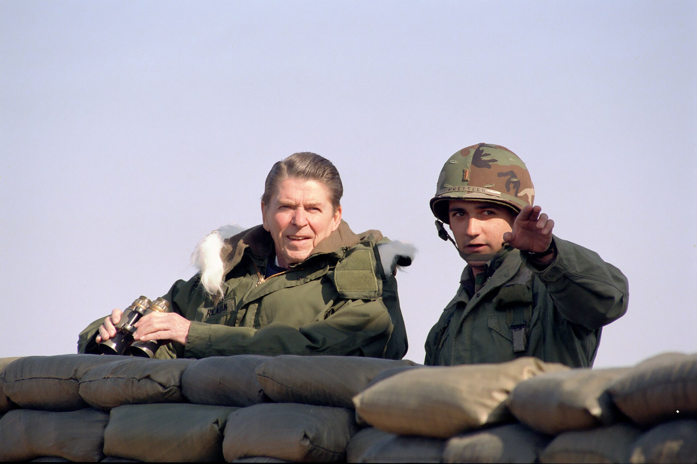
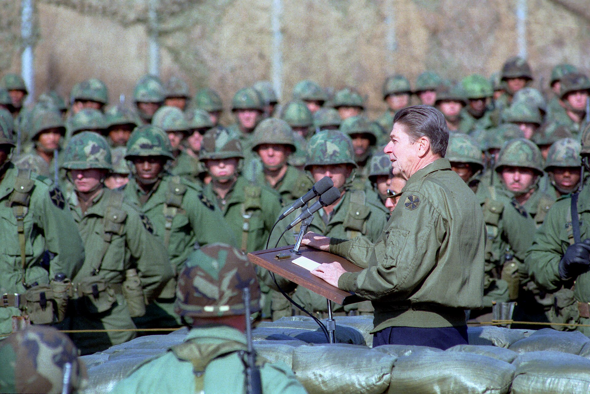
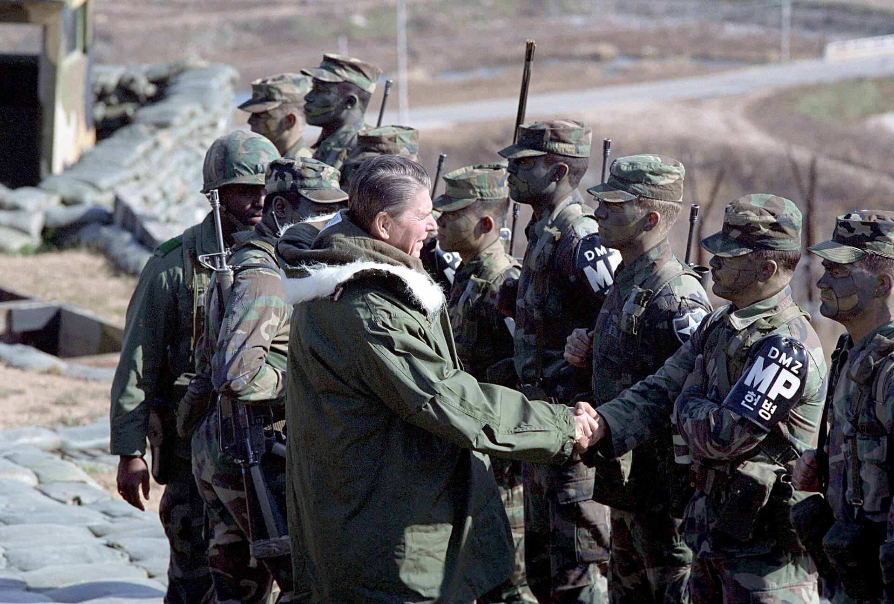

43년 전 오늘, 1983년 11월 12일. 로널드 레이건 미국 대통령이 미 공군 1호기를 타고 서울 김포국제공항에 안착했습니다. 2박 3일간 이어진 이번 일정은 엄중한 안보 위기 속에서 한미 동맹의 결속을 전 세계에 알리는 중대한 계기였습니다.

## 비극과 긴장 속에서 성사된 미국 대통령의 방문

1983년 가을 한반도 주변 정세는 극도로 경색되어 있었습니다. 그해 9월 소련 전투기에 의한 대한항공 여객기 피격 사건으로 수많은 민간인이 목숨을 잃었고, 불과 한 달 전인 10월 9일에는 버마 랭군 아웅산 묘소에서 북한의 폭탄 테러로 한국의 핵심 각료와 수행원 17명이 순직하는 참사가 벌어졌습니다. 국가적 비통함과 안보에 대한 불안감이 극에 달했던 시기였습니다. 레이건 대통령의 방한은 지난 1981년 1월 전두환 대통령의 미국 방문에 대한 답방 형식이었으며, 미국 현직 대통령으로서는 역대 다섯 번째 한국 방문이었습니다.

## 김포공항 도착과 성대한 공식 환영식

11월 12일 오전 10시 25분, 레이건 대통령과 부인 낸시 여사, 조지 슐츠 국무장관을 비롯한 공식 수행원 16명과 비공식 수행원을 태운 미 공군 1호기가 김포공항 활주로에 내렸습니다. 공항 활주로에는 전두환 대통령 내외가 직접 마중을 나갔으며, 두 정상은 2년 10개월 만에 다시 만나 뜨거운 포옹과 굳은 악수를 나눴습니다. 이어 국제선 청사 3층에서 열린 환영식에서 전두환 대통령은 환영사를 통해 한미 양국이 상호방위조약을 맺은 이래 30년간 혈맹의 협력관계를 발전시켜 왔음을 강조하고, 이번 방문이 평화와 번영의 새 100년을 향한 역사적 이정표가 될 것이라고 말했습니다. 레이건 대통령 또한 도착성명에서 양국 국민의 우정은 위기 속에서 다져지고 승리로 강화되었다며 자유를 위한 상호 공약을 새롭게 하겠다고 답했습니다.

*President Ronald Reagan with United States Troops at Camp Liberty Bell The Demilitarized Zone South Korea - DPLA - 34f7d — 사진: President (1981-1989 : Reagan). White House Photographic Off / Public domain*

## 국회 본회의장 연설과 대북·소련 규탄

공항 환영식을 마친 레이건 대통령은 곧바로 여의도 국회의사당으로 이동해 국회 본회의장에서 특별 연설을 진행했습니다. 레이건 대통령은 연설을 통해 랭군에서의 비루한 북한의 공격으로 소중한 조언자와 친구들을 잃었다며 한국 정부와 희생자 유가족들에게 깊은 애도를 표했습니다. 또한 KAL기 격추 사건을 거론하며 민간 항공기를 공격하고 사망자 수색까지 방해한 소련의 비인도적 처사를 강하게 비판했습니다. 레이건 대통령은 북한이 50여 개 사단과 750대의 전투기를 갖추고 땅굴을 파며 위협을 지속하고 있음을 똑똑히 알고 있다면서, 주한미군 병사들은 한국 안보에 대한 미국의 확고부동한 공약을 상징한다고 선언해 의원들의 큰 박수를 받았습니다.

*President Ronald Reagan Addresses U.S. Troops at Camp Liberty Bell The Demilitarized Zone South Korea - DPLA - 8bdacc400 — 사진: President (1981-1989 : Reagan). White House Photographic Off / Public domain*

## 청와대 제1차 정상회담과 실질적 안보 억제책

국회 일정을 마친 뒤 레이건 대통령은 청와대로 이동해 전두환 대통령과 오찬을 함께하고 제1차 한미 정상회담에 들어갔습니다. 회담에서 두 정상은 북한의 무력 도발을 막기 위한 실효성 있는 응징 및 억제 대책을 집중적으로 논의했습니다. 한국군의 전력 증강을 위한 군사판매차관 확대, 주한미군 전력의 지속적인 유지와 강화, 그리고 상호방위조약의 효율적인 운용 방안이 폭넓게 다뤄졌습니다. 아울러 레이건 대통령은 한국 정부가 추진 중이던 남북 이산가족 찾기 운동에 북한이 호응해야 한다고 촉구하기도 했습니다.

*President Ronald Reagan During His Trip to Republic of Korea and a Visit to The Dmz Camp Collier - DPLA - 6921472c5474f5 — 사진: President (1981-1989 : Reagan). White House Photographic Off / Public domain*

## 선물 교환과 이어진 2박 3일의 숨 가쁜 일정

청와대 소접견실에서 양국 정상은 정성껏 준비한 기념 선물을 교환했습니다. 전두환 대통령 내외는 두 정상의 존영과 휘장이 새겨진 8각 크리스털 서진, 전통 나전칠기 문서함, 옥돌 보석함과 기념 우표책을 전했습니다. 이에 레이건 대통령 부부는 정교한 은제 볼과 딸기 모양 장식이 들어간 금바구니를 선물했습니다. 방한 첫날 저녁 공식 만찬과 민속공연 관람으로 일정을 마친 레이건 대통령은 이튿날인 13일 최전방 미군 부대를 직접 찾아 장병들을 격려하고 제2차 정상회담을 가졌으며, 14일 공동성명을 발표하고 귀국길에 올랐습니다.

## 그 시절 텔레비전 앞에 모여섰던 국민들의 기억

1983년 11월 레이건 대통령의 방한은 잇따른 국가적 참사로 불안과 비통함에 젖어 있던 국민들에게 강력한 안보 지원의 메시지를 던져주었습니다. 공항 도착부터 국회 연설, 청와대 만찬으로 이어진 전 과정은 텔레비전을 통해 전국에 생중계되었습니다. 어수선한 냉전의 소용돌이 속에서 숨죽이며 텔레비전 화면을 지켜보던 국민들에게, 공항 활주로에서 펄럭이던 태극기와 성조기, 그리고 단호했던 두 정상의 모습은 40여 년이 흐른 지금까지도 그 시절의 뚜렷한 기억으로 남아 있습니다.

### 참고 자료

- <https://newslibrary.naver.com/viewer/index.naver?articleId=1983111200329201004&editNo=2&printCount=1&publishDate=1983-11-12&officeId=00032&pageNo=1&printNo=11731&publishType=00020>
- <https://commons.wikimedia.org/wiki/File:President_Ronald_Reagan_Toasts_with_President_Chun_Doo_Hwan_During_a_Reception_at_The_Blue_House_in_Seoul_Republic_of_Korea_-_DPLA_-_b7ff2f6dacd2399014c2254cc04b0b34.jpg>
- <https://commons.wikimedia.org/wiki/File:President_Ronald_Reagan_with_United_States_Troops_at_Camp_Liberty_Bell_The_Demilitarized_Zone_South_Korea_-_DPLA_-_34f7db7b7832e0b54f6138a9e526344d.jpg>
- <https://commons.wikimedia.org/wiki/File:President_Ronald_Reagan_Addresses_U.S._Troops_at_Camp_Liberty_Bell_The_Demilitarized_Zone_South_Korea_-_DPLA_-_8bdacc4009b338ae5ac9ff666c9d0d3d.jpg>
- <https://commons.wikimedia.org/wiki/File:President_Ronald_Reagan_During_His_Trip_to_Republic_of_Korea_and_a_Visit_to_The_Dmz_Camp_Collier_-_DPLA_-_6921472c5474f57a5397f15e10880605.jpg>
