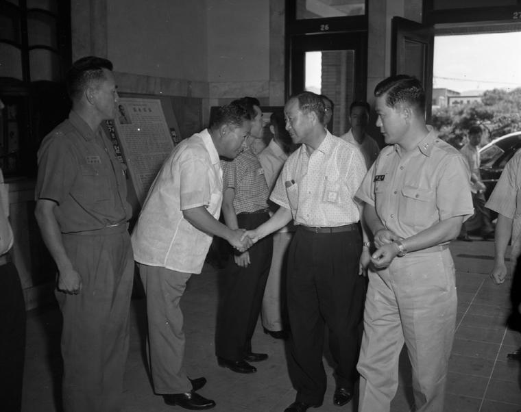
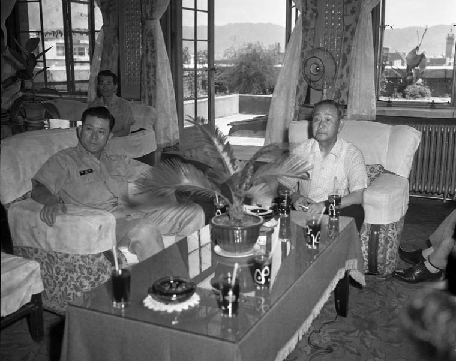

50년 전 오늘, 1976년 11월 12일. 1977학년도 대학입학 예비고사가 전국에서 일제히 치러졌습니다. 수험생 29만여 명이 전국 222개 고사장에 모여 대학 진학을 향한 첫 관문을 넘었습니다.

## 추첨 진학생들이 처음 치른 대입 예비고사

1976년 11월 12일 치러진 1977학년도 대학입학 예비고사는 교육계 안팎의 비상한 관심을 모았습니다. 서울과 부산 지역에서 고등학교 입학 추첨제를 통해 진학했던 학생들이 처음으로 대학 입시를 치르는 해였기 때문입니다.

고교 평준화 조치 이후 추첨으로 학교에 배정받았던 학생들이 대학 입시에서 어떤 성적을 거둘지 많은 이들의 이목이 쏠렸습니다. 이번 예비고사 응시자는 총 29만 2백 29명이었으며, 이 가운데 여성 수험생은 7만 4천 7백 36명이었습니다. 전국 평균 경쟁률은 2대 1을 나타냈습니다.

## 포근했던 날씨 속 전국 222개 고사장의 긴장

시험 당일 아침 수험생들은 오전 8시 30분까지 지정된 고사장에 입실을 마쳤습니다. 쌀쌀할 것이라는 일기예보와 달리 날씨는 전국적으로 맑았으며, 낮 기온은 12도에서 18도까지 올라 시험을 치르기에 비교적 온화했습니다.

서울 창덕여중을 비롯한 전국 2백 22개 고사장 주변은 이른 아침부터 긴장감이 감돌았습니다. 수험생들은 교문 앞에서 옷깃을 여미며 고사장으로 향했고, 그동안 갈고닦은 실력을 쏟아붓기 위해 차분하게 자리에 앉았습니다.

*사건 당시 사진 아님 · 1963년 — 사진: 충청남도 / KOGL Type 0 Public Domain*

## 1교시부터 4교시까지, 빡빡했던 시험 일정

시험은 오전 9시부터 1교시가 시작되어 늦은 오후까지 쉼 없이 이어졌습니다. 제1교시에는 오전 9시부터 10시 20분까지 과학 50문항과 국사 30문항을 풀었습니다.

이어 제2교시에는 오전 11시부터 낮 12시 40분까지 국민윤리 및 사회 50문항과 수학 25문항을 치렀습니다. 점심시간을 보낸 뒤 시작된 제3교시에는 오후 2시부터 2시 50분까지 외국어 50문항이 주어졌습니다. 마지막 제4교시는 오후 3시 30분부터 4시 50분까지 실업 또는 가정 30문항과 국어 50문항으로 마무리됐습니다.

*사건 당시 사진 아님 · 1963년 — 사진: 충청남도 / KOGL Type 0 Public Domain*

## 실업계열 신설과 높아진 성적 반영 비율

1977학년도 예비고사는 제도적으로도 중요한 변화가 있었습니다. 실업계 고교 출신 수험생들의 동일 계열 대학 진학 특혜 조치에 따라 실업계열이 신설되었으며, 시험은 일반계열과 예·체능계열, 실업계열 등 모두 8개 계열로 나뉘어 진행됐습니다.

각 대학의 예비고사 성적 반영 비율 역시 크게 올랐습니다. 대학들의 평균 반영률이 40.7퍼센트에 달하면서 수험생들은 예비고사 준비에 상당한 공을 들였습니다. 이에 따라 출제위원과 교사들은 합격 최저 점수가 전년보다 다소 높아질 것으로 전망했습니다.

![[752호] 이런일 저런일 ... 이용한 대학입학 예비고사 채점. (1969.11.22) 장면 1](../images/2026-11-12-05-4.jpg)
*[752호] 이런일 저런일 ... 이용한 대학입학 예비고사 채점. (1969.11.22) 장면 1 — 사진: KTV 국민방송 e영상역사관 (대한뉴스) / KTV 공공저작물 — 영상 저작물 전면 개방(대통령실 2025-07-09), 출처 표시*

## 12월 29일 합격자 발표를 기다리며

시험을 마친 수험생들은 무거운 책가방을 정리하며 교문을 나섰습니다. 치열했던 하루를 보낸 이들의 합격 여부는 한 달여 뒤인 12월 29일에 일제히 발표될 예정이었습니다.

예비고사는 훗날 학력고사와 대학수학능력시험으로 이어지며 한국 현대사에서 수많은 청춘들이 거쳐 간 삶의 이정표가 되었습니다. 추첨으로 고등학교에 들어가 처음으로 치열한 대입 경쟁을 마주했던 그 시절의 수험 생활은 오늘날에도 많은 이들의 가슴속에 특별한 기억으로 남아 있습니다.

### 참고 자료

- <https://newslibrary.naver.com/viewer/index.naver?articleId=1976111200329201004&editNo=2&printCount=1&publishDate=1976-11-12&officeId=00032&pageNo=1&printNo=9578&publishType=00020>
- <https://commons.wikimedia.org/wiki/File:%EA%B1%B0%EB%A6%AC%EC%A7%88%EC%84%9C_%ED%99%95%EB%A6%BD%EC%9A%B4%EB%8F%99_%EA%B8%B0%EA%B0%84_%EC%A4%91%EC%9D%98_%EA%B1%B0%EB%A6%AC_%ED%91%9C%EC%A0%95.jpg>
- <https://www.kogl.or.kr/recommend/recommendDivView.do?division=img&recommendIdx=37778>
- <https://www.ehistory.go.kr/view/movie?mediasrcgbn=KV&mediaid=646&mediadtl=5549&mediagbn=DH#t=0.3>
