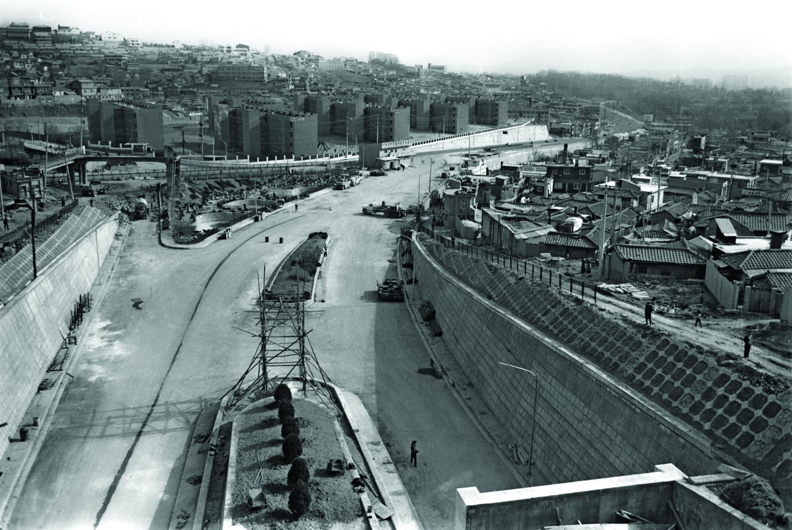
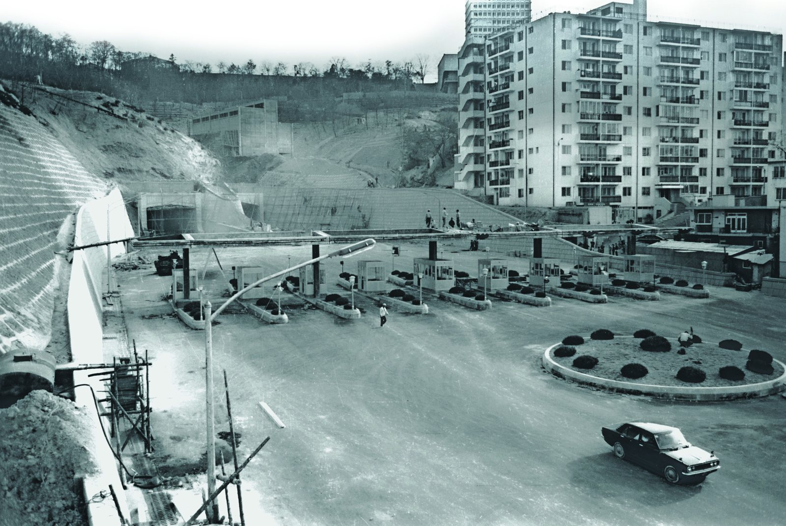
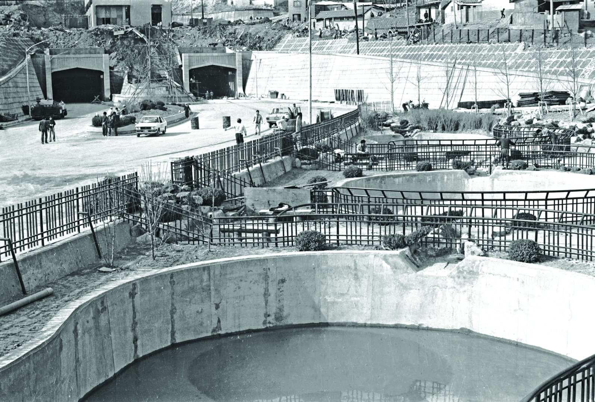

30년 전 오늘, 1996년 11월 12일. 서울시는 남산 1·3호 터널에 도입한 혼잡통행료 제도를 경기도와 접한 서울 시계 주요 지점까지 확대하겠다는 방침을 공식화했습니다. 전날 처음 시행된 2천 원의 통행료가 극적인 교통량 분산 효과를 내자마자 나온 발표였습니다.

## 극심한 도심 체증과 '혼잡통행료'의 도입

1990년대 중반 서울의 도심 교통난은 한계에 다다르고 있었습니다. 특히 한강 이남과 도심을 잇는 남산 1호와 3호 터널은 출퇴근 시간마다 거대한 주차장으로 변하기 일쑤였습니다. 도로를 더 짓는 방식으로는 늘어나는 승용차 수요를 감당할 수 없다는 판단에 따라 서울시는 경제적 부담을 지워 차량 진입을 억제하는 혼잡통행료 카드를 꺼내 들었습니다.

정부 역시 1996년 6월 「도시교통 정비촉진법」을 개정하여 제도적 근거를 마련했습니다. 평균 주행속도가 시속 20킬로미터 이하인 편도 4차선 이상 도로, 혹은 시속 16킬로미터 이하인 편도 3차선 이하 도로에 혼잡통행료를 부과할 수 있도록 규정한 것입니다. 이에 따라 1996년 11월 11일 오전 7시부터 남산 1·3호 터널을 지나는 운전자 1인 또는 2인 탑승 승용차에 2천 원의 요금이 부과되기 시작했습니다.

## 시행 첫날 갈라진 도로, 2천 원의 위력

징수 첫날이었던 11월 11일, 서울 시내 도로에서는 명암이 극명하게 엇갈렸습니다. 평소 거북이걸음을 반복하던 남산 1·3호 터널은 통행량이 급감하면서 눈에 띄게 한산한 모습을 보였습니다. 퇴근 시간대인 오후 7시 30분 남산 3호 터널 강남 방향 진출로 입구는 막힘없이 시원하게 뚫렸습니다.

반면 2천 원의 통행료를 아끼기 위해 우회로를 택한 차량들이 한꺼번에 몰려들었습니다. 동호대교 방향 금호터널 등 주요 우회로는 극심한 병목현상으로 인해 평소보다 훨씬 더 심각한 교통 체증을 겪어야 했습니다. 단 2천 원이라는 요금이 수많은 운전자의 출퇴근 경로를 단숨에 바꾸어 놓은 셈이었습니다.

*남산3호터널 에서 용산동을 바라본 모습 — 사진: 서울역사박물관 / KOGL Type 1 (공공누리 제1유형, 출처표시)*

## 조순 시장의 현장 시찰과 시계 확대 발표

시행 첫날 현장을 직접 점검한 조순 서울시장은 제도가 기대 이상의 성과를 거두었다고 자평했습니다. 남산 1·3호 터널뿐만 아니라 우회도로 역시 큰 무리 없이 흘러가고 있다는 보고를 받은 조 시장은 혼잡통행료를 외곽으로 넓히겠다는 계획을 공식화했습니다.

조 시장은 경기도와 접한 주요 시계 지점에서도 교통 혼잡이 극심한 양상을 보이고 있다고 지적했습니다. 그러면서 남산터널 구간의 교통상황 변화를 면밀히 분석한 뒤, 시계 주요 혼잡 지점을 중심으로 징수 지역을 순차적으로 늘려가겠다고 선언했습니다. 서울 전체의 교통 흐름을 위해 나홀로 승용차 이용을 스스로 자제해야 한다는 당부도 덧붙였습니다.

*남산3호터널 회현동 일대 — 사진: 서울역사박물관 / KOGL Type 1 (공공누리 제1유형, 출처표시)*

## 남태령과 경인로, 거세진 시민 반발

서울시가 혼잡통행료 확대를 검토한 대표적인 외곽 구간은 경인로 부천시계, 경인고속도로 입구, 남태령 등 수도권 출퇴근 차량이 집중되는 요충지였습니다. 앞서 서울시는 4월에도 1998년부터 도심 진입 22개 간선도로와 시계 도로, 나아가 한강 교량에까지 혼잡통행료를 단계적으로 도입하겠다는 장기 구상을 내놓은 바 있었습니다.

그러나 서울시의 강경한 확대 방침은 곧바로 거센 반발에 부딪혔습니다. 경기도에서 서울로 출퇴근하는 시민들은 대중교통망이 제대로 갖춰지지 않은 상황에서 자가용 진입에 요금부터 매기는 것은 행정편의주의적인 발상이라고 비판했습니다. 외곽 도로 통행료 부과는 서민들의 이동권만 침해할 것이라는 목소리가 높아졌습니다.

*남산3호터널 입구 양어장 — 사진: 서울역사박물관 / KOGL Type 1 (공공누리 제1유형, 출처표시)*

## 도심 교통 정책의 전환점으로 남은 기억

결국 수도권 경계 도로와 한강 다리까지 혼잡통행료를 징수하려던 거대한 계획은 시민들의 강력한 반대와 행정적 현실에 막혀 실행에 옮겨지지 못했습니다. 하지만 남산 1·3호 터널의 혼잡통행료는 도심 교통 수요를 조절하는 국내 최초이자 대표적인 정책 실험으로 굳건히 자리를 지켰습니다.

통행료 2천 원을 피하고자 터널 앞에서 차머리를 돌리거나, 동승자를 구하기 위해 애쓰던 풍경은 1990년대 후반을 지나온 운전자들에게 잊을 수 없는 일상의 장면이 되었습니다. 통행료 징수 첫날 뻥 뚫린 남산터널과 꽉 막힌 우회로 사이에서 고민하던 그 시절의 기억은 도심 교통의 역사를 되돌아보게 합니다.

### 참고 자료

- <https://newslibrary.naver.com/viewer/index.naver?articleId=1996111200329101001&editNo=45&printCount=1&publishDate=1996-11-12&officeId=00032&pageNo=1&printNo=15935&publishType=00010>
- <https://museum.seoul.go.kr/archive/archiveNew/NR_archiveView.do?ctgryId=CTGRY754&type=B&upperNodeId=CTGRY757&fileSn=300&fileId=H-TRNS-77726-757>
- <https://museum.seoul.go.kr/archive/archiveNew/NR_archiveView.do?ctgryId=CTGRY754&type=B&upperNodeId=CTGRY757&fileSn=300&fileId=H-TRNS-77727-757>
- <https://museum.seoul.go.kr/archive/archiveNew/NR_archiveView.do?ctgryId=CTGRY754&type=B&upperNodeId=CTGRY757&fileSn=300&fileId=H-TRNS-77728-757>
- <https://museum.seoul.go.kr/archive/archiveNew/NR_archiveView.do?ctgryId=CTGRY754&type=B&upperNodeId=CTGRY757&fileSn=300&fileId=H-TRNS-77730-757>
