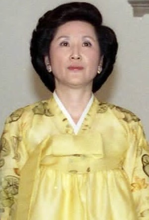
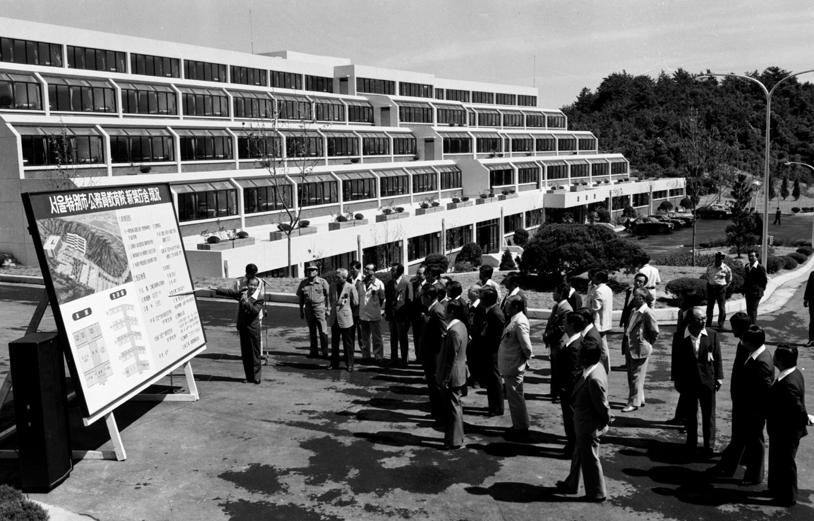

31년 전 오늘, 1995년 11월 13일. 대검찰청 중앙수사부 청사는 이른 아침부터 몰려든 취재진과 굳은 표정의 대기업 총수들로 숨이 막힐 듯 긴장감이 흘렀습니다. 노태우 전 대통령의 수천억 원대 비자금 조성 경위를 밝히기 위해 재계 거물들이 줄줄이 소환된 날이었습니다.

## 5천억 원 비자금 파문과 검찰의 칼날

1995년 가을, 정국을 뒤흔든 노태우 전 대통령의 비자금 사건은 대한민국을 거대한 충격 속에 몰아넣었습니다. 노 전 대통령 스스로 밝힌 비자금 규모만 무려 5천억 원에 달했습니다. 서민들에게는 상상조차 하기 힘든 천문학적인 액수였습니다.

대검 중수부는 즉각 대규모 수사팀을 꾸리고 자금의 출처를 파헤치기 시작했습니다. 검찰의 수사 칼날은 곧바로 대통령에게 거액을 건넨 것으로 의심받는 대기업들을 향했습니다. 그 돈이 기업의 정상적인 자금이었는지, 아니면 각종 특혜를 대가로 주고받은 뇌물이었는지를 밝혀내는 것이 핵심이었습니다.

## 주말도 밤낮도 없었던 재벌 총수 줄소환

11월 초부터 대검 청사 앞에는 매일같이 대형 세단들이 멈춰 섰습니다. 이름만 대면 온 국민이 다 아는 재벌 회장들이 연일 포토라인에 섰습니다. 11월 11일에는 선경그룹 최종현 회장, 기아그룹 김선홍 회장, 대농그룹 박용학 회장, 금호그룹 박성용 회장, 삼부토건 조남욱 회장 등 5명이 한꺼번에 검찰 조사를 받았습니다.

조사는 밤을 넘겨 이어졌습니다. 최종현 회장은 고강도 철야 조사를 받고 11월 12일 새벽 5시 30분이 되어서야 귀가했습니다. 검찰은 비자금 제공 외에도 태평양증권 인수 과정 등 각종 특혜 의혹을 집중적으로 추궁했습니다.

*사건 당시 사진 아님 · 1991년 — 사진: The Bush 41 Presidential Library / Public domain*

## 11월 12일과 13일, 멈추지 않은 소환 행렬

일요일이었던 11월 12일에도 소환은 멈추지 않았습니다. 대우그룹 김우중 회장, 롯데그룹 신격호 회장, 미원그룹 임창욱 회장이 검찰에 출두했습니다. 검찰은 김우중 회장을 상대로 노 전 대통령의 300억 원 가명계좌를 차명 실명전환해 준 경위와 사용처를 밤새도록 캐물었습니다.

이어 11월 13일에는 동양그룹 현재현 회장, 대한전선 설원량 회장, 동국제강 장상태 회장이 줄지어 검찰에 출두했습니다. 이로써 검찰에 소환되었거나 출두가 예정된 기업인은 순식간에 33명으로 늘어났습니다. 한국 경제를 이끌던 주요 그룹 총수들이 한자리에 모이듯 검찰 청사를 오가는 초유의 진풍경이 벌어졌습니다.

*서울특별시 공무원 교육원 청사 개원 — 사진: 서울역사박물관 / KOGL Type 1 (공공누리 제1유형, 출처표시)*

## 1천억 원의 빈자리와 노태우 전 대통령 재소환

검찰이 약 30곳의 대기업 총수를 조사해 확인한 비자금 액수는 3천6백억 원에서 3천7백억 원 수준이었습니다. 앞으로 추가 조사를 하더라도 총액은 4천억 원에 미치지 못할 것으로 예상됐습니다.

노 전 대통령이 스스로 밝혔던 5천억 원과 비교하면 1천억 원 이상의 차이가 발생한 것입니다. 검찰은 대기업 총수 조사를 서둘러 마무리한 뒤, 차액 1천여억 원의 출처와 뇌물 혐의를 입증하기 위해 노 전 대통령을 다시 불러 사법처리하겠다는 방침을 세웠습니다. 은행장이나 국영기업체 사장 등 또 다른 경제인들에 대한 추가 조사 가능성까지 흘러나왔습니다.

![[1992호] 전직 대통령 초청 회동 김영삼 대통령, 전직 대통령 초청 회동 (1994.01.13) 장면 1](../images/2026-11-13-01-4.jpg)
*[1992호] 전직 대통령 초청 회동 김영삼 대통령, 전직 대통령 초청 회동 (1994.01.13) 장면 1 — 사진: KTV 국민방송 e영상역사관 (대한뉴스) / KTV 공공저작물 — 영상 저작물 전면 개방(대통령실 2025-07-09), 출처 표시*

## 정경유착의 그늘이 남긴 역사의 기억

1995년 11월 13일 안팎의 풍경은 수십 년간 이어진 권력과 재벌 간의 정경유착 관행이 적나라하게 폭로된 역사적 순간이었습니다. 텔레비전 저녁 뉴스마다 굳은 표정으로 고개를 숙인 채 검찰 청사 계단을 오르던 재벌 총수들의 모습은 국민들에게 깊은 박탈감과 분노를 안겼습니다.

권력의 정점에 있던 전직 대통령과 한국 경제의 주역들이 한꺼번에 사법의 시험대에 올랐던 그날. 1995년 11월 대검찰청 앞을 메웠던 팽팽한 긴장감과 연일 터져 나오던 비자금 뉴스를 지금도 생생하게 기억하고 계시는 분들이 많습니다.

### 참고 자료

- <https://newslibrary.naver.com/viewer/index.naver?articleId=1995111300329101001&editNo=40&printCount=1&publishDate=1995-11-13&officeId=00032&pageNo=1&printNo=15595&publishType=00010>
- <https://commons.wikimedia.org/wiki/File:Roh_Tae-woo_-_cropped,_1990-Mar-13.jpg>
- <https://commons.wikimedia.org/wiki/File:Kim_Ok-suk.jpg>
- <https://museum.seoul.go.kr/archive/archiveNew/NR_archiveView.do?ctgryId=CTGRY766&type=B&upperNodeId=CTGRY770&fileSn=300&fileId=H-TRNS-96179-770>
- <https://www.ehistory.go.kr/view/movie?mediasrcgbn=KV&mediaid=11982&mediadtl=27374&mediagbn=DH#t=0.3>
