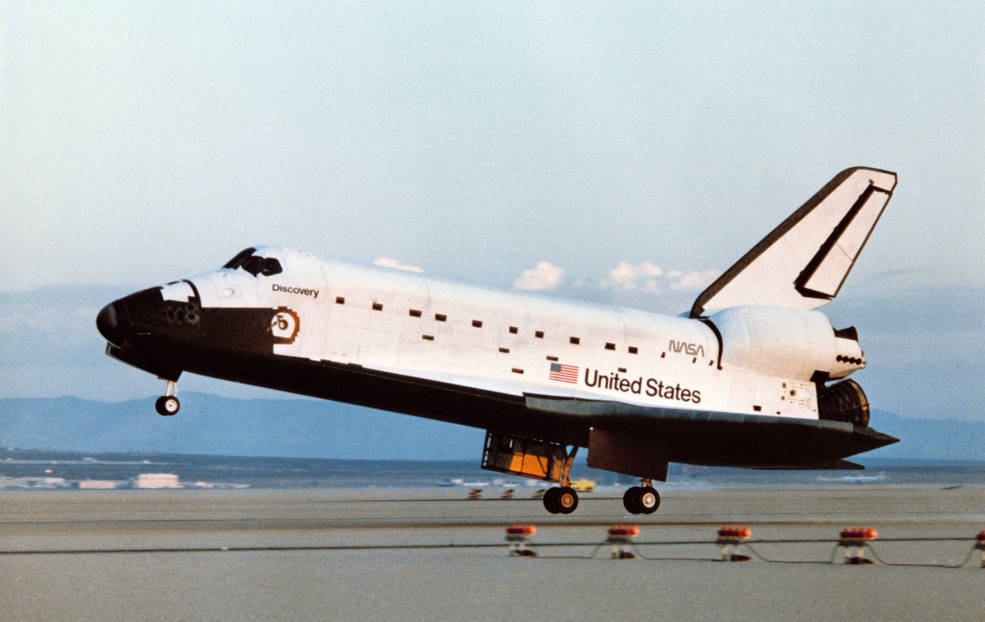
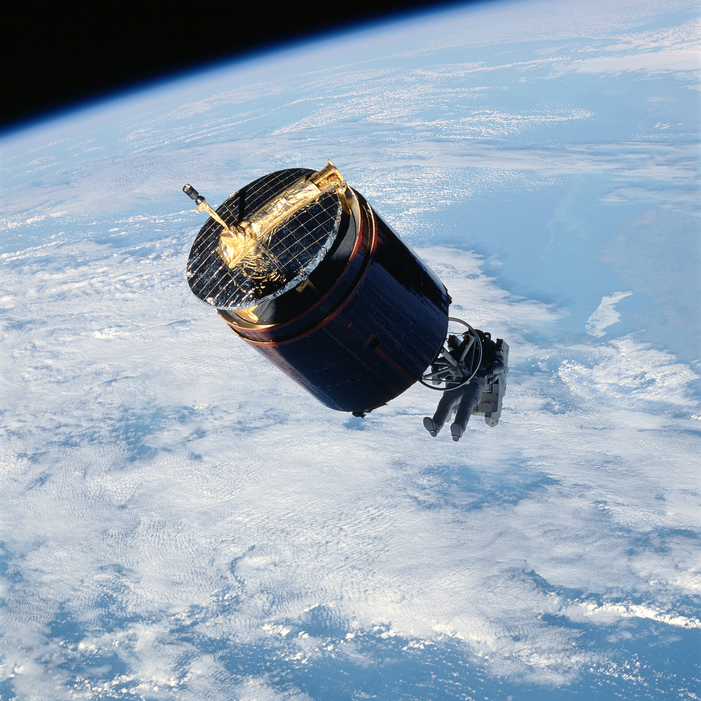
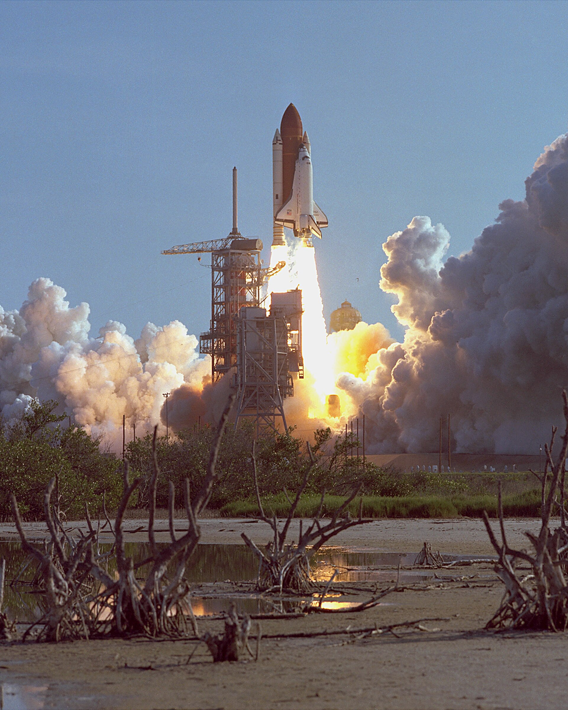

42년 전 오늘, 1984년 11월 13일. 미국의 유인 우주왕복선 디스커버리호가 우주 공간에서 고장 난 채 떠돌던 인공위성을 화물칸에 실어 회수하는 역사적인 쾌거를 달성했습니다.

## 궤도를 이탈한 통신위성과 사상 첫 구난 임무

1984년 우주 공간을 떠돌던 인도네시아의 통신위성 팔라파 B2호는 발사 후 정상 궤도에 진입하지 못하고 궤도를 이탈해 표류하고 있었습니다. 총알보다 빠른 속도로 궤도를 돌던 이 위성은 사실상 기능을 상실한 우주 미아나 다름없는 상태였습니다. 당시 미국 항공우주국은 고장 난 위성을 우주선 안으로 회수해 지구로 가져오는 전례 없는 구난 작전을 계획했습니다. 우주왕복선 디스커버리호 승무원들은 나흘 동안 궤도를 정밀 추적하며 팔라파 B2호에 신중하게 접근했습니다.

## 제트추진분사기와 견인기 '스팅어'의 위험한 접근

한국시간 1984년 11월 12일 밤 10시 17분, 디스커버리호의 화물칸 문이 열렸습니다. 우주인 조 앨런은 등에 제트추진분사기를 메고 우주선 밖 칠흑 같은 허공으로 몸을 던졌습니다. 그는 추진기를 미세하게 조절하며 시속 2만8천km의 맹렬한 속도로 비행 중인 팔라파 B2호로 천천히 다가갔습니다. 밤 11시 35분, 앨런은 '스팅어'라고 불리는 1m20cm 길이의 막대기형 견인기를 위성의 엔진 노즐 안으로 정확히 밀어 넣어 고정하는 데 성공했습니다.

*Sts-41d landing 41d-03299 — 사진: NASA / Public domain*

## 돌발 난관을 넘긴 비상작전과 6시간의 사투

견인기를 단단히 연결한 앨런이 위성을 디스커버리호 쪽으로 서서히 밀고 오자, 선실 안에서 대기하던 여성 우주인 애너 피셔가 15m 길이의 거대한 로봇 팔을 조종해 스팅어의 손잡이를 붙잡았습니다. 그러나 화물칸 안에서 기다리던 우주인 가드너가 위성의 돌출된 부분 때문에 손잡이를 제대로 쥐지 못하는 돌발 상황이 벌어졌습니다. 자칫 위성이 튕겨 나가 우주선과 충돌할 수 있는 아찔한 순간이었습니다. 승무원들은 즉시 비상 작전으로 전환해 로봇 팔을 분리하고, 무중력 상태를 이용해 길이 6.4m에 달하는 위성을 손으로 직접 밀어 화물칸에 밀어 넣었습니다.

*STS-51-A Westar 6 retrieval — 사진: NASA / Public domain*

## 우주 개발사에 기록된 신기원

총 6시간에 걸친 필사의 작업 끝에 팔라파 B2호는 마침내 디스커버리호의 화물칸에 안전하게 안착했습니다. 고장 난 인공위성을 우주 궤도 현장에서 포획해 우주선에 싣고 귀환하는 기술을 입증한 것은 인류 우주 비행사에서 사상 최초였습니다. 외신들은 일제히 긴급 타전으로 이 소식을 알렸고, 국내 조간신문들도 1면 머리기사로 우주 미아를 구조한 소식을 대서특필했습니다. 디스커버리호는 이틀 뒤인 11월 14일에도 또 다른 고장 위성인 웨스터 6호의 회수에 도전하며 우주 구난의 새 역사를 이어갔습니다.

*1984년 자료 — 사진: NASA / Public domain*

## 우주왕복선 디스커버리호가 남긴 유산

사상 첫 위성 회수라는 신기원을 세운 디스커버리호는 1984년 첫 비행을 시작으로 27년 동안 무려 39차례나 우주를 왕복하며 가장 많은 우주 임무를 완수한 왕복선으로 기록되었습니다. 허블 우주망원경 발사와 국제우주정거장 조립 등 수많은 기념비적 임무를 수행한 디스커버리호는 2011년 은퇴 후 스미스소니언 국립항공우주박물관 산하 스티븐 F. 우드바 하지 센터에 전시되어 있습니다. 우주 공간에서 인간의 손으로 인공위성을 건져 올렸다는 낭만적이면서도 숨 막히는 뉴스를 들었던 그날을 기억하십니까.

### 참고 자료

- <https://newslibrary.naver.com/viewer/index.naver?articleId=1984111300209201008&editNo=2&printCount=1&publishDate=1984-11-13&officeId=00020&pageNo=1&printNo=19421&publishType=00020>
- <https://commons.wikimedia.org/wiki/File:51A-05-013_-_STS-51A_-_51A_Shuttle_Tailfin_-_DPLA_-_a6f950a8594beec8d021f9df270a2b08.jpg>
- <https://commons.wikimedia.org/wiki/File:Sts-41d_landing_41d-03299.jpg>
- <https://commons.wikimedia.org/wiki/File:STS-51-A_Westar_6_retrieval.jpg>
- <https://commons.wikimedia.org/wiki/File:STS-41-D_launch_August_30,_1984.jpg>
