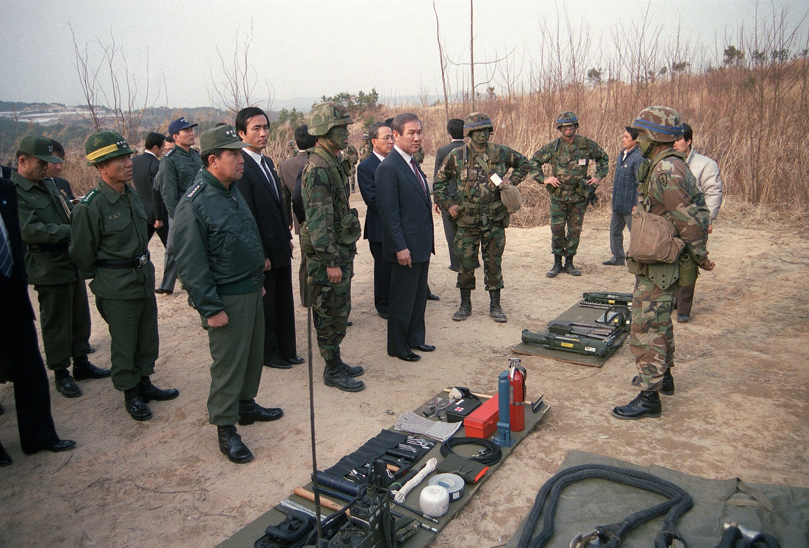

35년 전인 1991년 11월 13일, 서울 청와대에서 중국 최고위 각료와 대한민국 국가원수가 사상 처음으로 공식 회동을 가졌다는 소식이 일제히 전해졌습니다. 아시아태평양경제협력체 회의를 계기로 성사된 이 만남은 냉전의 벽을 허물고 한중 수교의 물꼬를 튼 역사적인 분수령이었습니다.

## 닫혀 있던 문, 무역대표부에서 시작된 교류

한국과 중국은 오랜 세월 정식 국교가 단절된 상태였습니다. 양국은 대사관 대신 민간 성격의 무역대표부를 설치하여 조심스럽게 인적 교류와 통상 규모를 넓혀가고 있었습니다. 국가원수와 장관급 인사 간의 공식 접촉은 철저히 차단되어 있었으며, 고위급 만남도 같은 해 10월 초 뉴욕 유엔총회에서 열린 외무장관 회담이 가장 높은 수준이었습니다.

## 1991년 11월 12일, 청와대에서의 40분 단독 요담

변화의 물꼬는 제3차 아시아태평양경제협력체(APEC) 서울 각료회의였습니다. 중국의 첸치천 외교부장과 리란칭 대외경제무역부장은 김포공항을 통해 서울에 도착했습니다. 노태우 대통령은 15개 참가국 대표단을 청와대에서 공동 접견한 직후, 첸치천 외교부장 일행과 별도의 단독 면담 자리를 마련했습니다. 대한민국 국가원수가 중국의 현직 각료를 만난 것은 건국 이래 처음이었습니다.

이날 면담은 오후 4시 40분부터 40분 동안 진지한 분위기 속에서 진행되었습니다. 한국 측에서는 이상옥 외무부장관, 정해창 대통령 비서실장, 김종휘 대통령 외교안보특별보좌관이 배석했고, 중국 측에서는 리란칭 대외경제무역부장과 수행원들이 동석했습니다.

*사건 당시 사진 아님 · 1989년 — 사진: Al Chang / Public domain*

## 북한 핵사찰 요구와 국교 정상화 촉구

노태우 대통령은 면담 자리에서 11월 8일 발표했던 한반도 비핵화 선언의 배경을 상세히 설명했습니다. 점증하는 북한의 핵무기 개발이 동북아 안보에 심각한 위협이 되고 있음을 지적하며, 북한이 조속히 핵안전협정에 서명하고 국제핵사찰을 수용하도록 중국 정부가 적극적으로 협조해 줄 것을 강력히 당부했습니다.

아울러 노태우 대통령은 날로 늘어나는 양국의 교역과 교류를 언급하며, 현재의 무역대표부 관계를 넘어 정식 외교관계를 맺어야 한다고 강조했습니다. 이에 대해 첸치천 외교부장은 한중 외교관계가 조속히 정상화되어야 한다는 원칙에 동의를 표하고, 북한의 핵사찰 수락을 이끌어내기 위한 중국 측의 노력을 설명했습니다.

![[1886호] 대통령 신년사 대통령 신년사 (노태우) (1991.12.30) 장면 2](../images/2026-11-13-03-3.jpg)
*[1886호] 대통령 신년사 대통령 신년사 (노태우) (1991.12.30) 장면 2 — 사진: KTV 국민방송 e영상역사관 (대한뉴스) / KTV 공공저작물 — 영상 저작물 전면 개방(대통령실 2025-07-09), 출처 표시*

## 철저한 보안과 잇따른 고위급 회담

면담이 끝난 뒤 청와대 이수정 대변인은 중국 측의 요청에 따라 접견 내용을 구체적으로 공개하지 않기로 양해했다고 발표했습니다. 당시 두 나라 사이의 미묘한 외교적 입장과 주변국을 고려한 신중한 조치였습니다. 첸치천 외교부장은 이후 11월 14일 이상옥 외무장관과 정식 한중 외무장관 회담을 갖고 양국 관계 정상화와 무역협정 체결 등을 더욱 구체적으로 논의했습니다.

![[1876호] 몽골 인민공화국 대통령 방한 (푼살마긴 오치르바트 대통령) 몽골 인민공화국 대통령 방한 (1991.10.23) 장면 2](../images/2026-11-13-03-4.jpg)
*[1876호] 몽골 인민공화국 대통령 방한 (푼살마긴 오치르바트 대통령) 몽골 인민공화국 대통령 방한 (1991.10.23) 장면 2 — 사진: KTV 국민방송 e영상역사관 (대한뉴스) / KTV 공공저작물 — 영상 저작물 전면 개방(대통령실 2025-07-09), 출처 표시*

## 1992년 공식 수교로 이어진 결실

청와대에서 이루어진 40분간의 단독 요담은 양국 관계를 공식 외교 단계로 격상시키는 결정적 전환점이었습니다. 이후 첸치천 외교부장은 1992년 평양을 직접 방문해 김일성 주석에게 한국과의 정식 국교 수립 방침을 전달하는 중요한 역할을 맡기도 했습니다. 서울 청와대에서 첫발을 내디딘 대화는 마침내 1992년 8월 역사적인 한중 수교로 결실을 맺었습니다.

### 참고 자료

- <https://newslibrary.naver.com/viewer/index.naver?articleId=1991111300329101001&editNo=15&printCount=1&publishDate=1991-11-13&officeId=00032&pageNo=1&printNo=14227&publishType=00010>
- <https://commons.wikimedia.org/wiki/File:Roh_Tae-woo_-_cropped,_1989-Mar-13.jpg>
- <https://commons.wikimedia.org/wiki/File:Roh_Tae-woo_-_cropped,_1989-Mar-13_05.jpg>
- <https://www.ehistory.go.kr/view/movie?mediasrcgbn=KV&mediaid=12227&mediadtl=28581&mediagbn=DH#t=0.7>
- <https://www.ehistory.go.kr/view/movie?mediasrcgbn=KV&mediaid=12204&mediadtl=28473&mediagbn=DH#t=0.7>
