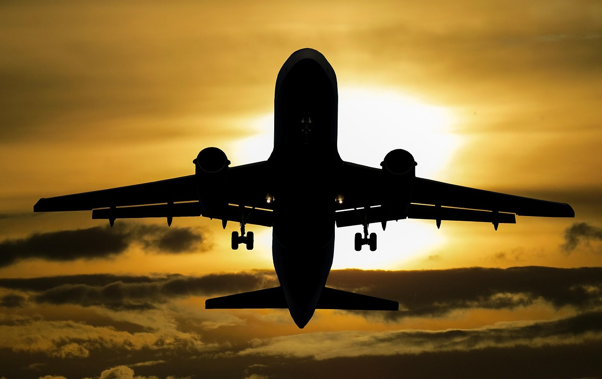
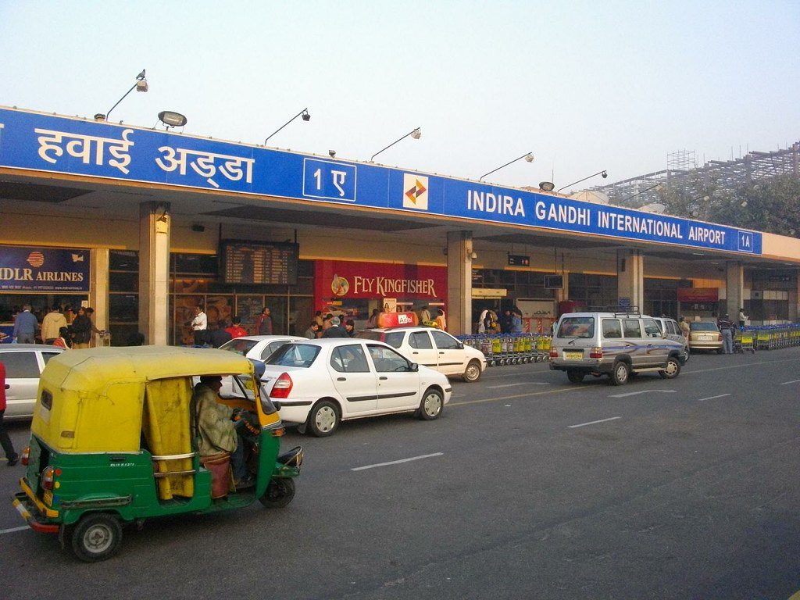
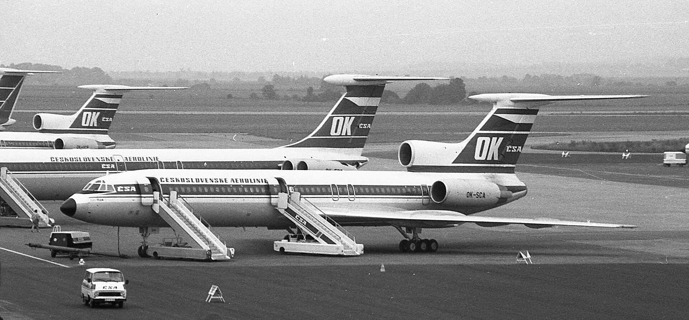

30년 전 오늘, 1996년 11월 13일. 인도 뉴델리 인근 상공에서 여객기 두 대가 공중 충돌해 탑승자 전원이 목숨을 잃었다는 소식이 긴급 타전되었습니다. 사우디아라비아 항공의 대형 점보기와 카자흐스탄 항공 여객기가 칠흑 같은 밤하늘에서 서로를 피하지 못하고 충돌한 초유의 사고였습니다.

## 뉴델리 상공에서 겹쳐진 두 비행기의 항로

1996년 11월 12일 밤 9시 50분경, 인도 뉴델리 인디라 간디 국제공항을 이륙한 사우디아라비아 항공 보잉 747 여객기는 사우디 제다와 다란을 향해 고도를 높이고 있었습니다. 같은 시각, 카자흐스탄 항공의 TU 154 여객기는 뉴델리 공항 착륙을 위해 고도를 낮추며 다가오고 있었습니다. 서로 다른 목적지를 향해 가던 두 대형 항공기는 좁은 항로 안에서 불의의 조우를 피하지 못했습니다.

## 붉게 물든 밤하늘과 목격자들의 충격

사고 지점은 뉴델리 서쪽 차르키 다드리 마을 상공이었습니다. 지상에 있던 건축업자 라오 싱은 AP통신과의 통화에서 집 밖에 어둠이 깔린 후 상공 3~4킬로미터 부근에서 거대한 화염이 솟구치더니 밤하늘 전체가 온통 붉게 물들었다고 당시 상황을 생생히 증언했습니다. 평온하던 시골 마을 하늘 위에서 발생한 거대한 폭발은 지상 주민들에게도 씻을 수 없는 공포를 안겼습니다.

*사건 당시 사진 아님 · 이미지 사진 — 사진: garten-gg / Pixabay Content License*

## 미군 수송기가 목격한 공중 충돌 순간

비극적인 충돌 순간은 공중에 있던 다른 항공기에도 고스란히 목격되었습니다. 사고 당시 뉴델리 서북쪽 약 70킬로미터 상공을 비행 중이던 미군 수송기 조종사가 두 여객기가 공중에서 맞부딪치는 장면을 직접 확인하고 이를 군 당국에 보고했습니다. 어두운 밤하늘 속에서 두 여객기는 충돌과 동시에 큰 폭발을 일으키며 산산조각 났습니다.

*Terminal 1A (Domestic), Indira Gandhi International Airport — 사진: kawanet / CC BY 2.0*

## 탑승자 전원 사망과 열악했던 구호 환경

카자흐스탄 항공기에는 39명이 탑승해 있었으며, 두 여객기에 타고 있던 승객과 승무원 중 생존자는 단 한 명도 없었습니다. 인도 당국은 사고 직후 의료진과 구조대를 현장으로 급파했으나 현장은 병상이 30여 개에 불과한 작은 병원이 전부인 외진 평야 지대였습니다. 갑작스러운 대규모 참사를 수습하기에는 의료 및 구호 인프라가 턱없이 부족했습니다.

*Tupolev Tu-154M OK-SCA Ruzyne — 사진: kitmasterbloke / CC BY 2.0*

## 기종 안전성과 항공 관제 시스템의 문제

미국 뉴스 전문 채널 CNN은 사고 직후 긴급 뉴스를 편성해 사고 소식을 전하면서, 옛 소련에서 제작된 TU 154 기종이 보잉 747 기종에 비해 안전도가 떨어진다는 점을 지적했습니다. 그러나 야간 비행 중 두 여객기가 서로를 인지하지 못하고 같은 고도에서 정면으로 충돌한 근본적인 원인을 두고 항공 관제 시스템 전반에 대한 대대적인 점검이 불가피해졌습니다.

## 항공 역사상 가장 비극적인 교훈으로 남은 사고

이 사고는 지금도 세계 항공 역사상 최악의 공중 충돌 사고 중 하나로 기록되어 있습니다. 광활한 하늘 위에서 사소한 고도 오차와 관제 혼선이 수많은 인명을 앗아가는 끔찍한 결과로 이어질 수 있음을 전 세계에 경고한 사건이었습니다. 1996년 11월 전해졌던 이 비극적인 소식을 기억하는 이들에게 그날의 밤하늘은 지울 수 없는 안타까움으로 남아 있습니다.

### 참고 자료

- <https://newslibrary.naver.com/viewer/index.naver?articleId=1996111300329101001&editNo=45&printCount=1&publishDate=1996-11-13&officeId=00032&pageNo=1&printNo=15936&publishType=00010>
- <https://pixabay.com/photos/airplane-travel-adventure-6867678/>
- <https://pixabay.com/photos/aircraft-sunset-silhouette-clouds-1362586/>
- <https://www.flickr.com/photos/50902562@N00/3138486158>
- <https://commons.wikimedia.org/wiki/File:Tupolev_Tu-154M_OK-SCA_Ruzyne.jpg>
