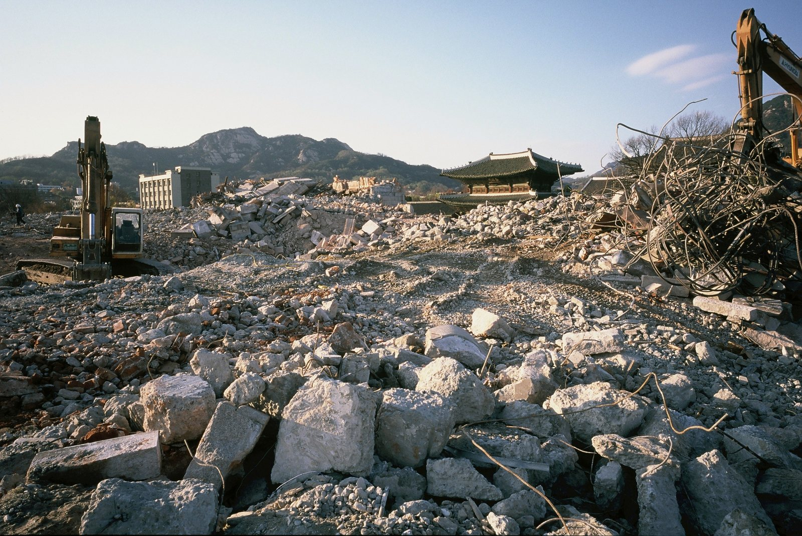
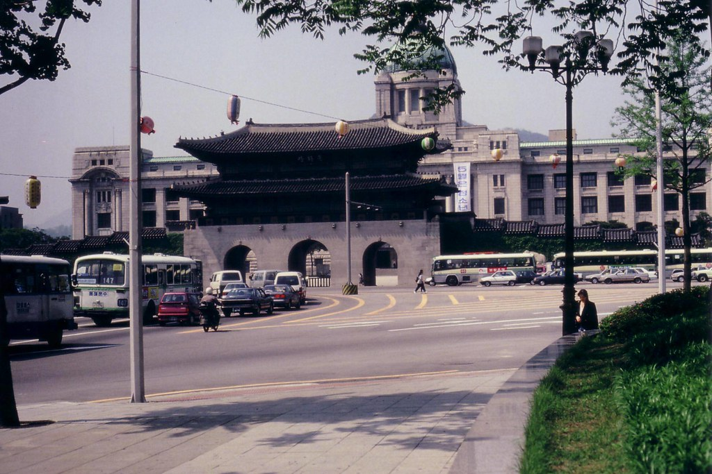

30년 전 오늘, 1996년 11월 14일. 일제 식민 통치의 상징이었던 옛 조선총독부 건물이 준공 70년 만에 역사 속으로 완전히 사라졌습니다. 마지막 남아 있던 북쪽 대회의실 외벽이 허물어지면서 가려져 있던 경복궁 근정전이 제 모습을 드러냈습니다.

## 경복궁을 가로막았던 70년의 역사

조선총독부 청사는 일제가 1910년 한일 병합 조약 이후 한반도를 통치하기 위해 운영하던 최고 통치 기관의 본부였습니다. 초기에는 남산 왜성대 왜관 부근의 통감부 건물을 그대로 쓰다가, 1926년 조선 왕조의 법궁인 경복궁의 흥례문 구역을 강제로 철거하고 그 자리에 웅장한 서양식 석조 건물을 신축했습니다.

근정전 바로 앞을 가로막고 들어선 이 건물은 조선 왕실의 권위를 훼손하고 식민 통치의 위압감을 심어주기 위한 정치적 목적을 띠고 있었습니다. 1926년 1월 완공된 이래 이 건물은 1945년 일제가 패망할 때까지 20년 가까이 식민 통치의 심장부 역할을 했습니다.

## 광복과 전쟁, 그리고 이어진 현대사의 질곡

1945년 8월 15일 해방 이후에도 건물은 사라지지 않았습니다. 미군정이 들어서며 미군정청 건물로 쓰였고, 1948년 대한민국 정부가 수립된 이후에는 정부 청사인 '중앙청'으로 간판을 바꿔 달았습니다.

한국전쟁 당시에는 북한 인민군이 서울을 점령하면서 인민군 전선사령부로 사용되기도 했으며, 퇴각 과정에서 내부에 방화가 일어나 큰 피해를 입기도 했습니다. 9월 28일 서울 수복 당시 우리 군이 이곳에 다시 태극기를 게양한 역사적 장소이기도 합니다. 전후 복구를 거쳐 1962년부터 다시 중앙청으로 쓰였고, 1986년부터는 국립중앙박물관으로 개조되어 사용되었습니다.

![[1439호] 중앙청이 박물관으로 ... 건물의 35년 역사 소개 (1983.06.03) 장면 2](../images/2026-11-14-01-2.jpg)
*[1439호] 중앙청이 박물관으로 ... 건물의 35년 역사 소개 (1983.06.03) 장면 2 — 사진: KTV 국민방송 e영상역사관 (대한뉴스) / KTV 공공저작물 — 영상 저작물 전면 개방(대통령실 2025-07-09), 출처 표시*

## 철거와 보존의 오랜 논쟁 끝에 내린 결단

대한민국 현대사의 중요한 사건들이 펼쳐진 무대였던 만큼, 이 건물을 역사적 교훈으로 남겨야 한다는 보존론과 일제 침략의 치욕스러운 상징이자 민족정기를 훼손하는 건물을 철거해야 한다는 주장이 수십 년 동안 팽팽히 맞섰습니다.

논쟁에 종지부를 찍은 것은 김영삼 정부였습니다. 광복 50주년을 맞은 1995년, 정부는 민족정기 회복과 경복궁 복원을 목표로 총독부 청사의 전면 철거를 공식 발표했습니다. 그해 8월 15일 광복절 기념식에서 건물 상징이었던 첨탑이 먼저 잘려 내려가면서 철거 작업이 본격화되었습니다.

*완전철거된 구 조선총독부 건물 2 — 사진: Seoul Research Data Service / CC BY 4.0*

## 마지막 대회의실 외벽 붕괴, 온전해진 경복궁

철거 공사를 맡은 현대건설은 건물 구조물을 위에서부터 차례로 해체해 들어갔습니다. 그리고 1996년 11월 13일과 14일에 걸쳐 건물 북쪽에 위치한 마지막 지상 구조물인 대회의실 외벽을 허물어뜨렸습니다.

육중한 석재와 콘크리트 외벽이 무너지자, 70년 동안 가로막혀 있던 경복궁 근정전과 그 뒤로 이어지는 북악산의 능선이 시원하게 눈앞에 펼쳐졌습니다. 당시 국립중앙박물관 측은 12월 말까지 지하에 묻혀 있는 기초 구조물과 초석까지 모두 파내어 지상과 지하의 흔적을 완전히 제거할 계획을 밝혔습니다.

*Historical buildings 조선총독부 청사 — 사진: Jens-Olaf / CC BY 2.0*

## 기억의 파편으로 남겨진 역사의 교훈

해체된 조선총독부 건물의 잔해와 가장 먼저 잘려 나갔던 첨탑 부재는 충청남도 천안의 독립기념관으로 옮겨졌습니다. 영구히 보존하여 숭상하는 것이 아니라, 민족의 아픈 역사를 기억하고 교훈으로 삼기 위해 야외 공원에 낮게 전시되었습니다.

일제의 침략 상징이 사라진 자리에는 이후 흥례문과 행각들이 본래의 모습대로 복원되었고, 경복궁은 제자리를 찾았습니다. 거대한 석조 건물이 무너져 내리며 마침내 우리의 궁궐이 제 하늘을 되찾았던 그날의 광경은 많은 이들에게 큰 울림을 남겼습니다.

### 참고 자료

- <https://newslibrary.naver.com/viewer/index.naver?articleId=1996111400209101004&editNo=45&printCount=1&publishDate=1996-11-14&officeId=00020&pageNo=1&printNo=23367&publishType=00010>
- <https://www.ehistory.go.kr/view/movie?mediasrcgbn=KV&mediaid=10826&mediadtl=23340&mediagbn=DH#t=0.3>
- <https://www.ehistory.go.kr/view/movie?mediasrcgbn=KV&mediaid=10826&mediadtl=23340&mediagbn=DH#t=0.7>
- <https://commons.wikimedia.org/wiki/File:%EC%99%84%EC%A0%84%EC%B2%A0%EA%B1%B0%EB%90%9C_%EA%B5%AC_%EC%A1%B0%EC%84%A0%EC%B4%9D%EB%8F%85%EB%B6%80_%EA%B1%B4%EB%AC%BC_2.jpg>
- <https://www.flickr.com/photos/65817306@N00/243074675>
