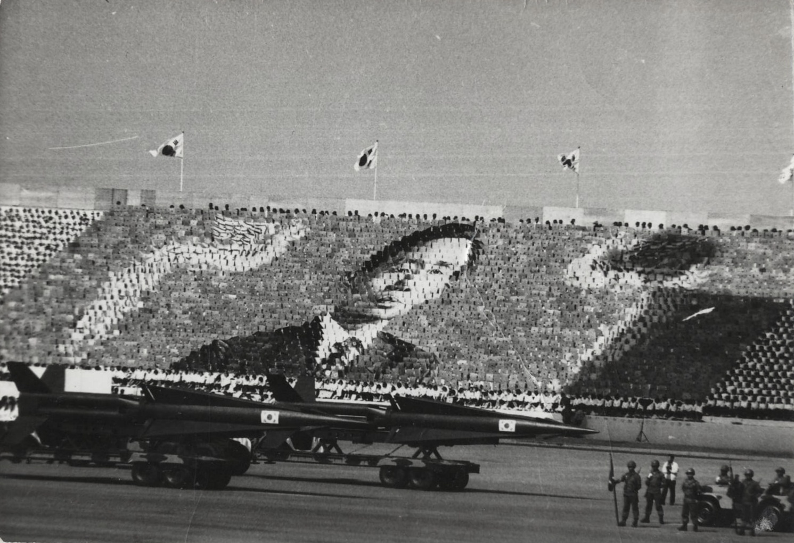
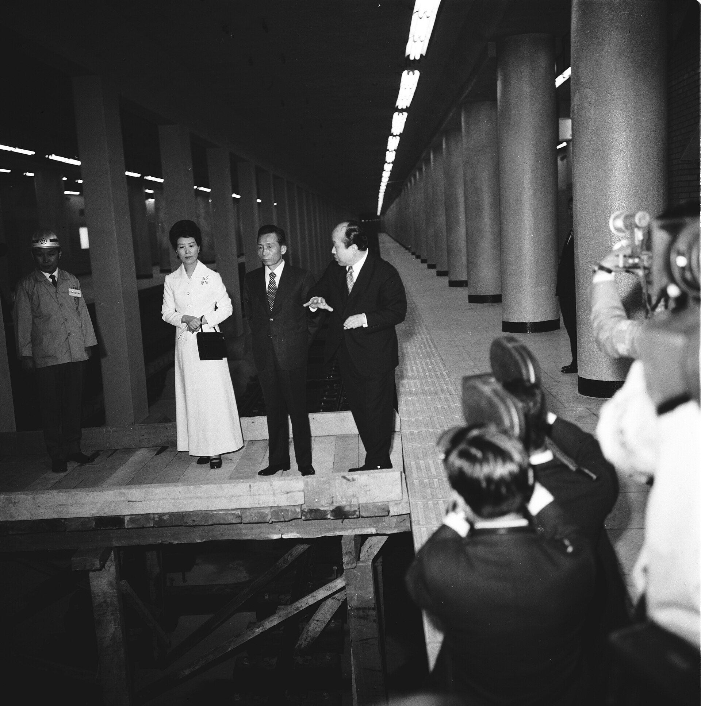
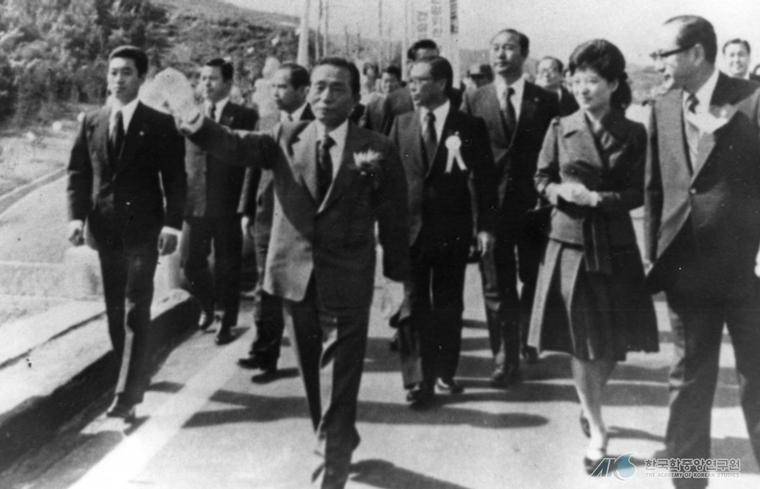

53년 전 오늘, 1973년 11월 14일. 호남고속도로와 남해고속도로가 마침내 개통됐습니다. 영남과 호남을 동서로 잇는 새 길이 열리면서 대한민국 전역을 종횡으로 잇는 기간고속도로망이 완성되었습니다.

## 7시간 걸리던 광주~부산, 3시간 30분 시대로

개통 전까지만 해도 호남과 영남을 오가는 교통편은 매우 열악했습니다. 광주에서 부산까지 자동차로 가려면 비포장 국도를 거치며 꼬박 7시간 가까이 달려야 했습니다. 하지만 착공 20개월 만에 남해고속도로와 호남고속도로 구간이 이어지면서 이 시간이 단숨에 3시간 30분으로 단축되었습니다.

시간이 절반으로 줄어들면서 물류와 사람의 이동 속도는 획기적으로 빨라졌습니다. 전주와 이리 등 내륙의 주요 산업 단지와 여수, 광양 등 남해안의 임해 공업 단지가 고속도로를 통해 하나의 경제권으로 묶이기 시작했습니다.

## 1973년 11월 14일, 광주 공설운동장의 준공식

1973년 11월 14일 오전 11시 30분, 전남 광주 공설운동장에서 호남·남해고속도로 준공식이 성대하게 거행되었습니다. 이날 행사에는 박정희 대통령을 비롯해 공사에 참여한 기술진과 근로자, 그리고 수많은 시민들이 참석해 역사적인 개통을 축하했습니다.

박 대통령은 준공 치사를 통해 호남과 남해고속도로의 개통으로 국토를 종횡으로 관통하는 기간고속도로망을 완성해 명실공히 전국 일일생활권을 형성하게 되었다고 강조했습니다. 아울러 이 거창한 토목공사의 완성은 우리 민족의 저력과 가능성을 보여준 역사적인 일이라고 치하했습니다.

*1973년 자료 — 사진: Baek, Jong-sik / CC BY-SA 2.5*

## 6년 동안 1천억 원 투입, 1천13킬로미터 완공

정부는 1968년부터 1973년까지 6년 동안 고속도로 건설 사업에 약 1천억 원의 자금을 집중적으로 투입했습니다. 그 결과 완공된 전국의 고속도로 총연장은 1천13킬로미터, 옛 단위로 2천5백 리를 넘어서게 되었습니다.

치사에서는 이 고속도로가 다른 나라의 손을 빌리지 않고 우리의 기술과 자본, 근로자들의 땀과 정열로 이루어낸 결실이라는 점이 강조되었습니다. 박 대통령은 도로가 단순한 물자 수송을 넘어 지역 간의 융화와 국민 총화를 이어주는 거대한 혈맥 역할을 할 것이라고 밝혔습니다.

*1973년 자료 — 사진: 서울역사박물관 / KOGL Type 1*

## 영동·동해고속도로 착공과 국도 포장 계획

이날 준공식에서는 향후 도로망 확충에 대한 구체적인 청사진도 발표되었습니다. 정부는 이듬해인 1974년에 원주에서 강릉을 잇는 영동고속도로와 동해고속도로를 착공하겠다는 계획을 밝혔습니다.

동시에 전국의 일반 국도 포장 사업도 연차적으로 추진하기로 했습니다. 1976년 말까지 전국 국도의 70퍼센트에 해당하는 5천8백 킬로미터를 포장하고, 1981년까지는 전국 국도 8천2백 킬로미터를 100퍼센트 완전 포장하겠다는 국가 도로 정비 일정이 제시되었습니다.

*사건 당시 사진 아님 — 사진: 한국학중앙연구원 / KOGL Type 1 attribution*

## 왕복 2차로로 출발해 대동맥이 되기까지

1973년 개통 당시의 남해고속도로는 중앙분리대가 없는 왕복 2차로 도로였습니다. 순천과 부산을 잇는 이 길은 산업화의 진전에 따라 교통량이 급증하면서 1977년부터 본격적인 확장 공사에 들어갔고, 1996년에는 전 구간이 왕복 4차로 이상으로 넓혀졌습니다.

이후 주요 상습 정체 구간은 6차로에서 8차로까지 추가 확장되었으며, 2012년에는 영암에서 순천으로 이어지는 서부 구간까지 연결망을 넓혔습니다. 50여 년 전 좁은 2차로로 첫발을 내디뎠던 남해고속도로는 지금도 남부권을 지탱하는 핵심 동맥으로 자동차들을 맞이하고 있습니다.

### 참고 자료

- <https://newslibrary.naver.com/viewer/index.naver?articleId=1973111400209201009&editNo=2&printCount=1&publishDate=1973-11-14&officeId=00020&pageNo=1&printNo=16038&publishType=00020>
- <https://commons.wikimedia.org/wiki/File:Armed_Forces_Day_of_South_Korea_(1973)_1.jpg>
- <https://commons.wikimedia.org/wiki/File:Card_Stunt_for_Park_Chung-hee.jpg>
- <https://commons.wikimedia.org/wiki/File:%EB%B0%95%EC%A0%95%ED%9D%AC_%EB%8C%80%ED%86%B5%EB%A0%B9%EC%9D%98_%EC%8B%9C%EC%B2%AD_%EC%95%9E_%EC%A7%80%ED%95%98%EC%B2%A0%EC%97%AD_%EA%B3%B5%EC%82%AC%ED%98%84%EC%9E%A5_%EC%8B%9C%EC%B0%B0_(1973.04.13).jpg>
- <https://www.kogl.or.kr/recommend/recommendDivView.do?division=img&recommendIdx=75035>
