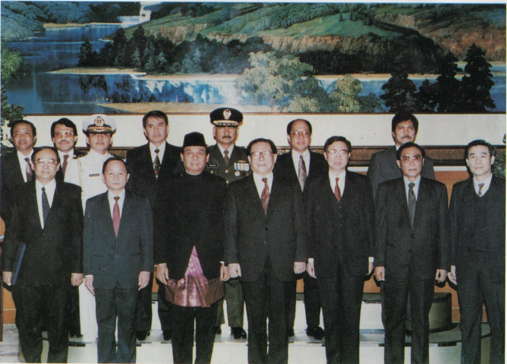
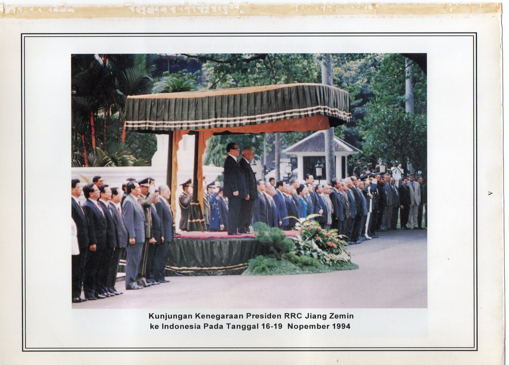
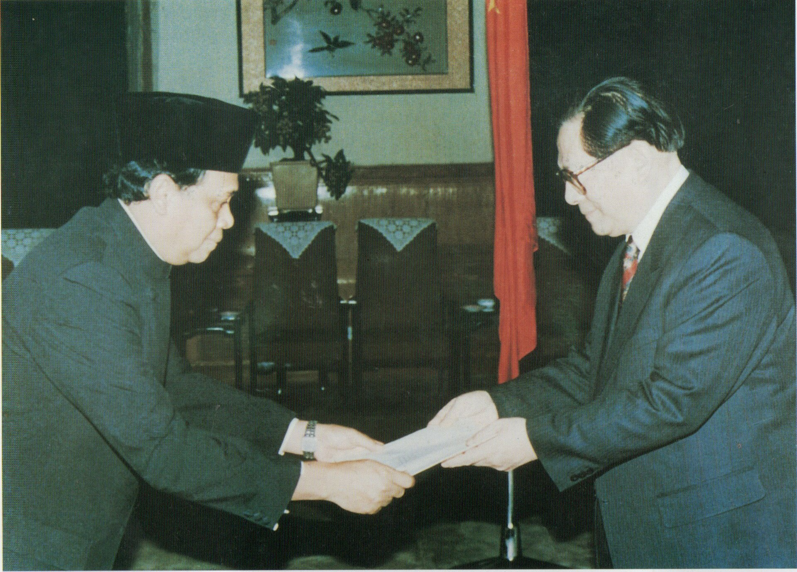

31년 전 오늘, 1995년 11월 14일. 중국의 국가원수인 장쩌민 국가주석이 청와대를 찾아 김영삼 대통령과 한중 정상회담을 가졌습니다. 중국 권력 서열 1위인 최고 지도자가 한국 땅을 공식 방문한 것은 역사상 처음이었습니다.

## 수교 3년 만에 성사된 중국 국가원수의 첫 서울 방문

대한민국과 중화인민공화국이 정식으로 외교관계를 맺은 것은 1992년 8월이었습니다. 반세기 가까이 냉전의 두터운 장벽에 가로막혀 총부리를 겨눴던 두 나라가 국교를 정상화한 지 불과 3년 만에 중국의 최고 권력자가 서울을 찾은 것입니다.

장쩌민 주석은 1993년 국가주석에 선출되며 당과 정부의 전권을 장악한 중국 제3세대 핵심 지도자였습니다. 그가 한국을 국빈 방문한다는 사실 자체만으로도 국내외 언론과 국민들의 커다란 이목이 쏠렸습니다.

## 100여 명의 매머드급 사절단과 함께 도착한 전용기

장쩌민 주석은 회담 전날인 11월 13일 오후, 부인 왕야평 여사와 함께 보잉 747 전용기편으로 성남 서울공항에 내렸습니다. 4박 5일간의 공식 일정을 시작하는 자리였습니다.

이번 방한에는 전기침 외교부장을 비롯해 정관근 공산당 정치국 위원, 왕충우 국가경제무역위원회 주임, 고수연 화학공업부장, 오의 대외경제무역합작부장 등 107~108명에 이르는 대규모 공식·비공식 수행단이 동행했습니다. 서울공항에서 공로명 외무장관과 황병태 주중대사의 영접을 받은 장 주석은 첫 숙소인 호텔신라로 이동해 여장을 풀었습니다.

*1994년 자료 — 사진: Embassy of Indonesia in Beijing / Public domain*

## 청와대 정상회담에서 다룬 핵심 현안들

11월 14일 오전 청와대에서 열린 정상회담은 단독 및 확대 회담으로 이어졌습니다. 김영삼 대통령과 장쩌민 주석은 한반도 주변 정세와 양국 간 실질적 경제 협력 증진 방안을 집중적으로 논의했습니다.

두 정상은 한반도의 안정을 위해 현재의 정전체제가 흔들림 없이 유지되어야 한다는 입장을 재확인했습니다. 아울러 북한 정세를 분석하고 대북 경수로 지원과 교착상태에 빠진 남북 대화의 재개 방안에 대해서도 깊이 있는 의견을 나눴습니다. 또한 며칠 뒤 일본 오사카에서 열릴 아시아·태평양경제협력체(APEC) 정상회의와 이듬해 방콕에서 열릴 아시아·유럽 정상회의(ASEM)에서의 다자 외교 협력도 협의했습니다.

*1994년 자료 — 사진: Embassy of Indonesia in Beijing / Public domain*

## 5대 산업 협력 구체화와 경제 협정 체결

경제 분야에서도 굵직한 합의가 잇따랐습니다. 양국 정상은 기존의 한중 산업협력위원회를 중심으로 자동차, 중형항공기, 고화질 텔레비전, 전전자교환기, 원자력 등 5개 핵심 분야의 협력을 한층 강화하기로 뜻을 모았습니다. 러시아 지역 가스 공동개발과 지역위성 사업도 협의 과제로 올랐습니다.

이날 외무부에서는 공로명 외무장관과 중국 오의 대외경제무역합작부장이 참석한 가운데 대외경제협력기금(EDCF) 차관협정이 체결되었습니다. 한국 정부는 중국 천진항 남항대교 건설 지원에 이어 호남성 광케이블 사업과 청도 고가도로 사업 등 추가 사업 협력을 구체화했습니다.

*1994년 자료 — 사진: Embassy of Indonesia in Beijing / Public domain*

## 중국 지도자 최초의 국회 연설과 과거사 언급

정상회담을 마친 장쩌민 주석은 이날 오후 여의도 국회의사당을 방문했습니다. 중국 최고 지도자로서는 사상 처음으로 대한민국 국회 단상에 올라 연설을 진행했습니다.

장 주석은 국회 연설에서 중국의 대외 정책과 한반도 평화 정책의 기본 방향을 상세히 설명했습니다. 더불어 당시 논란이 거세게 일던 일본 일부 정치인들의 과거사 망언과 관련해 역사를 올바르게 직시해야 한다는 메시지를 남기며 양국 국민들의 깊은 공감을 이끌어냈습니다.

## 냉전의 시대를 넘어 새로운 교류의 장을 열다

31년 전 오늘 성사된 장쩌민 주석의 방한은 한중 관계가 수교의 상징적 단계를 넘어 경제와 외교 전반에서 실질적인 동반자로 전환하는 결정적인 전환점이었습니다.

이후 두 나라는 무역과 인적 교류에서 폭발적인 성장을 거듭하며 동북아 정세의 핵심 축으로 자리 잡았습니다. 텔레비전 뉴스 속보를 통해 붉은 중국의 최고 지도자가 청와대 뜰에 들어서는 모습을 지켜보던 그날의 생생한 기억을 시청자 여러분은 어떻게 간직하고 계십니까.

### 참고 자료

- <https://newslibrary.naver.com/viewer/index.naver?articleId=1995111400329101001&editNo=40&printCount=1&publishDate=1995-11-14&officeId=00032&pageNo=1&printNo=15596&publishType=00010>
- <https://commons.wikimedia.org/wiki/File:%EA%B0%95%ED%83%9D%EB%AF%BC_%EC%A4%91%EA%B5%AD_%EA%B5%AD%EA%B0%80%EC%A3%BC%EC%84%9D_%EA%B5%AD%ED%9A%8C_%EC%A7%80%EB%8F%84%EC%9E%90_%EB%A9%B4%EB%8B%B4_%EB%B0%8F_%EC%97%B0%EC%84%A4.jpg>
- <https://commons.wikimedia.org/wiki/File:Ambassador_Juwana_and_President_Jiang_Zemin,_Informasi_Singkat_(1996),_pXI.jpg>
- <https://commons.wikimedia.org/wiki/File:Jiang_Zemin_visiting_Indonesia,_Informasi_Singkat_(1996),_pV.jpg>
- <https://commons.wikimedia.org/wiki/File:Juwana_presenting_credentials_to_president_Jiang_Zemin,_Informasi_Singkat_(1996),_pX.jpg>
