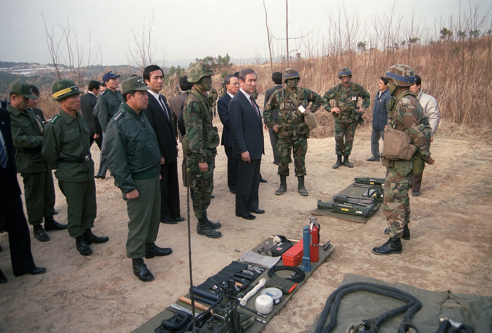
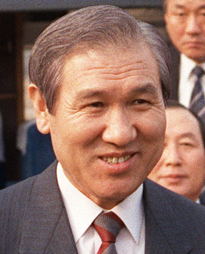
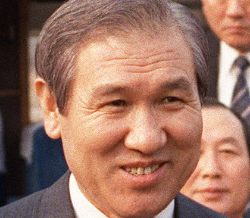

37년 전 오늘, 1989년 11월 14일. 정부가 침체된 경기를 되살리겠다며 기업 대출금리를 1퍼센트포인트 인하하는 긴급 경제 대책을 내놓았습니다. 올림픽 특수 이후 찾아온 수출 둔화와 투자 위축을 타개하려는 처방이었지만, 시장의 반응은 기대와 전혀 달랐습니다.

## 4개 부처 장관 합동 기자회견과 당면 대책 발표

1989년 11월 14일 오전 11시 30분, 서울 세종로 정부제1종합청사에서 이례적인 합동 기자회견이 열렸습니다. 조순 부총리 겸 경제기획원 장관을 비롯해 이규성 재무부 장관, 한승수 상공부 장관, 최영철 노동부 장관 등 경제와 노동을 관장하는 4개 부처 수장이 한자리에 모였습니다.

이날 발표된 정책은 '경제사회안정과 경쟁력제고를 위한 당면대책'이었습니다. 조순 부총리는 이날 오전 노태우 대통령에게 관련 내용을 사전 보고한 뒤 회견장에 섰습니다. 가라앉는 산업 활력을 되살리고 기업의 금융비용을 덜어주겠다는 것이 핵심 목표였습니다.

## 기업 대출금리 1%포인트 인하와 1조 원 특별설비자금

대책의 핵심은 금리 인하였습니다. 금융통화운영위원회는 이날 오전 임시 회의를 열고 한국은행의 재할인금리를 연 8퍼센트에서 연 7퍼센트로 1퍼센트포인트 전격 인하해 11월 15일부터 시행하기로 의결했습니다.

이에 따라 시중은행의 기업 대출 우대금리(프라임레이트)는 연 11퍼센트에서 10퍼센트로, 일반기업 대출금리도 13퍼센트에서 12퍼센트 수준으로 떨어지게 되었습니다. 정부는 단자사, 종합금융사, 보험사 등 제2금융권 대출금리도 연 14~15퍼센트 수준으로 인하를 유도해 전체적으로 연간 8천억 원 규모의 기업 금융비용 부담을 덜어주겠다고 밝혔습니다.

아울러 첨단산업과 수출산업 설비투자를 돕기 위해 연리 8퍼센트, 최장 10년 만기의 특별설비자금 1조 원을 신설하고, 이 가운데 5천억 원을 중소기업에 우선 배정하기로 했습니다. 연말까지였던 임시투자세액공제 시한도 내년 6월까지 연장되었습니다.

*Roh Tae-woo - cropped, 1989-Mar-13 05 — 사진: Al Chang / Public domain*

## 예금금리 동결과 과소비 억제라는 줄타기

그러나 이번 조치에서 은행의 예금(수신)금리는 전혀 손대지 않았습니다. 예금금리까지 내릴 경우 시중 부동자금이 부동산 투기나 과소비로 흘러들어가 물가를 자극할 수 있다는 우려 때문이었습니다.

정부는 동시에 소비성 가계자금 대출 한도와 신용카드 이용 한도를 축소하는 과소비 억제책도 병행했습니다. 향락산업에 대한 규제를 강화하고, 국세청 내에 재산세국을 신설하는 한편 아파트 분양 신청 시 자금조달계획서 제출을 의무화하는 부동산 투기 억제 방안도 함께 내놓았습니다. 기업 투자는 부추기되 시중 과소비는 틀어막겠다는 복합 처방이었습니다.

*Roh Tae-woo 1989-03-13 — 사진: CHERIE A. THURLBY / Public domain*

## '알맹이 없고 때늦었다' 재계의 냉담한 반응

정부의 대대적인 발표에도 불구하고 당일 시장과 재계의 반응은 싸늘했습니다. 대한상공회의소, 전국경제인연합회, 한국무역협회, 중소기업협동조합중앙회 등 경제단체들은 이번 대책이 침체된 경기를 살리기에는 턱없이 부족하다고 입을 모았습니다.

재계는 금리를 내리려면 최소한 2퍼센트포인트는 내려야 실질적인 효과가 난다고 반발했습니다. 전문가들 사이에서도 정책 결정 과정에서 부처 간 이견으로 발표가 지연되면서 타이밍을 놓쳤다는 비판이 나왔으며, '알맹이 없는 때늦은 조치'라는 냉혹한 평가가 신문 1면을 장식했습니다.

*Roh Tae-woo 1989-03-13 (headshot) — 사진: CHERIE A. THURLBY / Public domain*

## 시장평균환율제 도입 예고와 체질 개선의 과제

정부는 이번 대책을 통해 환율 제도 개편도 공식화했습니다. 수출 활성화를 위해 원화 절하를 유도하는 한편, 1990년 1분기 중으로 시장 실세가 반영되는 시장평균환율제를 전격 도입하고 향후 자유변동환율제로 이행하겠다는 로드맵을 제시했습니다.

또한 노사안정을 위해 노사정 및 학계가 참여하는 국민경제사회위원회를 발족하고 한국노사교육본부를 신설하겠다는 대책도 포함되었습니다. 1988년 서울 올림픽의 호황이 저물고 대내외 경제 환경이 급변하던 과도기, 한국 경제는 단기적인 금리 처방을 넘어선 근본적인 구조 조정의 갈림길에 서 있었습니다.

### 참고 자료

- <https://newslibrary.naver.com/viewer/index.naver?articleId=1989111400209201004&editNo=2&printCount=1&publishDate=1989-11-14&officeId=00020&pageNo=1&printNo=20960&publishType=00020>
- <https://commons.wikimedia.org/wiki/File:Roh_Tae-woo_-_cropped,_1989-Mar-13.jpg>
- <https://commons.wikimedia.org/wiki/File:Roh_Tae-woo_-_cropped,_1989-Mar-13_05.jpg>
- <https://commons.wikimedia.org/wiki/File:Roh_Tae-woo_1989-03-13.jpg>
- <https://commons.wikimedia.org/wiki/File:Roh_Tae-woo_1989-03-13_(headshot).jpg>
