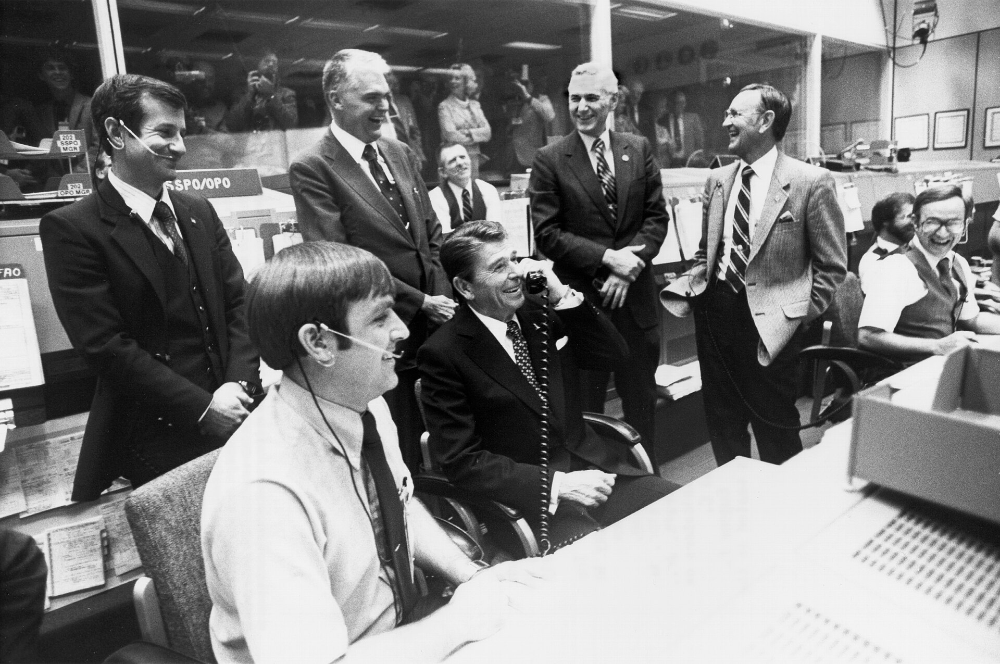
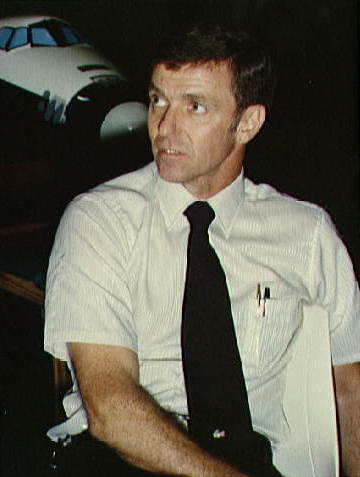
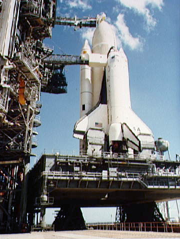

45년 전 오늘, 1981년 11월 14일. 미국의 두 번째 우주왕복선 비행에 나섰던 콜럼비아호가 비행 일정을 대폭 줄여 조기 귀환한다는 긴급 타전이 전 세계 신문 1면을 장식했습니다. 발사 직후 발생한 핵심 장비의 고장 때문이었습니다.

## 발사 6시간 만에 멈춰 선 연료전지

1981년 11월, 미국 케이프카내베랄에서 우주로 쏘아 올려진 우주왕복선 콜럼비아호는 인류의 큰 기대를 모으며 2차 우주여행에 나섰습니다. 그러나 궤도에 진입한 지 얼마 지나지 않은 발사 6시간 만에 심각한 문제가 발생했습니다.

콜럼비아호에 전력을 공급하는 3개의 연료전지 가운데 1개가 갑작스럽게 고장을 일으킨 것입니다. 연료전지는 화학에너지를 전기로 변환시켜 우주선 내부의 각종 장비와 생명유지장치를 가동하는 핵심 설비였습니다. 이 장치 하나가 기능을 멈추자 지상통제본부에는 비상이 걸렸습니다.

## 5일 일정을 2일로 대폭 단축한 지상통제본부

미국 텍사스 휴스턴의 존슨 우주센터 지상통제본부는 즉각 대책 회의에 들어갔습니다. 남은 2개의 연료전지만으로도 기본적인 비행은 가능했지만, 만에 하나 추가 고장이 발생할 경우 두 우주인의 생명이 위태로워질 수 있었습니다.

결국 미 항공우주국(NASA)은 콜럼비아호의 임무를 최소한으로 줄이고 조기 귀환 명령을 내렸습니다. 당초 5일간으로 예정되었던 장기 임무는 단 2일간으로 단축되었습니다. 비행 일정은 54시간, 지구 궤도 비행은 36회로 줄어들었습니다. 착륙 예정 시각은 미국 시간 14일 밤 9시 22분, 한국시간으로는 15일 오전 6시 22분으로 정해졌으며 착륙지는 캘리포니아의 에드워즈 공군기지였습니다.

*President Reagan at Mission Control, Houston - GPN-2000-001655 — 사진: NASA / Public domain*

## 긴박했던 우주인들, 중요 실험에 매달리다

콜럼비아호에 탑승하고 있던 우주인 조 잉글과 리처드 트룰리는 지상통제본부로부터 긴급 지시를 전달받았습니다. 일정이 절반 넘게 줄어든 만큼, 가장 중요한 우주비행 실험부터 우선순위를 정해 가급적 많은 임무를 수행하라는 지시였습니다.

존 매클리시 통제본부 대변인은 촉박한 비행 일정 속에서도 우주인들이 집중력을 발휘해 당초 계획했던 실험의 90%를 성공리에 완수할 수 있을 것이라고 언론에 밝혔습니다. 우주 공간에서 주어진 시간은 짧았지만 두 우주인은 휴식도 미룬 채 계획된 과학 장비들을 차례대로 점검하고 가동했습니다.

*STS-2 Engle interview — 사진: NASA / Public domain*

## "사람 팔처럼 해냈다", 로봇팔 실험의 성공

이번 2차 비행에서 가장 큰 관심을 모았던 핵심 시험 과제는 바로 화물칸에 탑재된 로봇팔 작동 실험이었습니다. 향후 우주에서 인공위성을 회수하거나 구조물을 조립하기 위해 반드시 검증해야 할 장치였습니다.

궤도를 배면 비행하던 콜럼비아호의 후방 카메라는 화물칸에서 로봇팔이 유연하게 뻗어 나오는 장면을 선명하게 포착했습니다. 로봇팔은 지구의 푸른 곡면을 배경으로 마치 사람의 팔처럼 정밀하게 움직이며 모든 시험 동작을 완벽히 소화했습니다. 전력 계통의 결함 속에서도 우주왕복선의 핵심 기능을 입증해 낸 귀중한 순간이었습니다.

*STS-002 shuttle — 사진: NASA / Public domain*

## 33회 유인비행 중 세 번째 일정 단축

미국이 수행해 온 33회의 유인우주비행 역사에서 발사 후 비행 일정이 단축된 것은 이번 콜럼비아호가 세 번째였습니다. 우주 개척의 역사에서 예기치 못한 기계적 결함은 언제든 일어날 수 있었지만, 미국 항공우주국은 무리한 임무 강행 대신 철저한 안전 원칙을 택했습니다.

비록 당초 계획했던 5일간의 긴 여정은 채우지 못했지만, 콜럼비아호는 필수 과제를 대부분 성공시키며 귀환길에 올랐습니다. 1981년 11월의 차가운 초겨울, 지구 반대편의 한국 국민들도 라디오와 조간신문을 통해 우주에서 날아온 전지 고장 소식과 무사 귀환 소식을 숨죽이며 지켜보았습니다.

### 참고 자료

- <https://newslibrary.naver.com/viewer/index.naver?articleId=1981111400329201005&editNo=2&printCount=1&publishDate=1981-11-14&officeId=00032&pageNo=1&printNo=11117&publishType=00020>
- <https://commons.wikimedia.org/wiki/File:STS-2_OSTA_install.jpg>
- <https://commons.wikimedia.org/wiki/File:President_Reagan_at_Mission_Control,_Houston_-_GPN-2000-001655.jpg>
- <https://commons.wikimedia.org/wiki/File:STS-2_Engle_interview.jpg>
- <https://commons.wikimedia.org/wiki/File:STS-002_shuttle.jpg>
