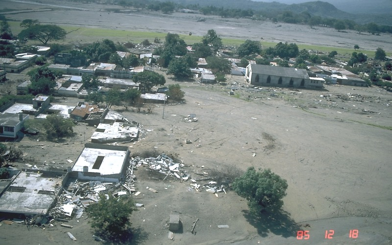
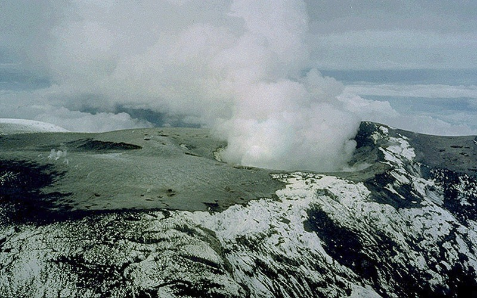
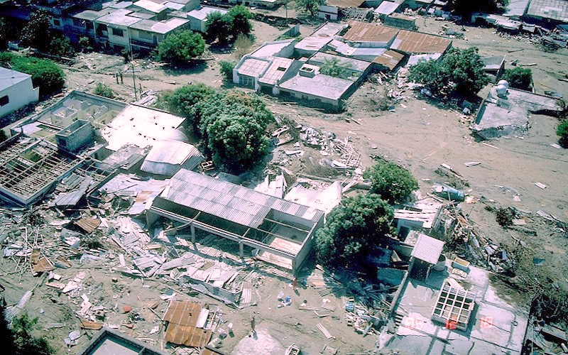

41년 전 오늘, 1985년 11월 15일. 콜롬비아 서부 네바도 델 루이스 화산 폭발로 2만 5천여 명이 사망했다는 충격적인 외신 보도가 국내 조간신문 1면을 뒤덮었습니다. 5세기 동안 잠잠했던 휴화산이 뿜어낸 열기는 산 정상의 거대한 만년설을 녹였고, 이로 인해 발생한 토석류는 하룻밤 사이에 인근 도시 하나를 통째로 집어삼켰습니다.

## 5세기 만에 깨어난 해발 5,400미터의 설산

콜롬비아 수도 보고타에서 북서쪽으로 약 160킬로미터 떨어진 곳에 위치한 네바도 델 루이스 화산은 해발 약 5,400미터의 고봉입니다. 안데스산맥 중심부에 자리 잡은 이 산은 5백 년 동안 분화하지 않아 사람들에게는 평온한 만년설의 산으로 인식되어 있었습니다.

하지만 1985년 11월 13일 밤 9시 30분(한국 시간 14일 오전 11시 30분), 지하 깊은 곳에서 끓어오르던 마그마가 마침내 분출했습니다. 화산재와 파편이 수백 미터 상공으로 치솟았고, 분화구에서 뿜어져 나온 고열은 화산 정상부를 덮고 있던 방대한 눈과 얼음을 순식간에 녹여버렸습니다.

## 눈 녹은 물이 만든 거대한 진흙 강

녹아내린 수억 톤의 물은 산비탈을 타고 흘러내리며 흙과 바위, 화산재와 뒤섞였습니다. 이 거대한 흙탕물은 랑구닐라강 등 인근 하천으로 쏟아져 들어가며 순식간에 시속 수십 킬로미터로 질주하는 파괴적인 이류(진흙 강)로 변했습니다.

어둠이 짙게 깔린 밤, 화산으로부터 약 50킬로미터나 떨어져 있던 킬다스주와 톨리마주 일대의 마을들은 이 무시무시한 자연의 재앙을 전혀 예측하지 못했습니다. 강물이 범람하면서 거센 진흙의 파도가 계곡 아래 평원 지대를 향해 거침없이 덮쳐갔습니다.

*Armerodisaster — 사진: http://volcanoes.usgs.gov/Imgs/Jpg/Ruiz/30410135_070_large.j / Public domain*

## 인구 5만의 도시 아르메로의 비극

가장 참혹한 피해를 입은 곳은 농업 중심지였던 인구 5만 명의 도시 아르메로였습니다. 한밤중에 들이닥친 흙더미는 불과 수십 분 만에 시가지 전체를 삼켜버렸습니다. 콜롬비아 정부 당국의 집계에 따르면 아르메로시의 85퍼센트가 완전히 파괴되어 폐허로 변했습니다.

시내에 남아 있던 건물은 앙상한 골조만 드러낸 1백여 채에 불과했고, 거리에는 인적이 완전히 끊겼습니다. 상공을 비행했던 헬기 조종사는 도시 전체가 거대한 진흙탕물 속에 잠겼으며, 살아남은 주민 1백여 명이 물에 휩쓸리지 않기 위해 나무 위에 매달려 구조를 요청하고 있는 처참한 모습을 증언했습니다.

*Nevado del Ruiz summit 1985 - Marso — 사진: Jeffrey Marso, USGS geologist / Public domain*

## 고립된 생존자들과 긴급 구조의 사투

참사 직후 콜롬비아 정부는 화산 주변 반경 180킬로미터 지역을 긴급 재난지역으로 선포하고 구조 활동에 나섰습니다. 하지만 댐과 저수지가 무너지고 전력 시설과 통신망이 두절되었으며, 주요 도로마저 두꺼운 진흙탕에 묻혀 차량 진입이 불가능했습니다.

구조대원들은 허리까지 빠지는 펄 속에서 생존자들을 한 사람씩 들것에 실어 대기 중이던 헬기와 경비행기로 이송했습니다. 당국은 인근 지역인 레리다와 마리키타 등에 긴급 임시병원을 가설하고, 쏟아져 들어오는 부상자들을 치료하기 위해 우방국들에 긴급 의료 지원을 요청했습니다.

*Armero Mudflow and ruins — 사진: N. Banks (w:United States Geological Survey) / Public domain*

## 2만 5천 명의 사망자, 세계를 울린 경각심

콜롬비아 적십자사와 현지 방송 보도에 따르면 이번 화산 폭발로 인한 사망자는 2만 명에서 2만 5천 명에 달했고, 부상자 역시 2만 5천여 명에 이르는 것으로 잠정 집계되었습니다. 20세기 화산 분화 참사 중에서도 가장 많은 인명 피해를 낸 비극 중 하나였습니다.

거대한 자연재해 앞에서 하룻밤 사이에 삶의 터전을 통째로 잃어버린 이 사건은 전 세계에 화산 감시 체계와 조기 경보, 방재 대책의 중요성을 일깨우는 뼈아픈 역사의 교훈으로 남았습니다.

### 참고 자료

- <https://newslibrary.naver.com/viewer/index.naver?articleId=1985111500209201007&editNo=2&printCount=1&publishDate=1985-11-15&officeId=00020&pageNo=1&printNo=19731&publishType=00020>
- <https://commons.wikimedia.org/wiki/File:Nevado_del_Ruiz_1985.jpg>
- <https://commons.wikimedia.org/wiki/File:Armerodisaster.png>
- <https://commons.wikimedia.org/wiki/File:Nevado_del_Ruiz_summit_1985_-_Marso.jpg>
- <https://commons.wikimedia.org/wiki/File:Armero_Mudflow_and_ruins.jpg>
