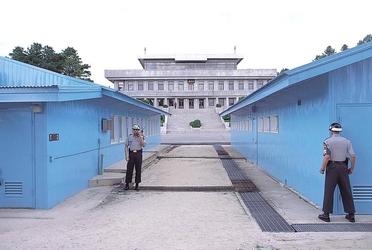
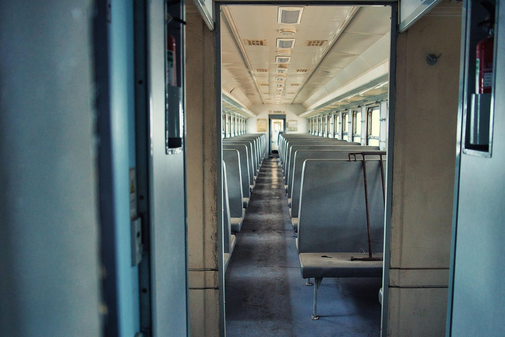

42년 전 오늘, 1984년 11월 15일. 분단 이후 처음으로 판문점에서 남북 경제회담이 열렸습니다. 끊어진 경의선 철길을 다시 잇고 물자를 나누자는 파격적인 제안이 오가며 한반도에 새로운 교류의 가능성이 피어올랐습니다.

## 판문점에 마주 앉은 남북 대표 14명

1984년 11월 15일 오전 10시, 판문점 중립국감독위원회 회의실에서 역사적인 첫 남북 경제회담이 시작되었습니다. 분단 이후 남과 북이 정치·군사적 대립을 떠나 순수 경제 협력과 물자 교역을 논의하기 위해 공식 회담을 연 것은 이때가 처음이었습니다. 우리 측에서는 김기환 해외협력위 기획단장을 수석대표로 한 7명의 대표가 참석했고, 북측에서는 리성록 무역부부장을 단장으로 한 7명의 대표가 마주 앉았습니다. 얼어붙은 냉전의 긴장 속에서도 양측 대표는 악수를 나누며 대화의 물꼬를 텄습니다.

## 쌍방이 동시에 꺼낸 "경의선 철도를 잇자"

이날 회담에서 가장 큰 주목을 받은 대목은 철도 연결 문제였습니다. 남북 양측은 기조발언을 통해 물자 교역 시 원활한 수송을 위해 현재 끊겨 있는 남북 간 철도, 즉 경의선을 다시 연결하자는 제안을 공통으로 내놓았습니다. 한국전쟁으로 문산과 개성 사이 선로가 끊긴 지 30여 년 만에 양측 당국자가 한자리에서 철도 복원에 합의한 셈이었습니다. 양측은 또한 회담 진행과 교역 업무를 뒷받침하기 위해 남북 간 전용 통신선을 설치하고, 남북경제협력위원회를 두자는 점에서도 의견 일치를 보았습니다.

*사건 당시 사진 아님 — 사진: 경기도 / KOGL Type 1 attribution*

## 우리 측의 10개항 제의와 구체적 교역 품목

우리 측 수석대표인 김기환 단장은 물자 교역에 대한 기본 구상을 담은 10개항을 제시했습니다. 무연탄, 철광석, 선철, 고철 등 광산물과 명태, 옥수수, 팥 같은 농수산물을 북측으로부터 사들이기를 희망한다고 밝혔습니다. 그 대신 우리 측이 생산하는 자동차, 컬러 텔레비전, 음향기기 등 전기·전자제품과 경운기, 재봉기 등 기계류, 섬유와 의약품 등을 북측에 공급할 수 있다고 설명했습니다. 아울러 남북 교역은 외국 간 무역이 아니므로 관세를 물리지 말 것과 판문점에 공동 화물 하역장을 설치하는 방안, 제3국 은행을 통한 결제 방식 등을 함께 제안했습니다.

*사건 당시 사진 아님 · 이미지 사진 — 사진: r-q / Pixabay Content License*

## 북측의 합작 구상과 항만 상호 이용 제안

북측 리성록 단장 역시 경제 합작과 자원 공동 개발에 관한 구상을 털어놓았습니다. 남북이 각자의 설비와 노력을 바탕으로 상대방 지역의 탄광 등 광산을 공동 개발하자고 제안하며, 북측은 철광석과 탄광을 제공하고 남측은 중석이나 몰리브덴 광산을 제공하는 방안을 예로 들었습니다. 어업 분야에서는 서해와 동해에 공동어로구역을 설정하고 '수산합영회사'를 설립해 함께 운영하자고 밝혔습니다. 물자 수송을 위해서는 철도 연결뿐 아니라 북측의 남포·원산항과 남측의 인천·포항항을 서로 개방해 이용하자고 덧붙였습니다.

![[1515호] 남북한 경제 회담 제 1차 남북한 경제 회담( 판문점 중립국 감시 위원회 회의실) (1984.11.16) 장면 2](../images/2026-11-15-02-4.jpg)
*[1515호] 남북한 경제 회담 제 1차 남북한 경제 회담( 판문점 중립국 감시 위원회 회의실) (1984.11.16) 장면 2 — 사진: KTV 국민방송 e영상역사관 (대한뉴스) / KTV 공공저작물 — 영상 저작물 전면 개방(대통령실 2025-07-09), 출처 표시*

## 2시간 40분의 첫걸음, 그리고 이어진 역사

비록 의제 명칭을 둘러싸고 우리 측의 '물자 교역과 경제 협력'과 북측의 '합작과 교류'라는 입장 차이가 있었지만, 회담은 전반적으로 진지하고 생산적인 분위기 속에서 2시간 40분 만에 마무리되었습니다. 양측은 12월 5일 같은 장소에서 2차 회담을 갖기로 합의하고 판문점을 떠났습니다. 1984년 이날 판문점에서 싹텄던 경의선 연결 구상은 훗날 2000년대 도라산역 신설과 문산-개성 간 철도 복원 공사, 그리고 2007년 시험 운행으로 구체화되며 남북 화해의 상징적인 이정표로 역사에 남았습니다.

### 참고 자료

- <https://newslibrary.naver.com/viewer/index.naver?articleId=1984111500329201005&editNo=2&printCount=1&publishDate=1984-11-15&officeId=00032&pageNo=1&printNo=12043&publishType=00020>
- <https://www.kogl.or.kr/recommend/recommendDivView.do?division=img&recommendIdx=37201>
- <https://pixabay.com/photos/old-train-train-nostalgia-china-8110662/>
- <https://www.ehistory.go.kr/view/movie?mediasrcgbn=KV&mediaid=11801&mediadtl=26387&mediagbn=DH#t=0.7>
