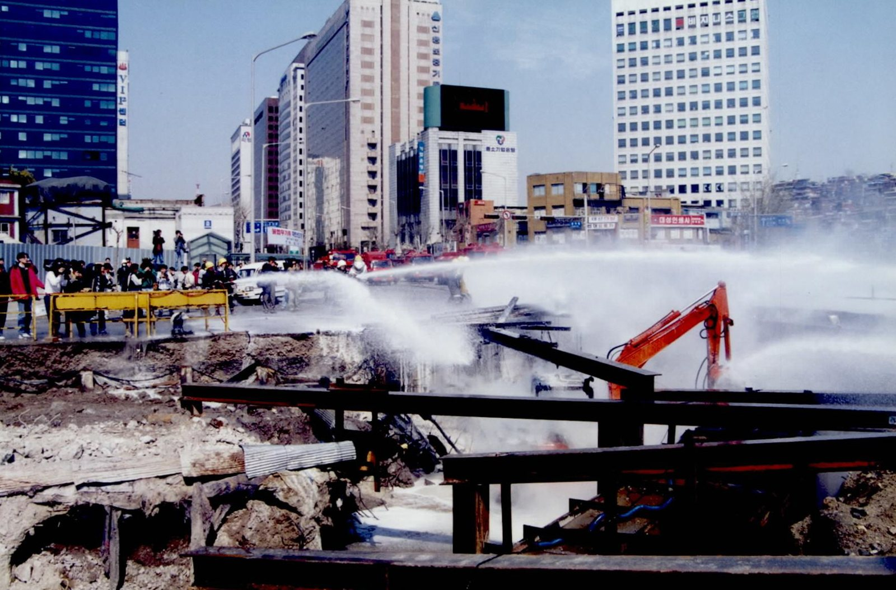
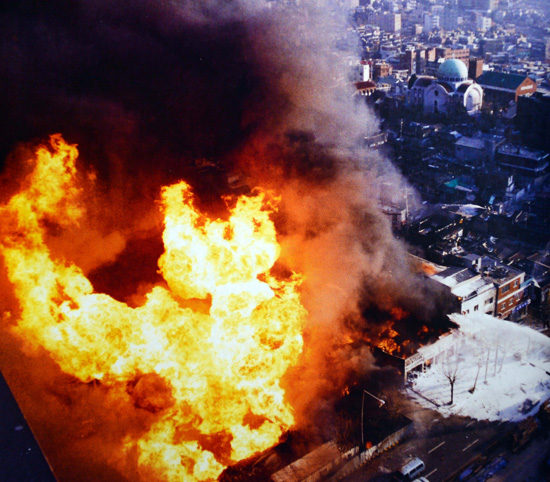

30년 전 오늘, 1996년 11월 15일 신문 1면은 강제구인된 최규하 전 대통령의 소식으로 뒤덮였습니다. 12·12 군사반란과 5·18 내란 사건의 진실을 규명하기 위해 열린 항소심 법정에 전직 국가수반이 강제로 불려 나오는 사상 초유의 일이 일어났습니다. 그러나 대법정에 들어선 최 전 대통령은 끝내 입을 열지 않았습니다.

## 서교동 자택에서 집행된 강제구인

1996년 11월 14일 아침, 서울 마포구 서교동 최규하 전 대통령 자택 주변에는 팽팽한 긴장감이 감돌았습니다. 서울지검 수사관 4명이 구인장을 들고 도착한 것은 오전 7시 40분경이었습니다. 측근들과 구인 절차를 논의한 검찰은 오전 9시경 자택 안으로 들어가 구인장을 집행했습니다.

짙은 회색 정장에 오른손에는 지팡이를 든 최 전 대통령은 비서관, 경호대장과 함께 개인 승용차에 올랐습니다. 경찰 순찰차와 검찰 차량의 호위를 받으며 서교동 자택을 출발한 차량은 서울 서초동 서울고등법원 청사로 곧장 향했습니다.

## 법정에 선 전직 대통령과 일시 퇴정

서울고등법원 417호 대법정에서는 형사1부 심리로 12·12 및 5·18 사건 항소심 11차 공판이 열렸습니다. 이날 재판에서는 피고인석에 있던 전두환, 노태우 두 전직 대통령이 잠시 법정 밖으로 퇴정하는 이례적인 장면이 펼쳐졌습니다.

변호인 측이 전직 대통령 3명이 한 법정에 동시에 서는 비극만은 피해 달라고 요청했고, 재판부가 이를 받아들였기 때문입니다. 피고인들이 퇴정한 뒤 굳은 표정의 최 전 대통령이 지팡이를 짚고 증인석으로 들어섰습니다.

*1996년 12월 7일 아현동 도시가스 폭발 사고 19941207000012 — 사진: 서울특별시 소방재난본부(Seoul Metropolitan Fire &amp; Disaster Headquar / CC BY-SA 4.0*

## "선서는 증언을 전제로 한다" 끝내 거부한 증언

증인석에 앉은 최 전 대통령은 이름과 주소를 묻는 재판부의 인정신문에는 순순히 답했습니다. 하지만 재판장이 증인선서를 요구하자 태도는 완전히 달라졌습니다. 최 전 대통령은 선서는 증언을 전제로 하는 것이라며 선서 자체를 완강히 거부했습니다.

최 전 대통령은 전직 대통령이 재임 중 국정행위에 대해 훗날 법정에서 일일이 증언한다면 국가경영상 문제를 낳고 후임 대통령들의 직무 수행에 큰 부담을 준다는 논리를 폈습니다. 재판부는 정당한 사유가 되지 않는다며 신문을 이어갔지만, 최 전 대통령은 검찰과 변호인의 질문에 일절 입을 다물었습니다. 신문은 시작된 지 40분 만인 오전 11시 49분경 허탈하게 끝났습니다.

*1996년 12월 7일 아현동 도시가스 폭발 사고 bbuheng201212032027100 — 사진: 서울특별시 소방재난본부(Seoul Metropolitan Fire &amp; Disaster Headquar / CC BY-SA 4.0*

## 전두환 사형·노태우 무기징역… 검찰의 엄중한 구형

최 전 대통령이 퇴정한 뒤 오후에 속개된 결심공판에서 검찰은 피고인 전원에게 추상같은 법의 심판을 내려달라며 중형을 요구했습니다. 검찰은 1심에서 사형을 선고받은 전두환 피고인에 대해 항소기각 의견을 내며 원심과 같은 사형을 재구형했습니다.

반란 및 내란 중요임무종사 혐의가 적용된 노태우 피고인에게는 1심 구형량과 같은 무기징역이 내려졌습니다. 황영시, 정호용 피고인에게도 무기징역이, 허화평, 허삼수, 이학봉 등 8명에게는 징역 15년이 구형되는 등 신군부 핵심 인사들에게 무거운 죗값이 청구되었습니다.

![[1564호] 제 40주년 경찰의 날 기념식 제 40주년 경찰의 날 기념식(세종문화회관) (1985.10.25) 장면 2](../images/2026-11-15-04-4.jpg)
*[1564호] 제 40주년 경찰의 날 기념식 제 40주년 경찰의 날 기념식(세종문화회관) (1985.10.25) 장면 2 — 사진: KTV 국민방송 e영상역사관 (대한뉴스) / KTV 공공저작물 — 영상 저작물 전면 개방(대통령실 2025-07-09), 출처 표시*

## 최후진술과 지금까지 남겨진 역사의 침묵

사형이 구형된 전두환 피고인은 최후진술에서 자신의 부덕으로 국민의 자긍심이 크게 훼손된 데 대해 죄송하다며 최고책임자로서 궁극적 책임은 지겠다고 밝혔습니다. 서울고법 형사1부는 항소심 선고공판을 다음 달인 12월 16일 열겠다고 예고했습니다.

12·12 군사반란 당시 계엄사령관 연행 재가 과정과 신군부 집권 과정의 전말을 밝혀줄 열쇠를 쥐고 있던 최 전 대통령. 법정에 강제로 끌려 나와서도 끝내 입을 열지 않았던 그의 침묵은, 오늘날까지도 현대사의 풀리지 않은 깊은 아쉬움으로 남아 있습니다.

### 참고 자료

- <https://newslibrary.naver.com/viewer/index.naver?articleId=1996111500289101002&editNo=5&printCount=1&publishDate=1996-11-15&officeId=00028&pageNo=1&printNo=2727&publishType=00010>
- <https://commons.wikimedia.org/wiki/File:1996%EB%85%84_12%EC%9B%94_7%EC%9D%BC_%EC%95%84%ED%98%84%EB%8F%99_%EB%8F%84%EC%8B%9C%EA%B0%80%EC%8A%A4_%ED%8F%AD%EB%B0%9C_%EC%82%AC%EA%B3%A0_19941207000009.jpg>
- <https://commons.wikimedia.org/wiki/File:1996%EB%85%84_12%EC%9B%94_7%EC%9D%BC_%EC%95%84%ED%98%84%EB%8F%99_%EB%8F%84%EC%8B%9C%EA%B0%80%EC%8A%A4_%ED%8F%AD%EB%B0%9C_%EC%82%AC%EA%B3%A0_19941207000012.jpg>
- <https://commons.wikimedia.org/wiki/File:1996%EB%85%84_12%EC%9B%94_7%EC%9D%BC_%EC%95%84%ED%98%84%EB%8F%99_%EB%8F%84%EC%8B%9C%EA%B0%80%EC%8A%A4_%ED%8F%AD%EB%B0%9C_%EC%82%AC%EA%B3%A0_bbuheng201212032027100.jpg>
- <https://www.ehistory.go.kr/view/movie?mediasrcgbn=KV&mediaid=10874&mediadtl=23526&mediagbn=DH#t=0.7>
