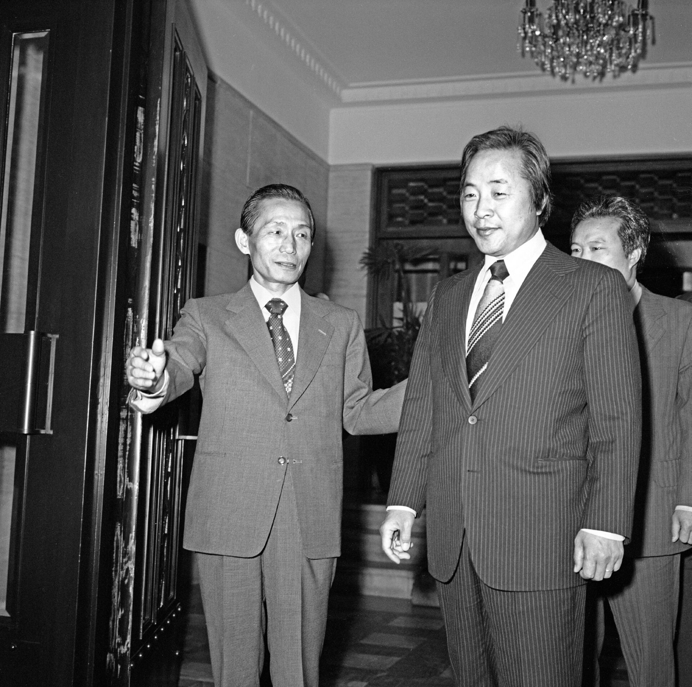
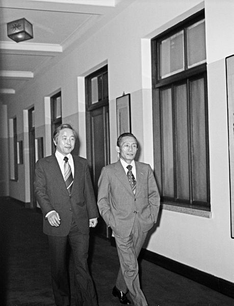
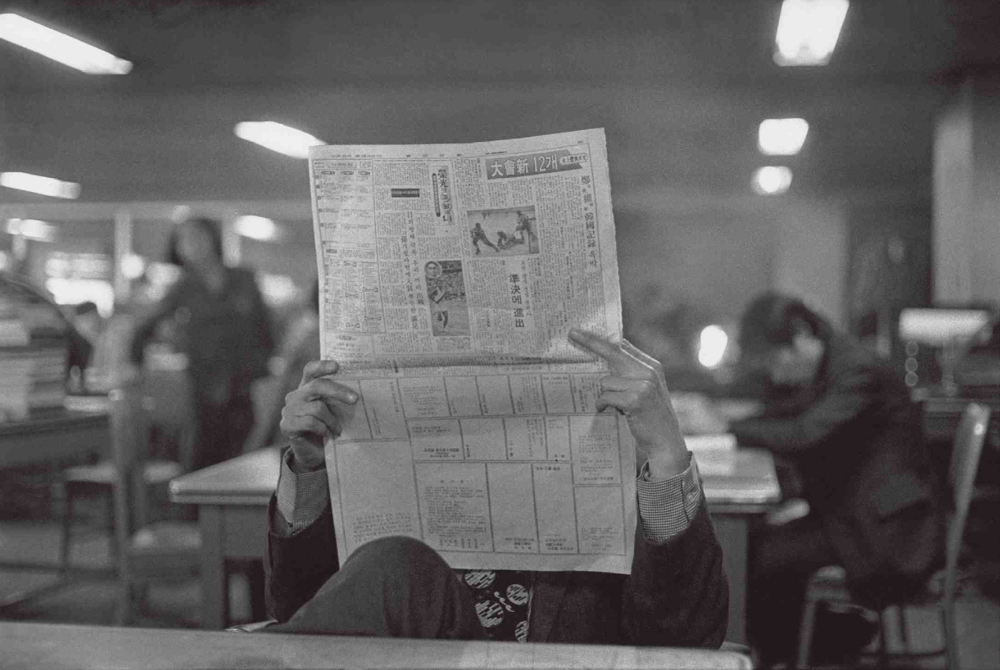

51년 전 오늘, 1975년 11월 15일. 정부는 수입 물자를 절약하고 근검절약 생활을 정착시키기 위한 강력한 '물자절약추진방안'을 마련해 발표했습니다. 제2무임소장관실에 추진본부를 설치하고 매달 박정희 대통령에게 점검 결과를 직접 보고하도록 한 고강도 조치였습니다.

## 제2무임소에 설치된 추진본부와 매달 10일의 점검

1975년 11월 14일 청와대 국무회의에서 최종 확정된 이 방안은 외화 유출을 막고 국가 경제를 안정시키기 위해 마련되었습니다. 석유, 석탄, 전력 등 핵심 에너지원은 물론 쌀, 설탕, 종이 펄프, 기계류 등 수입 의존도가 높은 소비재 전반이 감축 대상에 올랐습니다. 정부는 구태회 제2무임소장관을 본부장으로 하는 '물자절약추진본부'를 가동했습니다.

정부 각 부처에는 기획관리실장을 단장으로 하는 자체 추진단을 두어 상시 점검 체계를 갖추었습니다. 매달 10일은 '소비절약점검의 날'로 지정되었고, 12월은 '에너지소비절약의 달'로 선포되어 국가 전체가 절약 실적 관리에 돌입했습니다.

## 다방 설탕 8그램 의무화와 식탁 위의 혼식 장려

절약 운동은 국민들의 먹거리와 일상 공간 깊숙이 들어왔습니다. 당밀과 원당 수입을 억제하기 위해 제과 및 제빵 업체의 무분별한 증설을 막았고, 전국 다방에서 쓰이던 소포장 설탕을 기존 10그램에서 8그램으로 줄여 사용하도록 의무화했습니다. 커피와 코코아 원두의 수입 담보금 적립률도 함께 인상되었습니다.

주곡 절약도 강력하게 추진되었습니다. 막걸리(탁주)를 빚을 때 밀가루 소비를 줄이기 위해 원료의 40퍼센트를 옥수수가루(옥분)로 대체하도록 했습니다. 정부에서 방출하는 양곡은 전량 혼합곡으로 내보냈으며, 보리쌀과 밀가루 가격은 쌀값의 50퍼센트 수준으로 유지해 자연스럽게 혼분식을 유도했습니다.

*1975년 자료 — 사진: 대한민국 정부 / Public domain*

## 겨울방학 55일 연장과 밤거리 네온사인의 소등

난방과 전력 소비를 줄이기 위한 규제도 파격적이었습니다. 기름 절약을 위해 임시로 늘렸던 학생들의 방학 기간을 계속 유지하여 겨울방학은 55일, 여름방학은 27일로 길어졌습니다. 겨울철 학교 교실의 난방유 소비를 조금이라도 줄여보겠다는 고육지책이었습니다.

도심의 밤풍경도 바뀌었습니다. 병원과 약국, 단순 상호 표지를 제외한 사치성 광고용 네온사인은 신규 설치가 금지되고 기존 시설도 완전히 소등해야 했습니다. 백화점과 대형 상가의 전구 장식도 금지되었으며, 실내 수영장은 이듬해 5월 30일까지 영업이 금지되었습니다. 유흥접객업소의 영업시간 역시 겨울에는 밤 10시 반, 여름에는 밤 11시로 묶였고 한 달에 2회 이상 의무 휴일을 가져야 했습니다.

*1975년 자료 — 사진: 대한민국 정부 / Public domain*

## 실내온도 18도 이하와 고속도로 경제속도 운행

에너지 절약은 이동과 실내 생활에서도 엄격한 숫자로 관리되었습니다. 실내 온도는 겨울철 난방 시 18도 이하, 여름철 냉방 시 25도 이상으로 제한되었습니다. 체육시설의 야간 조명(나이터) 사용도 제한되어 테니스장은 전면 금지되었고 축구장과 야구장은 문교부 장관의 승인을 받은 대회나 국제 경기만 허가되었습니다.

교통 분야에서는 고속도로 경제속도 준수 지침이 내려졌습니다. 승용차는 시속 70킬로미터, 화물차는 시속 60킬로미터, 고속버스는 시속 100킬로미터로 제한 운행되었습니다. 버스 정류장 간격도 1,000미터에서 1,500미터로 넓게 재조정되었으며, 택시 부수제 실시와 함께 텔레비전 방송 시간도 줄여 전력 소비를 막았습니다.

*1975년 자료 — 사진: Photos taken by 전민조 and hosted by the National Museum of Kor / Public domain*

## 관공서부터 시작된 2킬로미터 걷기와 절약의 일상

정부와 공공기관 역시 솔선수범의 대상이었습니다. 공무원들의 관용 차량 사용과 전열기 사용이 엄격히 금지되었고, 시위나 선전용 아치와 현수막 제작도 억제되었습니다. 업무 중 불필요한 전화 사용을 금지하고 가까운 2킬로미터 거리는 걸어 다니는 운동까지 벌였습니다.

물자 하나, 기름 한 방울이 아쉬웠던 1970년대 중반, 온 국민은 다방의 8그램 설탕 봉지부터 55일간 이어진 긴 겨울방학까지 일상의 사소한 불편을 견뎌내며 시대를 건넜습니다. 허리띠를 바짝 졸라매던 그 시절의 풍경은 오늘날 우리 경제의 토대가 된 지나온 날의 자화상으로 남아 있습니다.

### 참고 자료

- <https://newslibrary.naver.com/viewer/index.naver?articleId=1975111500209201004&editNo=2&printCount=1&publishDate=1975-11-15&officeId=00020&pageNo=1&printNo=16653&publishType=00020>
- <https://commons.wikimedia.org/wiki/File:1975%EB%85%84_%EC%84%B1%EB%8F%84%EA%B5%90%ED%9A%8C_%EB%8C%80%ED%95%99%EB%B6%80_%ED%99%98%EC%86%A1%EC%98%88%EB%B0%B0(%EC%98%A5%EB%AA%A9%EC%82%AC%EB%8B%98_%EC%9C%A0%ED%95%99).jpg>
- <https://commons.wikimedia.org/wiki/File:%EB%B0%95%EC%A0%95%ED%9D%AC_%EB%8C%80%ED%86%B5%EB%A0%B9_%EA%B9%80%EC%98%81%EC%82%BC_%EC%8B%A0%EB%AF%BC%EB%8B%B9_%EC%B4%9D%EC%9E%AC_%EC%A0%91%EA%B2%AC.jpg>
- <https://commons.wikimedia.org/wiki/File:%EB%B0%95%EC%A0%95%ED%9D%AC_%EB%8C%80%ED%86%B5%EB%A0%B9_%EA%B9%80%EC%98%81%EC%82%BC_%EC%8B%A0%EB%AF%BC%EB%8B%B9_%EC%B4%9D%EC%9E%AC_%EC%A0%91%EA%B2%AC_02.jpg>
- <https://commons.wikimedia.org/wiki/File:Newspaper_with_blank_advertising_section_1975-01-23.png>
