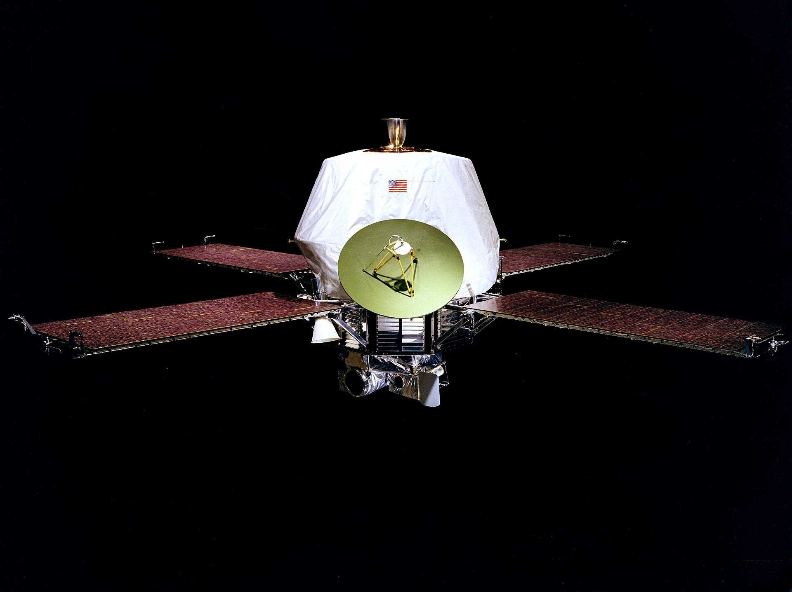
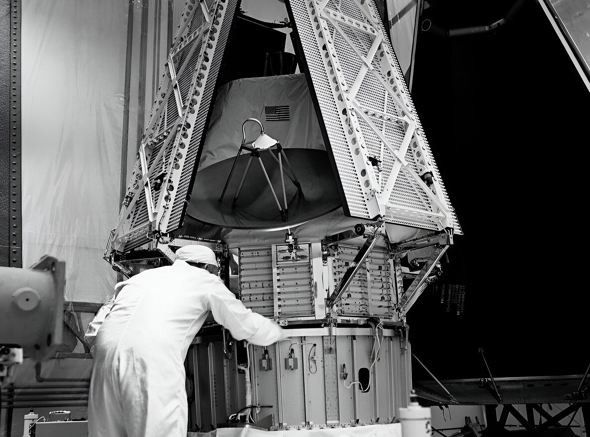
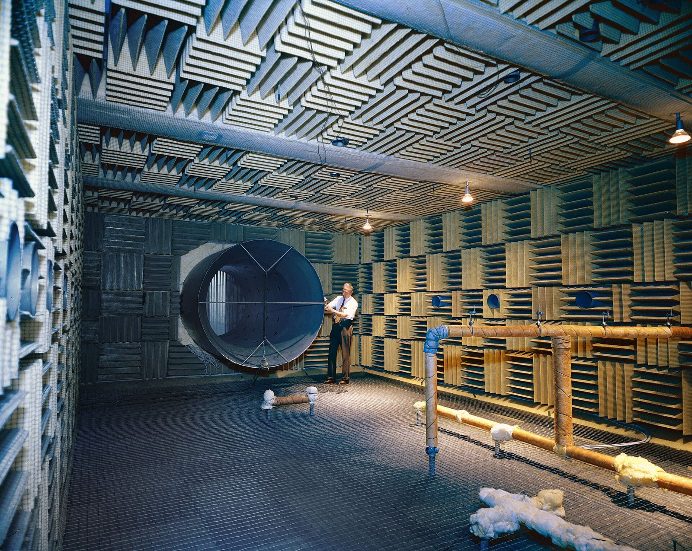

55년 전 1971년 11월 15일, 미국의 무인 우주 탐사선 마리너 9호가 인류 역사상 처음으로 화성 궤도에 안착했다는 소식이 전해졌습니다. 지구와 달 이외에 태양계의 다른 행성 주위를 도는 최초의 인공위성이 탄생한 순간이었습니다.

## 붉은 행성을 향한 인류의 오랜 도전

밤하늘에서 붉게 빛나는 화성은 인류 역사 속에서 늘 신비와 동경의 대상이었습니다. 망원경 너머로 바라보던 붉은 행성은 메마른 사막과 희박한 대기 속에 생명체가 존재할지도 모른다는 상상을 불러일으켰습니다. 1965년 마리너 4호가 화성을 스쳐 지나가며 사진을 찍었지만, 행성 전체를 관측하기에는 부족했습니다. 과학자들은 화성 둘레를 계속 돌며 조사할 진정한 인공위성을 원했습니다.

## 반년의 비행 끝에 이뤄낸 궤도 진입

미국의 무인 탐사선 마리너 9호는 약 반년에 걸친 우주 비행 끝에 화성에 다다랐습니다. 아득한 우주를 날아간 우주선이 화성의 중력에 안착하려면 정확한 감속이 필요했습니다. 마리너 9호는 로켓 엔진을 분사해 속도를 낮추며 타원형 궤도에 성공적으로 들어섰습니다. 이로써 인류는 지구와 달을 벗어나 태양계의 다른 행성을 도는 최초의 인공위성을 갖게 되었으며, 마리너 9호는 화성의 새로운 위성이 되었습니다.

*Mariner09 — 사진: NASA / Public domain*

## 먼지 폭풍 속에 전송된 첫 근접 사진

궤도에 안착한 마리너 9호는 곧바로 화성 남극 지대를 촬영해 지상으로 보냈습니다. 하지만 처음 도착한 사진들은 표면을 알아보기 어려울 만큼 매우 흐릿했습니다. 화성 전역을 뒤덮은 거대한 먼지 폭풍 때문이었습니다. 제트추진연구소의 대변인 앨버트 힙스 박사는 탐사선의 모든 장비가 정상 작동하고 있다고 발표했습니다. 인공위성이 궤도에 머물고 있었기에 먼지 폭풍이 가라앉기를 침착하게 기다릴 수 있었습니다.

*Mariner 9 undergoes final checks (cropped) — 사진: NASA Kennedy Space Center (NASA-KSC), image IDs: KSC-71P-036 / Public domain*

## 화성의 지도를 그리고 생명의 흔적을 찾다

마리너 9호의 임무는 매우 광범위했습니다. 탑재된 두 대의 텔레비전 카메라로 화성 표면을 샅샅이 촬영해 정밀한 지도를 작성하는 계획이 진행되었습니다. 아울러 자외선과 적외선 탐색 장비를 가동해 화성의 대기권과 표면 온도를 분석했습니다. 과학자들은 탐사선이 보내오는 자료를 통해 생명체 존재의 핵심 열쇠인 얼음이 존재하는지 면밀하게 추적했습니다.

*JPL aerodynamic noise facility 383-5765ac — 사진: NASA / Public domain*

## 거대한 화산과 협곡이 드러나다

행성을 뒤덮었던 거친 먼지가 점차 걷히자 놀라운 풍경이 눈앞에 나타났습니다. 거대한 화산인 올림푸스산의 웅장한 자태와 수천 킬로미터에 달하는 거대한 협곡 지대가 인류 앞에 모습을 드러냈습니다. 같은 해 소련의 탐사선 마스 2호와 마스 3호도 화성에 도달했지만, 궤도를 돌며 화성의 참모습을 밝혀낸 마리너 9호의 성과는 눈부셨습니다. 화성은 단순한 불모지가 아니라 역동적인 지형을 지닌 행성임이 확인되었습니다.

## 조간신문 속 우주 뉴스를 지켜보던 나날

1970년대 초, 신문 1면에 실린 화성 탐사 소식은 당시 시민들에게 깊은 인상을 남겼습니다. 신문과 방송을 통해 전해진 마리너 9호의 궤도 진입 뉴스는 우주를 향한 호기심을 한껏 끌어올렸습니다. 밤하늘에 붉게 떠 있는 작은 별 주위를 인간이 만든 우주선이 돌고 있다는 사실은 그 시절 많은 이들에게 꿈과 낭만을 안겨주었습니다.

## 지금도 붉은 행성을 향해 이어지는 발걸음

마리너 9호가 시작한 화성 궤도 탐사는 오늘날까지 활발하게 이어지고 있습니다. 1997년 이후 수많은 탐사선이 화성 궤도와 표면에서 활동하며 고대 물의 흔적과 신비를 밝혀내고 있습니다. 50여 년 전 붉은 행성의 궤도에 처음 안착했던 마리너 9호의 도전은 인류가 우주로 시야를 넓히는 데 결정적인 전환점이 되었습니다.

### 참고 자료

- <https://newslibrary.naver.com/viewer/index.naver?articleId=1971111500209201013&editNo=2&printCount=1&publishDate=1971-11-15&officeId=00020&pageNo=1&printNo=15419&publishType=00020>
- <https://commons.wikimedia.org/wiki/File:Mariner_9_undergoes_final_checks.jpg>
- <https://commons.wikimedia.org/wiki/File:Mariner09.jpg>
- <https://commons.wikimedia.org/wiki/File:Mariner_9_undergoes_final_checks_(cropped).jpg>
- <https://commons.wikimedia.org/wiki/File:JPL_aerodynamic_noise_facility_383-5765ac.jpg>
