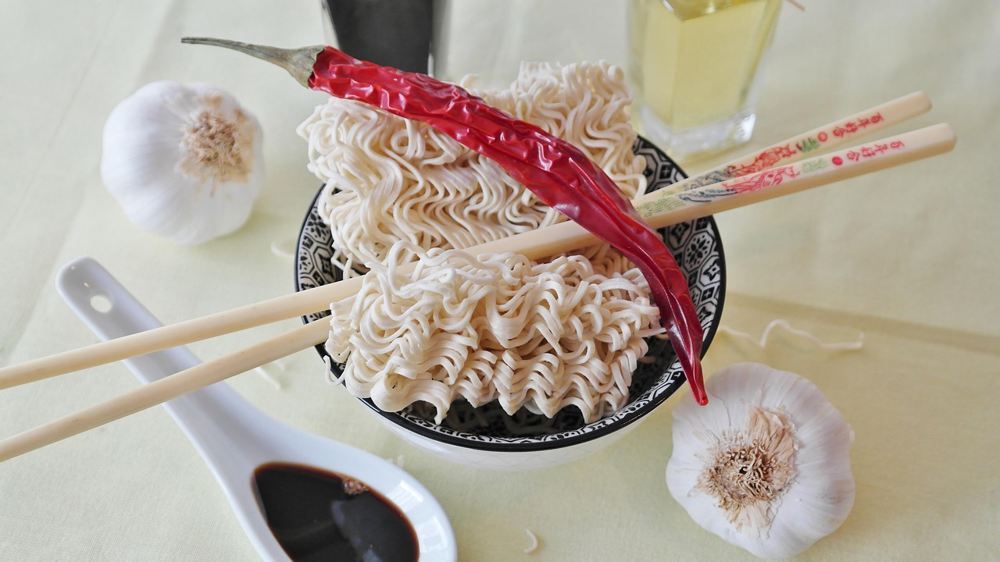
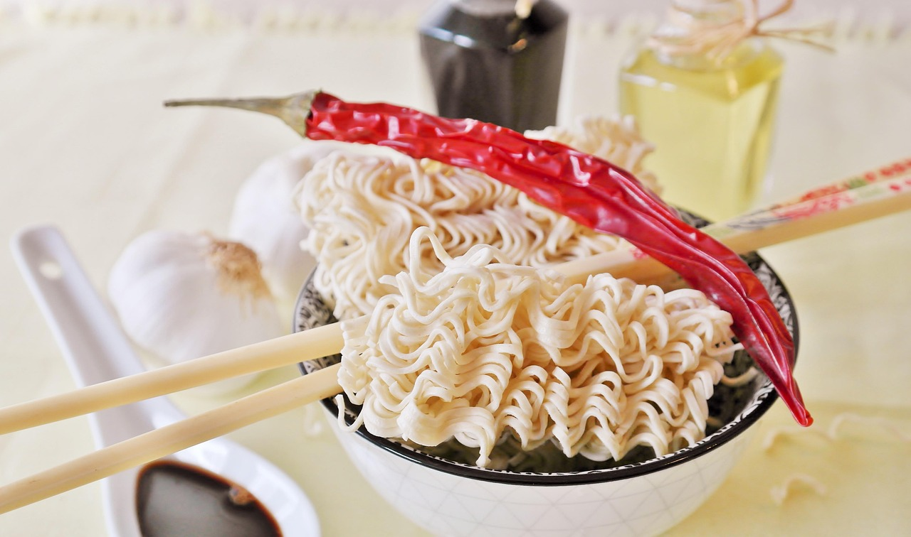

37년 전 오늘, 1989년 11월 16일. 전 국민의 주식이나 다름없던 라면을 둘러싸고 벌어진 '우지 파동'에 대해 주무 부처인 보건사회부가 마침내 입을 열었습니다. 보건사회부는 라면 완제품에서 중금속이나 비소 등 유해 물질이 검출되지 않아 인체에 무해하다고 공식 발표했습니다.

## 서민 음식 라면을 덮친 비식용 쇠기름의 충격

1980년대 후반 당시 라면 한 봉지의 가격은 100원이었습니다. 가벼운 주머니로도 한 끼를 든든하게 때울 수 있어 학생부터 직장인까지 모든 서민의 곁을 지키던 대표적인 생필품이었습니다. 하지만 라면을 튀기는 기름으로 미국산 비식용 우지가 수입되어 사용되었다는 사실이 검찰 수사로 드러나면서 사회는 거대한 분노에 휩싸였습니다. 서민들은 매일같이 먹던 음식에 공업용 기름이 들어갔다는 소식에 배신감을 감추지 못했고, 상점마다 라면 반품 사태가 잇따랐습니다.

## 1989년 11월 16일 보건사회부의 긴급 발표

사태가 걷잡을 수 없이 커지자 정부는 검찰과 학계, 소비자단체와 함께 식품위생검사소위원회를 구성했습니다. 소위원회는 지난 11월 10일 삼양식품의 삼양라면과 삼양육개장, 서울하인즈와 오뚜기식품의 마가린, 삼립유지와 부산유지의 쇼트닝 등 총 6개 품목을 수거해 국립보건원에 정밀 검사를 의뢰했습니다. 그리고 11월 16일 오전, 김종인 보건사회부 장관이 직접 검사 결과를 발표했습니다. 김 장관은 삼양라면 등 2개 라면 품목에서 비소나 중금속, 이물질이 전혀 검출되지 않았고 산가 역시 기준에 적합해 인체에 무해하다고 밝혔습니다.

*사건 당시 사진 아님 · 이미지 사진 — 사진: RitaE / Pixabay Content License*

## 드러난 규격 미달과 엇갈린 행정처분

라면 자체는 무해 판정을 받았지만, 함께 검사된 유지류 제품들에서는 규격 위반이 잇따라 적발되었습니다. 서울하인즈의 맥도날드쇼트닝은 산화방지제인 몰식자산프로필이 기준치인 킬로그램당 0.1그램의 3배에 달하는 0.3그램이나 검출되었습니다. 당국은 해당 제품에 대해 제조정지 1개월과 함께 기존 유통 제품을 수거해 폐기하도록 명령했습니다. 또한 삼양식품과 부산유지의 정제 우지는 요드가와 산가가 기준치를 초과해 1개월간 품목 제조정지 처분을 받았습니다. 서울하인즈와 삼립유지의 일부 마가린 역시 수분과 조지방 함량이 기준에 미달해 경고 처분을 받았습니다.

*사건 당시 사진 아님 · 이미지 사진 — 사진: RitaE / Pixabay Content License*

## 완제품 처리 지침 빠져 계속된 소비자의 혼란

정부의 '무해' 발표에도 불구하고 현장의 혼란은 가라앉지 않았습니다. 당국은 원료 우지의 정제 과정에 문제가 있어 제조정지 처분을 내리면서도, 이미 시중에 유통된 수많은 라면과 가공식품을 소비자가 먹어도 되는지 폐기해야 하는지 명확한 처리 방침을 밝히지 못했습니다. 원료의 비식용 등급 문제와 제품의 인체 무해성 사이에서 발생한 괴리는 국민들의 불안을 잠재우지 못했고, 식탁의 불안감은 여전히 이어졌습니다.

![[1604호] 자원의 재활용 1회 용품을 줄여 낭비방지 (1986.08.01) 장면 1](../images/2026-11-16-01-4.jpg)
*[1604호] 자원의 재활용 1회 용품을 줄여 낭비방지 (1986.08.01) 장면 1 — 사진: KTV 국민방송 e영상역사관 (대한뉴스) / KTV 공공저작물 — 영상 저작물 전면 개방(대통령실 2025-07-09), 출처 표시*

## 식품 안전 제도의 정비와 교훈

사태 수습을 위해 보건사회부는 향후 라면 등 모든 식품 제조에 식용으로 공식 분류된 우지만을 사용하도록 강제했습니다. 이미 수입된 비식용 원료와 정제 우지는 식품 이외의 산업적 용도로만 쓰이도록 제한했습니다. 아울러 현행 식품공전의 미비점을 전면 보완하고, 단속 인력과 검사 장비를 대폭 확충하겠다는 재발 방지책을 내놓았습니다. 1989년의 우지 파동은 값싸고 친숙했던 가공식품의 위생 기준을 근본적으로 되돌아보게 만든 뼈아픈 전환점이었습니다.

### 참고 자료

- <https://newslibrary.naver.com/viewer/index.naver?articleId=1989111600209201005&editNo=2&printCount=1&publishDate=1989-11-16&officeId=00020&pageNo=1&printNo=20962&publishType=00020>
- <https://pixabay.com/photos/food-ramen-noodles-cooking-japan-1216048/>
- <https://pixabay.com/photos/noodles-instant-noodles-instant-3201642/>
- <https://pixabay.com/photos/noodles-instant-noodles-instant-3201672/>
- <https://www.ehistory.go.kr/view/movie?mediasrcgbn=KV&mediaid=11053&mediadtl=24414&mediagbn=DH#t=0.3>
