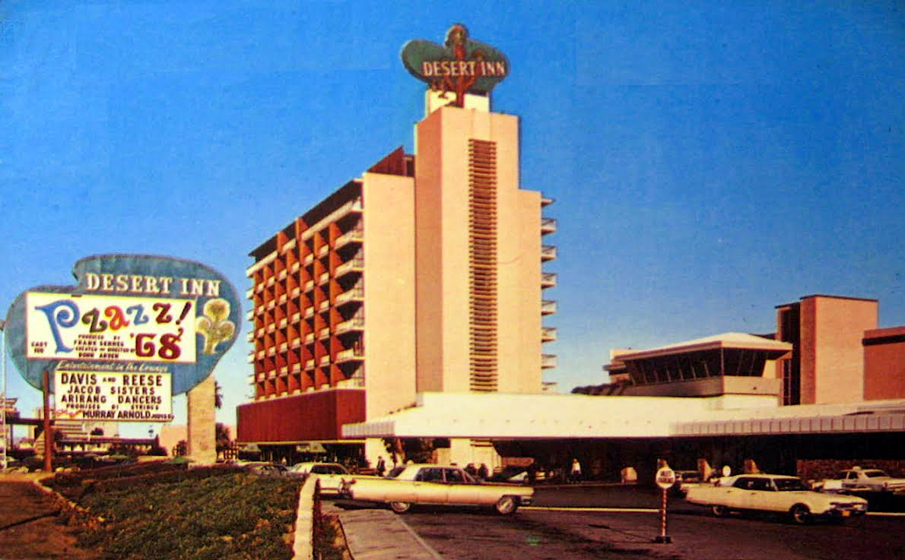
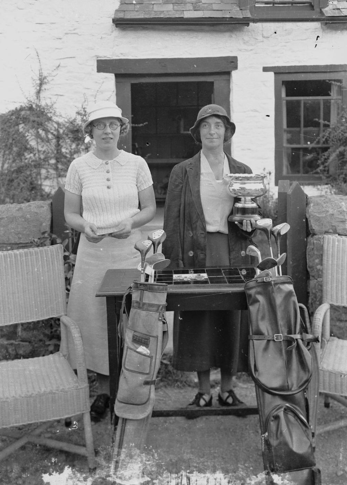

27년 전 오늘, 1999년 11월 16일. 스물두 살의 박세리 선수가 미국 여자프로골프(LPGA) 투어 시즌 최종전인 페이지넷 투어 챔피언십에서 우승컵을 들어 올렸습니다. 데뷔 첫해였던 1998년에 이어 2년 연속 4승을 달성하며 20세기 미국 정규 투어의 대미를 화려하게 장식한 순간이었습니다.

## IMF 외환위기 속에서 피어난 희망의 아이콘

1990년대 말 한국 사회는 국제통화기금(IMF) 구제금융 사태로 큰 혼란과 실의에 빠져 있었습니다. 공장 문이 닫히고 평생직장을 잃은 서민들이 한숨을 내쉬던 때였습니다. 바로 그 암흑 같은 시기에 바다 건너 미국에서 날아온 박세리의 승전보는 온 국민을 위로하는 최고의 치료제였습니다.

박세리는 1998년 LPGA 무대에 뛰어들자마자 메이저 대회인 맥도날드 챔피언십과 U.S. 여자 오픈을 연거푸 제패하며 신인상을 거머쥐었습니다. 특히 U.S. 여자 오픈 연장전에서 물에 빠진 공을 치기 위해 양말을 벗고 들어갔던 하얀 발목의 투혼은 국민들에게 '우리도 다시 일어설 수 있다'는 묵직한 울림을 안겨주었습니다.

## 1999년 시즌, 연이은 승전보와 마지막 무대

이듬해인 1999년에도 박세리의 질주는 멈추지 않았습니다. 숍라이트 클래식을 시작으로 제이미 파 크로거 클래식, 삼성 월드 챔피언십을 잇달아 제패하며 정규 투어 3승을 쌓았습니다. 당시 한국 팬들은 주말마다 텔레비전 앞에 모여 박세리의 시원한 장타와 정확한 아이언 샷을 지켜보며 응원을 보냈습니다.

그리고 1999년 11월, 20세기를 마감하는 LPGA 마지막 정규 투어 대회인 '99 페이지넷 투어 챔피언십'이 미국 네바다주 라스베이거스의 데저트인 골프클럽(파72)에서 열렸습니다. 총상금 100만 달러가 걸린 왕중왕전 성격의 대회로, 당대 세계 최고의 여성 골퍼들이 총출동한 자리였습니다.

*1970 Desert Inn — 사진: Las Vegas News Agency, Las Vegas / Public domain*

## 세계적인 거물들과 벌인 피 말리는 3파전

대회 마지막 날인 11월 15일, 박세리는 침착하게 타수를 줄여갔습니다. 최종 4라운드에서 2언더파 70타를 기록한 박세리는 최종 합계 12언더파 276타를 적어냈습니다. 그러나 우승으로 가는 길은 결코 순탄하지 않았습니다.

호주의 강호 캐리 웹, 영국의 베테랑 로라 데이비스 역시 박세리와 같은 12언더파로 경기를 끝내며 승부는 세 사람의 서든데스 연장전으로 이어졌습니다. 당시 세계 여자 골프계를 주름잡던 최고의 실력자들이 20세기 마지막 여왕 자리를 두고 단판 승부를 펼치게 된 것입니다.

*The Desert Inn Vegas 1968 — 사진: Piasticchrome, Boston, MA-photo by Las Vegas News Agency, La / Public domain*

## 1.5미터 버디 퍼팅으로 장식한 연장 불패

피를 말리는 긴장감이 감돌던 연장 첫 홀. 티샷과 어프로치에 이어 승부수를 띄운 박세리에게 찾아온 거리는 홀컵까지 약 1.5미터였습니다. 침착하게 라인을 살핀 박세리는 흔들림 없는 스트로크로 버디 퍼팅을 그대로 홀컵에 집어넣었습니다.

파에 그친 캐리 웹과 로라 데이비스를 단숨에 제치고 두 팔을 번쩍 치켜든 감격의 순간이었습니다. 이번 대회 우승으로 박세리는 우승 상금 21만 5000달러를 추가하며 시즌 상금 95만 6926달러로 상금 랭킹 3위에 올랐습니다. 또한 정규 투어 통산 8승째를 따내며 '연장전 승부사'로서의 명성을 다시금 입증했습니다.

*Two ladies with golf clubs, one holding a trophy, Builth Wells Golf Club (1293629) — 사진: Percy Benzie Abery / CC0*

## '세리 키즈'로 이어진 한국 골프의 새로운 역사

이날 같은 대회에 출전한 신인 김미현 선수도 최종 라운드에서 4언더파를 치며 공동 10위에 올라 한국 여자 골프의 저력을 함께 보여주었습니다. 박세리가 닦아놓은 길 위에서 대한민국 여자 골프는 눈부신 황금기를 맞이하게 됩니다.

박세리의 투혼을 텔레비전으로 보며 골프채를 잡았던 박인비, 최나연 등 이른바 '박세리 키즈'들이 훗날 세계 무대를 휩쓸었습니다. 20세기 끝자락에서 라스베이거스의 그린을 지배했던 박세리의 1.5미터 퍼팅은 대한민국 스포츠 역사의 방향을 완전히 바꾸어 놓은 명장면으로 오늘날까지 기억되고 있습니다.

### 참고 자료

- <https://newslibrary.naver.com/viewer/index.naver?articleId=1999111600329101009&editNo=40&printCount=1&publishDate=1999-11-16&officeId=00032&pageNo=1&printNo=16906&publishType=00010>
- <https://www.kogl.or.kr/recommend/recommendDivView.do?division=img&recommendIdx=32652>
- <https://commons.wikimedia.org/wiki/File:1970_Desert_Inn.jpg>
- <https://commons.wikimedia.org/wiki/File:The_Desert_Inn_Vegas_1968.jpg>
- <https://commons.wikimedia.org/wiki/File:Two_ladies_with_golf_clubs,_one_holding_a_trophy,_Builth_Wells_Golf_Club_(1293629).jpg>
