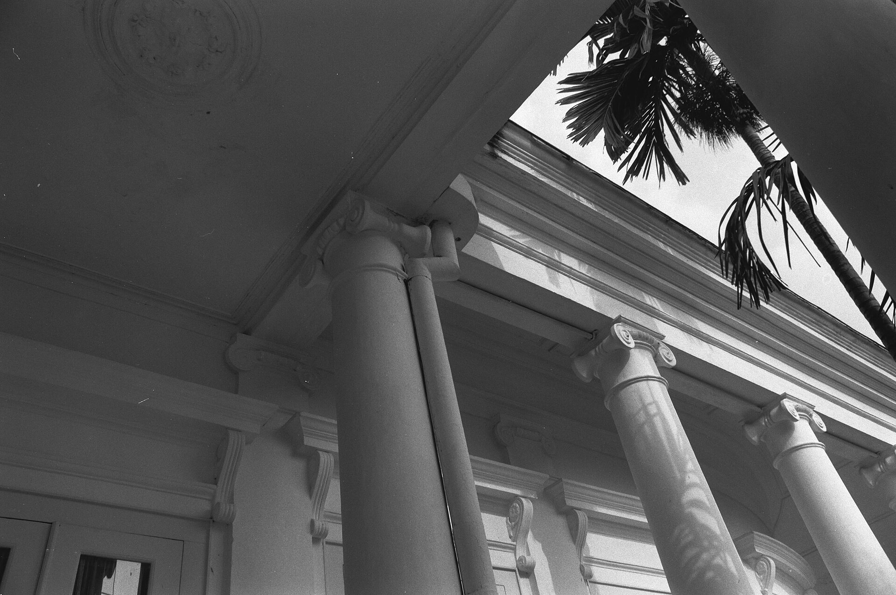
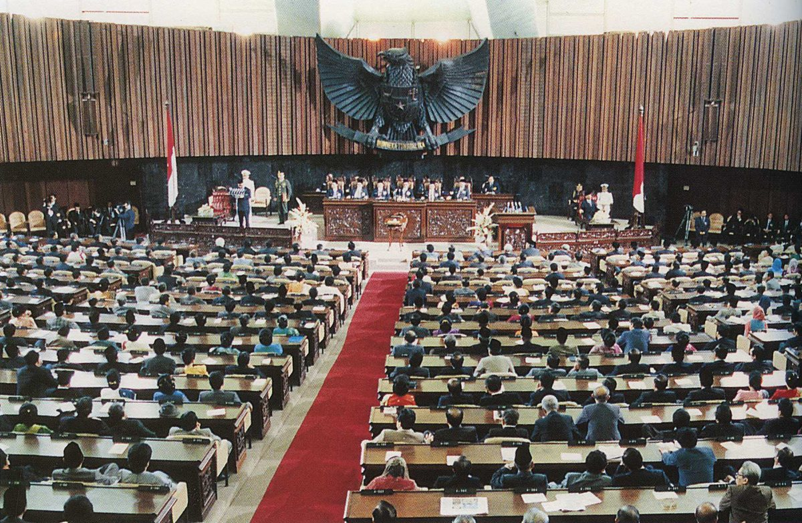

32년 전 오늘, 1994년 11월 16일. 아시아태평양경제협력체(APEC) 18개국 정상이 참여한 인도네시아 보고르 정상회의에서 역내 무역과 투자의 완전한 자유화를 약속한 ‘보고르 선언’이 채택되었습니다. 세계 경제 질서가 급변하던 1990년대 중반, 태평양을 둘러싼 거대 경제권이 하나의 교역 그룹을 지향하겠다고 천명한 순간이었습니다.

## 세계무역기구 출범 앞두고 세운 원대한 이정표

1994년 당시 국제 경제는 우루과이 라운드 타결에 이어 1995년 세계무역기구(WTO) 출범을 앞두고 커다란 전환점에 서 있었습니다. 관세와 비관세 장벽을 걷어내고 국경 없는 자유무역 체제를 구축하려는 움직임이 세계 곳곳에서 숨 가쁘게 진행되었습니다.

이러한 흐름 속에서 1989년 출범한 아시아태평양경제협력체는 역내 경제 통합을 한 단계 끌어올릴 실질적인 로드맵을 필요로 했습니다. 회원국 사이의 현격한 경제 격차를 조율하면서도 공동의 번영을 도모할 수 있는 구체적인 목표 연도가 필요하다는 공감대가 형성되었습니다.

## 선진국 2010년, 개발도상국 2020년 2단계 자유화

1994년 11월 15일 채택되어 이튿날 대대적으로 보도된 보고르 선언의 핵심은 '2단계 무역 자유화'였습니다. 경제 발전 수준이 높은 선진산업국은 2010년까지, 상대적으로 시간이 더 필요한 개발도상국은 2020년까지 완전한 무역 자유화를 달성하기로 시한을 정했습니다.

이 선언은 법적인 강제 구속력을 갖지는 않았지만, 각국 정상이 자발적으로 정치적 의지를 표명했다는 점에서 국제 사회에 매우 강력한 신호를 보냈습니다. 또한 아펙은 폐쇄적인 블록을 만드는 대신 역외 국가에 대해서도 새로운 보호장벽을 세우지 않는 ‘개방적 지역주의’를 원칙으로 내세웠습니다.

*1993년 자료 — 사진: Ziegler175 / CC BY-SA 4.0*

## 보고르궁 정원에 펼쳐진 이색적인 ‘바틱 셔츠’ 외교

이번 정상회의는 회담 내용뿐 아니라 정상들의 복장으로도 세계인의 이목을 집중시켰습니다. 인도네시아 자카르타 근교의 유서 깊은 휴양지 보고르궁에서 열린 회의에서 각국 지도자들은 인도네시아 전통의상인 바틱 셔츠를 맞춰 입고 기념사진을 촬영했습니다.

김영삼 대통령을 비롯해 빌 클린턴 미국 대통령, 장쩌민 중국 국가주석, 무라야마 도미이치 일본 총리, 마하티르 모하마드 말레이시아 총리 등이 화려한 문양의 셔츠를 입고 정원에 나란히 선 모습은 기존의 딱딱한 정상회담 분위기를 완전히 바꾸어 놓았습니다. 개최국의 전통문화를 존중하며 친근함을 다진 이 풍경은 이후 아펙 정상회의의 상징적인 전통으로 자리 잡게 되었습니다.

*사건 당시 사진 아님 · 1989년 — 사진: Wieringa, P.C. / CC BY-SA 4.0*

## 한국의 외교적 성과와 정보통신 구상 제안

회의에 참석한 김영삼 대통령은 아펙이 세계 무역 자유화를 선도해야 한다고 역설하며 무역과 투자에 걸림돌이 되는 각종 규제와 장벽을 제거하는 일이 가장 시급하다고 강조했습니다. 아울러 회원국 간 발전 격차를 감안해 유연하게 실천하되 선진국이 목표를 앞당겨야 한다고 제의했습니다.

특히 김 대통령은 아시아태평양 정보통신기반구조(APII) 구상을 제창하며, 역내 정보통신망 확충과 협력을 논의하기 위한 통신·정보산업장관회의 개최를 제안했습니다. 정상들은 이를 전격 수용해 이듬해인 1995년 한국에서 해당 장관회의를 개최하기로 합의하는 실질적인 외교 성과를 거두었습니다.

*사건 당시 사진 아님 · 1993년 — 사진: State Secretariat of the Republic of Indonesia / Public domain*

## 글로벌 개방 시대를 이끈 약속의 무게

보고르 선언은 이후 수십 년 동안 아시아 태평양 지역의 통상 협력과 관세 인하, 투자 환경 개선을 견인한 나침반 역할을 했습니다. 비록 각국의 경제적 이해관계와 국제 정세의 부침으로 완전한 무관세화에 도달하는 길은 험난했지만, 개방과 연대를 통해 번영을 일구겠다는 당시의 약속은 큰 발자취를 남겼습니다.

텔레비전 화면을 통해 형형색색의 전통 셔츠를 입은 세계 정상들의 모습을 지켜보며 우리 경제의 개방과 세계화를 실감했던 1994년의 그날. 역사의 한 페이지를 장식한 보고르 선언은 오늘날에도 거대한 무역 질서의 전환점으로 기억되고 있습니다.

### 참고 자료

- <https://newslibrary.naver.com/viewer/index.naver?articleId=1994111600209101001&editNo=45&printCount=1&publishDate=1994-11-16&officeId=00020&pageNo=1&printNo=22686&publishType=00010>
- <https://commons.wikimedia.org/wiki/File:RIBogorSeerose.jpg>
- <https://commons.wikimedia.org/wiki/File:RIBogorVictoriaRegia.jpg>
- <https://commons.wikimedia.org/wiki/File:Interieur_paleis,_voormalig_Buitenzorg,_binnenhoek,_vertrek_1.15_richting_1.06_-_20650977_-_RCE.jpg>
- <https://commons.wikimedia.org/wiki/File:1993_People%27s_Consultative_Assembly.jpg>
