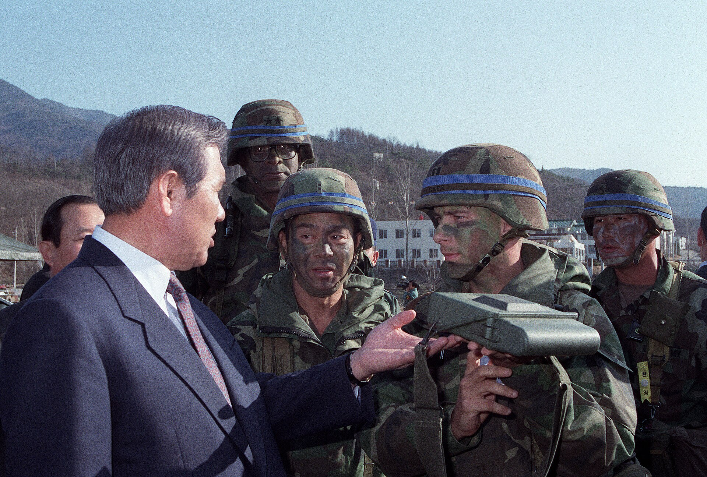
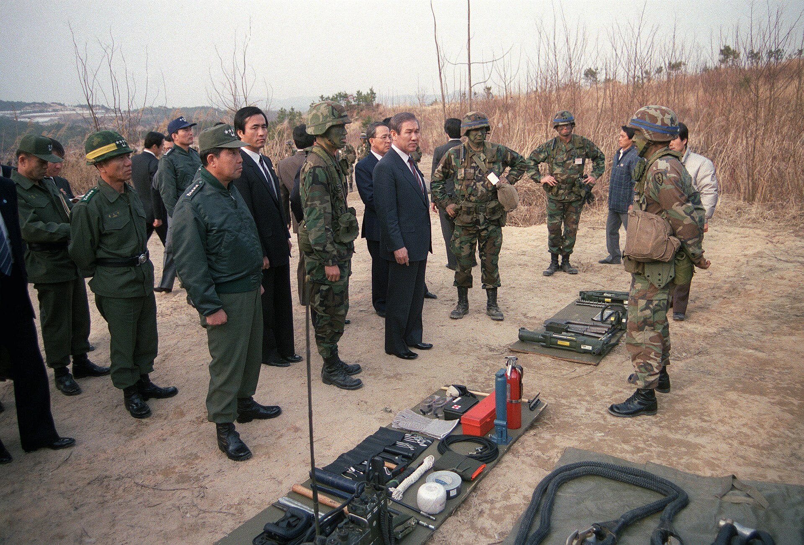
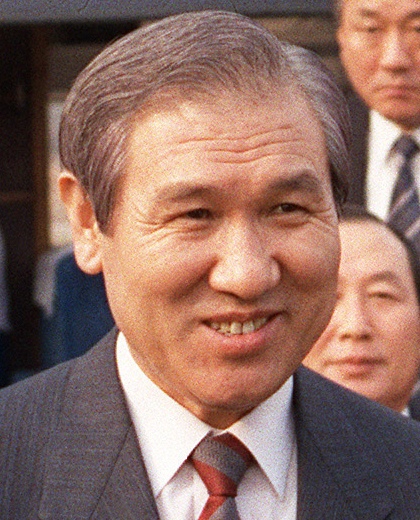

35년 전 오늘, 1991년 11월 16일. 국세청이 현대그룹 정주영 명예회장 일가와 계열사에 단일 세무조사 사상 최대 규모인 1천3백61억 원의 세금 고지서를 일제히 발송했습니다. 당시 기준으로 천문학적인 액수의 세금 폭탄이 떨어지자 현대그룹은 납세를 거부하고 법정 투쟁을 선언하며 정면 충돌에 나섰습니다.

## 단일 세무조사 사상 최대, 1천3백61억 원의 충격

1991년 11월 국세청이 확정한 현대그룹 추징세액은 1천3백61억 원에 달했습니다. 세부 내역을 보면 소득세 6백70억 원, 법인세 6백31억 원, 증여세 60억 원이었습니다. 1990년 짜장면 한 그릇이 1000원, 시내버스 요금이 140원 안팎이던 물가를 고려하면 실로 상상을 초월하는 천문학적인 규모였습니다.

현대그룹은 당초 세무조사 결과 추징세액이 8백억 원 선에 이를 것으로 추정하고 있었습니다. 그러나 국세청의 최종 고지 금액이 예상을 훌쩍 뛰어넘는 1천3백억 원대로 확정되자 현대 수뇌부는 엄청난 충격과 함께 강경 대응으로 방향을 틀었습니다.

## 세무서의 일제 직접 송달과 현대의 납세 거부

국세청은 1991년 11월 16일 주소지 관할 세무서별로 정주영 명예회장 일가와 각 계열사에 고지서를 직접 송달했습니다. 국세청 기준에 따르면 법인세 6백31억 원과 증여세 60억 원은 11월 말까지, 소득세 6백70억 원은 원천징수의무가 있는 법인이 원천징수해 12월 10일까지 자진 납부해야 하는 일정이었습니다.

하지만 현대그룹은 고지서를 전달받자마자 원칙적인 납세 거부 방침을 세웠습니다. 현대 관계자들은 세금을 전액 또는 일부라도 미리 내고 다투는 방안을 검토했으나, 그렇게 하면 국세청의 부당한 추징 내역을 스스로 인정하는 꼴이 된다고 판단했습니다. 재산 압류 처분을 당하는 한이 있더라도 순순히 응하지 않겠다는 배수진이었습니다.

*사건 당시 사진 아님 · 1990년 — 사진: CHERIE A. THURLBY / Public domain*

## 감사원 심사청구에서 서울고등법원까지

현대그룹은 세금을 내는 대신 공식적인 불복 절차를 밟기로 결정했습니다. 납세 고지서를 받은 날부터 법정 시한인 60일 이내, 즉 1992년 1월 15일까지 감사원에 과세 불복에 대한 심사를 청구하기로 했습니다.

통상적인 국세청 심사 청구와 국세심판소 절차를 건너뛰고 곧바로 감사원 심사를 청구한 뒤, 주장이 받아들여지지 않을 경우 서울고등법원에 국세청장을 상대로 행정소송을 제기하겠다는 정면 승부 수순이었습니다. 이는 행정부의 과세 처분에 사법부의 판단으로 맞서겠다는 초강수였습니다.

*사건 당시 사진 아님 · 1989년 — 사진: Al Chang / Public domain*

## 실세금리 20% 시대, 체납이 낫다는 셈법

현대가 납세를 거부할 수 있었던 배경에는 당시의 독특한 금융 환경도 작용했습니다. 세금을 납기 내에 내지 않으면 7일 이내에 5%의 가산금이 붙고, 이후 매월 2%씩 중가산금이 추가되지만 둘을 합쳐도 최고 한도는 25%로 제한되어 있었습니다.

당시 시중 실세금리는 연 20%를 훨씬 웃돌고 있었습니다. 재계에서는 막대한 현금을 세금으로 묶어두느니 최고 25%의 가산금을 물더라도 자금을 굴리며 버티는 편이 경제적으로도 덜 불리하다고 판단했을 것이라는 분석이 나왔습니다.

*사건 당시 사진 아님 · 1989년 — 사진: CHERIE A. THURLBY / Public domain*

## 현대건설만 예외, 현실적 타협과 정면충돌

전면적인 납세 거부를 선언하면서도 현대는 현실적인 계산을 완전히 놓지는 않았습니다. 국세를 체납할 경우 정부 관급 공사 입찰 참가 등에 치명적인 제약을 받게 되는 현대건설 등 극히 일부 과세분에 대해서만 세금을 내고, 나머지 대부분에 대해서는 강력한 법정 투쟁을 병행하는 투트랙 전략을 택했습니다.

재계 1위 현대그룹과 과세 당국인 국세청이 물러설 수 없는 외나무다리에서 맞붙었던 이 사건은 기업의 승계와 조세 정의, 정경 관계를 둘러싸고 한국 사회 전체에 커다란 화두를 던진 역사적 분기점이었습니다.

### 참고 자료

- <https://newslibrary.naver.com/viewer/index.naver?articleId=1991111600329101001&editNo=15&printCount=1&publishDate=1991-11-16&officeId=00032&pageNo=1&printNo=14230&publishType=00010>
- <https://commons.wikimedia.org/wiki/File:President_George_H._W._Bush_and_First_Lady_Barbara_Bush_with_Korean_President_Roh_Tae-woo_and_Kim_Ok-suk.jpg>
- <https://commons.wikimedia.org/wiki/File:Roh_Tae-woo_-_cropped,_1990-Mar-13.jpg>
- <https://commons.wikimedia.org/wiki/File:Roh_Tae-woo_-_cropped,_1989-Mar-13_05.jpg>
- <https://commons.wikimedia.org/wiki/File:Roh_Tae-woo_1989-03-13.jpg>
