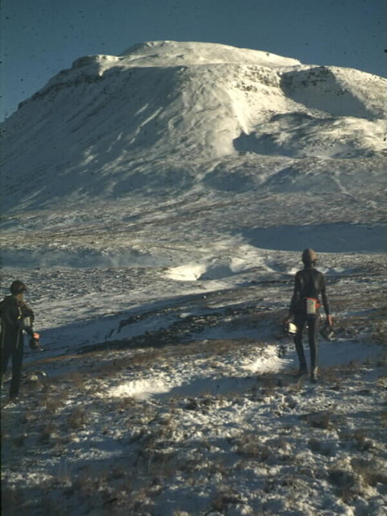

49년 전 오늘인 1977년 11월 16일 새벽, 강원도 삼척군 장성읍 대한석탄공사 장성광업소 지하 갱도에서 불길이 치솟았습니다. 칠흑 같은 지하 막장에서 석탄을 캐던 광부 수백 명이 일순간 짙은 연기 속에 갇히며 온 나라가 가슴을 졸였습니다.

## 새벽 2시 45분, 수직갱 변압기에서 시작된 불길

사고는 1977년 11월 16일 새벽 2시 45분경에 일어났습니다. 불이 시작된 곳은 지하 갱도 안에서 엘리베이터 구실을 하던 수직갱에서 약 40미터 떨어진 동력 변압기였습니다. 변압기에서 일어난 누전 스파크가 순식간에 불길로 번졌고, 불길과 함께 뿜어져 나온 맹독성 유독가스와 짙은 연기가 수직갱과 연결된 여러 갱도로 걷잡을 수 없이 퍼져나갔습니다. 새벽 시간 지하 깊은 곳에서 석탄 채굴에 매진하던 광부들은 눈앞을 가리는 검은 연기와 숨 막히는 공기 속에서 필사의 탈출로를 찾아야 했습니다.

## 2킬로미터 경사 갱도로의 필사적인 탈출

화재가 발생하자 수직갱을 통한 통로가 막히면서 광부들은 연기를 피해 다른 연결 갱도를 향해 달렸습니다. 다행히 오전 9시 30분경까지 상당수 작업원은 화재 현장에서 약 2킬로미터가량 떨어진 경사진 갱도를 통해 지상으로 빠져나올 수 있었습니다. 하지만 모든 이들이 무사히 빠져나온 것은 아니었습니다. 지하 가장 낮은 바닥 막장에서 작업 중이던 작업원 130여 명은 미처 빠져나오지 못해 극심한 고통을 겪었으며, 자욱한 가스를 마시고 실신하는 소동이 빚어지기도 했습니다.

*Walking to Tatham Wife Hole - geograph.org.uk - 1193760 — 사진: Andy Waddington / CC BY-SA 2.0*

## 지하 깊은 막장에 고립된 46명의 광부

상당수의 광부가 간신히 탈출에 성공했지만, 가장 깊은 막장에서 작업하던 광부 46명은 끝내 지상으로 올라오지 못했습니다. 화재가 발생한 지점에서 아래쪽에 위치해 있던 이들은 위쪽 갱도를 가득 메운 열기와 연기 때문에 탈출로가 완전히 차단된 상태였습니다. 당일 오후 2시가 넘도록 지하 막장에 고립된 46명의 생사는 확인되지 않았고, 지상에서 애타게 소식을 기다리던 가족들과 동료 광부들은 발을 구르며 눈물을 삼켜야 했습니다.

![[1009호] 김종필 총리 동정 김종필 총리 동정 (1974.11.16) 장면 1](../images/2026-11-16-07-3.jpg)
*[1009호] 김종필 총리 동정 김종필 총리 동정 (1974.11.16) 장면 1 — 사진: KTV 국민방송 e영상역사관 (미공개 대한뉴스) / KTV 공공저작물 — 영상 저작물 전면 개방(대통령실 2025-07-09), 출처 표시*

## 산소마스크 쓴 구조대 투입과 강력 콤프레서 공기 주입

장성광업소 측은 고립된 광부들을 구하기 위해 산소마스크를 착용한 30명의 정예 구조대원을 지하로 긴급 투입했습니다. 구조대원들은 갇힌 광부들에게 전달할 비상용 산소마스크까지 휴대하고 갱도로 진입했습니다. 그러나 갱내에 남아 있는 화재 열기와 앞을 분간할 수 없을 정도로 꽉 찬 연기 때문에 구조 작업은 큰 난관에 부딪혔습니다. 이에 광업소 측은 고립된 46명의 질식을 막기 위해 강력한 대형 콤프레서를 동원하여 지하 깊은 막장까지 신선한 외부 공기를 지속적으로 불어넣는 긴급 조치를 취했습니다.

![[1009호] 김종필 총리 동정 김종필 총리 동정 (1974.11.16) 장면 2](../images/2026-11-16-07-4.jpg)
*[1009호] 김종필 총리 동정 김종필 총리 동정 (1974.11.16) 장면 2 — 사진: KTV 국민방송 e영상역사관 (미공개 대한뉴스) / KTV 공공저작물 — 영상 저작물 전면 개방(대통령실 2025-07-09), 출처 표시*

## 엇갈린 공식 발표와 애타는 기다림

이날 오전 10시 무렵 변압기 화재는 거의 진화 단계에 접어들었습니다. 당시 대한석탄공사 측은 화재 지점에서 약 1.5킬로미터 떨어진 갱도에서 작업 중이던 광부들이 다른 사갱을 통해 전원 탈출해 인명 피해가 없다고 공식 발표하기도 했습니다. 그러나 실제로는 오후 2시 현재까지도 46명의 광부가 깊은 지하에 갇혀 있는 것으로 드러나며 긴장감은 더욱 높아졌습니다. 화재 현장의 열기와 갱내 유독가스를 완전히 배출하고 갇힌 이들을 모두 구출해 내기 위한 사투는 갱도 안팎에서 계속되었습니다.

## 서민들의 겨울을 덥히던 탄광 광부들의 땀과 눈물

1970년대 석탄은 온 나라의 겨울을 지켜주던 가장 중요한 에너지원이었습니다. 집집마다 연탄을 들이며 겨울 채비를 하던 그 시절, 지하 수백 미터 막장의 어둠 속에서 땀 흘리던 광부들의 헌신이 있었기에 국민들은 따뜻한 겨울을 날 수 있었습니다. 한 치 앞도 보이지 않는 갱도에서 불길과 연기 속을 뚫고 살아 돌아오기를 간절히 염원했던 1977년 장성탄광의 화재는, 산업화의 그늘 속에서 목숨을 걸고 일터로 향했던 산업 역군들의 숭고한 희생과 고난을 되새기게 합니다.

### 참고 자료

- <https://newslibrary.naver.com/viewer/index.naver?articleId=1977111600209201007&editNo=2&printCount=1&publishDate=1977-11-16&officeId=00020&pageNo=1&printNo=17268&publishType=00020>
- <https://www.kogl.or.kr/recommend/recommendDivView.do?division=img&recommendIdx=4562>
- <https://commons.wikimedia.org/wiki/File:Walking_to_Tatham_Wife_Hole_-_geograph.org.uk_-_1193760.jpg>
- <https://www.ehistory.go.kr/view/movie?mediasrcgbn=KV&mediaid=20100900&mediadtl=35942&mediagbn=DK#t=0.3>
- <https://www.ehistory.go.kr/view/movie?mediasrcgbn=KV&mediaid=20100900&mediadtl=35942&mediagbn=DK#t=0.7>
