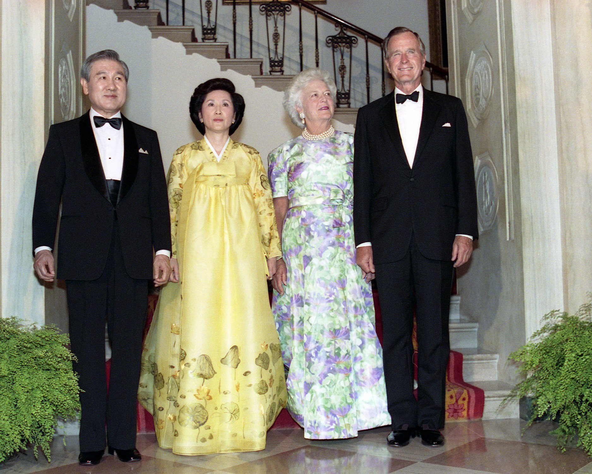

31년 전 오늘, 1995년 11월 17일. 대한민국 헌정사상 처음으로 전직 대통령이 뇌물 수수 혐의로 구속되어 서울구치소에 수감되었다는 소식이 온 나라를 뒤흔들었습니다. 최고 권력의 정점에서 물러난 전직 국가원수가 차가운 구치소 독방에 갇히는 모습은 국민들에게 지울 수 없는 충격과 깊은 상처를 남겼습니다.

## 수사 착수 28일 만에 내려진 구속 결정

검찰 대검찰청 중앙수사부는 비자금 의혹에 대한 본격적인 수사에 들어간 지 28일 만인 1995년 11월 16일, 노태우 전 대통령에 대해 특정범죄가중처벌법상 뇌물수수 혐의를 적용해 전격 구속영장을 청구했습니다. 대검 중수부 문영호 2과장이 이날 오후 1시 25분 서울지방법원에 영장을 접수했습니다.

서울지방법원 김정호 판사는 기록을 검토한 끝에 5시간 30분여 만인 오후 6시 50분경 구속영장을 발부했습니다. 국정의 최고책임자로서 모든 행정 업무를 총괄하고 기업 활동에 영향력을 행사할 수 있는 지위를 이용해 직무와 관련한 뇌물을 수수했다는 점이 구속 사유로 명시되었습니다.

## 대통령 집무실에서 오간 2천억 원대의 검은돈

검찰이 영장에서 밝혀낸 노 전 대통령의 혐의는 충격적이었습니다. 노 전 대통령은 재임 기간 동안 30개 대기업 총수들로부터 기업 경영에 대한 선처 등의 명목으로 모두 2천3백58억 9천6백만 원의 거액을 뇌물로 받아 챙긴 혐의를 받았습니다.

특히 뇌물이 오간 장소가 당초 거론되던 청와대 별실이나 안가가 아니라 청와대 대통령 집무실이었다는 사실이 새롭게 밝혀져 국민적 분노를 샀습니다. 검찰은 국정 최고책임자가 재임 중 기업인들로부터 받은 돈은 직무 관련성이 인정되는 포괄적 뇌물에 해당한다고 판단하고 법을 엄격히 적용했습니다.

*1991년 자료 — 사진: The Bush 41 Presidential Library / Public domain*

## 대검 청사에서 서울구치소까지 38분간의 호송

구속영장이 발부된 지 38분 만인 11월 16일 오후 7시 29분, 검찰은 영장 집행에 들어갔습니다. 대검찰청 청사 현관에 모습을 드러낸 노 전 대통령은 침통한 표정으로 고개를 숙이며 국민들에게 송구하다는 뜻을 밝혔습니다.

노 전 대통령은 중수부 수사관들과 함께 대검찰청 호송 승용차에 탑승해 서울구치소로 향했습니다. 차량이 출발한 지 29분 만인 오후 7시 58분, 경기 의왕시 서울구치소 철문을 통과하면서 헌정사상 첫 전직 대통령 구속수감이 집행되었습니다.

![[1930호] 영국 찰스 왕세자 내외분 방한 영국 찰스 왕세자 내외분 방한 (1992.11.04) 장면 1](../images/2026-11-17-01-3.jpg)
*[1930호] 영국 찰스 왕세자 내외분 방한 영국 찰스 왕세자 내외분 방한 (1992.11.04) 장면 1 — 사진: KTV 국민방송 e영상역사관 (대한뉴스) / KTV 공공저작물 — 영상 저작물 전면 개방(대통령실 2025-07-09), 출처 표시*

## 재벌 총수 줄소환과 사법 처리 방침

검찰 수사는 노 전 대통령 개인에 그치지 않고 정경유착의 핵심에 있던 대기업 총수들에게로 확대되었습니다. 검찰은 36개 기업체 대표들을 소환해 거액의 자금이 전달된 경위를 집중적으로 조사했습니다.

검찰은 노 전 대통령에게 뇌물을 건넨 30개 재벌그룹 총수 가운데 공소시효가 지난 일부를 제외한 대우그룹 김우중 회장, 동아그룹 최원석 회장 등 20여 명의 사법 처리가 불가피하다고 밝혔습니다. 권력과 자본이 결탁한 부패의 사슬이 사법부의 심판대 위에 오른 순간이었습니다.

![[1992호] 전직 대통령 초청 회동 김영삼 대통령, 전직 대통령 초청 회동 (1994.01.13) 장면 1](../images/2026-11-17-01-4.jpg)
*[1992호] 전직 대통령 초청 회동 김영삼 대통령, 전직 대통령 초청 회동 (1994.01.13) 장면 1 — 사진: KTV 국민방송 e영상역사관 (대한뉴스) / KTV 공공저작물 — 영상 저작물 전면 개방(대통령실 2025-07-09), 출처 표시*

## 헌정사상 첫 불명예가 남긴 역사적 교훈

제13대 대통령을 지낸 노태우 전 대통령은 군인 출신으로 최고 권력의 자리에 올랐으나, 결국 부패와 비리의 멍에를 벗지 못하고 수감되는 말로를 맞았습니다. 전직 국가원수라 할지라도 법 앞에서는 예외가 될 수 없다는 사법적 원칙이 엄정하게 확인된 사건이었습니다.

당시 신문들은 '수치의 역사에 마침표를 찍자'며 부패 청산을 강력히 요구했고, 시민들은 참담한 심정으로 역사의 현장을 지켜보았습니다. 최고 권력이 저지른 비리와 정경유착의 어두운 과거를 되돌아보는 이 사건은 오늘날에도 우리 사회에 무거운 질문을 던지고 있습니다.

### 참고 자료

- <https://newslibrary.naver.com/viewer/index.naver?articleId=1995111700329101001&editNo=40&printCount=1&publishDate=1995-11-17&officeId=00032&pageNo=1&printNo=15599&publishType=00010>
- <https://commons.wikimedia.org/wiki/File:Roh_Tae-woo_-_cropped,_1990-Mar-13.jpg>
- <https://commons.wikimedia.org/wiki/File:President_George_H._W._Bush_and_First_Lady_Barbara_Bush_with_Korean_President_Roh_Tae-woo_and_Kim_Ok-suk.jpg>
- <https://www.ehistory.go.kr/view/movie?mediasrcgbn=KV&mediaid=12330&mediadtl=28895&mediagbn=DH#t=0.3>
- <https://www.ehistory.go.kr/view/movie?mediasrcgbn=KV&mediaid=11982&mediadtl=27374&mediagbn=DH#t=0.3>
