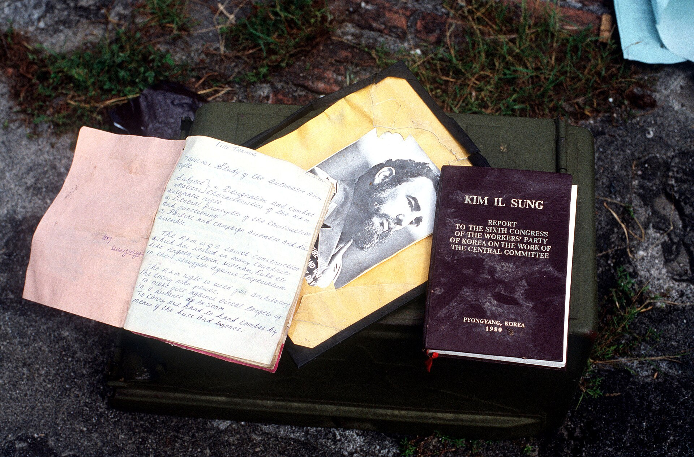
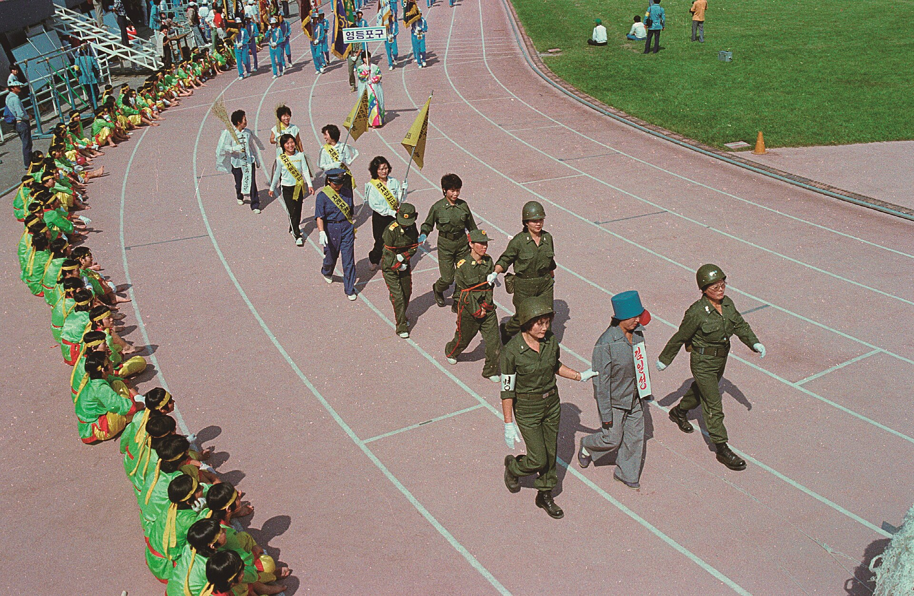

40년 전 오늘, 1986년 11월 17일. 대한민국 국방부가 전방 대남 확성기 방송 내용을 바탕으로 북한 김일성이 피살되었다는 충격적인 소식을 공식 발표했습니다. 조간과 석간 신문들이 일제히 1면 머리기사로 김일성 피살을 보도하면서 대한민국 전체가 거대한 긴장감에 휩싸였습니다.

## 휴전선 너머에서 들려온 기이한 확성기 방송

사건의 발단은 1986년 11월 16일 낮으로 거슬러 올라갑니다. 16일 낮 1시 10분경부터 북한군 전방 GP 대여섯 곳에서 설치된 대남 선전용 확성기를 통해 전에 없던 내용이 흘러나오기 시작했습니다. 확성기에서는 김일성이 열차 안에서 총격을 받고 서거했다는 내용과 함께 김일성과 김정일의 업적을 찬양하는 방송이 반복되었습니다. 이어 북한군 전방부대에 경계를 강화하라는 지시가 방송되었고, 전방 선전마을 철탑 게양대에는 조기가 내걸렸습니다.

## 장송곡과 '김정일을 지도자로 모시자'는 방송

전방 초소의 특이 동향은 17일 새벽까지 계속되었습니다. 새벽 2시 무렵에는 사망을 애도하는 장송곡 음악 방송이 흘러나왔고, 이어서 김정일을 지도자로 모시자는 구호가 지속적으로 대남 확성기를 통해 전파를 탔습니다. 서부전선 일대 일부 GP에서는 김일성이 열차 사고를 당했다는 방송도 나왔습니다. 비무장지대를 지키던 국군 장병들은 한밤중에 울려 퍼지는 장중한 조곡과 애도 방송을 들으며 일촉즉발의 긴장 속에서 경계태세를 유지해야 했습니다.

*사건 당시 사진 아님 · 1983년 — 사진: Technical Sergeant (TSgt) Mike Creen, US Air Force / Public domain*

## 국방부의 공식 발표와 언론의 대서특필

11월 17일 오전, 이흥식 국방부 대변인은 공식 기자회견을 열고 북한이 16일 전방 지역 대남 확성기 방송을 통해 김일성이 총격으로 사망했다는 방송을 실시했다고 공식 발표했습니다. 국방부는 북한 보도기관의 공식 발표는 아직 없으나 우리 군은 철저한 경계태세를 유지하고 있다고 밝혔습니다. 이 발표와 함께 국내 언론들은 일제히 호외와 1면 머리기사로 '김일성 총격으로 사망', '김일성 피살'이라는 대형 헤드라인을 내걸었습니다.

*사건 당시 사진 아님 · 1982년 — 사진: Seoul Museum of History / KOGL Type 1*

## 무성한 권력투쟁설과 외신의 엇갈린 첩보

사망설이 퍼지자 국내외에서는 북한 내부에서 심각한 권력투쟁이나 군부 쿠데타가 일어났을 것이라는 분석이 쏟아졌습니다. 군 총참모장 오극렬이 이끄는 군부 세력이 정변을 일으켜 김일성을 피살하고 김정일을 연금했다는 설부터, 관련자들이 국경을 넘어 도피했다는 외신 보도까지 잇따랐습니다. 또한 몽골 수상의 방북 일정이 취소되었다는 소식 등이 더해지며 정변설에 힘이 실렸습니다. 그러나 평양 정규 방송에서는 별다른 공식 발표가 나오지 않아 의문은 점점 커져갔습니다.

![[1010호] [특보] 휴전선에 남침 땅굴 ... 넘어 뚫어 놓은 땅굴의 진행도. (1974.11.23) 장면 2](../images/2026-11-17-02-4.jpg)
*[1010호] [특보] 휴전선에 남침 땅굴 ... 넘어 뚫어 놓은 땅굴의 진행도. (1974.11.23) 장면 2 — 사진: KTV 국민방송 e영상역사관 (대한뉴스) / KTV 공공저작물 — 영상 저작물 전면 개방(대통령실 2025-07-09), 출처 표시*

## 심리전의 혼선이 낳은 현대사의 거대한 오보

당시 정부 일각에서는 전방 대남 확성기 방송이 심리전의 일환으로 기만술일 가능성을 열어두고 정밀 분석을 진행하기도 했습니다. 실제로 전방 확성기의 내용과 달리 김일성은 살아 있었으며, 실제로는 그로부터 8년 뒤인 1994년 7월 8일에 사망했습니다. 북한군 전방 부대의 돌발적인 대남 방송과 이를 둘러싼 첩보 혼선이 겹치면서 1986년 11월 17일의 사건은 대한민국 현대사에서 가장 충격적이고 기이했던 오보 소동 중 하나로 기록되었습니다.

### 참고 자료

- <https://newslibrary.naver.com/viewer/index.naver?articleId=1986111700209201003&editNo=2&printCount=1&publishDate=1986-11-17&officeId=00020&pageNo=1&printNo=20040&publishType=00020>
- <https://commons.wikimedia.org/wiki/File:Bundesarchiv_Bild_183-1984-0601-041,_Berlin,_Besuch_Kim_Il_Sung-_Erich_Honecker.jpg>
- <https://commons.wikimedia.org/wiki/File:Captured_communist_literature,_including_a_photograph_of_Cuban_President_Fidel_Castro.jpg>
- <https://commons.wikimedia.org/wiki/File:1982%EB%85%84_%EC%84%9C%EC%9A%B8%EC%8B%9C%EB%AF%BC%EC%B2%B4%EC%9C%A1%EB%8C%80%ED%9A%8C_%EA%B0%9C%EB%A7%89%EC%8B%9D_%EC%84%A0%EC%88%98_%EC%9E%85%EC%9E%A5.jpg>
- <https://www.ehistory.go.kr/view/movie?mediasrcgbn=KV&mediaid=918&mediadtl=6193&mediagbn=DH#t=0.7>
