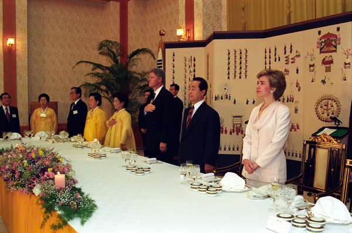
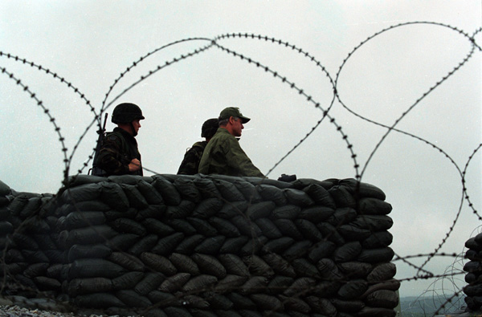
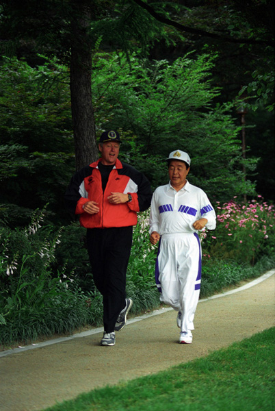

33년 전 오늘, 1993년 11월 17일. 대한민국 입시 역사상 처음이자 마지막이었던 제2차 대학수학능력시험의 분석 결과가 공개되었습니다. 전날인 11월 16일 전국에서 치러진 2차 수능을 마친 수험생들의 반응과 각 대학 지원 예상 점수가 언론을 통해 일제히 보도되었습니다.

## 학력고사의 한계를 넘기 위한 수능의 첫걸음

1980년대를 지배했던 대학입학학력고사는 고등학교 전 과목을 무조건 암기해야 하는 과도한 학습 부담을 낳았습니다. 교과서 위주의 암기식 주입 교육이 한계에 부딪히자, 교육 당국은 학생들의 통합적 사고력과 문제 해결력을 측정할 수 있는 새로운 시험을 구상했습니다. 그렇게 탄생한 것이 바로 대학수학능력시험이었습니다.

정부는 새로운 시험 체제를 안착시키기 위해 1990년부터 1992년까지 무려 7차례에 걸쳐 대규모 실험평가를 시행했습니다. 수많은 시뮬레이션과 문항 검증을 거친 끝에, 마침내 1994학년도 대입을 치르는 수험생들을 대상으로 1993년 첫 수능이 공식 도입되었습니다.

## 사상 초유의 '1년 2회 시험' 시도

수능이 처음 도입된 1993년에는 지금으로서는 상상하기 어려운 독특한 제도가 운영되었습니다. 바로 시험을 8월과 11월, 1년에 두 번 치르는 방식이었습니다. 1차 시험은 8월 20일 금요일에, 2차 시험은 11월 16일 화요일에 각각 실시되었습니다.

수험생들에게 복수의 응시 기회를 주어 단 한 번의 시험으로 인생이 결정되는 중압감을 덜어주고, 두 성적 중 더 좋은 점수를 선택해 대학에 지원할 수 있도록 하겠다는 취지였습니다. 하지만 현실에서는 수험생들이 두 번의 시험을 모두 준비하느라 오히려 수험 기간 내내 극심한 긴장과 피로에 시달려야 했습니다.

*Photograph of President William J. Clinton and First Lady Hillary Rodham Clinton Attending a State Dinner in the Blue Ho — 사진: President (1993-2001 : Clinton). White House Photograph Offi / Public domain*

## 1993년 11월 16일, 2차 수능의 체감 난이도

11월 16일 2차 수능이 치러진 뒤 발표된 수험생들의 반응은 대체로 1차보다 까다로웠다는 평가였습니다. 1교시 언어영역의 경우 1차 시험보다 지문이 길어져 시험시간이 턱없이 부족했다는 호소가 이어졌습니다. 수리탐구Ⅱ 영역 역시 과학탐구를 중심으로 체감 난이도가 높아 점수가 낮아질 것이라는 전망이 지배적이었습니다.

당시 우종옥 출제위원장은 수험생들의 혼란을 줄이기 위해 1차 시험의 난이도를 유지하면서 1차보다 점수가 약간 높게 나오도록 조율했다고 밝혔습니다. 하지만 시험을 치르고 나온 수험생들의 표정은 달랐고, 시험장 앞 게시판에 붙은 문제지를 다시 대조해보며 자신의 점수를 가늠해보는 수험생들의 모습에서 깊은 긴장감이 묻어났습니다.

*Photograph of President William J. Clinton with Troops at the Demilitarized Zone between North and South Korea - DPLA - — 사진: President (1993-2001 : Clinton). White House Photograph Offi / Public domain*

## 200점 만점 시절, 주요 대학의 합격선 분석

당시 수능은 총점 200점 만점 체제로 운영되었습니다. 시험 직후 입시기관들의 분석에 따르면, 서울대학교 주요 학과에 지원하기 위해서는 170점 이상을 받아야 할 것으로 전망되었습니다. 학과별로는 물리학과 180점, 의예과 179점, 법과대학 178점, 경제학과 173점 수준이 거론되었습니다.

또한 연세대학교, 고려대학교, 서강대 등 주요 사립대와 지방 국립대의 인기 학과는 155점에서 165점 사이에 지원선이 형성될 것으로 분석되었습니다. 2차 시험 답안지는 11월 17일 한국과학기술연구원으로 이송되어 본격적인 채점 작업에 들어갔으며, 성적은 12월 20일 수험생 개인별로 통보될 예정이었습니다.

*Photograph of President William J. Clinton Jogging with South Korean President Kim Young-sam in Seoul, South Korea - DPL — 사진: President (1993-2001 : Clinton). White House Photograph Offi / Public domain*

## 단 한 해로 막을 내린 두 번의 수능

야심 차게 출발했던 '1년 2회 수능' 제도는 첫해를 끝으로 역사 속으로 사라졌습니다. 1차 시험과 2차 시험 간의 난이도를 완벽하게 맞추기 어려웠고, 두 번의 대규모 국가시험을 관리하는 데 따르는 사회적 비용과 수험생들의 과도한 수험 부담이 문제로 지적되었습니다.

결국 교육 당국은 이듬해인 1994년 1995학년도 대입부터 수능을 11월에 단 한 차례만 시행하는 방식으로 개편했습니다. 오직 1993년에만 존재했던 여름과 늦가을의 두 차례 수능. 200점 만점의 문제지를 받아 들고 떨리는 손으로 답안을 채워 넣던 그때의 기억은 오늘날에도 많은 이들의 가슴속에 특별한 추억으로 남아 있습니다.

### 참고 자료

- <https://newslibrary.naver.com/viewer/index.naver?articleId=1993111700209101002&editNo=40&printCount=1&publishDate=1993-11-17&officeId=00020&pageNo=1&printNo=22346&publishType=00010>
- <https://commons.wikimedia.org/wiki/File:Photo_of_the_Military_Demarcation_Line_(MDL)_sign_(1993).JPEG>
- <https://commons.wikimedia.org/wiki/File:Photograph_of_President_William_J._Clinton_and_First_Lady_Hillary_Rodham_Clinton_Attending_a_State_Dinner_in_the_Blue_House_in_Seoul,_South_Korea_-_DPLA_-_4d9bee8ba799e2826eab58a9ac7c656d.jpg>
- <https://commons.wikimedia.org/wiki/File:Photograph_of_President_William_J._Clinton_with_Troops_at_the_Demilitarized_Zone_between_North_and_South_Korea_-_DPLA_-_28959779a9e1a9979163127dc656b5b2.jpg>
- <https://commons.wikimedia.org/wiki/File:Photograph_of_President_William_J._Clinton_Jogging_with_South_Korean_President_Kim_Young-sam_in_Seoul,_South_Korea_-_DPLA_-_db397cf78942930170d611051ed97b6c.jpg>
