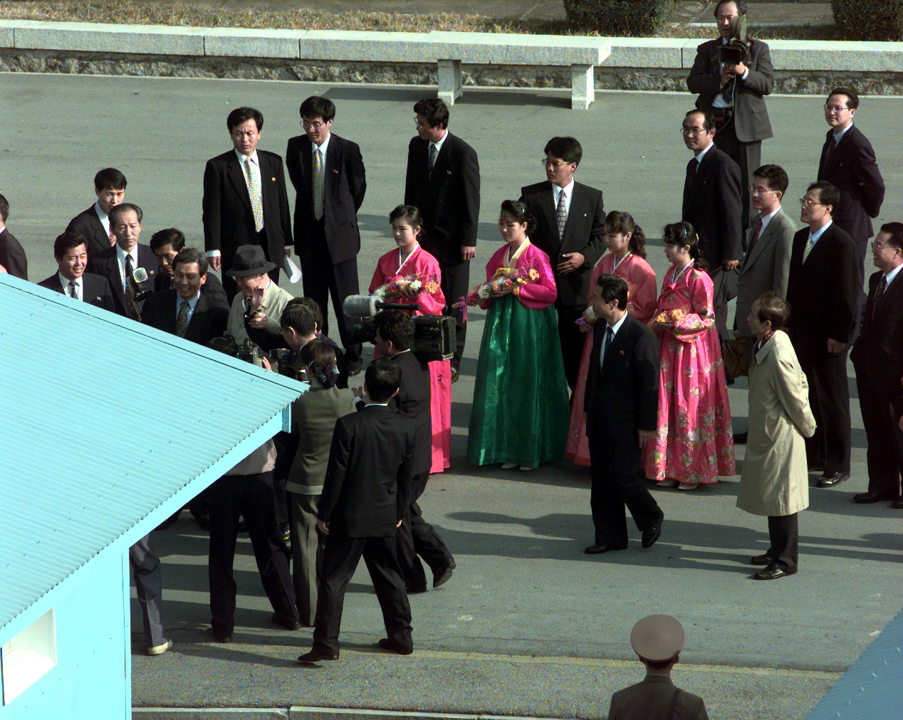
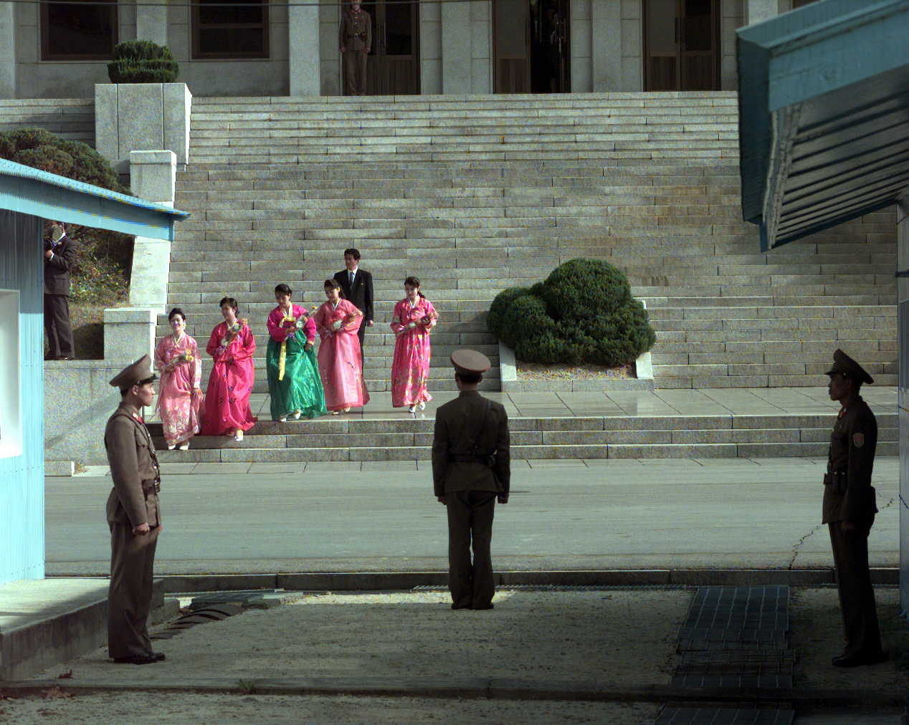
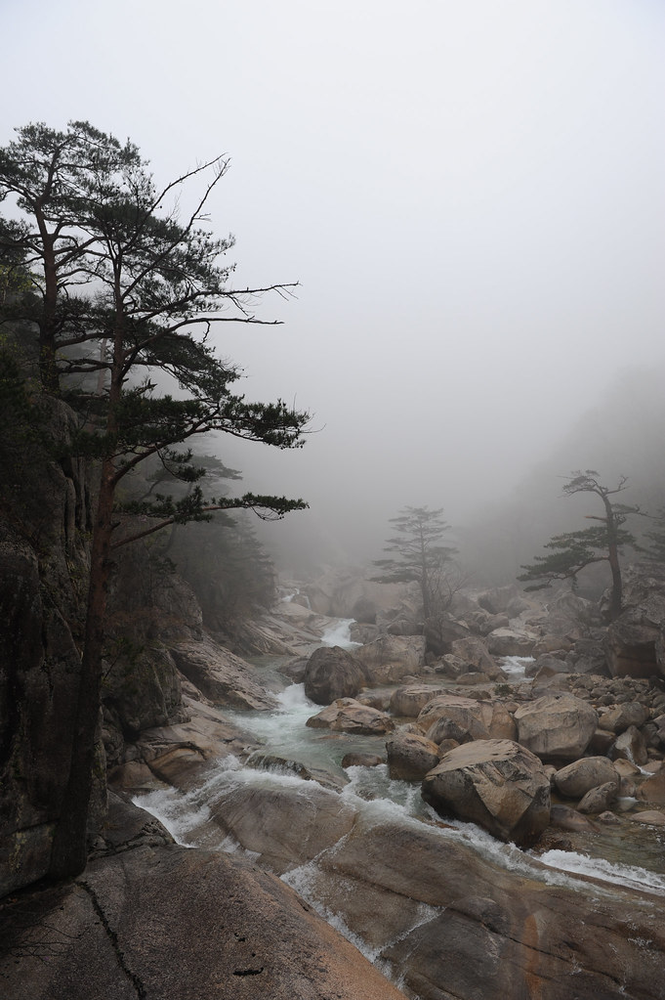

28년 전 오늘, 1998년 11월 17일. 현대금강호를 탄 남녘 관광객들이 북녘의 명산 금강산에 닿아 구룡폭포로 향하는 코스를 걸으며 절경을 만끽했다는 소식이 전해졌습니다.

## 반세기 만에 열린 뱃길, 남녘 사람을 품은 금강산

1998년 11월, 현대금강호가 동해 바닷길을 헤치고 북한 강원도에 위치한 금강산 부두에 입항했습니다. 1998년 11월 15일 금강산에 도착한 승객들은 관광 코스 들머리로 올라서며 감격스러운 첫 일정을 시작했습니다. 11월 17일 자 주요 신문들은 식당 목란관이 저 멀리 보이는 들머리를 오르는 관광객들과, 구룡폭포로 향하며 장관을 즐기는 승객들의 모습을 대대적으로 보도했습니다.

## 사계절마다 이름을 달리하던 일만 이천 봉

금강산은 높이 1,638미터의 비로봉을 주봉으로 동서 40킬로미터, 남북 60킬로미터에 걸쳐 펼쳐진 명산입니다. 봄에는 온 산이 새싹과 꽃으로 덮인다 하여 금강산, 여름에는 녹음이 짙어 신선이 산다는 봉래산, 가을에는 일만 이천 봉이 단풍으로 물들어 풍악산, 겨울에는 앙상한 바위 뼈가 드러난다고 하여 개골산으로 불렸습니다. 대한민국 속초시와 불과 50킬로미터가량 떨어진 이 아름다운 산은 오랜 분단으로 갈 수 없는 그리움의 상징이었습니다.

*Ladies from North Korea wearing traditional hanbok leave Panmungak to present gifts to South Korean business tycoon Chun — 사진: TSGT Renee' Sitler / Public domain*

## 목란관을 지나 구룡폭포로 향하던 발걸음

11월 15일 금강산에 오른 남녘 승객들의 발걸음은 외금강의 명소인 구룡연 구역으로 향했습니다. 식당 목란관을 뒤로하고 이어진 코스는 개성의 박연폭포, 설악산의 대승폭포와 더불어 조선 3대 폭포로 꼽히는 구룡폭포로 이어졌습니다. 구룡폭포는 높이 74미터, 너비 4미터에 달하며, 폭포 절벽과 바닥 전체가 거대한 하나의 화강암 덩어리로 이루어져 있어 보는 이들에게 장쾌한 물줄기와 압도적인 웅장함을 선사했습니다.

*Ladies from North Korea wearing traditional hanbok leave Panmungak to present gifts to South Korean business tycoon Chun — 사진: TSGT Renee' Sitler / Public domain*

## 신라 시대 온천부터 천연기념물까지 이어진 비경

금강산 외금강 지역에는 신라 시대에 발견되어 왕족과 관리들이 애용했다는 온정리 온천이 자리 잡고 있습니다. 라돈과 메타규산이 풍부하게 함유되어 천연기념물 제226호로 지정된 이곳 역시 관광객들의 편의 시설로 마련되었습니다. 1천만 년 전부터 이어진 지질 활동과 풍화 작용이 빚어낸 기암괴석, 만물상과 삼일포의 비경 등 잘 알려진 3개 코스가 외부에 개방되며 남한 관광객들을 맞이했습니다.

*Mount Kumgang — 사진: Tormod Sandtorv / CC BY-SA 2.0*

## 화진포에서 닿던 길, 2008년 멈춰 선 안타까운 여정

금강산 관광은 현대아산과 북한의 공동 관리 아래 점차 코스를 넓혀가며 해마다 수많은 관광객을 불러 모았습니다. 관광객들은 화진포 아산 휴게소에서 수속을 밟고 배를 타며 남북 화해와 교류의 상징을 몸소 체험했습니다. 그러나 2008년 7월 11일, 금강산 관광객 피격 사망 사건이 발생하면서 온 국민의 가슴을 설레게 했던 금강산 관광은 전면 중단되고 말았습니다.

## 배를 타고 바라보던 구룡폭포의 감동

수많은 국민이 동해 바다를 건너 금강산의 흙과 바위를 마주했던 그 시절은 여전히 많은 이들의 가슴속에 깊은 추억으로 남아 있습니다. 거대한 화강암 절벽 사이로 쏟아지던 구룡폭포의 물소리와 목란관 들머리를 오르며 가슴 벅차오르던 당시의 감동은 세월이 흘러도 쉬이 잊히지 않는 역사의 한 장면입니다.

### 참고 자료

- <https://newslibrary.naver.com/viewer/index.naver?articleId=1998111700329101005&editNo=45&printCount=1&publishDate=1998-11-17&officeId=00032&pageNo=1&printNo=16593&publishType=00010>
- <https://commons.wikimedia.org/wiki/File:Ladies_from_North_Korea_wearing_traditional_hanbok_leave_Panmungak_to_present_gifts_to_South_Korean_business_tycoon_Chung_Ju-yung_981027-F-XT789-528.jpg>
- <https://commons.wikimedia.org/wiki/File:Ladies_from_North_Korea_wearing_traditional_hanbok_leave_Panmungak_to_present_gifts_to_South_Korean_business_tycoon_Chung_Ju-yung_981027-F-XT789-527.jpg>
- <https://commons.wikimedia.org/wiki/File:Ladies_from_North_Korea_wearing_traditional_hanbok_leave_Panmungak_to_present_gifts_to_South_Korean_business_tycoon_Chung_Ju-yung_981027-F-XT789-526.jpg>
- <https://www.flickr.com/photos/14585659@N07/7376171496>
