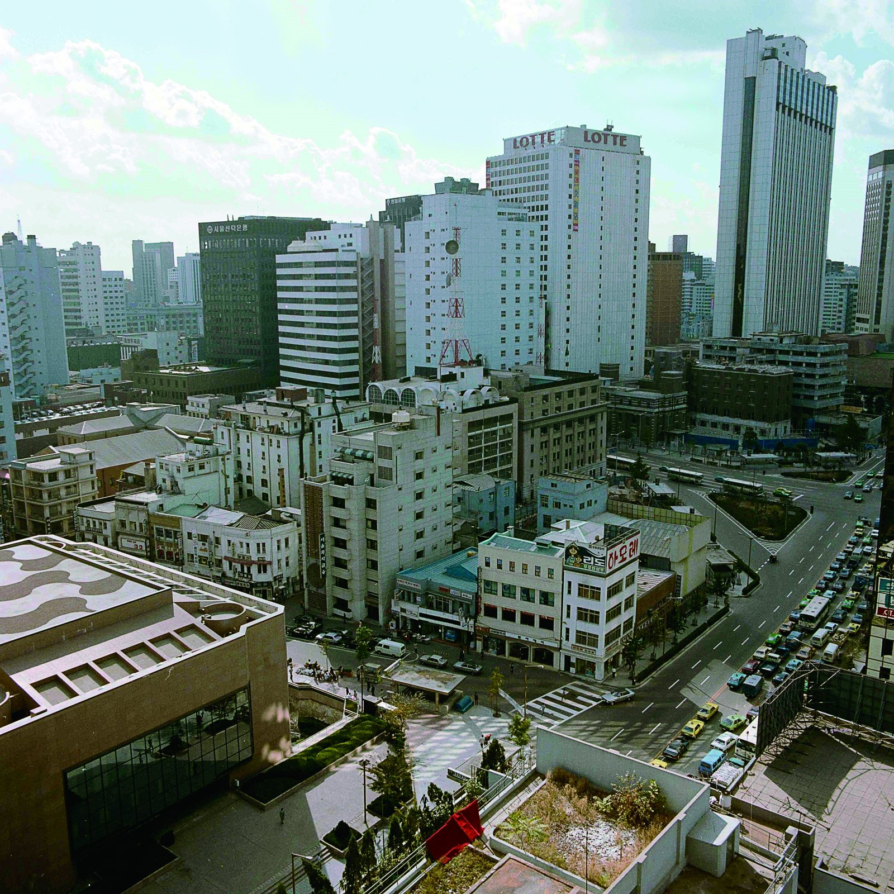
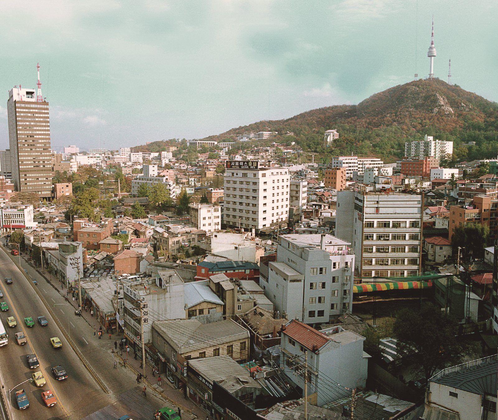
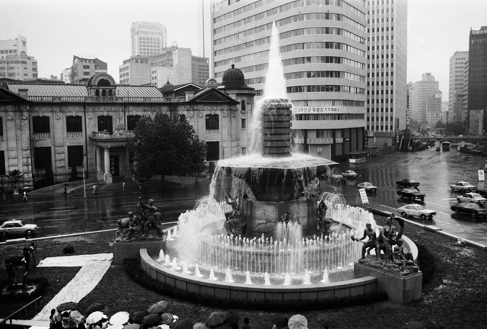

29년 전 오늘, 1997년 11월 18일. 미국 달러에 대한 원화 환율이 사상 처음으로 1000원을 돌파하며 외환 거래가 중단됐다는 충격적인 소식이 조간신문 1면을 뒤덮었습니다. 한동안 위태롭게 버티던 외환시장과 금융시장이 순식간에 마비 상태에 빠져들며 온 나라가 커다란 불안감에 휩싸였습니다.

## 1000원 방어선과 외환당국의 한계

1997년 11월 당시 달러당 1000원은 한국 경제의 심리적 저지선으로 여겨졌습니다. 기업들의 연쇄 부도와 종합금융사의 외화 결제 수요가 겹치면서 시장에서는 달러 품귀 현상이 극에 달했습니다. 재정경제원 등 외환당국은 외환보유고를 헐어 환율 상승을 막으려 했으나, 눈덩이처럼 불어나는 달러 수요를 감당하기에는 역부족이었습니다.

## 1997년 11월 17일 오후 2시 10분의 거래 중단

11월 17일 외환시장은 986원으로 출발해 오전 내내 비교적 안정세를 유지했습니다. 그러나 오후 들어 외환당국이 추가 달러 매도 개입을 포기하면서 상황은 급변했습니다. 오후 1시 52분 환율이 1000원을 넘어섰고, 불과 20여 분 뒤인 오후 2시 10분경 하루 변동 제한폭인 1008.60원까지 치솟았습니다. 더 이상 환율이 오를 수 없는 상한선에 도달하면서 거래는 사실상 전면 중단됐습니다.

*도심재개발 명동 구역 — 사진: 서울역사박물관 / KOGL Type 1 (공공누리 제1유형, 출처표시)*

## 은행 창구의 혼란과 치솟은 현찰 매도율

외환시장에서 달러 거래가 멈추자 시중은행 창구도 발칵 뒤집혔습니다. 각 시중은행은 고객에게 달러화를 팔 때 적용하는 현찰 매도율을 당초 1001.29원에서 사상 최고치인 1020.07원으로 급히 재고시했습니다. 해외 유학생이나 수출입 기업들은 달러를 구하지 못해 발을 동동 굴렀고, 18일의 매매기준율도 전날보다 4.10원 오른 990.60원으로 고시될 예정이었습니다.

*도심재개발 회현구역 제1지구 — 사진: 서울역사박물관 / KOGL Type 1 (공공누리 제1유형, 출처표시)*

## 주가지수 500선 붕괴와 외국인 순매도

외환시장의 마비는 주식시장으로 곧장 번졌습니다. 금융개혁 법안의 국회 처리 무산 소식과 환율 급등이라는 악재가 쏟아지면서 투자 심리는 급속히 얼어붙었습니다. 오전 내내 주식을 사들이던 외국인 투자자들도 오후 들어 돌연 매도로 돌아서 195억원어치를 순매도했습니다. 결국 종합주가지수는 지난 주말보다 22.39포인트 폭락한 496.98로 마감하며 7일 만에 500선이 힘없이 무너졌습니다.

*한국은행 앞 분수대 — 사진: 서울역사박물관 / KOGL Type 1 (공공누리 제1유형, 출처표시)*

## 16%대로 치솟은 금리와 마비된 채권시장

자금시장 역시 제 기능을 잃어버렸습니다. 3년 만기 회사채 수익률은 연 13.40%로 뛰어올라 1995년 8월 10일의 13.44% 이후 2년 3개월 만에 최고치를 기록했습니다. 이날 시장에 나온 회사채 거래량은 455억원에 그쳤습니다. 현대, 삼성, LG 등 우량 대기업마저 자금을 구하기 위해 기업어음(CP) 발행에 매달렸으나, 어음할인 능력이 바닥나며 CP 금리는 연 16.88%까지 폭등했습니다.

## 무정부 상태의 경제와 IMF 구제금융의 전조

당시 언론들은 정책 당국의 불신과 갈등을 두고 경제가 '무정부 상태'에 빠졌다고 비판했습니다. 재정경제원과 한국은행이 대립하고 재경원 내부에서도 국제통화기금(IMF) 구제금융 요청 여부를 두고 혼선이 빚어졌습니다. 1달러 1008원 돌파와 거래 중단은 한국 경제가 더 이상 스스로의 힘으로 버티기 어렵다는 것을 알린 신호탄이었으며, 정부는 불과 며칠 뒤 IMF에 구제금융을 공식 신청하게 됩니다.

### 참고 자료

- <https://newslibrary.naver.com/viewer/index.naver?articleId=1997111800209101001&editNo=45&printCount=1&publishDate=1997-11-18&officeId=00020&pageNo=1&printNo=23712&publishType=00010>
- <https://commons.wikimedia.org/wiki/File:RIAN_archive_426989_IMF_Managing_Director_Michel_Camdessus_and_Russian_Prime_Minister_Viktor_Chernomyrdin_meeting_to_sign_credit_agreement.jpg>
- <https://museum.seoul.go.kr/archive/archiveNew/NR_archiveView.do?ctgryId=CTGRY772&type=B&upperNodeId=CTGRY774&fileSn=300&fileId=H-TRNS-101573-774>
- <https://museum.seoul.go.kr/archive/archiveNew/NR_archiveView.do?ctgryId=CTGRY766&type=B&upperNodeId=CTGRY767&fileSn=300&fileId=H-TRNS-96015-767>
- <https://museum.seoul.go.kr/archive/archiveNew/NR_archiveView.do?ctgryId=CTGRY760&type=B&upperNodeId=CTGRY762&fileSn=300&fileId=H-TRNS-84241-762>
