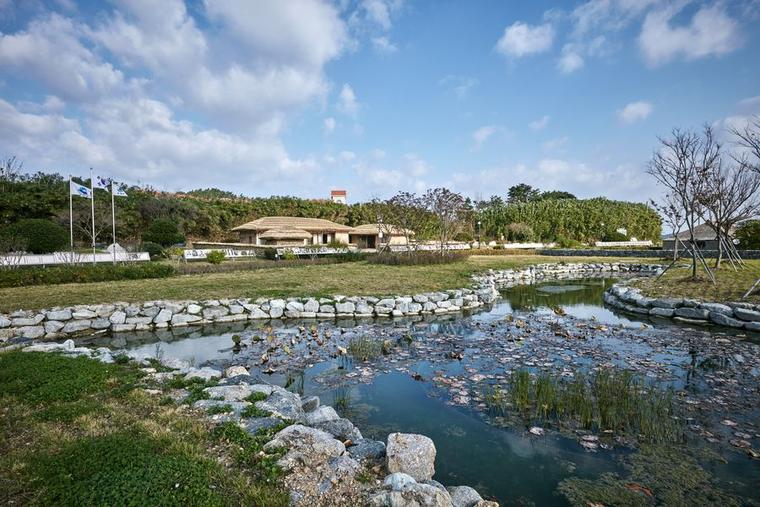
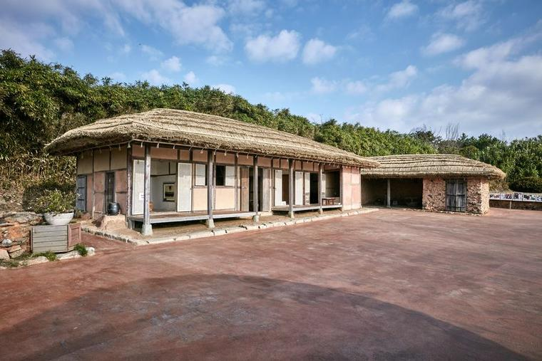
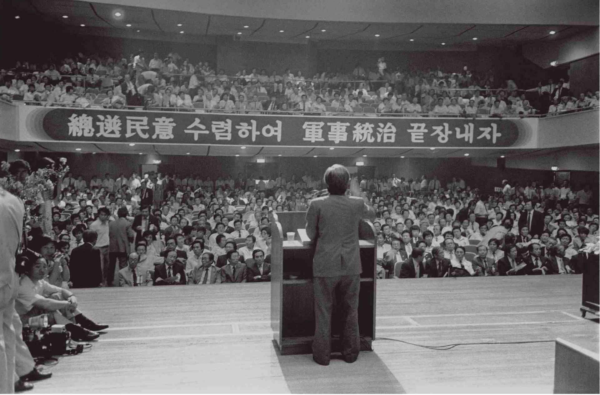

38년 전 오늘, 1988년 11월 18일. 대한민국 국회에서 5·18 광주민주화운동의 진상을 규명하기 위한 역사적인 광주특위 제1차 청문회가 열렸습니다. 1980년 신군부의 집권 과정에서 발생했던 비극적 사건의 실체를 밝히기 위해 국회가 주관하고 방송사가 전국에 생중계한 최초의 본격 청문회였습니다.

## 전국을 멈춰 세운 청문회 텔레비전 생중계

1988년 11월 18일 오전 10시, KBS와 MBC 텔레비전 그리고 기독교방송을 통해 국회 광주특위 청문회 실황이 전국으로 전파를 탔습니다. 당시 문동환 위원장이 이끄는 국회 광주특위는 18일과 19일, 그리고 24일과 25일까지 나흘간에 걸쳐 1차 청문회를 진행하기로 결정한 상태였습니다.

이날 중계방송이 시작되자 전국의 사무실과 상점, 가정집 텔레비전 앞은 청문회를 지켜보려는 시민들로 가득 찼습니다. 제5공화국 시기 내내 언론 통제로 철저히 가려져 있던 1980년 5월의 진실이 공식 석상에서 여야 국회의원들과 핵심 당사자들의 입을 통해 생생하게 드러나는 순간이었기 때문입니다.

## 증인석에 선 김대중, '내란음모는 조작됐다'

이날 가장 큰 관심사는 단연 첫 증인으로 나선 김대중 평화민주당 총재였습니다. 김 총재는 증언대에 서서 '양심에 따라 진실만을 밝히겠다'고 선서한 뒤, 1980년 자신을 사형 판결로 내몰았던 이른바 '김대중 내란음모사건'의 내막을 낱낱이 진술했습니다.

김 총재는 1980년 5·18 직전 전남대 총학생회장이던 정동년 씨를 만난 적이 없으며, 시위 자금으로 5백만 원을 전달한 사실도 전혀 없다고 밝혔습니다. 정동년 씨를 실제로 처음 만난 것은 1985년 4월이었다고 증언하며, 당시 군 합동수사본부 피의자 신문 과정에서 혐의를 시인했던 자백은 인간적인 심신의 한계 때문에 나온 허위였다고 밝혔습니다. 즉, 광주항쟁의 책임을 야당 정치인에게 덮어씌우기 위해 신군부가 사건을 날조했다는 주장이었습니다.

*사건 당시 사진 아님 — 사진: 한국관광공사 / KOGL Type 1 attribution*

## 보안사의 회유와 '발포 책임자 전두환' 지목

김 총재는 조사 당시 중앙정보부에서 겪었던 협박과 회유도 구체적으로 공개했습니다. 1980년 5월 17일 연행된 후 50여 일이 지났을 무렵, 당시 보안사 간부였던 이학봉 대령이 찾아와 '대통령만 단념하면 사형은 면한다. 살 수 있는 유일한 길은 우리에게 협력하는 것뿐'이라며 각서를 요구했다고 밝혔습니다. 김 총재는 이에 대해 광주 시민들과 함께 죽기로 작정했다며 협력을 거부했다고 증언했습니다.

또한 당시 광주에서 이루어진 계엄군의 발포 명령 책임자가 누구냐는 의원들의 질문에 김 총재는 단호하게 답했습니다. 김 총재는 정황 증거와 당시 기관원들의 진술, 국민 일반의 확신을 종합해 볼 때 전두환 전 대통령이 발포 명령의 진실한 책임자임에 틀림없다고 증언했습니다. 상식을 가진 사람이라면 당시 실권자 몰래 대량학살이 단행됐다고 생각할 수 없다는 논리였습니다.

*사건 당시 사진 아님 — 사진: 한국관광공사 / KOGL Type 1 attribution*

## 불참한 두 전직 대통령과 빈자리

국회 광주특위는 이날 청문회를 앞두고 최규하 전 대통령과 전두환 전 대통령에게도 증인 출석을 요구했습니다. 그러나 두 전직 대통령은 끝내 증인석에 모습을 드러내지 않았습니다.

최규하 전 대통령은 청문회 전날인 17일 오후 문동환 위원장에게 서한을 보내 '현 국면에서 본인의 출석 증언은 진상조사에 도움이 되지 않을 뿐 아니라 나라를 위해서도 바람직하지 않다'며 불참을 통보해 왔습니다. 전두환 전 대통령은 아무런 사전 통고도 없이 청문회에 불참했습니다. 이에 문동환 위원장은 개회사를 통해 법 규정에 따라 동행명령장을 발부하는 절차를 밟겠다고 밝혔습니다.

*사건 당시 사진 아님 · 1985년 — 사진: Photos taken by 전민조 and hosted by the National Museum of Con / KOGL Type 1*

## 여야의 날 선 공방과 이희성 계엄사령관 출석

청문회장에서는 1980년 5·17 계엄확대조치의 성격을 두고 여야 의원 간의 치열한 공방이 벌어졌습니다. 야당 의원들은 5·17 조치가 국회를 마비시키고 모든 정치활동을 정지시킨 군인들의 정권 탈취 쿠데타였으며 명백한 위헌 조치라고 규탄했습니다. 반면 집권 여당인 민정당 의원들은 당시 사회적 혼란과 정치권의 분열, 극렬한 시위 때문에 계엄 확대가 불가피했다고 맞섰습니다.

이날 청문회에는 김대중 총재 외에도 1980년 당시 계엄사령관을 지낸 이희성 씨가 증인으로 출석해 신문을 받았습니다. 광주 현장에서 일어난 군의 진압 방식과 발포 경위를 둘러싸고 당시 군 지휘부의 책임 소재를 밝히려는 의원들의 추궁이 이어졌습니다.

## 한국 정치사와 민주주의에 남긴 이정표

1988년 11월 18일 시작된 5·18 광주청문회는 대한민국 헌정사에서 국회가 행정부와 군부의 과거 권력 남용을 국민 앞에 공개 검증한 중대한 전환점이었습니다. TV 생중계를 통해 전파된 증언들은 왜곡되어 있던 현대사의 진실을 세상 밖으로 끌어내는 기폭제가 되었습니다.

당시 제기된 증언과 폭로들은 이후 1995년 5·18 특별법 제정과 신군부 핵심 인사들에 대한 사법 처리로 이어지는 결정적 발판이 되었습니다. 진실을 밝히기 위해 증언대에 섰던 이들과 숨죽이며 텔레비전을 지켜보던 국민들의 열망은 한국 민주주의의 깊은 상처를 직시하고 치유하는 출발점이 되었습니다.

### 참고 자료

- <https://newslibrary.naver.com/viewer/index.naver?articleId=1988111800329201003&editNo=3&printCount=1&publishDate=1988-11-18&officeId=00032&pageNo=1&printNo=13278&publishType=00020>
- <https://www.kogl.or.kr/recommend/recommendDivView.do?division=img&recommendIdx=3262>
- <https://commons.wikimedia.org/wiki/File:New_democratic_party_convention_1985-08-01.png>
