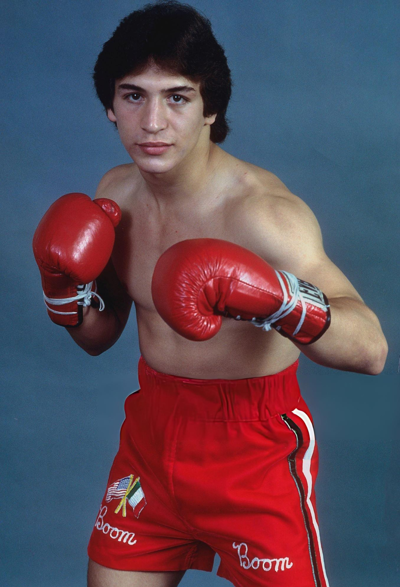
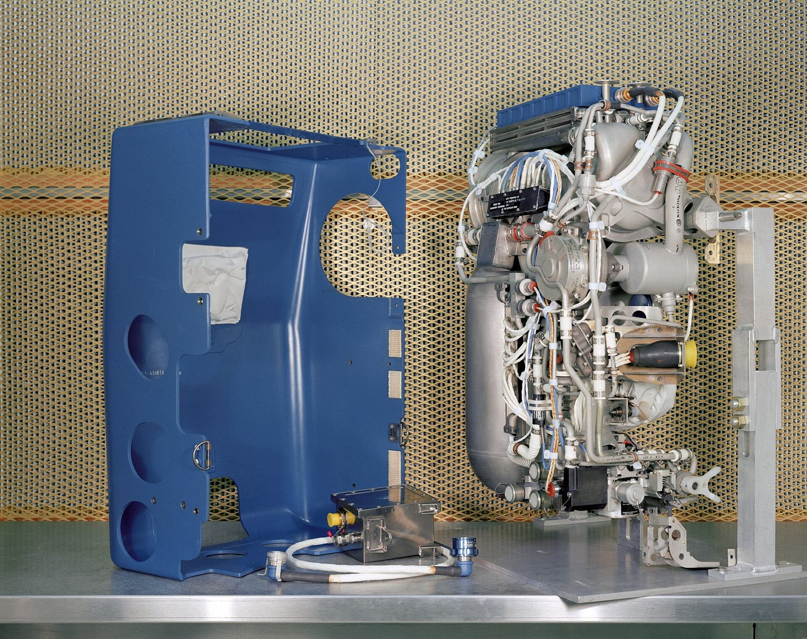
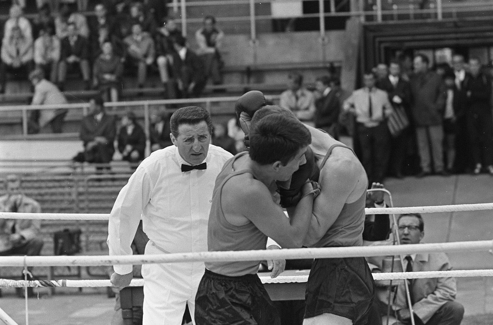

44년 전 오늘, 1982년 11월 18일. 미국 네바다주 라스베이거스의 데저트 스프링스 병원에 입원 중이던 복서 김득구 선수가 끝내 숨을 거두었습니다. WBA 라이트급 챔피언 레이 맨시니와의 혈투 끝에 쓰러진 지 나흘 만의 일이었습니다.

## 가난을 딛고 링 위에 선 도전

김득구는 강원도 고성군의 어촌 마을에서 태어났습니다. 어린 시절 아버지를 여의고 어려운 환경에서 자란 그는 열여섯 살에 서울로 상경했습니다. 구두닦이와 투어 가이드 등 궂은일을 하며 검정고시를 거쳐 학교를 다녔고, 1976년 동아체육관에 들어가며 복싱을 시작했습니다.

1978년 프로로 전향한 김득구는 빠른 성장세를 보였습니다. 1980년 한국 챔피언에 올랐고, 1982년 2월에는 동양 태평양 복싱 연맹(OPBF) 라이트급 타이틀을 따내며 세계 복싱 협회(WBA) 랭킹 1위로 뛰어올랐습니다. 통산 17승 1무 1패의 전적으로 마침내 세계 챔피언 타이틀에 도전할 기회를 잡았습니다.

## 라스베이거스 호텔에서 남긴 각오

1982년 11월, 김득구는 WBA 라이트급 세계 챔피언 레이 맨시니와 맞붙기 위해 미국 라스베이거스로 향했습니다. 해외 원정 경기는 필리핀에 이어 생애 두 번째였으며, 미국 본토 무대는 처음이었습니다.

챔피언 맨시니는 강펀치를 가진 21세의 젊은 강자였습니다. 미국 현지에서는 챔피언의 우세를 점쳤지만, 김득구의 각오는 남달랐습니다. 그는 시합을 앞두고 호텔 방의 전등갓에 '죽거나 살거나'라는 글귀를 한글로 적어둘 만큼 비장한 결의를 품고 체중 감량과 훈련을 이어갔습니다.

*Ray Mancini by Chaz Fenn 2 — 사진: Chaz Fenn / Public domain*

## 시저스 팰리스의 혈투와 14라운드

1982년 11월 13일(한국 시간 14일 오전), 라스베이거스 시저스 팰리스 호텔 야외 특설 링에서 경기가 시작되었습니다. 김득구는 초반부터 물러서지 않고 맨시니와 치열한 난타전을 펼쳤습니다. 맨시니의 왼쪽 눈과 귀를 부어오르게 할 정도로 팽팽하게 맞서며 경기는 후반 라운드까지 이어졌습니다.

그러나 생애 처음으로 15라운드 경기를 치르던 김득구는 후반으로 갈수록 체력적 한계에 부딪혔습니다. 14라운드가 시작된 지 19초 만에 챔피언의 오른손 스트레이트가 김득구의 턱을 강타했습니다. 링 바닥에 쓰러진 김득구는 로프를 붙잡고 비틀거리며 다시 일어섰지만, 리처드 그린 주심은 경기를 중단시키고 맨시니의 승리를 선언했습니다.

*Apollo portable life support system — 사진: NASA / Public domain*

## 끝내 돌아오지 못한 4일간의 사투

경기가 끝난 직후 김득구는 링 위에서 의식을 잃고 쓰러졌습니다. 들것에 실려 인근 데저트 스프링스 병원으로 급송된 그는 두개골 내 100밀리리터의 혈종이 발견되어 즉시 긴급 뇌수술을 받았습니다. 그러나 수술 후에도 의식을 회복하지 못하고 산소호흡기에 의지한 채 뇌사 상태에 머물렀습니다.

한국에서 급히 미국으로 날아온 어머니 양선녀 씨는 아들의 의학적 사망 상태를 주치의로부터 전해 듣고 산소호흡기 제거에 동의했습니다. 어머니는 아들의 심장과 콩팥 등 장기를 병원에 기증하겠다는 뜻을 밝혔고, 1982년 11월 18일 오전 10시 55분(한국 시간) 김득구는 향년 26세로 세상을 떠났습니다.

*Boksen voor aanvang wedstrijd DOS tegen NAC. Scheidsrechter Bennie Brit en bokse, Bestanddeelnr 920-6735 — 사진: Ben Merk / Anefo / CC0*

## 세계 복싱계를 뒤바꾼 규정 개정

김득구의 사망은 전 세계 스포츠계에 엄청난 파장을 일으켰습니다. 당시 미국 전역에 텔레비전으로 생중계된 이 참사는 복싱의 안전성에 대한 거센 논쟁을 불렀고 미국 의회에서 청문회가 열리기도 했습니다.

이를 계기로 세계 복싱 기구들은 세계 타이틀전 경기 방식을 전면 개편했습니다. 기존 15라운드로 치러지던 챔피언전을 12라운드로 단축했고, 라운드 사이의 휴식 시간을 60초에서 90초로 늘렸습니다. 아울러 스탠딩 다운제를 도입하고 올림픽 권투 경기에서도 헤드기어 착용이 의무화되는 등 복서의 생명을 보호하기 위한 제도적 변화가 잇따랐습니다.

## 남겨진 사람들과 영원한 기억

사건 이후의 여파는 참혹했습니다. 김득구의 어머니는 깊은 슬픔 속에 세상을 떠났고, 경기 주심을 맡았던 리처드 그린 역시 죄책감에 시달리다 유명을 달리했습니다. 상대 선수였던 맨시니 또한 극심한 트라우마를 겪었습니다. 김득구의 사후인 1983년에는 그의 유복자가 태어나 성장했습니다.

비록 비극으로 끝났지만, 링 위에서 마지막 순간까지 쓰러지지 않으려 로프를 붙잡던 김득구의 모습은 당대 수많은 이들의 가슴에 깊은 울림을 남겼습니다. 그가 목숨을 걸고 치른 마지막 경기는 오늘날 수많은 복서들의 안전을 지키는 중요한 전환점으로 역사에 기록되어 있습니다.

### 참고 자료

- <https://newslibrary.naver.com/viewer/index.naver?articleId=1982111800209201012&editNo=2&printCount=1&publishDate=1982-11-18&officeId=00020&pageNo=1&printNo=18808&publishType=00020>
- <https://commons.wikimedia.org/wiki/File:Duk_Koo_Kim_vs_Ray_Mancini_ticket.png>
- <https://commons.wikimedia.org/wiki/File:Ray_Mancini_by_Chaz_Fenn_2.jpg>
- <https://commons.wikimedia.org/wiki/File:Apollo_portable_life_support_system.jpg>
- <https://commons.wikimedia.org/wiki/File:Boksen_voor_aanvang_wedstrijd_DOS_tegen_NAC._Scheidsrechter_Bennie_Brit_en_bokse,_Bestanddeelnr_920-6735.jpg>
