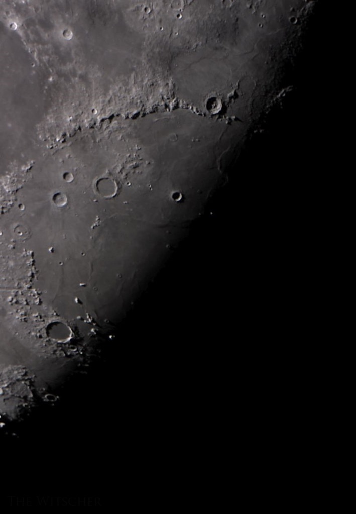
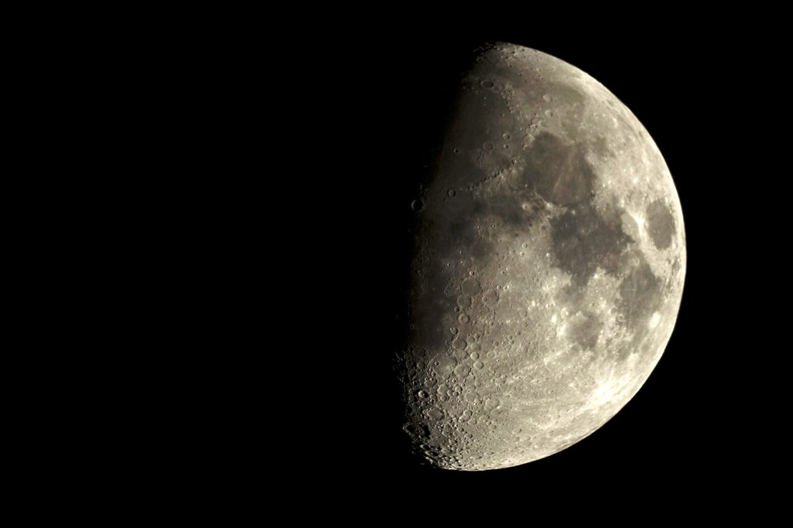

56년 전 오늘, 1970년 11월 18일. 소련의 무인 우주선 루나 17호가 달 표면에 안착한 뒤 인류 역사상 최초의 달 표면 이동 차량인 루노코드 1호를 내려놓고 첫 주행 실험에 성공했다는 소식이 전해졌습니다. 사람이 타지 않은 바퀴 달린 기계가 지구 밖 천체 표면을 스스로 굴러다니며 탐사를 벌인 역사적인 순간이었습니다.

## 냉전기 우주 경쟁과 소련의 무인 탐사

미국과 소련의 우주 경쟁은 달을 향한 치열한 기술 질주로 이어졌습니다. 1959년 9월 13일 소련의 루나 2호가 세계 최초로 달 표면에 도달했고, 같은 해 10월 7일 루나 3호가 인류 최초로 달 뒷면을 촬영해 전송했습니다. 이어 1966년 2월 3일에는 루나 9호가 달 표면에 부드럽게 착륙하는 연착륙에 성공하며 관측 사진을 보내왔습니다.

1969년 7월 20일 미국의 아폴로 11호가 인간을 달에 착륙시키며 앞서 나갔지만, 소련은 독자적인 무인 탐사 기술 개발을 계속했습니다. 1970년 9월 24일 루나 16호가 무인 탐사선으로는 최초로 달 토양을 채취해 지구로 귀환하는 데 성공했고, 곧이어 원격 조종 이동 차량을 탑재한 루나 17호가 발사되었습니다.

## 1970년 11월 17일, 비의 바다에 내린 탐사차

1970년 11월 11일 발사된 루나 17호는 11월 17일 낮 12시 47분(한국시간), 달 표면의 비의 바다에 무사히 연착륙했습니다. 착륙 후 모선은 차분하게 다음 단계를 준비했습니다. 착륙 약 3시간 뒤인 오후 3시 28분, 선체 상부에 실려 있던 무인 탐사차 루노코드 1호가 모선과 분리되었습니다.

루노코드 1호는 모선에 설치된 특수 사다리를 타고 천천히 달 표면으로 내려앉았습니다. 이어 지구 우주본부의 원격 조종을 받으며 착륙 지점에서 20미터, 나아가 모선으로부터 60미터 거리의 표면을 주행하는 데 성공했습니다. 인류 우주 개발사에서 바퀴 달린 이동 차량이 달 표면을 실제로 주행한 것은 이때가 처음이었습니다.

*Mare Imbrium — 사진: TheWitscher / CC BY 2.0*

## 대형 욕조 닮은 차체와 최첨단 과학 장비

모스크바 텔레비전 방송을 통해 공개된 루노코드 1호의 모습은 독특했습니다. 길이 3미터에 바퀴 바닥 폭 1.5미터 크기로, 꼭대기에 돔 형태 덮개가 얹혀 있어 언뜻 바퀴가 달린 대형 욕조처럼 보였습니다. 차체 양옆에는 총 8개의 바퀴가 달려 있어 험준한 달 표면을 이동할 수 있도록 설계되었습니다.

차량에는 정밀한 과학 장비들이 탑재되었습니다. 월면 주행 장치를 비롯해 월석과 월진 채취 장치, 무선 통신 장치, 텔레비전 관측 카메라 2대, 그리고 프랑스에서 제작한 45센티미터 곱하기 20센티미터 크기의 레이저 광선 반사경 등이 실렸습니다. 이들 장비는 착륙 직후 정상적으로 가동을 시작했습니다.

차량의 동력은 돔 덮개 아래 반사경과 결합한 태양 배터리에서 얻었습니다. 극심한 온도 변화와 진공 상태인 달 환경을 견뎌내기 위해 특수 윤활유가 사용되었고, 차체 각 부위 역시 무거운 하중을 견딜 수 있는 특수 금속으로 제작되었습니다. 절벽이나 계곡을 만나면 자동으로 정차하는 안전 기능도 갖추고 있었습니다.

*The Moon tonight — 사진: JanetR3 / CC BY 2.0*

## 2~3초의 시차를 뚫고 화면 보며 원격 조종

루노코드 1호의 주행은 지구 지상 관제소 조종사들의 손끝에서 이루어졌습니다. 관제소 조작자들은 탐사선과 차량에 장착된 텔레비전 카메라가 보내오는 화면을 스크린으로 지켜보며 방향과 속도를 조종했습니다.

지구와 달 사이의 신호 교환에는 약간의 시차가 발생했습니다. 조작자들이 신호를 보내면 2~3초 뒤에 탐사차가 반응하고, 그 움직임이 다시 2~3초 뒤 지상 수신 장치 스크린에 전송되는 방식이었습니다. 조작자들은 화면을 주의 깊게 살피며 조심스럽게 탐사차를 전진시켰습니다.

이동 차량과 루나 17호 모선에는 지구로 돌아오기 위한 귀환 장치가 없었습니다. 정해진 임무가 끝날 때까지 달 표면에 남아 과학 실험과 관측 임무를 수행하도록 제작된 것이었습니다.

*moon — 사진: osde8info / CC BY-SA 2.0*

## 우주 탐사 로버의 역사적 첫걸음과 오늘날

루노코드 1호의 성공은 달 탐사 경쟁에서 무인 자동화 기술의 놀라운 진보를 보여주었습니다. 이후 1973년 1월 15일 루나 21호와 함께 착륙한 루노코드 2호는 달 표면을 총 37킬로미터 이동하며 오랜 기간 지구 밖 천체 표면을 가장 멀리 이동한 로버로 기록되었습니다.

1976년 루나 24호를 끝으로 한동안 뜸했던 달 탐사는 1990년 일본의 히텐, 2007년 10월 24일 중국의 창어 1호, 인도의 찬드라얀 1호 등으로 이어졌습니다. 중국은 2013년 12월 14일 창어 3호로 착륙에 성공하고 2019년 1월 3일 창어 4호로 세계 최초로 달 뒷면에 착륙했습니다. 대한민국 역시 2022년 첫 달 궤도선 다누리를 발사했으며, 2030년 달 착륙선 발사를 계획하고 있습니다.

1970년 11월, 밤하늘 달 표면 위로 8개의 바퀴를 굴리며 첫 주행 기록을 남겼던 소련의 무인 탐사차는 오늘날 전 세계가 펼치고 있는 우주 로버 탐사의 출발점이 되었습니다.

### 참고 자료

- <https://newslibrary.naver.com/viewer/index.naver?articleId=1970111800329201011&editNo=2&printCount=1&publishDate=1970-11-18&officeId=00032&pageNo=1&printNo=7731&publishType=00020>
- <https://commons.wikimedia.org/wiki/File:CSIRO_ScienceImage_4350_CSIROs_Parkes_Radio_Telescope_with_moon_in_the_background.jpg>
- <https://www.flickr.com/photos/137103951@N02/24862382650>
- <https://www.flickr.com/photos/54060879@N02/6803749855>
- <https://www.flickr.com/photos/8764442@N07/27801782104>
