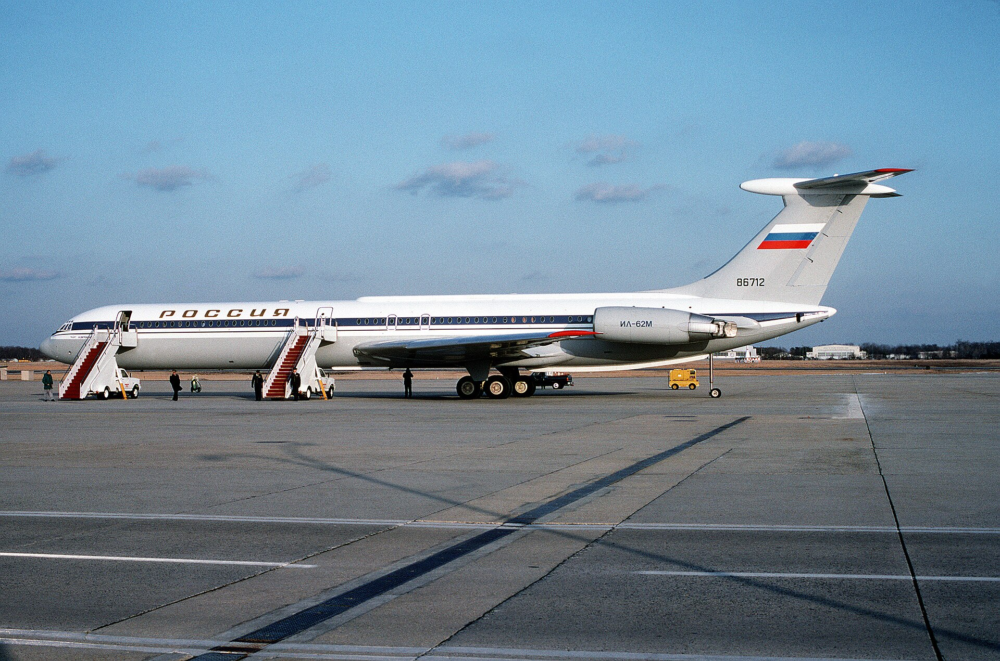
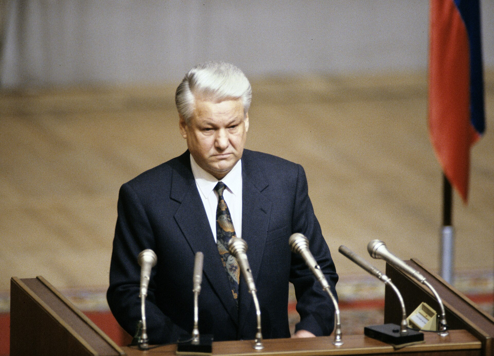
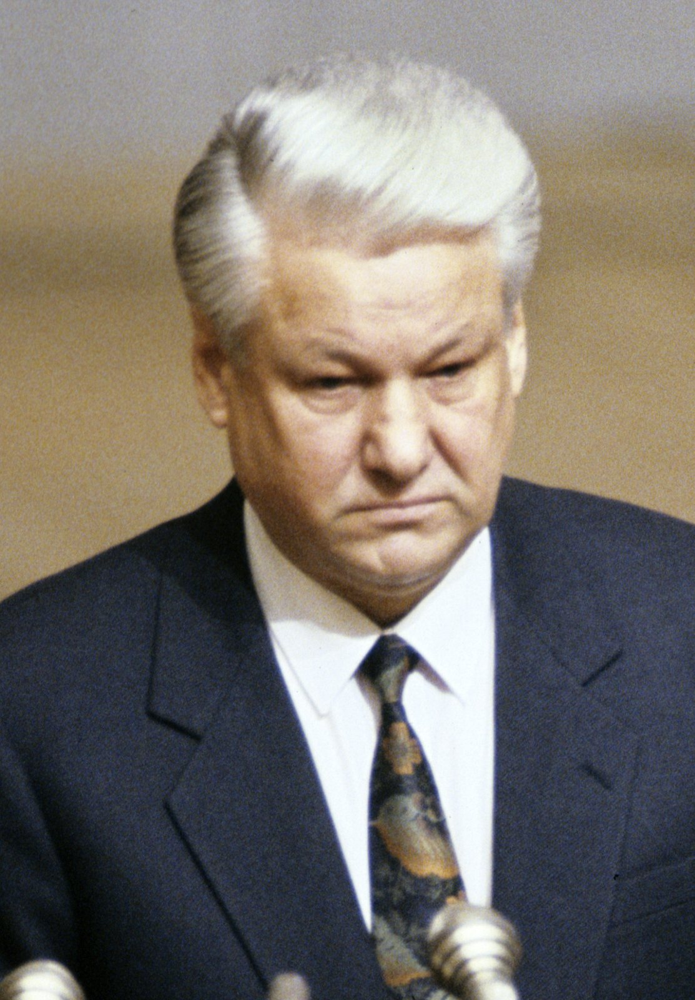

34년 전 오늘, 1992년 11월 19일. 러시아의 보리스 옐친 대통령이 서울 청와대에서 노태우 대통령과 마주 앉았습니다. 냉전의 한 축이었던 옛 소련의 뒤를 이은 러시아 국가원수가 사상 처음으로 대한민국 수도를 찾은 순간이었습니다.

## 서울 땅을 밟은 첫 러시아 국가원수

보리스 옐친 대통령 내외는 노태우 대통령의 초청으로 2박 3일간의 공식 방한을 위해 1992년 11월 18일 오후 특별기편으로 서울공항에 도착했습니다. 현승종 국무총리의 영접을 받은 옐친 대통령은 곧바로 동작동 국립묘지를 찾아 헌화와 분향을 마친 뒤 숙소로 이동했습니다. 수십 년간 이어진 냉전의 대립을 넘어 러시아의 최고 지도자가 국립묘지에 헌화하는 모습은 그 자체로 거대한 역사적 변화를 보여주었습니다.

## 청와대 정상회담과 기본관계조약 서명

11월 19일 오전 청와대에서 양국 정상의 회담이 열렸습니다. 노태우 대통령과 옐친 대통령은 회담을 마친 뒤 양국 간의 신뢰와 우호 협력을 규정한 「한국과 러시아간의 기본관계에 관한 조약」에 서명했습니다. 이와 함께 부총리와 외무·재무·상공·국방 등 관계 장관들도 이중과세방지협정, 세관협력협정, 군사교류 합의서 등 6개 조약과 협약에 서명하며 양국 관계를 공식 제도화했습니다.

*A left side view of the I1-62M aircraft of Russian President Boris Yeltsin parked on on the flight line following the of — 사진: Department of Defense. American Forces Information Service.  / Public domain*

## 회담장에서 건넨 가방 1개, KAL 007기의 진실

이날 정상회담에서 가장 극적인 순간은 옐친 대통령이 가방 1개를 노태우 대통령에게 건넸을 때였습니다. 가방 안에는 지난 1983년 소련 전투기에 격추된 대한항공 007기의 블랙박스 본체와 조종실 음성 기록 테이프(CVR), 비행 기록 테이프(FDR)가 들어 있었습니다. 옐친 대통령은 KAL기 피격 사건에 대한 의혹을 완전히 해소하기 위해 기록 테이프를 그대로 넘겨준다고 밝혔습니다. 노태우 대통령은 이에 대해 러시아 정부가 블랙박스 본체를 넘겨준 것은 양국의 신뢰를 보여주는 것이라며 사의를 표했습니다.

*Борис Ельцин (13-02-1992) — 사진: Юрий Абрамочкин / РИА Новости / CC BY 4.0*

## 북핵 저지 공조와 1961년 군사동맹 재검토

양국 정상은 북한 핵개발 저지를 위한 강력한 공조 의지도 천명했습니다. 옐친 대통령은 북한에 대한 핵물자와 기술 공급을 이미 중단했으며 앞으로도 공급하지 않겠다고 선언했습니다. 또한 북한과 지난 1961년 맺은 우호협력 및 상호원조조약 제1조의 자동 군사개입 조항을 재검토하겠다고 밝혀, 북한과의 군사동맹 조약을 사실상 파기할 수 있음을 내비쳤습니다.

*Борис Ельцин (13-02-1992) (cropped) — 사진: Юрий Абрамочкин / РИА Новости / CC BY 4.0*

## 6.25 자료 인도 약속과 과거사 정리

과거사에 대한 전향적인 태도도 이어졌습니다. 옐친 대통령은 러시아가 6.25 관련 자료를 조사하고 발굴하는 작업을 진행 중이며, 조사가 끝나면 누가 전쟁을 도발했는지 명확히 판명될 것이라고 말했습니다. 이어 12월 말 1단계 자료 조사가 마무리되는 대로 즉각 한국에 자료를 넘기겠다고 약속했습니다. 비극적 사건의 블랙박스와 역사 문서의 공개 약속은 오랜 세월 반목했던 두 나라가 마침내 진실과 화해의 길로 들어서는 중대한 디딤돌이 되었습니다.

### 참고 자료

- <https://newslibrary.naver.com/viewer/index.naver?articleId=1992111900209201001&editNo=3&printCount=1&publishDate=1992-11-19&officeId=00020&pageNo=1&printNo=22004&publishType=00020>
- <https://commons.wikimedia.org/wiki/File:RIAN_archive_6442_Official_visit_of_the_Russian_President_Boris_Yeltsin_to_Korea.jpg>
- <https://commons.wikimedia.org/wiki/File:A_left_side_view_of_the_I1-62M_aircraft_of_Russian_President_Boris_Yeltsin_parked_on_on_the_flight_line_following_the_official%27s_arrival_-_DPLA_-_0a42d3f6008d0bfbc5b182195aaf5fbe.jpeg>
- <https://commons.wikimedia.org/wiki/File:%D0%91%D0%BE%D1%80%D0%B8%D1%81_%D0%95%D0%BB%D1%8C%D1%86%D0%B8%D0%BD_(13-02-1992).jpg>
- <https://commons.wikimedia.org/wiki/File:%D0%91%D0%BE%D1%80%D0%B8%D1%81_%D0%95%D0%BB%D1%8C%D1%86%D0%B8%D0%BD_(13-02-1992)_(cropped).jpg>
