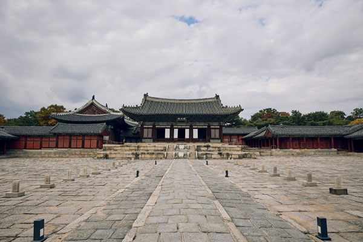
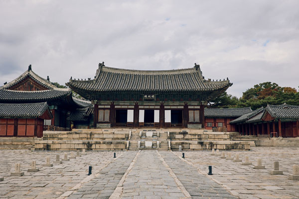
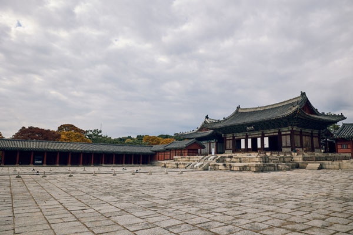

44년 전 오늘, 1982년 11월 19일. 조선 영조 때 사도세자가 갇혀 숨졌던 비극의 뒤주가 220년 만에 세상에 모습을 드러냈습니다. 소설과 드라마 속 비극의 소품으로만 여겨졌던 역사의 형구가 서울의 한 민가에 고스란히 보존되어 온 사실이 밝혀졌습니다.

## 220년 만에 세상에 나온 비극의 뒤주

1982년 11월 18일, 학계 최고 권위자들이 서울 도봉구 미아3동 132의 2에 위치한 한 가옥을 찾았습니다. 문화재위원장 이숭녕 박사와 황수영 동국대학교 총장이 마주한 것은 조선왕조 최대의 비극으로 꼽히는 임오화변의 중심 유물, 바로 사도세자가 갇혀 목숨을 잃었던 뒤주였습니다. 1762년 영조의 노여움을 사 뒤주 속에서 굶주림과 갈증으로 세상을 떠난 사도세자의 유물이 220년 만에 처음으로 외부에 공개된 순간이었습니다.

## 어머니 영빈 이씨가 친정으로 보낸 한 맺힌 유품

이 뒤주가 민가에 보관될 수 있었던 내력은 비통했습니다. 소유자인 이모 씨 문중의 전언에 따르면, 사도세자의 생모인 영빈 이씨가 아들의 참혹한 죽음을 뼈아프게 슬퍼하며 자신의 친정인 광주 이씨 집안으로 뒤주를 옮겨놓도록 했습니다. 세자가 평소 사용하던 삼학경상과 놋대야도 함께 친정으로 보내 영구히 보관하게 했습니다. 집안에서는 뒤주를 들여온 직후 내부에 남아 있던 오물을 치우고 극진히 간직해왔다고 전했습니다.

*사건 당시 사진 아님 — 사진: 세종학당재단 / KOGL Type 1 attribution*

## 가로 110·높이 105센티미터, 굳게 닫혔던 목물

전문가들이 실측한 뒤주는 가로 110센티미터, 세로 70센티미터, 높이 105센티미터 크기였습니다. 3센티미터 두께의 단단한 판자와 12센티미터 두께의 기둥을 사용해 매우 견고하게 짜여 있었으며, 길이 20센티미터에 직경 5센티미터에 달하는 육중한 자물쇠가 채워져 있었습니다. 뒤주 내부에는 후대에 적어 넣은 글씨와 함께, 세자가 숨을 거둘 당시 시신의 위치를 기록한 상하좌우 표시가 뚜렷하게 남아 있었습니다. 집안에서는 매년 정월 초하루가 되면 뒤주 위에 경상을 얹고 물을 가득 채운 놋대야를 올려 제사를 지내왔습니다. 참혹하게 목숨을 잃은 세자가 겪었을 갈증을 달래기 위한 정성이었습니다.

*사건 당시 사진 아님 — 사진: 세종학당재단 / KOGL Type 1 attribution*

## 태종·세종·문종의 어보와 왕실 유물 30여 점

현장에서는 뒤주뿐만 아니라 국보급 가치를 지닌 왕실 유물 30여 점이 함께 확인되어 학계를 놀라게 했습니다. 조선 초기 군주들의 본명이 새겨진 어보 세 점이 대표적이었습니다. 태종의 본명인 '방원'이 새겨진 11센티미터 높이의 흑진주 어보, 세종의 본명 '도'가 새겨진 12센티미터 청옥 어보, 문종의 본명 '향'이 새겨진 9센티미터 백옥 어보였습니다. 당시 종묘에 역대 왕들의 어보 269점이 보존되어 있었으나 태종의 것은 전무했고 세종의 어보 역시 존호만 새겨져 있었기에, 본명이 새겨진 이 어보들은 유일무이한 가치를 지닌 것으로 평가받았습니다.

*사건 당시 사진 아님 — 사진: 세종학당재단 / KOGL Type 1 attribution*

## 6.25 전쟁 속에서도 땅에 묻어 지켜낸 보물들

이 밖에도 명종의 어보, 선조의 계비 인목대비와 영빈 이씨가 사용한 길이 35센티미터의 옥용잠 2개와 옥가락지 4개, 인목대비의 삼합경대와 반닫이, 영빈 이씨의 국화장이 거실과 방 세 개에 가득 차 있었습니다. 숙종 계비 인현왕후 민비의 병풍, 영조가 옥새를 인수했던 옻칠 책상, 영조와 영빈의 수라상, 장희빈의 10폭 자수병풍도 보존되어 있었습니다. 소장자 집안은 6.25 전쟁의 참화 속에서도 유물들을 땅속에 파묻어가며 대를 이어 보존해온 것으로 전해졌습니다.

## 역사의 상처를 마주하게 만든 그날의 기록

유물을 조사한 황수영 박사는 사도세자가 숨진 지 220년이라는 세월과 영빈 이씨 집안과의 인척 관계, 함께 전해오는 각종 왕실 가구와 서화들을 종합할 때 사도세자가 갇혔던 진품 뒤주가 틀림없다는 감정 의견을 내놓았습니다. 한중록과 야담, 드라마 속 이야기로만 마주하던 참혹한 역사가 실물 유물로 확인되며 당시 많은 국민에게 깊은 탄식과 울림을 남겼습니다.

### 참고 자료

- <https://newslibrary.naver.com/viewer/index.naver?articleId=1982111900209201006&editNo=2&printCount=1&publishDate=1982-11-19&officeId=00020&pageNo=1&printNo=18809&publishType=00020>
- <https://www.kogl.or.kr/recommend/recommendDivView.do?division=img&recommendIdx=92344>
- <https://www.kogl.or.kr/recommend/recommendDivView.do?division=img&recommendIdx=92343>
- <https://www.kogl.or.kr/recommend/recommendDivView.do?division=img&recommendIdx=92342>
- <https://www.kogl.or.kr/recommend/recommendDivView.do?division=img&recommendIdx=92341>
