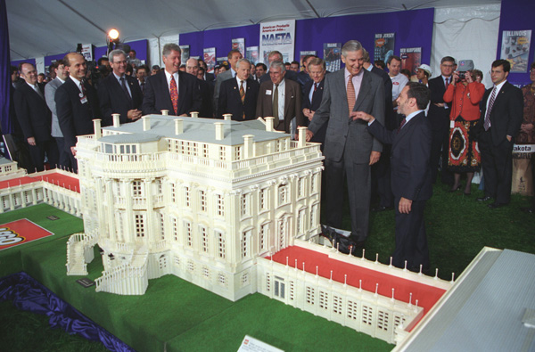
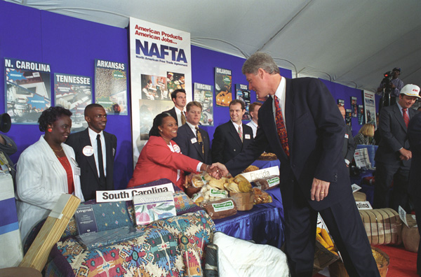
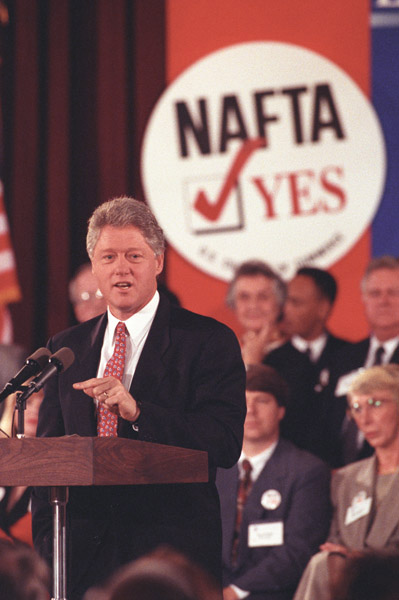

33년 전 오늘, 1993년 11월 19일. 미국 하원이 미국과 캐나다, 멕시코를 하나의 거대한 자유무역지대로 묶는 북미자유무역협정(NAFTA) 비준안을 가결했다는 소식이 국내 주요 조간신문 1면을 대대적으로 장식했습니다. 당시 인구 3억 7천만 명, 국내총생산 6조 8천억 달러에 이르는 세계 최대 단일 무역시장의 등장은 세계 경제의 지형을 뒤흔드는 일대 사건이었습니다.

## 찬성 234표 대 반대 200표, 치열했던 표결

미국 워싱턴 현지 시각 11월 17일 밤, 미국 하원은 나프타 비준안을 두고 운명의 표결을 진행했습니다. 통과에 필요한 하원 과반인 218표를 16표 넘긴 찬성 234표, 반대 200표로 가결되었습니다. 정당별로는 민주당에서 찬성 102표와 반대 156표가 나왔고, 공화당에서 찬성 132표와 반대 43표, 무소속 1표 반대로 집계되어 야당인 공화당의 지지가 결정적 역할을 했습니다. 치열했던 찬반 논쟁을 거쳐 하원을 통과하면서 나프타는 상원 통과와 선포 절차만을 남겨두게 되었습니다.

## 세계 최대 경제 블록의 탄생

나프타는 1994년 1월 1일 발효를 목표로 15년간 세 나라 사이의 상품과 서비스 교역에서 관세 및 비관세 장벽을 단계적으로 철폐하는 협정이었습니다. 미국의 막강한 자본과 고도 기술, 마케팅 능력에 캐나다의 풍부한 천연자원, 멕시코의 저임금 노동력이 결합하는 구조였습니다. 유럽공동체(EC)를 능가하는 거대 단일 시장이 구축되면서 북미 대륙을 아우르는 새로운 무역 질서가 태동했습니다.

*Photograph of President William J. Clinton Looking at a Lego Model of the White House at a North American Free Trade Agr — 사진: President (1993-2001 : Clinton). White House Photograph Offi / Public domain*

## 클린턴 대통령, '다음 표적은 아시아 시장 개방'

하원 비준안 통과 직후 백악관에서 기자회견을 연 빌 클린턴 미국 대통령은 정치적 승리를 선언하며 시선을 해외로 돌렸습니다. 클린턴 대통령은 '이제는 아시아 지역의 무역장벽 철폐에 힘을 모으겠다'며 아시아 시장을 관세화와 시장 개방 압력의 제1 표적으로 지목했습니다. 그는 전 세계 시장을 개방시켜 미국 내에 수십만 개의 일자리를 만들겠다고 공언했습니다. 곧이어 아시아태평양경제협력체(APEC) 정상회담이 열리는 시애틀로 떠나 아시아 지도자들에게 시장 개방을 직접 요구하겠다고 밝혔습니다.

*Photograph of President William J. Clinton Participating in a North American Free Trade Agreement (NAFTA) Products Event — 사진: President (1993-2001 : Clinton). White House Photograph Offi / Public domain*

## 한국 대미 수출에 닥친 심각한 위기감

이 소식은 당시 미국 시장 의존도가 높았던 한국 경제에 큰 충격파를 던졌습니다. 북미 지역 현지 생산 기반이 취약했던 한국은 무관세 혜택을 받는 멕시코산 제품과의 가격 경쟁에서 밀릴 수밖에 없다는 우려가 쏟아졌습니다. 특히 당시 한국의 주력 수출 품목이었던 섬유, 의류, 신발 분야가 직접적인 타격을 입어, 이듬해 한 해 동안에만 3억 달러 이상의 대미 수출 감소가 나타날 것이라는 어두운 전망이 나왔습니다.

*Photograph of President William J. Clinton Speaking at the North American Free Trade Agreement (NAFTA) Event at the Unit — 사진: President (1993-2001 : Clinton). White House Photograph Offi / Public domain*

## 우루과이라운드와 세계화 파고의 시작

나프타 통과는 단순히 북미 3국의 협정에 그치지 않았습니다. 클린턴 대통령은 나프타 비준을 지렛대 삼아 전 세계적인 우루과이라운드(UR) 협정 타결을 강력히 밀어붙이겠다고 예고했습니다. 빗장을 걸어 잠그던 시대가 끝나고 국가 간 관세 장벽이 무너지는 무한경쟁의 시대가 눈앞으로 다가왔음을 알리는 신호탄이었습니다. 신문과 방송마다 연일 긴급 대책 마련을 촉구하며 긴장감이 최고조에 달했습니다.

### 참고 자료

- <https://newslibrary.naver.com/viewer/index.naver?articleId=1993111900209101001&editNo=40&printCount=1&publishDate=1993-11-19&officeId=00020&pageNo=1&printNo=22348&publishType=00010>
- <https://commons.wikimedia.org/wiki/File:Photograph_of_President_William_J._Clinton_and_Vice_President_Al_Gore_Meeting_with_Environmental_Groups_Endorsing_the_North_American_Free_Trade_Agreement_-_DPLA_-_76633517c5d59d945dd722a1e919473e.jpg>
- <https://commons.wikimedia.org/wiki/File:Photograph_of_President_William_J._Clinton_Looking_at_a_Lego_Model_of_the_White_House_at_a_North_American_Free_Trade_Agreement_(NAFTA)_Products_Event_-_DPLA_-_cd7e12bf779f874e7d2ec2b7e02efbf1.jpg>
- <https://commons.wikimedia.org/wiki/File:Photograph_of_President_William_J._Clinton_Participating_in_a_North_American_Free_Trade_Agreement_(NAFTA)_Products_Event_on_the_South_Lawn_-_DPLA_-_ed1c536bfddf7f9b27760532929fe645.jpg>
- <https://commons.wikimedia.org/wiki/File:Photograph_of_President_William_J._Clinton_Speaking_at_the_North_American_Free_Trade_Agreement_(NAFTA)_Event_at_the_United_States_Chamber_of_Commerce_-_DPLA_-_6fa8a3d5de42247a97329652282abbf3.jpg>
