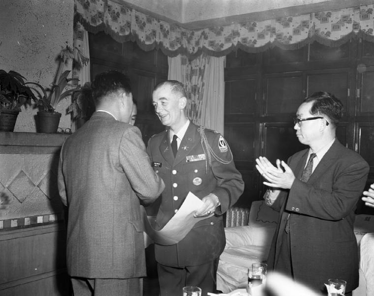
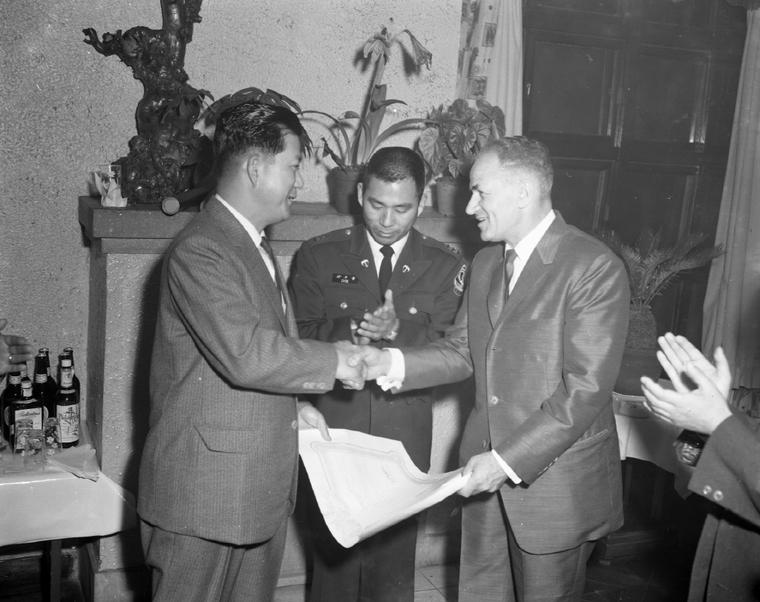
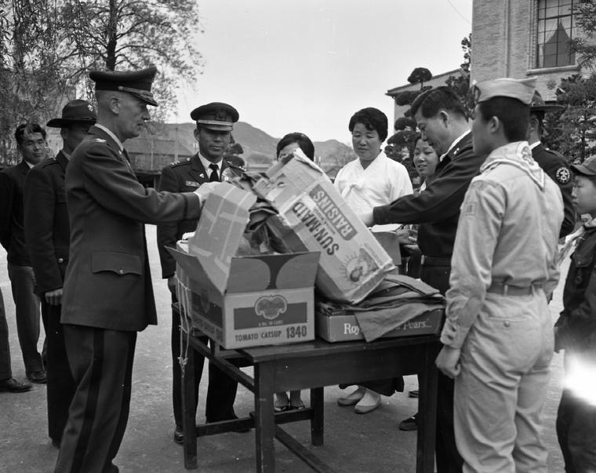

53년 전 오늘, 1973년 11월 19일. 주한미군이 사용해 오던 군용 화폐, 이른바 '미군표(MPC)'의 사용이 전격 중지됐습니다. 한미 주한미군지위협정(SOFA) 합동위원회의 발표로 해방 이후 한국 사회의 그늘과 일상을 함께했던 군용 지폐가 역사의 뒤안길로 물러났습니다.

## 미군표의 정체와 도입 배경

미군표는 정식 명칭으로 군용 지불 증서(MPC)라 불리던 특수 화폐였습니다. 미국 정부가 전시나 준전시 상태로 간주되는 특정 지역에 주둔하는 군인들의 급여와 영내 거래를 위해 발행한 지폐였습니다. 본토 달러의 무분별한 유출을 막고 달러의 국제적 가치 안정을 도모하기 위한 장치였습니다.

주한미군은 해방 이후 한국에 주둔하면서 영내 매점인 피엑스(PX)와 각종 미군 시설에서 이 미군표를 공식 지불 수단으로 활용해 왔습니다. 푸른빛이나 붉은빛을 띤 독특한 도안의 이 지폐는 군부대 내부에서 통용되는 제한된 돈이었지만, 한국 현대사의 굴곡 속에서 부대 담장을 넘어 일반 사회로까지 번져 나갔습니다.

## 태환 불가와 암거래의 온상

미군표는 원칙적으로 한국 화폐와의 공식 환전, 즉 태환이 인정되지 않는 화폐였습니다. 인가받은 미군 관계자만이 소지하고 사용할 수 있는 것이 원칙이었습니다. 그러나 한국 전쟁 이후 물자가 극도로 부족했던 시절, 미군표는 피엑스에서 흘러나오는 귀한 외제 물품을 구입할 수 있는 특별한 수단으로 인식되었습니다.

이로 인해 미군표를 불법으로 손에 넣은 일부 내국인들이 피엑스 물품을 대량으로 사들여 시중에 유통하는 암거래가 번번이 발생했습니다. 부정하게 유출된 미군표가 수사 당국에 적발되더라도 물품의 유출을 일시적으로 막을 뿐, 유출된 군표 자체를 환수하거나 구제할 방법이 마땅치 않아 당국의 큰 골칫거리였습니다.

*사건 당시 사진 아님 · 1963년 — 사진: 충청남도 / KOGL Type 0 Public Domain*

## 1973년 11월 19일, 전격적인 사용 중지

이러한 부작용을 해소하기 위해 한미 양국은 주한미군지위협정 합동위원회를 통해 미군표 폐지를 전격 결정했습니다. 지난 11월 5일 열린 회의에서 최종 합의에 도달한 뒤, 11월 19일 아침을 기해 미군표의 효력을 공식 중지시켰습니다.

이날부터 한국 내에서 인가받은 대상자가 소지하고 있던 기존의 미군표는 미 본토 달러로 교환되기 시작했습니다. 그동안 군사적 특수 화폐로만 유지되던 주한미군의 지불 수단이 마침내 미국 본토의 공식 통화인 달러화로 정상화된 순간이었습니다.

*사건 당시 사진 아님 · 1963년 — 사진: 충청남도 / KOGL Type 0 Public Domain*

## 엄격한 통화 제한 조치와 단속

미군표를 폐지하고 달러화를 도입하면서 한미 합동위원회는 엄격한 통제 방침을 함께 발표했습니다. 달러 사용은 오직 미국 관련 시설 내부로만 제한되었으며, 인가되지 않은 일반 한국인의 미 본토 달러 소지와 사용은 계속해서 금지되었습니다.

미국 측 사법기관은 주한미군과 군속, 그 가족들의 불법 통화 거래를 철저히 단속하기로 했습니다. 미군 은행 시설 역시 개인 계좌를 통한 비정상적인 달러 예치나 인출을 엄격히 감시했습니다. 아울러 한국 통화법에 따라 합법적 경로가 아닌 방식으로 달러를 취득하는 내국인에 대한 한국 사법당국의 단속 강화도 함께 요청되었습니다.

*사건 당시 사진 아님 · 1963년 — 사진: 충청남도 / KOGL Type 0 Public Domain*

## 한국 경제 안정의 공인과 역사적 의미

미군표의 사용 중지는 단순한 군용 화폐의 교체를 넘어 한국 경제사에서도 적지 않은 의미를 지녔습니다. 미군표는 전쟁 위협이 상존하고 경제가 불안정한 지역에서 주로 쓰이던 통화였기에, 이를 폐지했다는 것은 미국 정부가 한국 경제의 안정도를 객관적으로 인정했다는 뜻으로 풀이되었습니다.

외자 도입과 대외 신인도 제고에 긍정적인 신호로 평가받았던 미군표 폐지 조치. 기지촌 주변과 시장 골목을 떠돌며 시대를 대변하던 특수 지폐는 그렇게 역사의 기록 속으로 사라졌습니다.

### 참고 자료

- <https://newslibrary.naver.com/viewer/index.naver?articleId=1973111900209201005&editNo=2&printCount=1&publishDate=1973-11-19&officeId=00020&pageNo=1&printNo=16042&publishType=00020>
- <https://www.kogl.or.kr/recommend/recommendDivView.do?division=img&recommendIdx=37697>
- <https://www.kogl.or.kr/recommend/recommendDivView.do?division=img&recommendIdx=37691>
