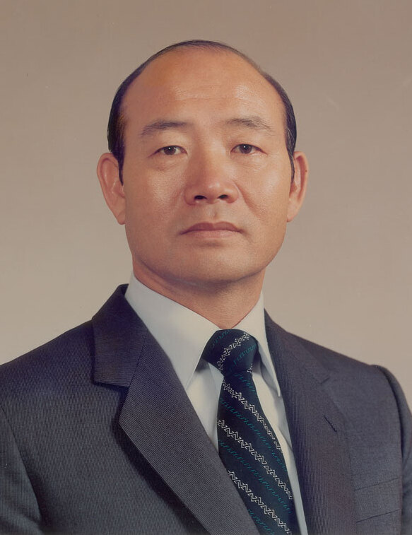
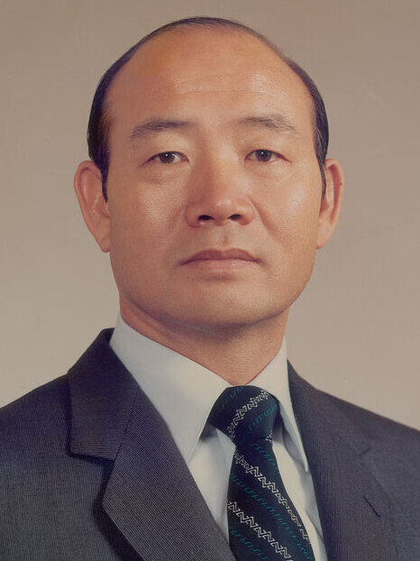

45년 전 오늘인 1981년 11월 20일, 신문 지면에는 오랜 세월 국민의 밤길을 통제해 왔던 야간통행금지가 곧 사라진다는 반가운 소식이 실렸습니다. 해방되던 해부터 시작되어 37년 동안이나 이어졌던 통금이 마침내 막을 내리게 된 결정적 순간이었습니다.

## 여의도 전경련회관에서 성사된 전격 합의

1981년 11월 19일 저녁, 서울 여의도 전경련회관에 여야 지도부와 정부 핵심 관계자들이 속속 모여들었습니다. 민정당의 권정달 사무총장과 나석호 정책위의장, 이종찬 원내총무, 윤석순 사무차장이 참석했고, 민한당에서는 신상우 사무총장과 고재청 원내총무, 한영수 정책위의장이 마주 앉았습니다. 여기에 국민당의 신철균 사무총장, 조일제 정책위의장, 이동진 원내총무, 의정동우회의 황명수 회장 대행, 그리고 정부 측의 정종택 정무제1장관까지 함께했습니다. 이날 모임은 초저녁부터 1시간 50분 동안 진지하게 이어졌습니다. 각 정파의 대표들은 국민 생활을 옥죄어온 통금 조치를 이번 정기국회 회기 내에 해제하도록 정부에 건의안을 내기로 전격 합의했습니다.

## 해방 이후 37년 만에 풀리는 통제의 밤

우리나라의 야간통행금지는 해방되던 해로부터 시작되어 37년이라는 긴 시간 동안 유지되었습니다. 건국 36년 동안 전 국민의 밤길을 가로막았던 통금은 사이렌 소리와 함께 일상을 멈추게 만들던 대표적인 제도였습니다. 하지만 이날 여야가 뜻을 모으면서 군사작전이나 치안상 반드시 필요한 접적지역과 일부 해안선을 제외한 전국 90% 이상의 지역에서 통금이 사라지게 되었습니다. 비록 국회의 건의안이 법적 구속력을 갖는 것은 아니었으나, 여당인 민정당이 이미 정부 측과 충분한 사전 협의를 마친 상태였기에 실제 해제는 확실시되었습니다.

*사건 당시 사진 아님 · 1980년 — 사진: Korea.net / Korean Culture and Information Service / CC BY-SA 2.0*

## 서울올림픽 개최와 개방 시대로의 전환

통금 해제가 급물살을 타게 된 가장 큰 배경에는 오는 88년 서울에서 열릴 올림픽이 있었습니다. 세계인의 축제인 올림픽 유치가 결정된 상황에서, 수도 서울을 비롯한 온 나라의 밤길을 통제하는 것은 대외적인 위상에 맞지 않는다는 판단이 작용했습니다. 민정당 권정달 사무총장은 회담을 마친 뒤 개방 시대에 대처하고 국민에게 제약을 가해오던 구시대의 제도를 풀어야 할 때라고 설명했습니다. 또한 올림픽에 대비해 국민적 훈련을 쌓고 사회 안정과 국력 신장을 대내외에 과시하기 위해 통금 해제를 결정했다고 밝혔습니다. 정부 역시 올림픽 개최와 관련해 적당한 시기에 통금을 해제하겠다는 방침을 이미 시사한 바 있었습니다.

*사건 당시 사진 아님 · 1980년 — 사진: Korea.net / Korean Culture and Information Service / CC BY-SA 2.0*

## 시행 시기를 둘러싼 조율과 준비

통금 해제의 원칙은 확정되었으나 구체적인 시행 시기를 두고는 신중한 접근이 이어졌습니다. 당초 이르면 내년 1월 중에 시행될 것이라는 관측이 나왔으나, 치안 공백을 막기 위한 정부의 사전 준비가 먼저 갖춰져야 했습니다. 권정달 사무총장은 통금 해제 시기가 정부의 준비 조치를 감안해 결정될 문제라며, 당장 내년 1월 1일부터라고 못 박을 수는 없지만 내년 중 조속한 시일 내에 해금되도록 건의하겠다고 설명했습니다. 국회가 이번 회기 내에 건의안을 통과시켜 정부로 보내면, 정부는 국무회의 의결을 거쳐 필요한 조치를 공포하고 단계적 혹은 전면적 해제를 밟아나가기로 했습니다.

![[1356호] 원효대교 준공 원효대교 준공(원효로 4가~ 여의도 ) (1981.10.30) 장면 1](../images/2026-11-20-01-4.jpg)
*[1356호] 원효대교 준공 원효대교 준공(원효로 4가~ 여의도 ) (1981.10.30) 장면 1 — 사진: KTV 국민방송 e영상역사관 (대한뉴스) / KTV 공공저작물 — 영상 저작물 전면 개방(대통령실 2025-07-09), 출처 표시*

## 올림픽특위와 과거 특별법 폐지 합의

이날 1시간 50분에 걸친 회담에서는 야간통행금지 해제 외에도 여러 정치 현안이 함께 다뤄졌습니다. 여야는 오는 88년 서울올림픽을 범국민적으로 뒷받침하기 위해 국회 안에 올림픽문제를 다룰 특별위원회를 설치하기로 의견을 모았습니다. 아울러 과거 비상 시국에 만들어졌던 「국가보위에 관한 특별조치법」과 「8.3경제조치」의 폐지 법안을 이번 정기국회 회기 내에 여야 공동으로 발의해 처리하기로 재확인했습니다. 비록 교육세 신설 문제와 약 5백억원 규모의 새해 예산안 삭감 문제를 두고는 각 당의 입장이 갈려 추후 다시 논의하기로 했으나, 시국을 풀기 위한 대화의 물꼬를 텄다는 점에서 큰 주목을 받았습니다.

## 해방 이후의 숙제를 풀고 나눈 건배

회담을 마친 여야 중진들은 한자리에 모여 활짝 웃는 얼굴로 건배를 나누었습니다. 언론은 이를 두고 '해방 이후의 숙제를 푼 초저녁 회합'이자 '범정파 건배'라고 전했습니다. 정부와 여당의 사전 조율이 바탕이 되긴 했지만, 여야가 머리를 맞대고 대화 형식으로 오랜 난제를 해결했다는 점에서 긍정적인 평가가 이어졌습니다. 37년 동안 닫혀 있던 밤의 문이 열리고, 대한민국의 일상은 완전히 새로운 전기를 맞이하게 되었습니다.

### 참고 자료

- <https://newslibrary.naver.com/viewer/index.naver?articleId=1981112000329201004&editNo=2&printCount=1&publishDate=1981-11-20&officeId=00032&pageNo=1&printNo=11122&publishType=00020>
- <https://commons.wikimedia.org/wiki/File:A_member_of_the_Korean_Army_Logistics_Command_Band_and_members_of_the_Dong_Ju_High_School_girls_band_await_the_arrival_of_the_aircraft_carrier_USS_MIDWAY_(CV_41)_-_DPLA_-_98c9ba03122ebd9ae41d263329f3c03a.jpeg>
- <https://commons.wikimedia.org/wiki/File:Chun_Doo-hwan_(%EC%A0%84%EB%91%90%ED%99%98)_Presidential_Portrait_(cropped).jpg>
- <https://commons.wikimedia.org/wiki/File:Chun_Doo-hwan_(%EC%A0%84%EB%91%90%ED%99%98)_Presidential_Portrait_(3x4).jpg>
- <https://www.ehistory.go.kr/view/movie?mediasrcgbn=KV&mediaid=10390&mediadtl=22314&mediagbn=DH#t=0.3>
