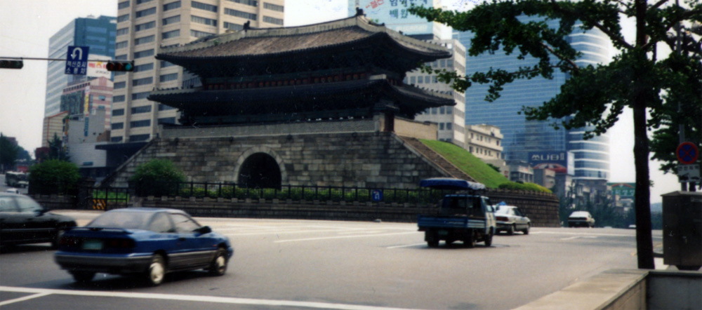
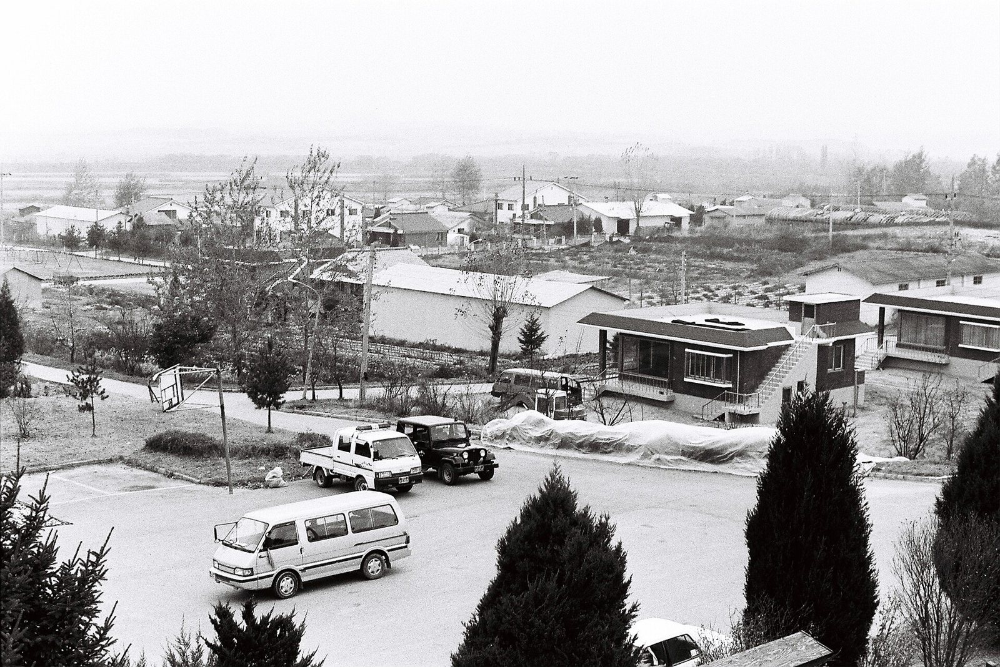
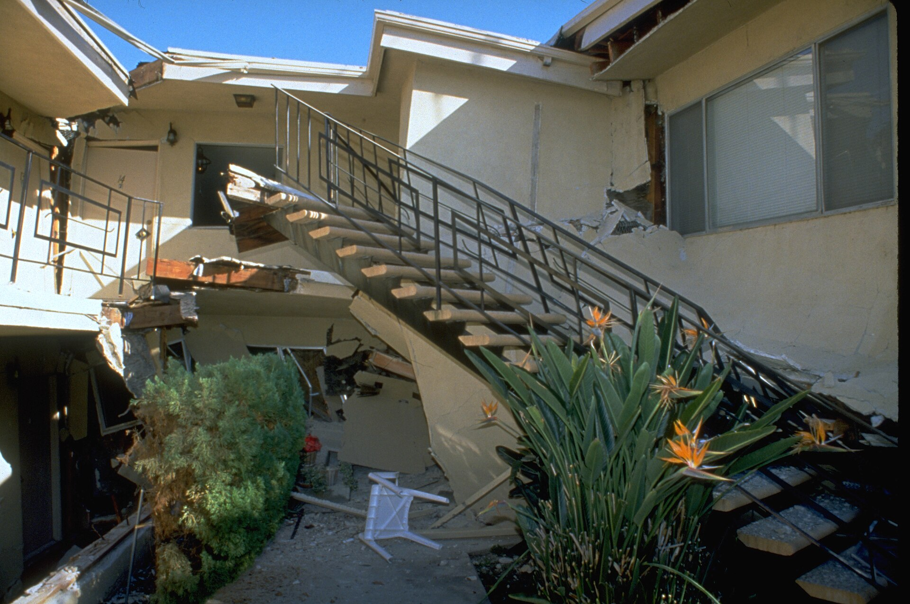

32년 전 오늘, 1994년 11월 20일. 서울 남산의 남쪽 능선을 가로막고 서 있던 남산외인아파트가 폭파 공법으로 완전히 철거되었습니다. 굉음과 함께 거대한 콘크리트 건물 두 동이 주저앉는 데 걸린 시간은 불과 15초였습니다.

## 남산의 하늘을 가로막았던 고층 아파트

남산 남쪽 능선에 자리했던 남산외인아파트는 1972년에 건립되었습니다. 2개 동으로 이루어진 이 고층 건물은 건립 당시 현대적인 시설을 자랑했으나, 해발 270.85미터 높이의 남산 산자락 한가운데 솟아 있어 도심 남쪽 능선의 흐름을 정면으로 끊어놓았습니다.

서울 시내 곳곳에서 바라보았을 때 남산의 자연스러운 산세를 가로막는 대표적인 흉물로 지적받았고, 자연환경과 도시 경관을 훼손한다는 비판이 오랫동안 이어졌습니다.

## 서울정도 600년 기념 '남산 제모습 찾기'

조선 태조가 1394년 한양으로 도읍을 옮긴 이래 남산은 수도 한양을 둘러싼 성곽의 남쪽 안산이자 목멱산으로 불리며 도심의 중심 역할을 해왔습니다. 그러나 일제강점기 조선신궁 조성과 해방 이후의 무분별한 개발로 원래의 산세를 크게 잃어버렸습니다.

서울시는 1991년부터 공원 내 부정적 시설 89동을 이전하고 예장동, 회현동, 한남동 일대를 정비하는 대대적인 '남산 제모습 가꾸기' 사업에 돌입했습니다. 그리고 서울정도 600년을 맞이한 1994년, 남산 본래의 능선을 가로막던 외인아파트를 전격 철거하기로 최종 결정했습니다.

*Southern Gate 숭례문 崇禮門 (5678277441) — 사진: InSapphoWeTrust from Los Angeles, California, USA / CC BY-SA 2.0*

## 단 15초 만에 사라진 콘크리트 벽

1994년 11월 20일 오후 3시, 남산 자락 현장에는 수많은 시민과 취재진의 시선이 집중되었습니다. 발파 카운트다운이 끝나자마자 건물 내부에 설치된 폭약이 순차적으로 폭발했습니다.

거대한 2개 동의 아파트는 폭파 해체 공법에 따라 제자리에서 폭삭 주저앉았고, 이 모든 과정에 걸린 시간은 불과 15초였습니다. 솟구쳐 오른 자욱한 먼지 구름이 걷히자 오랫동안 가려져 있던 남산의 시원한 산자락이 마침내 푸른 하늘 아래 그대로 드러났습니다.

*1994년 11월 북방선 일대 통일촌 — 사진: 경기도 / KOGL Type 1*

## 공원으로 돌아온 남산 자락

철거된 외인아파트 부지와 인근 외인 단독주택단지 자리는 1996년까지 야외식물원을 비롯한 생태 공원으로 조성되었습니다. 콘크리트 건물이 서 있던 자리에 다양한 초본과 목본 식물이 심어지며 시민들이 편안하게 거닐 수 있는 녹지 공간으로 거듭났습니다.

또한 서울시는 같은 해 11월 29일 남산 산자락에 서울의 생활과 문화를 담은 문물 600점을 수장한 서울 1000년 타임캡슐을 매설하여 400년 후인 2394년에 열리도록 보존하였습니다.

*사건 당시 사진 아님 · 1994년 — 사진: FEMA News Photo / Public domain*

## 오늘날 서울의 중심과 녹색 쉼터

남산은 1940년 공원으로 지정되고 1968년 9월 2일 개원한 이래, 오늘날 서울에서 가장 넓은 면적을 자랑하는 시민의 공원으로 사랑받고 있습니다. 1962년 5월 12일 운행을 시작한 남산케이블카와 해발 480미터 높이에 이르는 남산서울타워는 서울을 상징하는 명소로 확고히 자리 잡았습니다.

1994년 11월 20일 단 15초 만에 이루어진 외인아파트 폭파는 남산을 다시 자연의 모습으로 되돌리고 시민들의 쉼터로 온전히 회복시킨 뜻깊은 역사의 한 장면으로 기억되고 있습니다.

### 참고 자료

- <https://newslibrary.naver.com/viewer/index.naver?articleId=1994112000209101009&editNo=45&printCount=1&publishDate=1994-11-20&officeId=00020&pageNo=1&printNo=22690&publishType=00010>
- <https://commons.wikimedia.org/wiki/File:Kyongheru.jpg>
- <https://commons.wikimedia.org/wiki/File:Southern_Gate_%EC%88%AD%EB%A1%80%EB%AC%B8_%E5%B4%87%E7%A6%AE%E9%96%80_(5678277441).jpg>
- <https://commons.wikimedia.org/wiki/File:1994%EB%85%84_11%EC%9B%94_%EB%B6%81%EB%B0%A9%EC%84%A0_%EC%9D%BC%EB%8C%80_%ED%86%B5%EC%9D%BC%EC%B4%8C.jpg>
- <https://commons.wikimedia.org/wiki/File:Collapsed_Apartment_building_stairway,_1994_Northridge_Earthquake.jpg>
