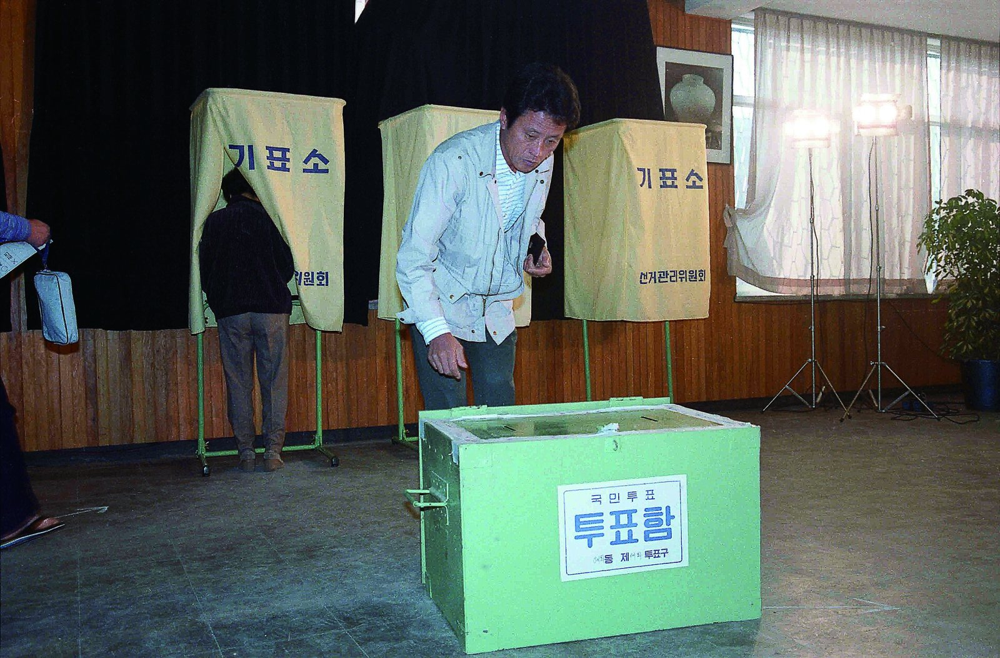
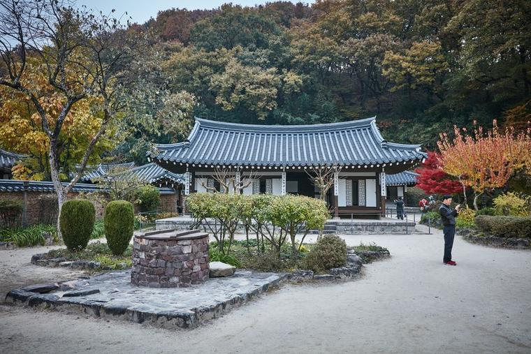
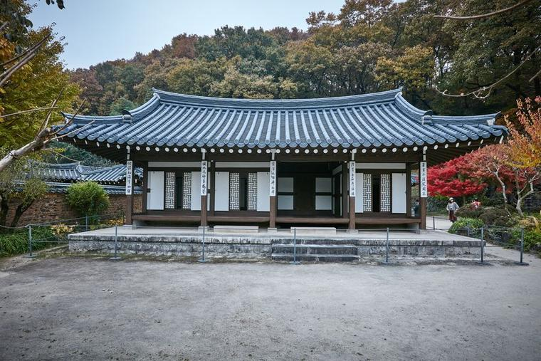

39년 전 오늘인 1987년 11월 20일, 신문과 방송은 일제히 한국 재계의 큰 별이 졌다는 소식을 전했습니다. 삼성그룹을 창업해 굴지의 기업집단으로 키워낸 호암 이병철 회장이 11월 19일 오후 5시 5분, 서울 용산구 이태원동 자택에서 폐암으로 별세했다는 소식이었습니다. 향년 78세였습니다.

## 대구 삼성상회에서 시작된 3만 원의 출발

1910년 경남 의령에서 태어난 이병철 회장은 중동중학을 거쳐 일본 와세다대학 정경과를 다니다 귀국했습니다. 이후 사업에 뜻을 두고 1938년 3월, 대구 수동에서 자본금 3만 원으로 삼성상회 간판을 내걸었습니다.

삼성상회는 청과류와 건어물을 도소매하고 중국 등지로 수출하며 기반을 닦았습니다. 당시 출시했던 '별표국수'는 대중에게 큰 인기를 끌며 사업의 든든한 밑천이 되었습니다.

## 제조업 개척과 전자산업 진출로 일군 14조 원

광복과 한국전쟁의 혼란을 거치며 이 회장은 1951년 부산에서 삼성물산을 다시 세웠고, 1953년 제일제당, 1954년 제일모직을 잇따라 설립하며 제조업에 본격적으로 뛰어들었습니다. 수입에 의존하던 소비재를 직접 생산해 산업의 기틀을 마련하겠다는 구상이었습니다.

1969년에는 삼성전자공업을 세우며 당시로서는 모험에 가까웠던 전자산업에 진출했습니다. 이후 중화학공업, 유통, 언론, 금융 등으로 영역을 넓혀가며 삼성은 37개 계열사에 연간 외형 14조 원에 이르는 국내 최정상급 기업집단으로 우뚝 섰습니다. 1961년에는 전국경제인연합회의 전신인 한국경제인협회 창설을 이끌고 초대 회장을 맡기도 했습니다.

*대통령직선제 개헌 찬반 국민투표 — 사진: 서울역사아카이브 / KOGL Type 1*

## 이태원 자택에서 맞이한 마지막 순간

칠순을 넘긴 나이에도 경영 일선을 지휘하던 이병철 회장은 1986년 말부터 폐암 진단을 받고 투병 생활을 이어왔습니다. 1987년 11월 7일 증세가 급격히 나빠져 서울대병원에 입원해 치료를 받다 이태원동 자택으로 돌아왔습니다.

그리고 11월 19일 늦은 오후, 서울 용산구 이태원동 자택에서 부인 박두을 여사와 4남 6녀의 가족들이 지켜보는 가운데 조용히 숨을 거두었습니다. 자서전 『호암자전』을 남기고 떠난 그의 빈소에는 정·재계 인사들의 조문 발길이 이어졌습니다.

*사건 당시 사진 아님 — 사진: 한국관광공사 / KOGL Type 1 attribution*

## 호암아트홀 영결식과 자연농원 안장

고인의 장례는 사흘 뒤인 11월 23일 오전 9시, 서울 서소문동 중앙일보사 호암아트홀에서 삼성그룹장으로 엄수되었습니다. 정관계와 재계 주요 인사들이 참석해 한 시대를 이끈 기업인의 마지막 길을 배웅했습니다.

영결식을 마친 운구 행렬은 경기도 용인군 용인자연농원(현 에버랜드) 내에 마련된 묘역으로 향했습니다. 자연농원은 고인이 생전 황무지를 개간해 대규모 농원과 국민 휴식처로 가꾼 각별한 장소였습니다.

*사건 당시 사진 아님 — 사진: 한국관광공사 / KOGL Type 1 attribution*

## 이건희 회장 체제의 출범과 새로운 시대

이병철 창업주의 타계 이후 삼성그룹의 대권은 셋째 아들인 이건희 부회장에게 계승되었습니다. 이건희 회장은 그해 12월 삼성그룹 제2대 회장으로 취임하며 삼성을 이끌게 되었습니다.

이후 삼성은 제일제당(현 CJ), 전주제지(현 한솔), 신세계백화점 등으로 계열 분리를 거치며 오늘날의 반도체와 첨단 정보기술(IT) 중심의 글로벌 기업으로 거듭나는 변곡점을 맞이했습니다.

### 참고 자료

- <https://newslibrary.naver.com/viewer/index.naver?articleId=1987112000209201009&editNo=2&printCount=1&publishDate=1987-11-20&officeId=00020&pageNo=1&printNo=20349&publishType=00020>
- <https://commons.wikimedia.org/wiki/File:6%EC%9B%94_%EB%AF%BC%EC%A3%BC_%ED%95%AD%EC%9F%81_%EB%B3%B4%ED%96%89%EB%A1%9C_%EB%8F%85%EC%9E%AC_%EA%B7%9C%ED%83%84_%EB%AC%B8%EA%B5%AC.jpg>
- <https://commons.wikimedia.org/wiki/File:%EB%8C%80%ED%86%B5%EB%A0%B9%EC%A7%81%EC%84%A0%EC%A0%9C_%EA%B0%9C%ED%97%8C_%EC%B0%AC%EB%B0%98_%EA%B5%AD%EB%AF%BC%ED%88%AC%ED%91%9C.jpg>
- <https://www.kogl.or.kr/recommend/recommendDivView.do?division=img&recommendIdx=2758>
