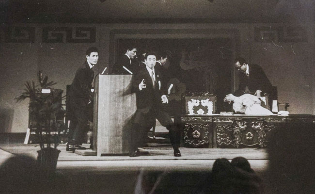
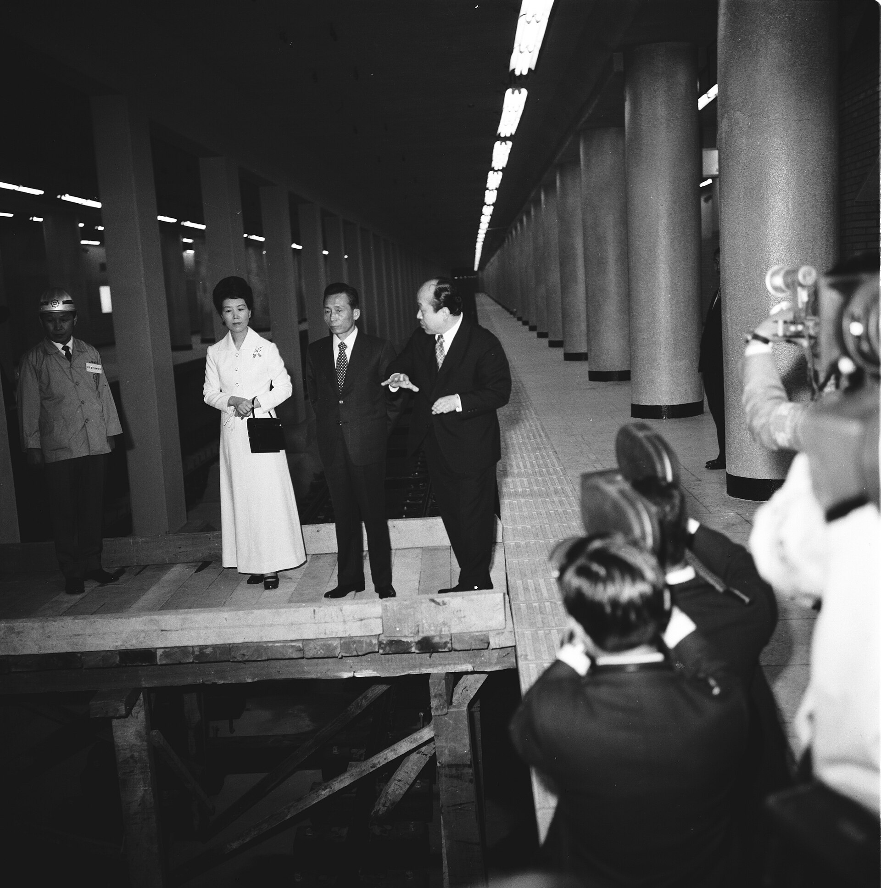
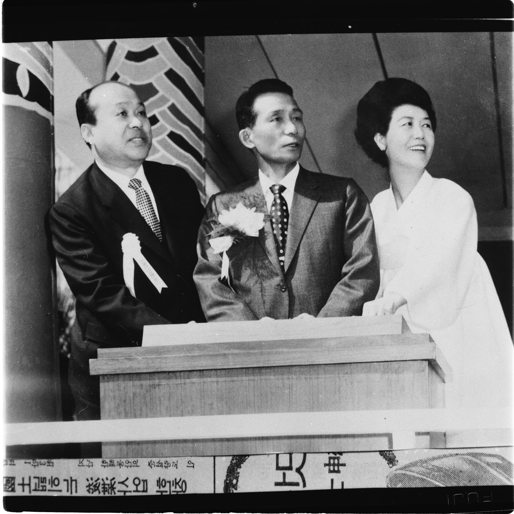

52년 전 오늘, 1974년 11월 20일. 서울고등법원 제2형사부는 8·15 저격 사건의 범인 문세광에게 항소심에서도 사형을 선고했습니다. 광복절 행사장에서 울린 흉탄으로 영부인 육영수 여사가 서거한 지 석 달 만에 내려진 항소심 판결이었습니다.

## 국립극장을 뒤흔든 8·15의 총성

1974년 8월 15일 오전 10시 23분, 서울 국립극장에서 열린 제29회 광복절 경축식장은 순식간에 아수라장으로 변했습니다. 박정희 대통령이 경축사를 낭독하던 도중 객석 뒤편에서 총성이 울렸습니다. 재일동포 문세광이 권총을 들고 단상을 향해 돌진하며 난사한 탄환 중 한 발이 연단에 앉아 있던 영부인 육영수 여사의 머리에 맞았습니다.

육영수 여사는 즉시 서울대병원으로 이송되어 5시간이 넘는 뇌수술을 받았으나, 끝내 의식을 회복하지 못하고 그날 저녁 7시에 서거했습니다. 온 국민은 깊은 슬픔과 충격에 휩싸였고, 8월 19일 거행된 국민장 영결식에는 수많은 시민이 거리로 나와 눈물로 마지막 길을 배웅했습니다.

## 혼자 죽긴 억울하다며 낸 항소

현장에서 체포된 문세광은 스물세 살의 청년이었습니다. 수사 당국은 그가 북한의 사주를 받은 조총련계 공작에 포섭되어 대통령 암살을 기도한 것으로 결론지었습니다. 서울형사지방법원에서 열린 1심 재판부는 사건 발생 약 두 달 만인 1974년 10월 19일, 문세광에게 사형을 선고했습니다.

사형 선고를 받은 문세광은 곧바로 판결에 불복해 항소장을 냈습니다. 당시 그는 배후와 공범들이 아직 잡히지 않은 상황에서 혼자 모든 책임을 지고 죽는 것은 억울하다는 주장을 폈습니다. 변호인 측 또한 피고인이 범행에 이르게 된 환경과 조총련의 책동 등을 참작해 형량을 낮춰야 한다고 주장했습니다.

*1974년 자료 — 사진: 임희순(조선일보 기자) / Public domain*

## 서울고법 제2형사부의 기각 판결

1974년 11월 20일 오전 10시 25분, 서울고등법원 제2형사부 심리로 열린 항소심 선고공판에 내외신 기자들과 방청객들의 이목이 쏠렸습니다. 재판장 전상석 부장판사는 판결문을 낭독하며 피고인의 항소를 기각하고 원심대로 사형을 선고한다고 밝혔습니다.

재판부는 조총련의 책동이 범행의 원천적 배경이라는 점에 일부 수긍할 면이 있다 하더라도, 범행 자체의 무게를 결코 덜어낼 수는 없다고 못 박았습니다. 재판부는 범행 동기와 목적의 불법성, 피고인의 광신적 폭력성과 소영웅주의적 성격, 저격이라는 수단의 잔혹성을 차례로 지적했습니다.

*1973년 자료 — 사진: 서울역사박물관 / KOGL Type 1*

## 결과의 중대성과 국가 안위의 위협

재판부가 밝힌 사형 유지의 결정적 이유는 피해와 파장의 막대함이었습니다. 비록 대통령 암살은 미수에 그쳤으나 국가원수에게 총구를 겨누었고, 그 결과 국가원수 부인의 고귀한 생명을 앗아간 결과는 돌이킬 수 없을 만큼 중대하다는 판단이었습니다.

또한 북한과 대치하고 있는 국가안보적 현실에서 이러한 범행은 극심한 사회적 불안을 초래하고 국기를 흔들어 국가의 안위를 위협한 가공할 범죄라고 규정했습니다. 변호인이 거론한 사형폐지론에 대해서도 양심적이고 합리적인 심리를 거쳐 명백히 증명된 중대 범죄에 대해 사형을 피하는 것은 심판의 기피라며 단호히 선을 그었습니다.

*1971년 자료 — 사진: 서울역사박물관 / KOGL Type 1*

## 단호했던 사법부와 남겨진 역사

항소심에서도 사형이 선고되자 문세광은 대법원에 상고하겠다는 뜻을 내비쳤습니다. 그러나 국가 원수 부인의 목숨을 앗아간 충격적인 비극 앞에서 사법부의 판단은 추호의 흔들림도 없었습니다. 법정 안팎에서는 준엄한 법의 심판이 당연하다는 여론이 지배적이었습니다.

광복절의 경축 분위기를 단숨에 비극으로 몰아넣고 온 나라를 비탄에 잠기게 했던 8·15 사건. 그로부터 석 달 뒤 내려진 문세광의 항소심 사형 선고는, 격동의 1970년대를 살아간 국민들의 뇌리에 잊을 수 없는 엄중한 역사의 한 장면으로 남아 있습니다.

### 참고 자료

- <https://newslibrary.naver.com/viewer/index.naver?articleId=1974112000329201012&editNo=2&printCount=1&publishDate=1974-11-20&officeId=00032&pageNo=1&printNo=8971&publishType=00020>
- <https://commons.wikimedia.org/wiki/File:Seoul_Metro_1974-001.JPG>
- <https://commons.wikimedia.org/wiki/File:Attempted_Assassination_of_Pak_Ch%C5%8Fng-h%C5%ADi,_15_August_1974.jpg>
- <https://commons.wikimedia.org/wiki/File:%EB%B0%95%EC%A0%95%ED%9D%AC_%EB%8C%80%ED%86%B5%EB%A0%B9%EC%9D%98_%EC%8B%9C%EC%B2%AD_%EC%95%9E_%EC%A7%80%ED%95%98%EC%B2%A0%EC%97%AD_%EA%B3%B5%EC%82%AC%ED%98%84%EC%9E%A5_%EC%8B%9C%EC%B0%B0_(1973.04.13).jpg>
- <https://commons.wikimedia.org/wiki/File:%EC%A7%80%ED%95%98%EC%B2%A0_%EA%B1%B4%EC%84%A4_%EC%B0%A9%EA%B3%B5%EC%8B%9D%EC%97%90_%EC%B0%B8%EC%84%9D%ED%95%9C_%EB%B0%95%EC%A0%95%ED%9D%AC_%EB%8C%80%ED%86%B5%EB%A0%B9_%EB%82%B4%EC%99%B8_(1971._4._12).jpg>
