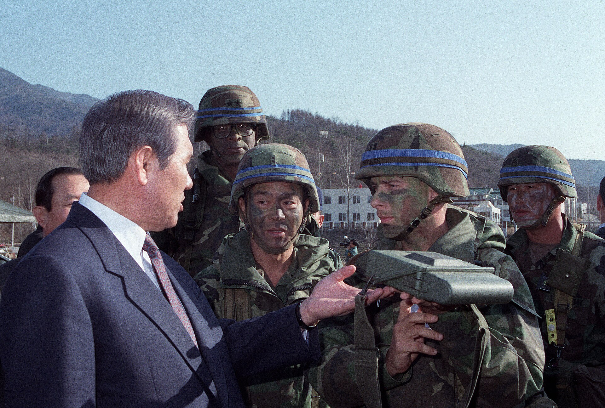
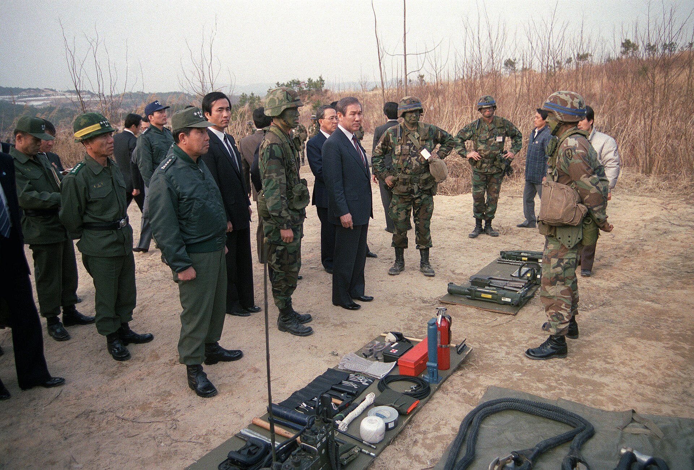
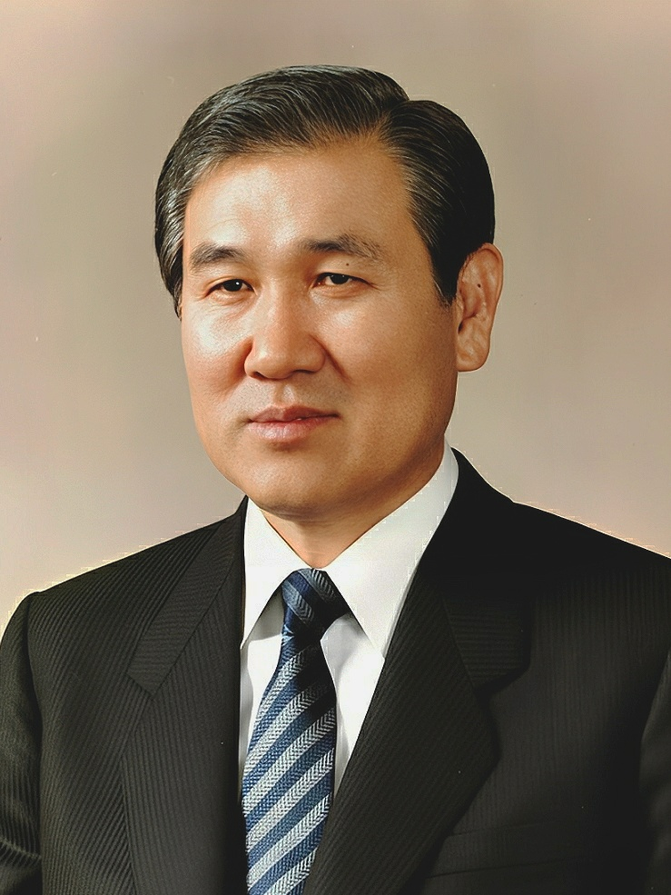

35년 전 오늘, 1991년 11월 20일. 정부가 현대그룹을 상대로 전면적인 조세 및 금융 제재 조치에 전격 착수했습니다. 국세청의 막대한 세금 추징에 맞서 정주영 명예회장이 공개적으로 납세 거부를 선언하자, 정부가 이를 국가기본질서에 대한 정면 도전으로 간주하고 총력 대응에 나선 것입니다.

## “돈이 없어서 못 낸다”… 정주영 회장의 납세 거부 파문

사건의 발단은 정주영 현대그룹 명예회장의 폭탄선언이었습니다. 국세청이 현대그룹 일가에 거액의 세금을 추징하자, 정 명예회장은 기자회견을 열고 “돈이 없어서 세금을 낼 수 없다”며 추징에 불복하겠다는 뜻을 공개적으로 밝혔습니다.

대한민국 경제 성장의 상징이자 굴지의 대재벌 총수가 정부의 과세 처분에 맞서 납세를 거부하고 나서자 정국과 재계는 엄청난 충격에 휩싸였습니다. 국민들 사이에서도 세금을 둘러싼 형평성 논란이 불거지며 파문은 걷잡을 수 없이 커졌습니다.

## 정부의 초강경 대응… “국가기강 확립 차원 제재”

정부의 반응은 단호했습니다. 정부 고위 당국자는 정 명예회장의 자세를 정권적 차원을 넘어 국가기본질서를 저해하는 행위로 판단했습니다. 현대그룹이 국가 경제에서 차지하는 위상이 크더라도 국가의 조세 징수권에 대한 도전을 묵과할 수 없다며, 가능한 모든 수단을 동원해 제재하겠다는 방침을 천명했습니다.

김종인 청와대 경제수석비서관 역시 “기업이 정부를 상대로 세금 납부를 정면 거부하는 일은 있을 수 없으며 상식적으로 이해하기 힘들다”며 세법에 따른 엄정한 집행을 강조했습니다. 정해창 대통령비서실장과 여당 수뇌부도 긴급 회동을 갖고 사태의 파장을 예의주시했습니다.

*사건 당시 사진 아님 · 1990년 — 사진: CHERIE A. THURLBY / Public domain*

## 신규 대출 전면 중단과 일가 재산 조사 착수

11월 19일과 20일을 기점으로 국세청과 금융당국의 구체적인 제재가 현실화되었습니다. 국세청은 세금 체납에 따른 재산 압류에 대비해 현대그룹 계열사는 물론 정주영 명예회장 일가의 재산 파악을 관할 세무서에 전격 지시했습니다.

동시에 금융권의 자금줄 차단이 시작되었습니다. 현대그룹 주거래은행인 외환은행을 비롯한 시중은행들은 기존 대출금의 만기 연장 외에는 신규 대출을 사실상 전면 중단하기로 결의했습니다. 현대에 대한 신규 여신 공급이 멈춰 서면서 그룹 전체의 유동성 관리에 비상이 걸렸습니다.

*사건 당시 사진 아님 · 1989년 — 사진: Al Chang / Public domain*

## 관급·민간 공사대금 압류와 계열사 투자 제한

국세청은 납기 마감일까지 세금을 내지 않을 경우 독촉장을 거쳐 즉각 압류에 착수하겠다고 밝혔습니다. 특히 체납 계열사들이 정부나 공공기관, 나아가 민간 발주처로부터 받아야 할 공사대금 채권을 최우선 압류 대상으로 지목했습니다. 이에 따라 현대건설은 4백억 원이 넘는 공사대금을 받지 못할 위기에 몰렸고, 현대중공업 역시 가스공사로부터 수주한 액화천연가스(LNG) 수송선 건조공사의 중도금 3백억 원 상당을 압류당할 처지에 놓였습니다.

은행권 제재도 잇따랐습니다. 외환은행과 조흥은행은 정몽구 회장의 주식 취득 자금 중 일부가 계열사 자금으로 확인되자 현대정공, 현대강관, 현대자동차서비스 등 3개 계열사에 대해 6개월간 신규 투자와 부동산 취득을 금지하고 연체이자를 부과하는 여신 제재를 단행했습니다.

*사건 당시 사진 아님 · 1988년 — 사진: Korea.net / Korean Culture and Information Service / CC BY-SA 2.0*

## 현대의 부분 후퇴… 3백억 원대 세금 우선 납부 결정

정부와 금융권의 전방위 압박이 거세지자 현대그룹도 버티기로 일관할 수만은 없었습니다. 법인세를 체납할 경우 관급공사 입찰 참가 자격이 박탈되는 등 당장 기업 활동에 치명적인 타격이 우려되었기 때문입니다.

결국 현대 측은 정주영 명예회장의 “형편에 따라 다소 낼 돈이 있으면 내겠다”는 언급에 따라 일부 세금을 우선 납부하기로 방침을 바꿨습니다. 현대건설 법인세 2백16억 원과 정몽구 회장 증여세 38억 원을 포함한 친인척 증여세 등 총 3백억 원 선의 세금을 먼저 내기로 하고 긴급 자금 마련에 들어갔습니다.

## 정부와 재벌의 정면충돌이 남긴 역사적 분기점

1991년 11월 벌어진 정부와 현대그룹의 충돌은 한국 경제 발전사에서 정부 권력과 대기업 총수가 가장 격렬하게 맞붙었던 사건 중 하나로 기록되어 있습니다. 단순한 조세 마찰을 넘어섰던 이 갈등은 이듬해 정주영 명예회장의 통일국민당 창당과 대선 출마로 이어지는 결정적 계기가 되었습니다.

정부의 엄정한 법 집행 의지와 재벌 기업의 힘이 정면으로 충돌하며 전국을 뒤흔들었던 그 시절, 신문 1면을 도배했던 이 긴박한 뉴스를 기억하시는 분들이 많으실 것입니다.

### 참고 자료

- <https://newslibrary.naver.com/viewer/index.naver?articleId=1991112000329101001&editNo=15&printCount=1&publishDate=1991-11-20&officeId=00032&pageNo=1&printNo=14234&publishType=00010>
- <https://commons.wikimedia.org/wiki/File:Roh_Tae-woo_-_cropped,_1989-Mar-13.jpg>
- <https://commons.wikimedia.org/wiki/File:Roh_Tae-woo_-_cropped,_1990-Mar-13.jpg>
- <https://commons.wikimedia.org/wiki/File:Roh_Tae-woo_-_cropped,_1989-Mar-13_05.jpg>
- <https://commons.wikimedia.org/wiki/File:Roh_Tae-woo_(%EB%85%B8%ED%83%9C%EC%9A%B0_)_Presidential_Potraits.jpg>
