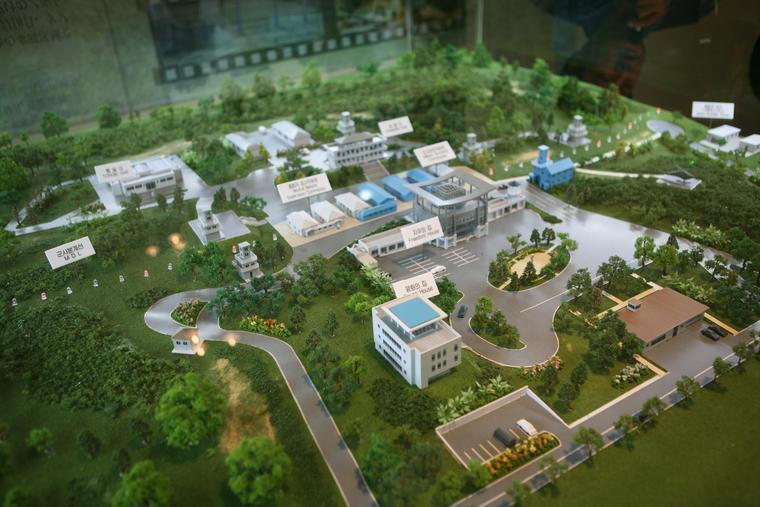
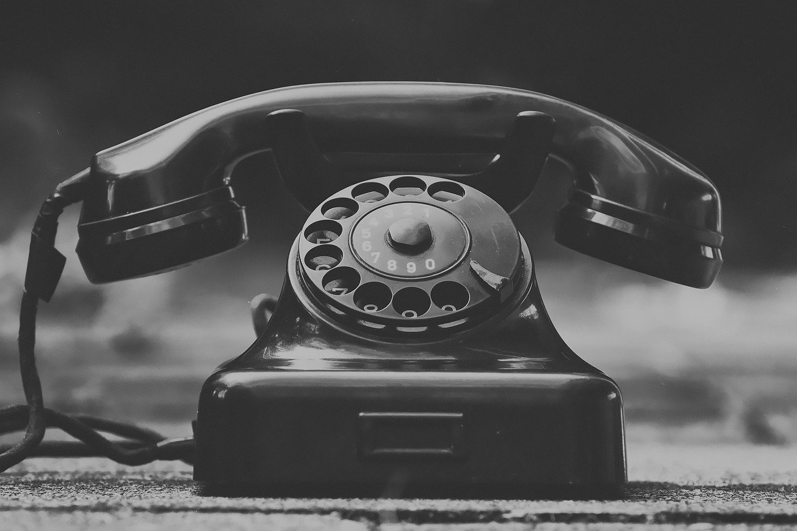
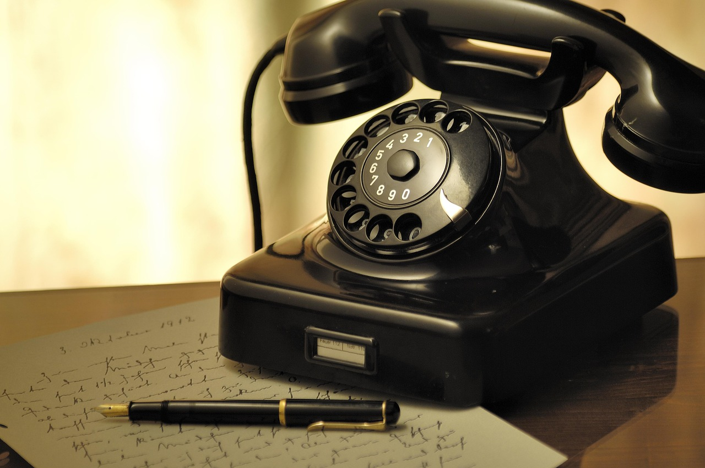

42년 전 오늘, 1984년 11월 20일. 분단 이후 오랜 침묵 속에 갇혀 있던 남북 대화의 문이 다시 열렸습니다. 1973년 제7차 회담을 끝으로 중단되었던 남북적십자 본회담을 서울에서 다시 열기로 남북 양측이 전격 합의했습니다.

## 11년의 단절과 1천만 이산가족의 기다림

1970년대 초 시작되었던 남북적십자회담은 1973년 평양에서 열린 제7차 본회담을 마지막으로 기약 없이 중단되었습니다. 남과 북으로 갈라진 채 소식조차 전하지 못하던 1천만 이산가족의 고통은 해를 거듭할수록 깊어졌습니다.

이후 실무접촉마저 끊기며 판문점의 연락 기능은 마비된 상태였습니다. 그러다 1984년 11월 20일, 7년여 만에 판문점에서 남북적십자 예비접촉이 다시 열리며 닫혀 있던 회담의 문이 조심스럽게 열렸습니다.

## 판문점에 마주 앉은 남북 대표단

1984년 11월 20일 오전, 판문점 중립국감독위원회 회의실에 남북 적십자 대표들이 마주 앉았습니다. 우리 측에서는 대한적십자사 사무총장인 조철화 수석대표를 비롯해 송영대 한적재해구호협의회 위원, 최은범 구호봉사부장 등 3명이 참석했습니다.

북측에서는 서성철 조선적십자회 중앙위원회 상무위원을 단장으로 한 3명의 대표가 회담장에 나왔습니다. 양측 대표들은 굳은 표정 속에서도 오랜만의 대화를 이어가며 악수를 나눴습니다.

*사건 당시 사진 아님 — 사진: 경기도 / KOGL Type 1 attribution*

## 2시간 3분 만에 이뤄낸 신속한 합의

이날 예비접촉은 1970년대에 이미 합의했던 기본 원칙들을 재확인하는 방식으로 신속하게 진행되었습니다. 회의는 시작된 지 불과 2시간 3분 만에 마무리되었습니다.

우리 측 조철화 수석대표는 기조발언을 통해 남북 이산가족들 사이에 재회의 길을 트는 것은 겨레 전체의 간절한 염원이자 미룰 수 없는 절박한 과제라고 강조했습니다. 북측 서성철 단장 역시 기존에 쌓인 성과를 토대로 회담을 진행하자는 데 원칙적으로 동의했습니다.

*사건 당시 사진 아님 · 이미지 사진 — 사진: Alexas_Fotos / Pixabay Content License*

## 서울과 평양을 오가는 본회담의 재개

양측은 과거의 합의에 따라 제8차 본회담을 서울에서 개최하고, 제9차 본회담은 평양에서 열기로 뜻을 모았습니다. 구체적인 개최 날짜에 대해서는 우리 측이 12월 18일부터 21일까지를 제안했고, 북측은 이듬해 1월 23일부터 열자고 제안하여 판문점 직통전화를 통해 추후 조정하기로 했습니다.

또한 판문점 ‘자유의 집’과 ‘판문각’ 사이의 상설회담 연락사무소 기능을 정상화하고, 끊어졌던 직통전화도 다시 개통하여 운영하기로 합의했습니다.

*사건 당시 사진 아님 · 이미지 사진 — 사진: 526663 / Pixabay Content License*

## 대표단 규모 확대와 의제의 확인

이날 회담에서는 본회담 대표단의 보도진 수를 종전 25명에서 50명으로 두 배 늘리기로 결정했습니다. 이에 따라 수석대표를 포함한 대표 7명, 자문위원 7명, 수행원 20명(북측 제안 절충), 보도진 50명 등 총 84명의 대규모 대표단이 왕래하게 되었습니다.

본회담에서 다룰 의제는 1972년에 합의된 5개 항을 그대로 유지하기로 했습니다. 이산가족의 주소와 생사 확인, 자유로운 방문과 상봉, 자유로운 서신 거래, 가족들의 자유의사에 의한 재결합, 기타 인도적 문제 해결이 포함되었습니다.

## 희망과 과제를 남긴 그날의 회담

회담 과정에서 북측은 회담을 축제 분위기로 만들기 위해 양측 민속공연단을 서울과 평양에 상호 파견하자고 제안하기도 했습니다. 하지만 우리 측은 이산가족의 고통을 덜어주는 본래 의제에 집중해야 한다며 이를 거부했고, 과거 관례대로 주최 측이 공연을 담당하기로 정리했습니다.

오전 12시 45분 기자회견에서 조철화 수석대표는 과거 확인했던 의제를 재확인하는 절차였기에 별다른 어려움 없이 원만히 합의를 이뤘다고 밝혔습니다. 분단의 장벽 속에서 이산가족 상봉의 실마리를 다시 풀어내려 했던 1984년 11월 20일의 판문점은, 지금도 남북 화해와 인도의 길을 되돌아보게 하는 중요한 역사로 기억되고 있습니다.

### 참고 자료

- <https://newslibrary.naver.com/viewer/index.naver?articleId=1984112000209201005&editNo=2&printCount=1&publishDate=1984-11-20&officeId=00020&pageNo=1&printNo=19427&publishType=00020>
- <https://commons.wikimedia.org/wiki/File:An_audiovisual_technician_carrys_a_video_camera_as_he_videotapes_the_area,_during_the_joint_South_Korean-US_Exercise_Team_Spirit_%2784._Panmunjom_is_where_the_treaty_to_end_the_Korean_-_DPLA_-_2f3844ea5f9a836b35fb23690283b585.jpeg>
- <https://www.kogl.or.kr/recommend/recommendDivView.do?division=img&recommendIdx=37201>
- <https://pixabay.com/photos/telephone-vintage-monochrome-phone-3594206/>
- <https://pixabay.com/photos/phone-letter-fountain-pen-dial-499991/>
