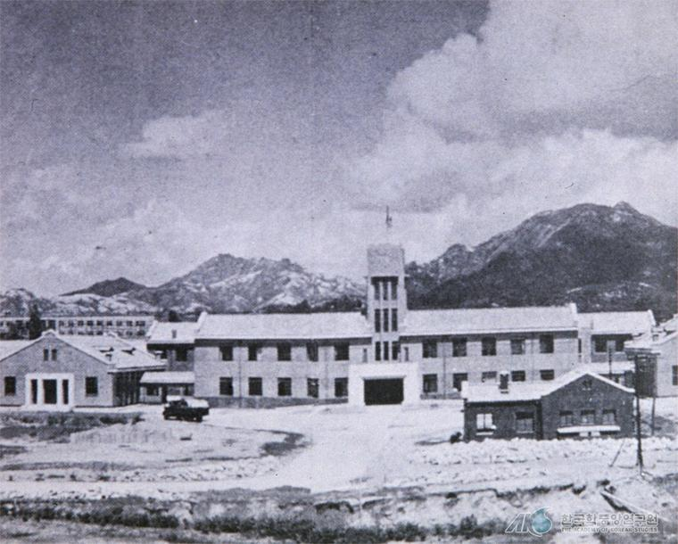

29년 전 오늘, 1997년 11월 21일. 국가안전기획부는 서울대 명예교수 고영복 씨가 1961년 포섭돼 36년간 고정간첩 활동을 해온 혐의로 구속 송치됐다고 발표했습니다. 같은 발표에서 서울지하철공사 간부 등 3명도 구속됐고, 사건 계기는 남파간첩 최정남·강연정 부부의 검거였습니다.

## 포섭 시점과 핵심 혐의

안기부는 고영복 씨가 1961년 이화여대 강사 재직 중 남파공작원에게 포섭된 뒤 36년간 고정간첩 활동을 했다고 발표했습니다. 고영복 씨의 나이는 69세로, 안기부는 그가 6명의 북한 공작원과 접촉하며 정보를 제공한 정황을 확보했다고 밝혔습니다.

## 부부간첩 검거가 폭로의 계기

이번 사건은 지난 8월 남파된 최정남(35)·강연정(28) 부부간첩을 검거하면서 불거졌습니다. 안기부 조사에 따르면 이들은 7월 30일 공작선을 타고 남하해 8월 2일 거제도 해안으로 상륙했고, 10월 27일 울산에서 포섭하려던 장면에서 검거됐습니다. 검거 다음날 강연정 씨는 몸에 숨긴 독약 앰풀로 음독해 병원으로 옮겨졌으나 사망했습니다.

*사건 당시 사진 아님 — 사진: 한국학중앙연구원 / KOGL Type 1 attribution*

## 지하철 관련자 구속과 국가기간망 우려

안기부는 고영복 외에도 서울지하철공사 동작설비분소장 심정웅(55)과 일가 일부를 구속 송치했다고 밝혔습니다. 심정웅 씨는 지하철 핵심시설 정보를 제공한 혐의를 받았고, 그의 친족들 일부도 불구속 입건되었습니다. 안기부는 철도·지하철 등 국가기간 시설에 대한 침투 가능성을 지적했습니다.

![[1293호] 우수공무원 포상 ... 외롭게 공직을 부담하는 숨은 일꾼이 많음. (1980.08.06) 장면 2](../images/2026-11-21-01-3.jpg)
*[1293호] 우수공무원 포상 ... 외롭게 공직을 부담하는 숨은 일꾼이 많음. (1980.08.06) 장면 2 — 사진: KTV 국민방송 e영상역사관 (대한뉴스) / KTV 공공저작물 — 영상 저작물 전면 개방(대통령실 2025-07-09), 출처 표시*

## 연루 규모와 수사의 확장

발표문에는 관련 혐의자 200여 명에 대한 참고인 조사와 동향 내사를 계속하고 있다는 내용이 포함돼 있었습니다. 안기부 관계자는 대남공작원들의 활동이 대담해진 점을 들어 접촉자 상당수가 국가보안법상 불고지 혐의를 받을 가능성이 있다고 밝혔습니다.

![[963호] 숨은 일꾼들 전라남도 해남 화원면 주광리 시하도 등대수. (1973.12.22) 장면 1](../images/2026-11-21-01-4.jpg)
*[963호] 숨은 일꾼들 전라남도 해남 화원면 주광리 시하도 등대수. (1973.12.22) 장면 1 — 사진: KTV 국민방송 e영상역사관 (대한뉴스) / KTV 공공저작물 — 영상 저작물 전면 개방(대통령실 2025-07-09), 출처 표시*

## 사건의 정치적 파장과 이후 절차

이 사건은 1997년 11월 20일 발표돼 제15대 대통령 선거를 한 달 앞둔 시점에 큰 파장을 일으켰습니다. 자료에는 고영복 씨가 유죄 선고를 받고 형을 감형받은 뒤, 1999년 김대중 정부 출범 후 사면되어 복권된 사실도 기록돼 있습니다.

## 왜 주목해야 하는가

이 사건은 한 학계 원로가 오랜 기간 고정간첩으로 활동했다는 점과, 국가기간 설비 관련자들이 연루됐다는 점에서 안보·사회적 충격을 남겼습니다. 남파 공작원 검거 경로와 관련자들의 신분, 그리고 광범위한 참고인 조사는 당시 사회 전반에 불안을 불러일으켰습니다.

## 지금 우리에게 남은 질문

사건 기록은 포섭 시점(1961년), 고영복의 장기간 접촉(36년), 부부간첩의 침투 경로(7월 30일~8월 2일)와 검거(10월 27일), 그리고 사건 발표(11월 20일)로 이어집니다. 그 결과 관련자 구속과 대규모 조사로 연결됐고, 이후 재판과 사면·복권으로 끝맺었습니다. 고영복 고정간첩 사건을 기억하십니까?

### 참고 자료

- <https://newslibrary.naver.com/viewer/index.naver?articleId=1997112100209101001&editNo=45&printCount=1&publishDate=1997-11-21&officeId=00020&pageNo=1&printNo=23715&publishType=00010>
- <https://commons.wikimedia.org/wiki/File:Night_on_a_Seoul_street_1997.jpg>
- <https://www.kogl.or.kr/recommend/recommendDivView.do?division=img&recommendIdx=72963>
- <https://www.ehistory.go.kr/view/movie?mediasrcgbn=KV&mediaid=10248&mediadtl=21491&mediagbn=DH#t=0.7>
- <https://www.ehistory.go.kr/view/movie?mediasrcgbn=KV&mediaid=887&mediadtl=5991&mediagbn=DH#t=0.3>
