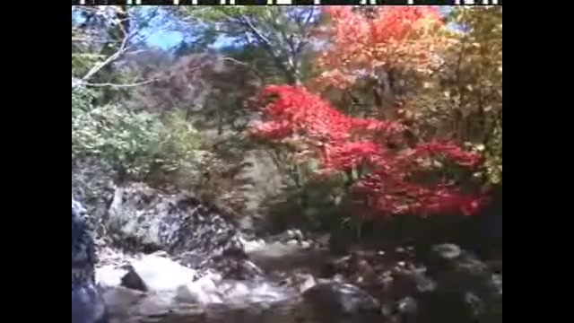

40년 전 오늘, 1986년 11월 21일. 이웅희 문공부장관은 북한의 금강산댐 건설을 둘러싼 정부 입장을 발표하며 즉각 중지를 촉구했습니다. 정부는 북한의 행위를 국제사회에 알리고 필요하면 모든 대응조치를 취하겠다고 경고했습니다.

## 왜 문제였나

정부는 금강산댐 건설이 남북을 관류하는 자연 하천의 수로를 변경해 우리 쪽의 천혜적 용수권을 침해할 뿐 아니라, 국토 분단과 민족 분열을 영구화하려는 행위라고 규정했습니다. 또한 88서울올림픽을 저지하려는 의도가 있다고 보고, 외교적·군사적 모험까지 불사할 수 있는 위협으로 보았습니다. 이웅희 장관은 북한이 우리측의 정당한 요구에 무성의하게 대응할 경우 정부는 국제기구와 세계인류 앞에 그 행위를 고발하겠다고 밝혔습니다.

## 그날 정부의 입장과 발언

이웅희 문공부장관은 21일 성명을 통해 북한이 공사를 은폐하며 극비리에 강행하고 있다고 지적했습니다. 그는 북한이 성의를 보이면 협상할 용의가 있음을 밝히면서도, 댐 건설 강행 시 안보상 자위수단으로 대응하지 않을 수 없다고 말했습니다. 정부는 구체적 대응책을 신중히 검토 중이라고 했습니다.

![[1621호] 금강산댐 규탄 궐기대회 청량리역 광장 금강산댐 건설 규탄 궐기대회 (1986.11.28) 장면 2](../images/2026-11-21-02-2.jpg)
*[1621호] 금강산댐 규탄 궐기대회 청량리역 광장 금강산댐 건설 규탄 궐기대회 (1986.11.28) 장면 2 — 사진: KTV 국민방송 e영상역사관 (대한뉴스) / KTV 공공저작물 — 영상 저작물 전면 개방(대통령실 2025-07-09), 출처 표시*

## 전문가들의 대응댐 제안

같은 날 현장에선 전문가들이 대응댐 건설 시나리오를 제시했습니다. 조사 결과 북한강 상류에서 대응댐 건설이 가능한 적지 3곳을 찾았고, 하천 표면이 해발 1백60m 내외인 점을 고려하면 2백40m 내외의 대응댐으로 해발 4백m의 금강산댐을 대비할 수 있다고 분석했습니다. 전문가들은 협곡을 이용해 폭 약 1㎞의 구조물을 쌓아두면 금강산댐 저수량 2백억t이 일시에 방류되더라도 아래쪽 피해를 피할 수 있다는 계산을 내놓았습니다.

*북괴 금강산댐 건설 ... . (1986.00.00) 장면 1 — 사진: KTV 국민방송 e영상역사관 (문화영화) / KTV 공공저작물 — 영상 저작물 전면 개방(대통령실 2025-07-09), 출처 표시*

## 정부의 대응과 국제적 관점

정부는 이번 사안을 국제적 관례와 규범의 문제로 보았습니다. 성명은 라인강 오염 문제 등 연안국들이 서로 권익을 존중하며 협의하는 사례를 언급하며, 하천 이용에 있어 상호 협의가 국제적 관례라고 강조했습니다. 북한의 일방적 하천 차단은 국제적으로 용서받기 어려운 불법 행위라고 규탄했습니다.

*TV, radio Fortepan 22767 — 사진: FOTO:Fortepan — ID 22767: Adományozó/Donor: Baráth Endre. / CC BY-SA 3.0*

## 그 뒤 일어난 일들

보도 자료들은 당시 정부가 대응 조치를 검토하며 경계를 강화했다고 전합니다. 전문가들의 대응댐 제안은 향후 수자원·토질 조사와 설계 준비의 필요성을 제기했습니다. 보도는 또한 북한이 내부 모순을 은폐하기 위해 대남 심리전을 강화할 것이라 전망했습니다.

## 오늘의 시청자에게

1986년 11월 21일의 보도는 한반도 수자원과 안보가 연결되어 있음을 부각했습니다. 당시 정부의 즉각 중지 촉구와 전문가들의 대응댐 제안은 그해 긴장 상황의 한 단면을 보여줍니다. 이 뉴스를 보신 분들 가운데 그날의 보도를 기억하시는 분도 계시겠지요.

### 참고 자료

- <https://newslibrary.naver.com/viewer/index.naver?articleId=1986112100209201003&editNo=2&printCount=1&publishDate=1986-11-21&officeId=00020&pageNo=1&printNo=20044&publishType=00020>
- <https://www.ehistory.go.kr/view/movie?mediasrcgbn=KV&mediaid=11140&mediadtl=24762&mediagbn=DH#t=0.3>
- <https://www.ehistory.go.kr/view/movie?mediasrcgbn=KV&mediaid=11140&mediadtl=24762&mediagbn=DH#t=0.7>
- <https://www.ehistory.go.kr/view/movie?mediasrcgbn=KV&mediaid=1434&mediadtl=7981&mediagbn=MH#t=0.3>
- <https://commons.wikimedia.org/wiki/File:TV,_radio_Fortepan_22767.jpg>
