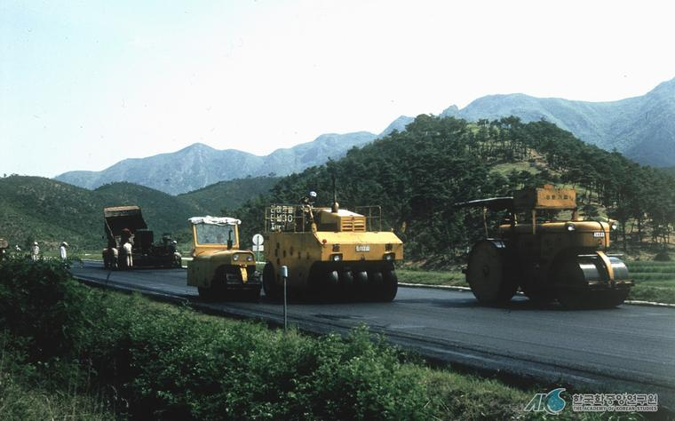
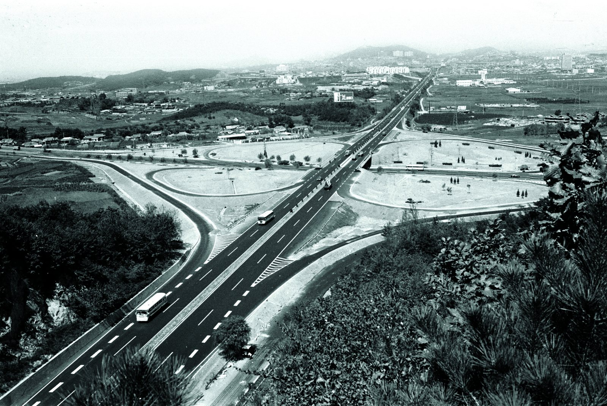

43년 전 오늘, 1983년 11월 21일. 정부가 경부고속도로 서울~대전 구간을 4차선에서 8차선으로 확장해 1988년까지 완공하겠다고 발표했습니다. 이 방안은 제5차 5개년계획 수정의 '지역개발부문 실천계획안'에 담겨 한국개발연구원(KDI)에서 열린 관민정책협의회에 상정됐습니다.

## 왜 8차선 확장이 필요했나

정부는 수도권의 과도한 팽창이 앞으로의 경제발전을 저해할 가능성이 크다고 판단했습니다. 그래서 수도권 기능을 지방으로 분산하고 지역 간 균형발전을 추진하기 위해 대전·광주·대구 등 1차 성장거점의 자생적 성장을 지원하겠다는 전략을 세웠습니다. 경부고속도로의 서울~대전 구간 확장은 이러한 지역개발 전략의 핵심 사업 가운데 하나였습니다.

## 어떤 계획안에서 나왔나

확장 계획은 제5차 5개년계획 수정의 '지역개발부문 실천계획안'에 포함돼 1983년 11월 21일 경제기획원이 KDI 주최 관민정책협의회에 제출해 협의에 들어갔습니다. 계획안에는 서울~대전 구간을 우선적으로 88년까지 8차선으로 넓히는 방안과 4차선을 추가로 신설하는 두 가지 안이 제시돼 용역 의뢰 등 타당성 검토에 들어가기로 했습니다.

*사건 당시 사진 아님 — 사진: 한국학중앙연구원 / KOGL Type 1 attribution*

## 공사 일정과 범위

정부는 확장공사를 1985년에 착공해 1988년까지 완공한다는 일정을 제시했습니다. 대상 구간은 경부고속도로의 서울~대전 구간으로, 현행 4차선을 왕복 8차선으로 확장하는 것이 기본안입니다. 다른 안으로는 기존 4차선을 유지한 채 별도로 4차선을 신설하는 방안도 검토 대상이었습니다.

![[784호] 경부고속도 로 준공 ... 내외. (1970.07.11) 장면 2](../images/2026-11-21-04-3.jpg)
*[784호] 경부고속도 로 준공 ... 내외. (1970.07.11) 장면 2 — 사진: KTV 국민방송 e영상역사관 (대한뉴스) / KTV 공공저작물 — 영상 저작물 전면 개방(대통령실 2025-07-09), 출처 표시*

## 재원 조달 어떻게 하나

도로망 확충 및 유지관리에 소요되는 재원을 마련하기 위해 정부는 자동차를 가진 사람 등 도로 사용자에게 별도의 목적세를 신설·부과하는 '도로사용자부담제' 도입 방안을 1984~85년 중에 검토하기로 했습니다. 즉 확장공사의 재원 일부를 도로 사용자에게서 직접 조달하는 방안이 검토 단계에 올랐습니다.

*경부고속도 로 양재 나들목 — 사진: 서울역사박물관 / KOGL Type 1 (공공누리 제1유형, 출처표시)*

## 계획과 함께 나온 다른 지역개발 방안

같은 실천계획안에는 수도권의 신·증설 규제 방안도 포함됐습니다. 정부는 공장·학교·업무용 건물 등 수도권 내 신증설을 억제하고 공공청사의 신·증축을 제한하는 등 인구 집중시설의 수도권 유입을 통제하겠다고 밝혔습니다. 또한 대단위 도시개발사업에 대해 사전 '인구영향평가제'를 실시하고, 전국 58개 도시의 20년 장기 도시기본계획을 내년까지 수립하겠다는 방안도 제시됐습니다.

## 통신·교통의 다른 약속들

실천계획안에는 도로 확장 외에도 다른 생활 인프라 계획이 포함돼 있습니다. 대구~춘천간 고속도로는 1985~86년 사이 실시설계에 들어가며, 1986년까지 전국 시외 통화가 완전자동화되고 10가구 이상 자연마을에는 모두 전화가 가설된다는 내용이 명시돼 있습니다. 이는 당시 광범위한 지역개발 구상이 도로 확장과 통신 인프라 개선을 동시에 추진하겠다는 맥락이었습니다.

## 당시 정부의 기대와 남긴 질문

정부는 서울~대전 구간의 8차선 확장을 통해 지역 간 물동량을 늘리고 지방경제 활성화를 도모하겠다고 밝혔습니다. 다만 보도 자료는 확장 방식(기존 차로를 넓힐지, 새로 4차선을 신설할지)과 재원 조달의 구체적 설계는 타당성 용역을 거쳐 결정될 것이라고 적시했습니다. 계획은 상정된 상태였고, 실제 착공과 완공 일정은 이후의 검토 결과에 따라 달라질 수 있었습니다.

### 참고 자료

- <https://newslibrary.naver.com/viewer/index.naver?articleId=1983112100209201006&editNo=2&printCount=1&publishDate=1983-11-21&officeId=00020&pageNo=1&printNo=19118&publishType=00020>
- <https://commons.wikimedia.org/wiki/File:Koreans_in_the_open-air_market_during_the_joint_U.S._Marine_Corps_and_Republic_of_Korea_marine_training_Exercise_Team_Spirit_%2783_-_DPLA_-_9709018acc3f0f2a7130720b4131f978.jpeg>
- <https://www.kogl.or.kr/recommend/recommendDivView.do?division=img&recommendIdx=67598>
- <https://www.ehistory.go.kr/view/movie?mediasrcgbn=KV&mediaid=670&mediadtl=5459&mediagbn=DH#t=0.7>
- <https://museum.seoul.go.kr/archive/archiveNew/NR_archiveView.do?ctgryId=CTGRY754&type=B&upperNodeId=CTGRY755&fileSn=300&fileId=H-TRNS-77677-755>
