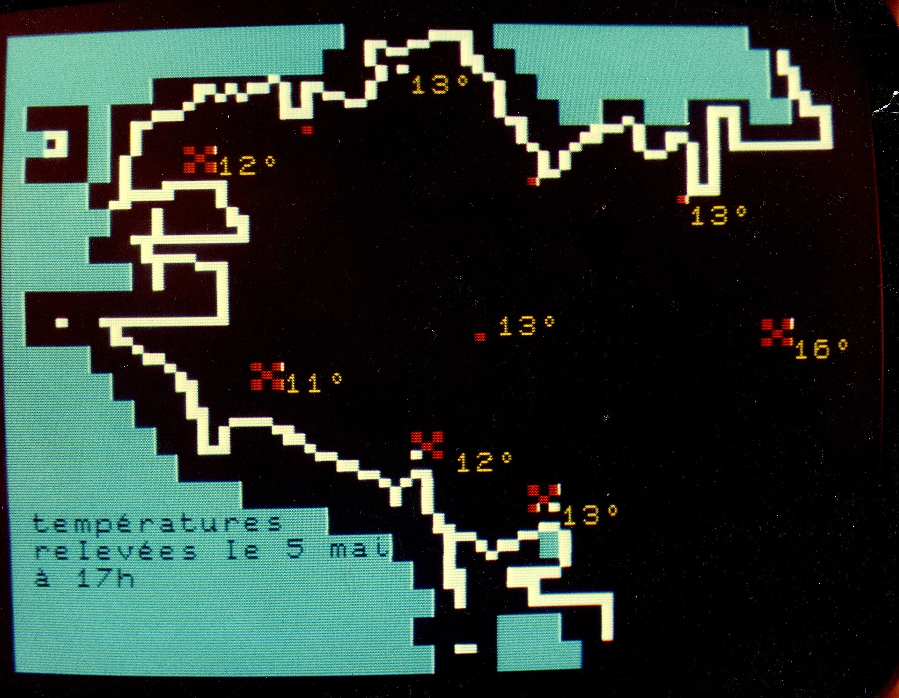

45년 전 오늘, 1981년 11월 21일. 체신부는 한국전기통신공사와 민간기업의 공동출자로 세운 데이터통신회사가 내년 1월부터 업무를 개시한다고 밝혔습니다. 설립자본금 70억원, 출자비율은 공사와 민간이 30%대·70% 방식입니다.

## 왜 데이터통신을 세웠나

체신부는 정보사회화의 조기실현과 반도체·컴퓨터·전자통신 공업의 발전 촉진을 목적으로 데이터통신 전담회사를 조기 설립하기로 했습니다. 1981년에는 전신·전화 외에 '제3의 통신'으로 불리는 데이터통신이 도래하고 있었고, 이에 대비한 행정적·산업적 기반을 마련하려는 목적이 분명했습니다.

## 설립 구조와 자금

체신부 발표에 따르면 설립자본금은 70억원입니다. 한국전기통신공사와 민간기업들이 공동으로 출자해 주식회사를 설립하는 방식으로, 공사와 민간의 출자비율은 30%대·70%로 정해졌습니다. 민간 출자 희망업체를 공모해 참여업체가 많으면 1개 업체당 주식소유지분을 3.5% 이내로 조정하겠다는 규정도 포함돼 있었습니다.

*사건 당시 사진 아님 · 1976년 — 사진: Christiane Schwartz / CC BY-SA 2.0 fr*

## 무슨 업무를 하게 되나

체신부는 새 회사의 사업범위를 데이터전송업, 데이터처리업, 데이터은행업으로 정했습니다. 정부 설명은 컴퓨터로 처리한 산업정보, 주식시세, 기상정보, 항공·열차표 예매 등 다양한 생활정보를 전자통신기기를 통해 전달·공급하겠다는 내용이었습니다. 중앙집중적 정보관리와 상호연결을 통해 정보 이용과 처리를 효율화하겠다는 목표였습니다.

![[1170호] 박정희 대통령 연두순시 ... 안내로 과학 발명, 실험 전시회 시찰 (1978.02.06) 장면 1](../images/2026-11-21-06-3.jpg)
*[1170호] 박정희 대통령 연두순시 ... 안내로 과학 발명, 실험 전시회 시찰 (1978.02.06) 장면 1 — 사진: KTV 국민방송 e영상역사관 (대한뉴스) / KTV 공공저작물 — 영상 저작물 전면 개방(대통령실 2025-07-09), 출처 표시*

## 민간 참여와 공모 절차

체신부는 내달 초까지 이 회사에 출자할 희망업체를 공모하기로 했습니다. 참여 희망업체가 많을 경우 민간업체의 주식소유지분을 조정하는 방안도 준비돼 있었습니다. 이런 공모 절차로 민간의 폭넓은 참여를 유도하면서도 특정 업체의 지분 과다 집중을 막겠다는 의도였습니다.

![[1170호] 박정희 대통령 연두순시 ... 안내로 과학 발명, 실험 전시회 시찰 (1978.02.06) 장면 2](../images/2026-11-21-06-4.jpg)
*[1170호] 박정희 대통령 연두순시 ... 안내로 과학 발명, 실험 전시회 시찰 (1978.02.06) 장면 2 — 사진: KTV 국민방송 e영상역사관 (대한뉴스) / KTV 공공저작물 — 영상 저작물 전면 개방(대통령실 2025-07-09), 출처 표시*

## 그 당시 통신 환경과 기대

1981년은 전신·전화 부문에서 전자교환 도입 등 통신 현대화가 진행되던 시기였습니다. 체신부는 데이터통신 전담회사의 설립으로 정보통신 시대의 도래를 알리고 관련 산업의 성장과 효율적 정보 활용을 촉진하려 했습니다.

## 지금과의 연결

체신부의 발표는 1982년 이후 한국의 전기통신 분야가 공사 중심으로 재편되고 데이터통신 서비스가 본격화되는 흐름과 맞닿아 있습니다. 그해 이후 전기통신 분야의 구조 변화와 산업 육성 정책은 이후 정보통신 발전의 밑거름이 되었습니다.

### 참고 자료

- <https://newslibrary.naver.com/viewer/index.naver?articleId=1981112100329201004&editNo=2&printCount=1&publishDate=1981-11-21&officeId=00032&pageNo=1&printNo=11123&publishType=00020>
- <https://commons.wikimedia.org/wiki/File:Corse-continent.jpg>
- <https://commons.wikimedia.org/wiki/File:BretagneVTX.jpg>
- <https://www.ehistory.go.kr/view/movie?mediasrcgbn=KV&mediaid=10141&mediadtl=20804&mediagbn=DH#t=0.3>
- <https://www.ehistory.go.kr/view/movie?mediasrcgbn=KV&mediaid=10141&mediadtl=20804&mediagbn=DH#t=0.7>
