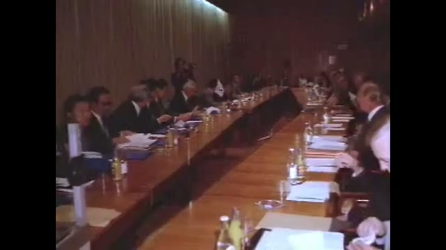

30년 전 오늘, 1996년 11월 21일. 동아국제음악콩쿠르 예선이 시작됐습니다. 대회 창설을 축하하는 기념식은 20일 서울 힐튼호텔에서 열렸고, 다음 날 예선은 예술의전당에서 열렸습니다.

## 창설을 알린 기념식

창설기념식과 환영연은 1996년 11월 20일 저녁 서울 힐튼호텔 그랜드볼룸에서 열렸습니다. 동아그룹 협찬으로 동아일보사와 일민문화재단이 주최한 이날 행사에는 김병관 동아일보사 회장과 김영수 문화체육부장관, 이종훈 동아그룹 부회장, 윤세영 SBS회장, 이강숙 한국예술종합학교 교장 등 각계 인사가 참석해 대회의 출범을 축하했습니다.

## 왜 특별했나

동아국제음악콩쿠르는 ‘한국 최초의 본격 국제음악콩쿠르’로 소개됐습니다. 김병관 회장은 "서양음악이 우리나라에 도입된 지 1백여년만에 우리 음악계의 오랜 숙원이었던 국제음악콩쿠르를 개최하게 돼 감회가 깊다"고 밝혔고, 김영수 문화체육부장관도 대회를 축하했습니다. 당시 조직과 지원 의지를 공개적으로 밝힌 점이 창설의 무게를 더했습니다.

![[2033호] 문화의 달 행사 소식 ... 35회 전국 민속 예술 경연 대회(춘천) (1994.10.26) 장면 1](../images/2026-11-21-07-2.jpg)
*[2033호] 문화의 달 행사 소식 ... 35회 전국 민속 예술 경연 대회(춘천) (1994.10.26) 장면 1 — 사진: KTV 국민방송 e영상역사관 (대한뉴스) / KTV 공공저작물 — 영상 저작물 전면 개방(대통령실 2025-07-09), 출처 표시*

## 그날의 풍경—참가와 준비

창설기념식 다음날인 11월 21일은 예선이 열린 날입니다. 보도에 따르면 23개국에서 참여한 46명의 경연자들이 예선을 치렀고, 출연자들은 이날 오전 예술의전당 리사이틀홀에서 추첨을 통해 연주순서를 결정한 뒤 연습에 들어갔습니다. 심사위원 8개국 10명은 숙소인 노보텔호텔에서 모여 채점기준 등을 협의했습니다.

*남덕우 총리 유럽 4개국 순방 ... 국제공항 (1981.00.00) 장면 1 — 사진: KTV 국민방송 e영상역사관 (문화영화) / KTV 공공저작물 — 영상 저작물 전면 개방(대통령실 2025-07-09), 출처 표시*

## 사전 반응과 지원 규모

대회를 주최한 측은 창설 전부터 국제적 관심과 지원을 확인했습니다. 이종훈 부회장은 최원석 회장을 대신해 참석한 자리에서 "34개국에서 1백56명의 젊은이들이 앞다투어 콩쿠르에 지원한 것으로 미루어볼 때 멀지 않아 이 콩쿠르가 세계적인 음악제전으로 발돋움하게 되리라는 것을 확신한다"고 말했습니다. 초기 지원 규모는 향후 대회의 잠재력을 보여준 숫자였습니다.

![[2022호] 잼버리대회 제 9회 한국 잼버리대회 (설악산 신평리) (1994.08.10) 장면 1](../images/2026-11-21-07-4.jpg)
*[2022호] 잼버리대회 제 9회 한국 잼버리대회 (설악산 신평리) (1994.08.10) 장면 1 — 사진: KTV 국민방송 e영상역사관 (대한뉴스) / KTV 공공저작물 — 영상 저작물 전면 개방(대통령실 2025-07-09), 출처 표시*

## 심사의 다짐

정진우 심사위원장은 창설에 대한 감사와 함께 심사의 공정성을 약속했습니다. 보도에 따르면 그는 "공정한 심사와 효율적 운영이 되도록 심사위원을 대표해 최선의 노력을 다하겠다"고 말했습니다. 조직과 심사 측의 다짐은 대회의 신뢰도를 높이는 요소였습니다.

## 그 뒤와 기억

1996년의 창설은 당시 한국 음악계의 오랜 숙원을 실현한 출발로 기록됩니다. 보도자료에 남은 날짜와 발언들은 대회가 한국의 국제음악무대를 세우려는 의지로 시작했음을 보여줍니다. 그날 예선과 기념식에 참여하거나 지켜본 이들이라면, 가족과 함께 이 이야기를 나눠 보셨을지도 모릅니다.

### 참고 자료

- <https://newslibrary.naver.com/viewer/index.naver?articleId=1996112100209101007&editNo=45&printCount=1&publishDate=1996-11-21&officeId=00020&pageNo=1&printNo=23373&publishType=00010>
- <https://pixabay.com/photos/record-shop-vinyl-records-music-9180482/>
- <https://www.ehistory.go.kr/view/movie?mediasrcgbn=KV&mediaid=11526&mediadtl=25892&mediagbn=DH#t=0.3>
- <https://www.ehistory.go.kr/view/movie?mediasrcgbn=KV&mediaid=1904&mediadtl=8726&mediagbn=MH#t=0.3>
- <https://www.ehistory.go.kr/view/movie?mediasrcgbn=KV&mediaid=12247&mediadtl=28642&mediagbn=DH#t=0.3>
