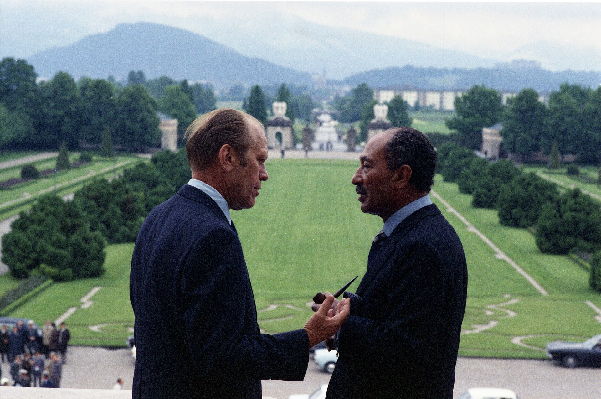
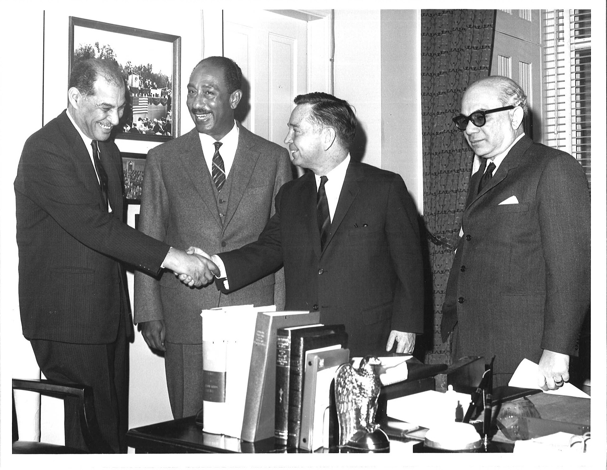
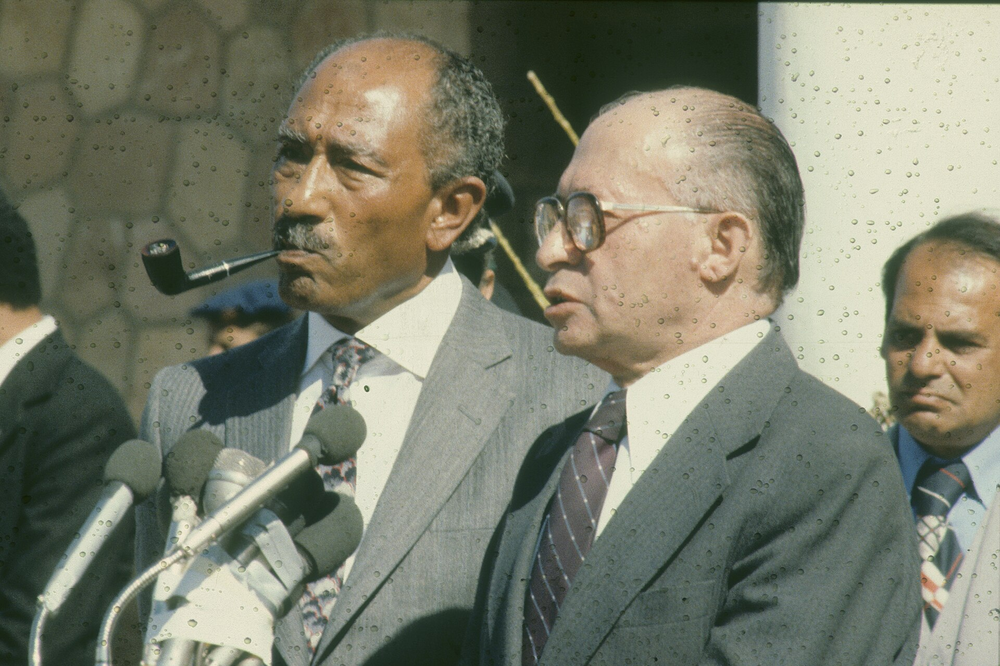

49년 전 오늘, 1977년 11월 21일. 안와르 사다트 이집트 대통령이 예루살렘을 방문해 메나헴 베긴 이스라엘 수상과 3차례 정상회담을 열고, 밤 11시 크네세트에서 TV 중계 연설을 통해 중동평화의 5개 항을 제시했습니다.

## 예루살렘 방문의 시간표

보도에 따르면 사다트 대통령은 20일 새벽 3시(한국시간, 현지시간 19일 하오 8시)에 예루살렘에 도착했습니다. 도착 뒤 메나헴 베긴 수상과 공식·비공식 합쳐 세 차례의 정상회담을 가졌고, 이날 회담에서는 이집트·이스라엘 간 부전조약 체결을 포함한 중동 평화정책이 논의됐습니다.

## 크네세트 연설과 TV 중계

사다트는 밤 11시 크네세트(의회) 단상에서 1시간 동안 연설을 했고, 이 연설은 이스라엘 전국에 TV로 중계됐습니다. 보도는 이 연설이 120석의 의회 앞에서 이뤄졌고, 청중과 국민을 향한 직접 호소의 성격을 띠었다고 전합니다.

*1975년 자료 — 사진: Unknown authorUnknown author or not provided / Public domain*

## 제시된 '평화 5원칙'

연설에서 사다트는 5개 항의 평화안을 제안했습니다. ①이스라엘의 아랍 점령지에서의 철수 ②팔레스타인 국가 창설권 인정 ③경계선의 확보 ④유엔헌장 준수와 무력 불사용 ⑤중동 지역에서의 전쟁 상태 종식을 요구하는 내용입니다.

*사건 당시 사진 아님 · 1976년 — 사진: CarlAlbertArchives / CC BY-SA 4.0*

## 베긴과의 회담 분위기

보도는 베긴 수상이 예루살렘과 이스라엘 국경 개방 및 아랍 세력과의 협상 용의를 표명했다고 전합니다. 사다트의 제안과 베긴의 반응은 당시 중동 분쟁사에 전례없는 평화 기반을 마련할 가능성을 보여준 대목으로 평가됐습니다.

*Menachem Begin (FL45926767) — 사진: Dan Hadani / CC BY 4.0*

## 방송과 청중의 반응

사다트의 연설은 청중의 박수로 마무리되었고, 신문은 연설이 청중에게 감명을 주었다고 보도했습니다. 기사에는 연설이 3백30만 이스라엘 국민을 향한 호소였다는 표현도 실렸습니다.

## 왜 이 방문이 특별했나

이집트 대통령이 예루살렘을 방문한 것은 이집트·이스라엘 관계에서 전례 없는 일이었습니다. 방문 자체와 공개 연설, 그리고 부전조약 체결 논의는 기존의 대립 구도에 변화를 시도한 사건으로 기록됩니다.

## 오늘의 의미

보도 자료에 충실히 정리하면, 1977년 사다트의 방문은 정상 간 직접 대화와 공개적 제안이 결합한 외교 시도로 남습니다. 연설은 당시의 정치적 파장을 보여주는 기록으로, 그날 텔레비전으로 연설을 본 이들이 많았다는 보도가 전해집니다.

### 참고 자료

- <https://newslibrary.naver.com/viewer/index.naver?articleId=1977112100209201007&editNo=2&printCount=1&publishDate=1977-11-21&officeId=00020&pageNo=1&printNo=17272&publishType=00020>
- <https://commons.wikimedia.org/wiki/File:Anwar_Sadat_and_Helmut_Schmidt.jpg>
- <https://commons.wikimedia.org/wiki/File:President_Gerald_R._Ford_and_President_Anwar_Al-Sadat_of_Egypt_Talking_on_the_Grand_Patio_of_the_Hotel_Schloss_Klessheim_in_Salzburg,_Austria_-_NARA_-_23869169.jpg>
- <https://commons.wikimedia.org/wiki/File:CAC_CC_001_18_15_0000_1437.jpg>
- <https://commons.wikimedia.org/wiki/File:Menachem_Begin_(FL45926767).jpg>
