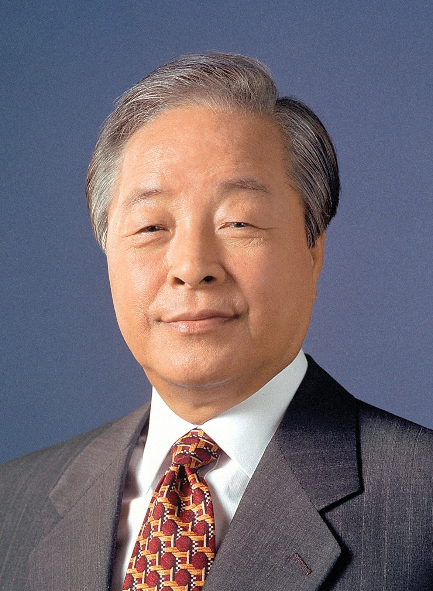
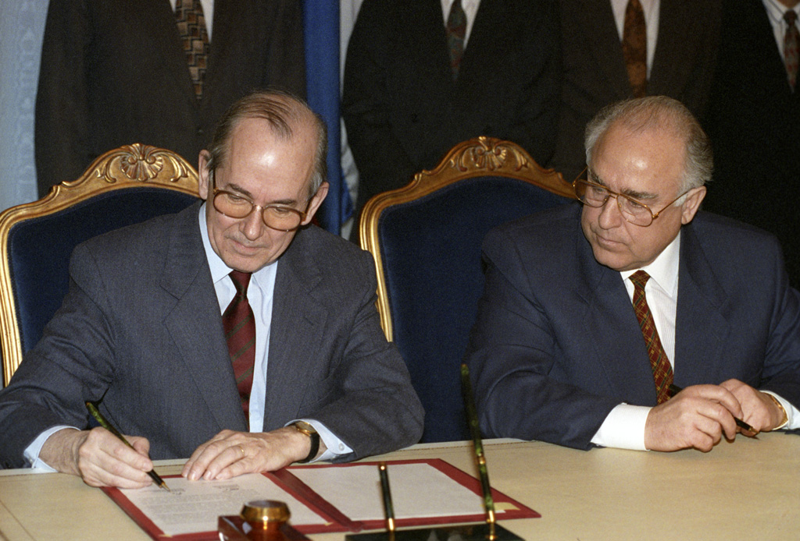
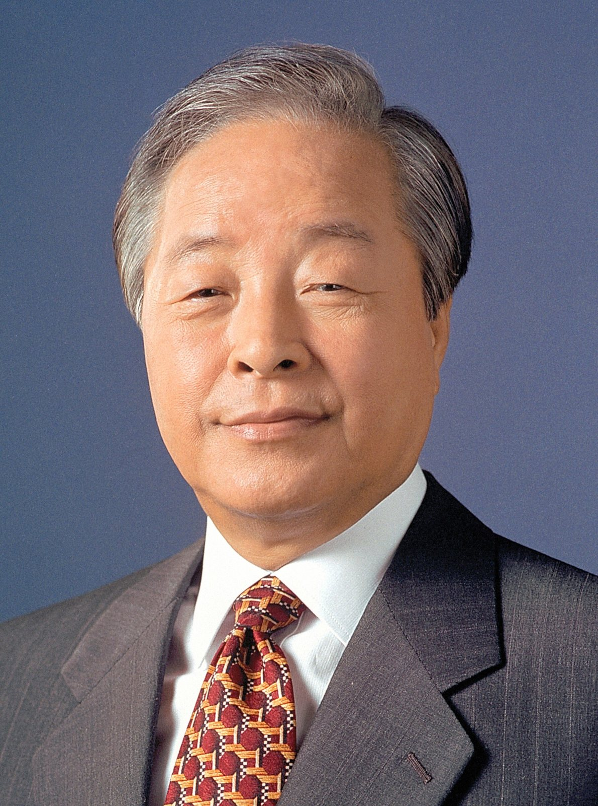

29년 전 오늘, 1997년 11월 22일. 전국 조간신문 1면은 일제히 하나의 긴급한 소식으로 뒤덮였습니다. 대한민국 정부가 심각한 금융·외환시장 위기를 타개하기 위해 국제통화기금(IMF)에 200억 달러 규모의 긴급 구제금융을 공식 요청했다는 발표였습니다.

## 벼랑 끝으로 내몰린 외환시장과 국가 신인도

1997년 하반기 한국 경제는 걷잡을 수 없는 혼란에 빠져들었습니다. 대기업들의 연쇄 부도와 금융기관의 부실 채권 누적으로 대외 신인도가 급락했고, 외국 금융기관들은 앞다투어 단기 만기 외채의 상환을 요구했습니다. 한국은행의 외환보유액은 바닥을 드러내기 시작했습니다. 원·달러 환율은 하루가 다르게 폭등했고 금융시장은 사실상 마비 상태로 치달았습니다. 독자적인 자금 조달로는 만기가 돌아오는 외채를 막을 수 없는 절대적인 위기였습니다.

## 11월 21일 밤 10시, 긴급 기자회견의 충격

운명의 발표는 11월 21일 밤에 이루어졌습니다. 임창열 신임 부총리 겸 재정경제원 장관은 이날 밤 10시 15분 서울 광화문 정부종합청사 대회의실에서 긴급 기자회견을 열었습니다. 임 부총리는 텔레비전 카메라와 취재진 앞에서 정부가 IMF에 대기성 차관 형태의 유동성 조절자금 지원을 공식 요청하기로 결정했다고 발표했습니다. 당시 발표된 기본 지원 규모는 IMF 긴급융자 55억 달러와 미국, 일본 등 주요 우방국의 협조융자를 포함해 최소 200억 달러 수준이었습니다.

*1993년 자료 — 사진: 대한민국 국가기록원 / KOGL Type 1*

## 워싱턴으로 향한 심야 직통 전화

기자회견 직후 임창열 부총리는 청사 집무실에서 곧바로 미국 워싱턴의 IMF 본부로 전화를 걸었습니다. 미셸 캉드쉬 IMF 총재와의 심야 직통 통화에서 정부의 공식적인 구제금융 요청서가 전달되었습니다. 임 부총리는 이에 앞서 낮에는 방한 중이던 스탠리 피셔 IMF 수석부총재와 만나 지원 규모와 대략적인 협의 조건을 논의했고, 일본의 미쓰즈카 히로시 대장상과도 전화 통화를 통해 양국 간 금융 협조를 긴밀히 타진한 상태였습니다.

*사건 당시 사진 아님 · 1995년 — 사진: Yuryi Abramochkin / Юрий Абрамочкин / CC BY-SA 3.0*

## 청와대 영수회담과 정치권의 고뇌

정부의 공식 발표 직전인 21일 저녁, 청와대에서는 김영삼 대통령과 주요 정당 지도자들의 긴급 회동이 열렸습니다. 한나라당 이회창 명예총재와 조순 총재, 새정치국민회의 김대중 총재, 자민련 박태준 총재가 참석한 자리였습니다. 김 대통령은 국정 최고책임자로서 책임을 통감한다며 IMF 자금 지원 요청의 불가피성을 설명했고, 대선 후보들을 비롯한 참석자들은 당면한 외환위기 극복을 위해 불가피한 조치라는 데 뜻을 모았습니다. 김 대통령은 다음 날인 22일 대국민 특별담화를 발표하고 국민들의 고통 분담과 협조를 호소하기로 결정했습니다.

*사건 당시 사진 아님 · 1993년 — 사진: 대한민국 국가기록원 / KOGL Type 1*

## 외환위기 체제의 시작과 남겨진 기억

정부의 IMF 구제금융 요청은 그 후 수년간 대한민국 사회 전체를 뒤흔든 거대한 구조조정의 신호탄이었습니다. 다음 주초부터 IMF 실사단이 서울에 도착해 가혹한 긴축재정과 금융·기업 구조조정, 고금리 정책 등을 요구하는 구체적인 협상에 돌입했습니다. 기업의 줄도산과 대규모 실직, 평생직장 개념의 붕괴 속에서 온 국민은 금모으기 운동 등으로 맞서며 혹독한 시련을 견뎌내야 했습니다. 1997년 11월 22일 아침 신문에 새겨진 'IMF 200억 달러 요청'이라는 문구는, 지금도 많은 이들의 기억 속에 가장 뼈아픈 역사의 한 페이지로 남아 있습니다.

### 참고 자료

- <https://newslibrary.naver.com/viewer/index.naver?articleId=1997112200209101001&editNo=45&printCount=1&publishDate=1997-11-22&officeId=00020&pageNo=1&printNo=23716&publishType=00010>
- <https://commons.wikimedia.org/wiki/File:Carlos_Menem_and_Michel_Camdessus_01.jpg>
- <https://commons.wikimedia.org/wiki/File:Kim_Young-sam_presidential_portrait.jpg>
- <https://commons.wikimedia.org/wiki/File:RIAN_archive_869274_Michel_Camdessus_and_Viktor_Chernomyrdin.jpg>
- <https://commons.wikimedia.org/wiki/File:Kim_Young-sam_presidential_portrait_(cropped).jpg>
