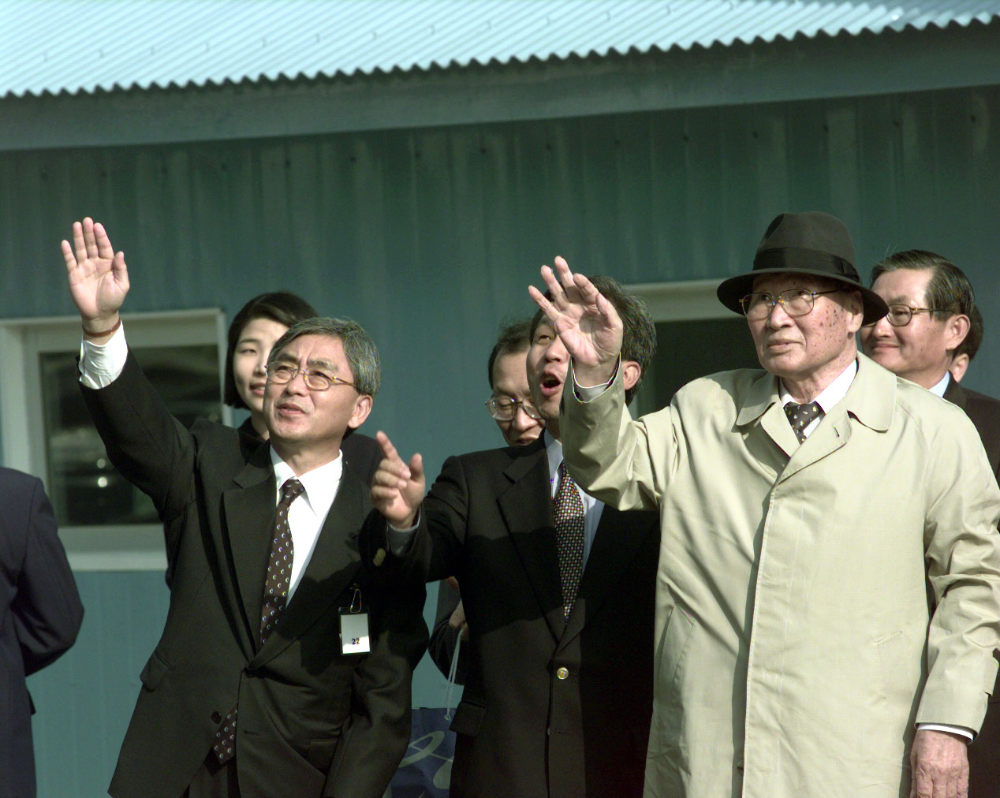
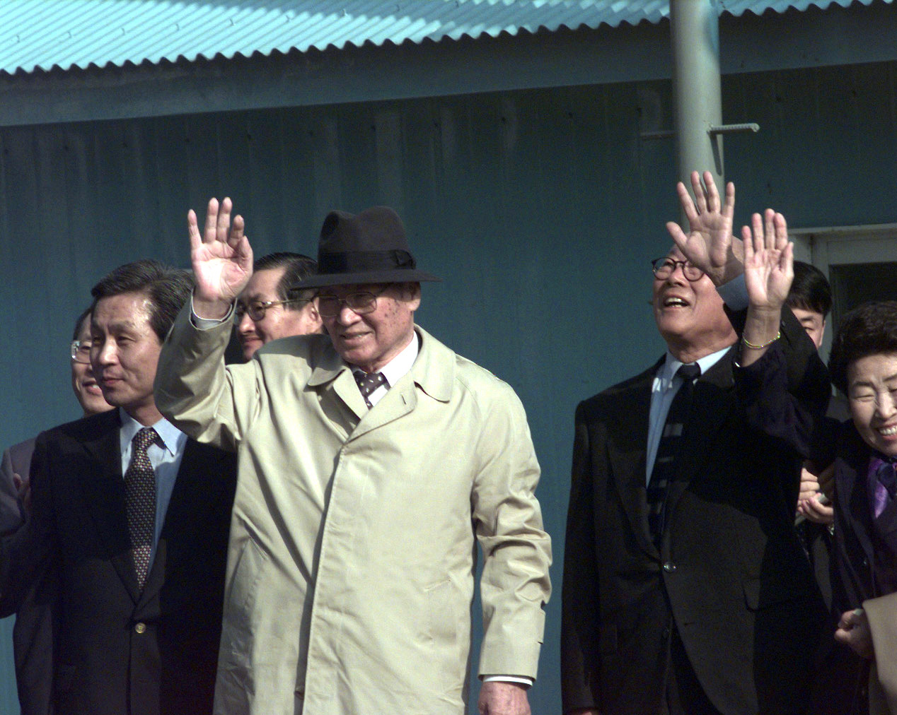
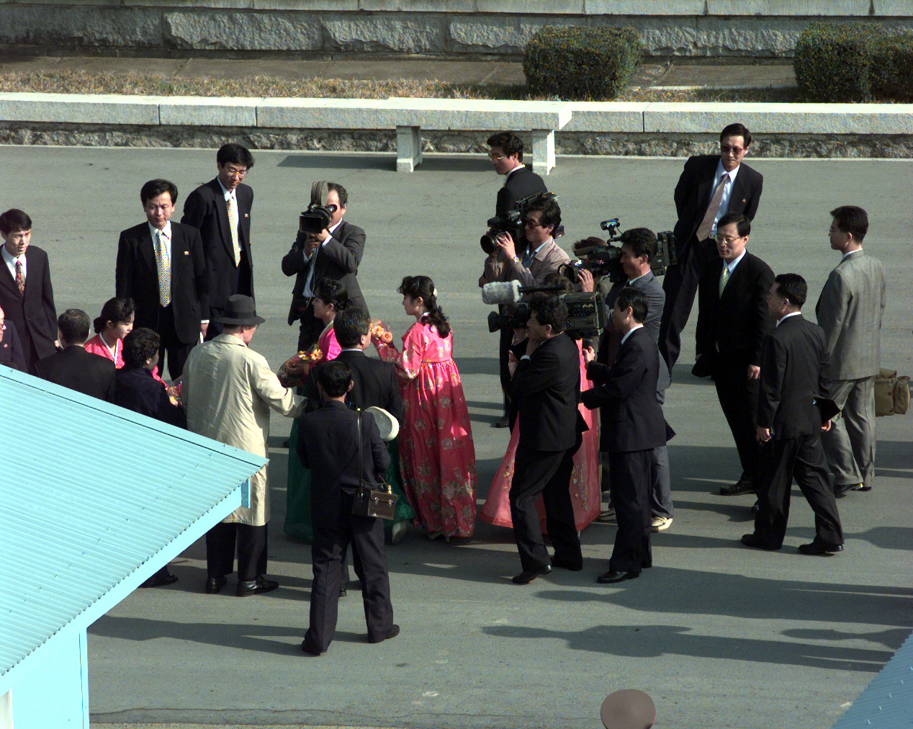

28년 전 오늘, 1998년 11월 22일. 분단 반세기 만에 처음으로 북녘 땅을 밟았던 금강산 관광선 현대금강호가 4박 5일간의 첫 항해를 마치고 동해항으로 돌아왔습니다. 실향민과 일반 관광객 등 937명의 승객을 태운 금강호의 귀환은 남북 분단의 단단한 얼음벽이 녹아내리는 역사적 순간이었습니다.

## 50년 만에 열린 바닷길, 장전항으로 향한 첫 출항

한국전쟁 이후 반세기 동안 굳게 닫혀 있던 북녘의 문이 바닷길을 통해 열렸습니다. 1998년 11월 18일, 실향민과 관광객 등 승객 937명과 승무원을 포함해 1,400여 명을 태운 현대금강호가 강원도 동해항을 출발했습니다.

남북 분단 이후 민간인이 대규모로 북한 땅을 공식 방문해 관광을 즐기는 것은 사상 처음 있는 일이었습니다. 오랫동안 노래와 그림, 교과서 속에서만 그리워하던 일만 이천 봉 금강산을 직접 눈으로 볼 수 있다는 사실에 온 국민의 시선이 바다 위 금강호에 쏠렸습니다.

## 장전항에 감돌던 긴장과 북녘 동포들의 환영

11월 19일 아침 7시 15분, 현대금강호가 북한 영내 장전항에 들어섰을 때 배 안에는 팽팽한 침묵과 긴장이 감돌았습니다. 그 침묵을 깬 것은 북측 수석관 박영철 씨의 환영 방송이었습니다. "파도 사나운 바다를 헤치고 오신 여러분, 얼마나 고생이 많으셨습니까?"

장전항에 내린 관광객들을 맞이한 북측 세관원들은 1인당 불과 3~4초 만에 통관 절차를 마치며 "반갑습니다. 구경 잘하십시오"라고 따뜻한 인사를 건넸습니다. 한 북한 경비원 노인은 "만물상은 바위, 구룡연은 구룡폭포와 상팔담, 해금강에서는 삼일포가 절경"이라며 "보고 나면 안 간다고 할걸"이라는 정겨운 농담을 건네기도 했습니다.

*Chung Ju-yung in 1998 — 사진: TSGT Renee' Sitler / Public domain*

## 삼록수 앞에서 부른 '우리의 소원'

관광 둘째 날부터 남과 북의 서먹함은 완연히 눈 녹듯 사라졌습니다. 산삼과 녹용이 흘러들어 한 번 마시면 10년이 젊어진다는 삼록수 앞에서 북측 관리인 리철숙 씨는 남녘 동포들을 위해 '금강산 노래'를 스스럼없이 불렀습니다.

노래가 끝나자 리씨와 남측 관광객들은 자연스럽게 서로 어깨를 겯고 '우리의 소원'을 합창했습니다. 함께 노래를 부른 마흔아홉 살 관광객 신상은 씨는 "작은 통일이 이뤄졌다"며 감격스러운 소감을 남겼습니다. 사흘간 만난 북측 주민은 100여 명 남짓이었지만, 관광객들은 순박하고 순수한 한핏줄의 정을 깊이 느꼈습니다.

*South Korean business tycoon Chung Ju-yung in 1998 — 사진: TSGT Renee' Sitler / Public domain*

## 51년 만에 확인된 어머니의 묘소

첫 금강산 관광길은 반세기 동안 가슴에 한을 품고 살아온 실향민들에게 애끓는 만남의 장이 되기도 했습니다. 충북 청주에서 온 76세 실향민 박순용 씨는 장전항에 내리자마자 관리사무소에 헤어진 어머니의 생사 확인을 부탁했습니다.

박씨는 관광 셋째 날인 20일 오후, 51년 동안 소식을 모르던 94세 모친이 이미 세상을 떠났으며 장전에 묘소가 있다는 소식을 전해 들었습니다. 비록 살아서 손을 맞잡지는 못했지만, 머나먼 고향 땅에 묻힌 어머니의 소식을 분단 이후 처음으로 확인한 순간이었습니다.

*Ladies from North Korea wearing traditional hanbok leave Panmungak to present gifts to South Korean business tycoon Chun — 사진: TSGT Renee' Sitler / Public domain*

## 구룡폭포와 만물상을 뒤로하고 동해항으로

관광객들은 3개 코스로 나뉘어 구룡폭포와 만물상, 삼일포와 해금강 등 절경을 차례로 둘러보았습니다. 마지막 날에는 하선이 보류되었던 취재진과 통일부 직원 12명의 입국도 허용되어 만물상과 구룡폭포를 둘러볼 수 있었습니다.

모든 일정을 마친 금강호는 11월 21일 밤 9시 10분 장전항을 출발해 한밤중 군사분계선을 넘었습니다. 그리고 22일 아침, 기다리던 가족들과 환영 인파가 모인 동해항에 무사히 닻을 내리며 역사적인 4박 5일간의 첫 항해를 성공적으로 마무리했습니다.

### 참고 자료

- <https://newslibrary.naver.com/viewer/index.naver?articleId=1998112200289101007&editNo=6&printCount=1&publishDate=1998-11-22&officeId=00028&pageNo=1&printNo=3355&publishType=00010>
- <https://commons.wikimedia.org/wiki/File:Chung_Ju-yung.jpg>
- <https://commons.wikimedia.org/wiki/File:Chung_Ju-yung_in_1998.JPEG>
- <https://commons.wikimedia.org/wiki/File:South_Korean_business_tycoon_Chung_Ju-yung_in_1998.JPEG>
- <https://commons.wikimedia.org/wiki/File:Ladies_from_North_Korea_wearing_traditional_hanbok_leave_Panmungak_to_present_gifts_to_South_Korean_business_tycoon_Chung_Ju-yung_981027-F-XT789-528.jpg>
