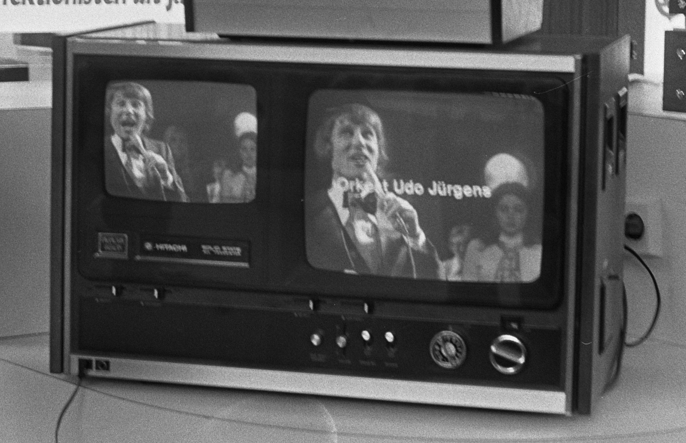
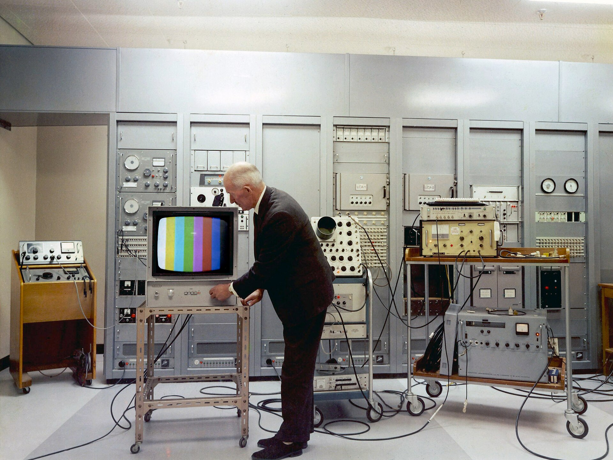

44년 전 오늘인 1982년 11월 22일, 인도 뉴델리에서 날아온 낭보가 온 나라를 들썩이게 했습니다. 제9회 아시안게임 무대에서 성사된 남북 첫 맞대결에서 한국 남녀 탁구 대표팀이 북한을 연달아 꺾고 동반 승리를 일궈냈습니다.

## 인도 뉴델리에서 열린 제9회 아시안게임

1982년 인도 뉴델리에서 개최된 제9회 아시안게임은 대회 초반부터 국민들의 커다란 관심을 모았습니다. 인도의 수도이자 계획도시인 뉴델리는 1951년 제1회 대회를 치른 데 이어 31년 만에 다시 아시안게임을 맞이했습니다. 당시 한국 선수단은 종합 3위 입상을 목표로 치열한 레이스를 시작했고, 그 최전선에는 남북 간의 피할 수 없는 자존심 대결이 걸려 있었습니다.

## 4시간 25분의 사투, 김완의 3전 전승 투혼

먼저 승전보를 울린 것은 남자 탁구였습니다. 11월 20일 밤에 펼쳐진 남자 단체전은 그야말로 한 편의 처절한 드라마였습니다. 양 팀은 한 치의 양보도 없이 게임을 주고받으며 무려 4시간 25분 동안 코트를 뜨겁게 달궜습니다.

승리의 일등 공신은 에이스 김완 선수였습니다. 김완 선수는 홀로 단식 3경기에 출전해 3전 전승을 거두는 놀라운 집중력을 발휘했습니다. 끝까지 승부를 알 수 없던 팽팽한 접전 끝에 한국은 최종 스코어 5대 4로 북한을 꺾고 감격적인 승리를 확정지었습니다.

![[1400호] 스포츠 ... 한번씩 열리는 국제대회임. (1982.09.03) 장면 2](../images/2026-11-22-04-2.jpg)
*[1400호] 스포츠 ... 한번씩 열리는 국제대회임. (1982.09.03) 장면 2 — 사진: KTV 국민방송 e영상역사관 (대한뉴스) / KTV 공공저작물 — 영상 저작물 전면 개방(대통령실 2025-07-09), 출처 표시*

## 3시간 6분의 풀게임 접전, 윤경미의 마지막 한 방

남자의 열기가 가시기도 전인 11월 21일 밤, 이번에는 여자 단체전이 시작되었습니다. 여자 대표팀 역시 북한을 상대로 물러설 수 없는 벼랑 끝 승부를 벌였습니다. 경기는 3시간 6분 동안 이어지는 풀게임 접전으로 흘러갔습니다.

양 팀이 2대 2로 맞선 채 승부는 마지막 5단식으로 넘어갔습니다. 운명의 코트에 들어선 선수는 실업 1년생인 윤경미 선수였습니다. 큰 무대의 중압감 속에서도 윤경미 선수는 북한의 이영숙 선수를 상대로 흔들리지 않는 침착함을 보여주었습니다. 결국 윤경미 선수가 세트스코어 2대 1로 승리를 거두며 한국은 종합 3대 2의 힘겨운 승리를 완성했습니다.

*Hitachi Memory Vision frame-grabber TV set at the 1974 Firato exhibition — 사진: Hans Peters for Anefo / CC0*

## 세계대회부터 이어진 여자 탁구의 북한전 4연승

이번 여자 탁구 단체전 승리는 단순한 1승 이상의 의미를 지녔습니다. 한국 여자 탁구는 1977년 영국 버밍엄에서 열린 세계탁구선수권대회에서 사상 처음으로 북한과 맞붙어 3대 1 승리를 거둔 바 있었습니다.

뉴델리에서의 승리로 한국 여자 탁구는 버밍엄 대결 이래 북한과의 공식 맞대결에서 4연승을 질주하게 되었습니다. 신예 선수의 과감한 패기와 선배들의 관록이 어우러져 만들어낸 값진 쾌거였습니다.

*A Colour Television Test — 사진: Archives New Zealand / CC BY-SA 2.0*

## 사이클 100km 단체전서 터진 첫 금메달

탁구 선수들의 낭보가 전해지던 11월 21일, 도로 위에서도 반가운 소식이 날아들었습니다. 한국의 초여름 날씨와 비슷했던 뉴델리 교외 도로에서 펼쳐진 사이클 도로 100킬로미터 단체전 경기였습니다.

한국의 네 건각은 강호로 꼽히던 일본과 중공 선수들을 따돌리며 100킬로미터 구간을 힘차게 질주했습니다. 2시간 10분 39초 04의 기록으로 결승선을 가장 먼저 통과한 선수들은 제9회 아시안게임 한국 선수단의 대회 첫 금메달을 목에 걸었습니다. 이 금메달은 한국의 종합 3위 달성을 밝히는 기분 좋은 신호탄이 되었습니다.

## 밤잠 설치며 응원했던 그 시절의 기억

1982년 11월 뉴델리에서 들려온 남녀 탁구의 동반 승리와 사이클 첫 금메달 소식은 신문 1면을 대대적으로 장식하며 국민들에게 큰 자긍심을 안겼습니다. 녹색 테이블 위에서 공 하나하나에 온 신경을 곤두세우며 4시간 넘는 혈투를 버텨낸 선수들의 투혼은 지금도 스포츠 역사의 한 페이지에 선명히 남아 있습니다.

### 참고 자료

- <https://newslibrary.naver.com/viewer/index.naver?articleId=1982112200329201005&editNo=2&printCount=1&publishDate=1982-11-22&officeId=00032&pageNo=1&printNo=11431&publishType=00020>
- <https://www.ehistory.go.kr/view/movie?mediasrcgbn=KV&mediaid=10395&mediadtl=22353&mediagbn=DH#t=0.3>
- <https://www.ehistory.go.kr/view/movie?mediasrcgbn=KV&mediaid=10395&mediadtl=22353&mediagbn=DH#t=0.7>
- <https://commons.wikimedia.org/wiki/File:Hitachi_Memory_Vision_frame-grabber_TV_set_at_the_1974_Firato_exhibition.jpg>
- <https://commons.wikimedia.org/wiki/File:A_Colour_Television_Test.jpg>
