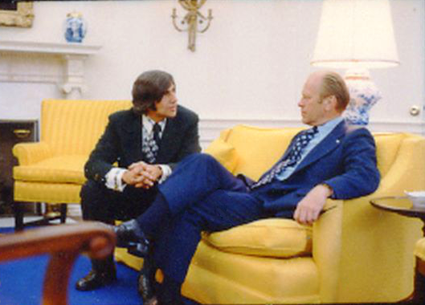
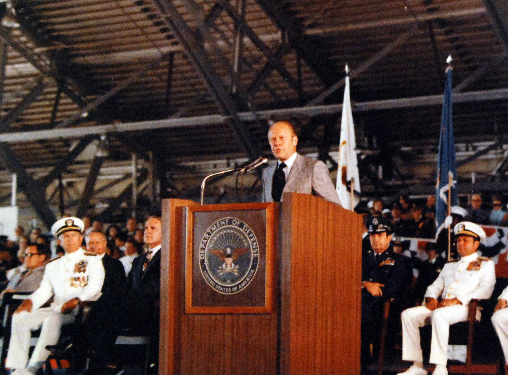
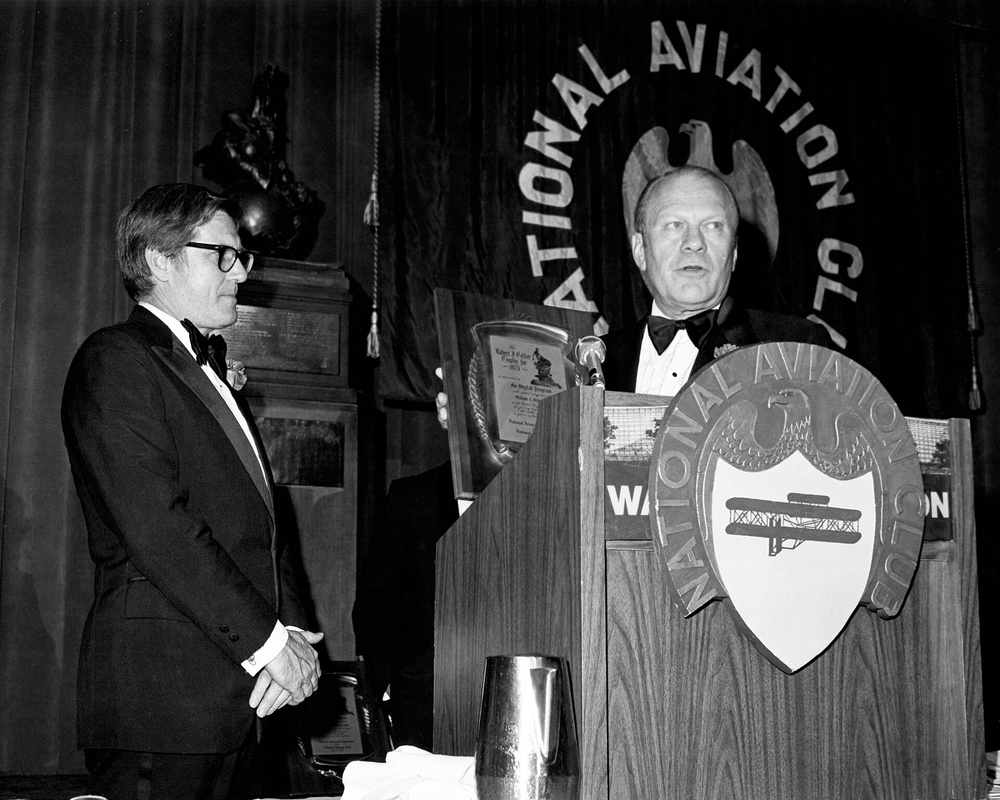

52년 전 오늘, 1974년 11월 22일. 제럴드 포드 미국 대통령이 전용기 편으로 김포공항에 도착했습니다. 현직 미국 대통령으로서는 역대 세 번째 방한이었습니다.

## 김포공항에 울려 퍼진 21발의 예포

1974년 11월 22일 오전 10시, 제럴드 포드 미국 대통령을 태운 전용기 미 공군 1호기가 김포공항 활주로에 내렸습니다. 헨리 키신저 국무장관과 도널드 럼스펠드 백악관 비서실장 등 공식·비공식 수행원 30명이 동행했습니다. 현직 미국 대통령의 방한은 1960년 드와이트 아이젠하워, 1966년 린든 존슨 대통령에 이어 8년 만이자 세 번째였습니다.

공항 트랩 아래에서는 박정희 대통령을 비롯해 정일권 국회의장, 민복기 대법원장, 김종필 국무총리 등 삼부요인과 각계 인사 1천3백여 명이 영접에 나섰습니다. 양국 국가가 울려 퍼지는 가운데 21발의 예포가 발사되었고, 두 정상은 나란히 3군 의장대를 사열했습니다. 구자춘 서울시장은 서울 방문을 환영하며 행운의 열쇠를 전달했습니다.

## 태극기와 성조기 물결, 180만 인파의 카퍼레이드

45분간의 공항 환영식을 마친 뒤 포드 대통령과 박정희 대통령은 지붕이 열린 오픈카에 함께 올랐습니다. 김포가도를 시작으로 제2한강교와 신촌 로터리, 서소문을 거쳐 시청 앞 서울 도심으로 이어지는 연도에는 이른 아침부터 수많은 시민들이 줄을 이었습니다.

경찰 추산 약 180만 명에 달하는 환영 인파는 양국 정상의 차량이 지날 때마다 태극기와 성조기를 흔들며 열렬히 환호했습니다. 건물 옥상과 창문마다 손을 흔드는 사람들로 가득 찼고, 꽃가루가 날리며 도심 일대는 거대한 환영 무대에 휩싸였습니다. 카퍼레이드 행렬은 오전 11시 30분 숙소인 서울 소공동 조선호텔에 도착했습니다.

*BillyZeoliGeraldFordOvalOffice — 사진: Kennerly / Public domain*

## 국립묘지 헌화와 고 육영수 여사 묘소 참배

조선호텔에 여장을 푼 포드 대통령은 잠시 휴식을 취한 뒤 곧바로 동작동 국립묘지로 향했습니다. 정오에 현충문에 도착한 포드 대통령은 현충탑에 헌화하고 호국영령들의 넋을 기렸습니다.

이어 낮 12시 10분에는 불과 넉 달여 전인 그해 8월 15일 광복절 기념식장에서 흉탄에 맞아 서거한 고 육영수 여사의 묘소를 찾았습니다. 포드 대통령은 엄숙한 표정으로 헌화와 분향을 올리며 고인의 명복을 빌었습니다.

*428-GX-KN 22255 (25792026204) — 사진: National Museum of the U.S. Navy / Public domain*

## 헬기로 전방 미2사단 방문, 땅굴 현장 확인

국립묘지 참배를 마친 포드 대통령은 낮 12시 40분 서종철 국방부 장관의 안내를 받아 헬리콥터 편으로 서부전선 미 육군 제2사단을 방문했습니다. 최전방 기지에서 장병들과 함께 점심 식사를 나누며 안보 최일선에서 근무하는 미군 장병들의 노고를 치하했습니다.

포드 대통령 일행은 이 자리에서 당시 비무장지대 남방한계선 부근에서 발견된 북한의 군사 침투용 지하 땅굴 관련 증거품과 전시 사진들을 직접 보고받기도 했습니다. 한반도 안보의 엄중함을 현장에서 확인한 포드 대통령은 다시 헬리콥터로 서울로 복귀했습니다.

*Vice President Gerald R. Ford presented the Collier Trophy Award - 1973 - JDC2011e075769 orig — 사진: NASA / Public domain*

## 청와대 정상회담과 굳건한 방위 공약

이날 오후 3시, 포드 대통령은 청와대를 예방해 박정희 대통령과 제1차 한미 정상회담을 가졌습니다. 한국 측에서는 김종필 총리와 김동조 외무부 장관, 김정렴 비서실장, 함병춘 주미대사가 배석했고, 미국 측에서는 키신저 국무장관, 리처드 스나이더 주한미국대사, 필립 하비브 동아태 차관보 등이 참석했습니다.

두 정상은 한국과 미국이 과거 한국전쟁과 베트남전쟁에서 함께 싸워온 혈맹 관계임을 강조했습니다. 포드 대통령은 대한 방위 공약의 확고한 이행을 재확인하고, 한반도의 평화 유지와 전쟁 재발 방지를 위해 두 나라가 긴밀히 협력하기로 뜻을 모았습니다. 정상회담 후 저녁에는 청와대 영빈관에서 공식 만찬과 민속공연 관람이 이어졌습니다.

## 반세기 전 서울 거리에 남은 기억

포드 대통령의 이번 방한은 닉슨 독트린과 인도차이나 정세의 격변 속에서 한미 안보 공약에 대한 국민적 불안감을 덜어주는 중요한 외교적 전환점이었습니다. 다음 날인 11월 23일 오전 2차 정상회담을 마친 포드 대통령은 다음 행선지인 블라디보스토크로 떠났습니다.

당시 김포가도에서 시청 앞까지 180만 인파가 거리를 메우고 환호하던 광경은 그 시절 흑백 텔레비전 뉴스와 신문 호외를 통해 전국에 전해졌습니다. 격동의 냉전기 속에서 열렸던 1974년의 그 특별했던 환영 인파와 정상회담 풍경은 지금도 많은 어르신들의 기억 속에 또렷이 남아 있습니다.

### 참고 자료

- <https://newslibrary.naver.com/viewer/index.naver?articleId=1974112200209201005&editNo=2&printCount=1&publishDate=1974-11-22&officeId=00020&pageNo=1&printNo=16353&publishType=00020>
- <https://commons.wikimedia.org/wiki/File:Ford_National_Security_Council.jpg>
- <https://commons.wikimedia.org/wiki/File:BillyZeoliGeraldFordOvalOffice.png>
- <https://commons.wikimedia.org/wiki/File:428-GX-KN_22255_(25792026204).jpg>
- <https://commons.wikimedia.org/wiki/File:Vice_President_Gerald_R._Ford_presented_the_Collier_Trophy_Award_-_1973_-_JDC2011e075769_orig.jpg>
